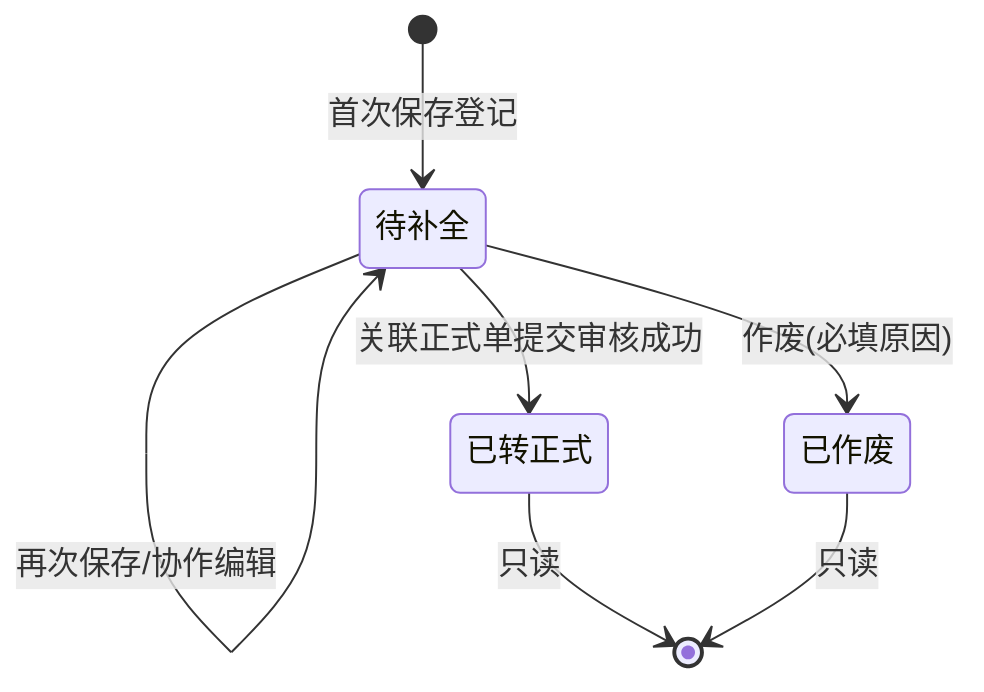

# 入库暂存登记 — 需求讨论纪要

> **文档性质**：草稿对话 · 讨论沉淀 · **非 PRD 真源**  
> **讨论日期**：2026-10-13  
> **关联基准模块**：[入库记录](../02-PRD文档/🌟🌟🌟-最新基准版/B端PC/02-仓储/09-入库管理-入库记录/)（正式入库单三件套）  
> **定稿路径（待办）**：建议在 `09-入库管理-入库记录` 同级或子目录新增「入库暂存登记」三件套，并增量修订入库记录主 PRD「功能范围」

---

## 一、业务背景与痛点

现场入库繁忙时，常出现：

- **新货主**需短信二元核验（R03），货主不在场或无法及时收验证码，无法完成【提交审核】；
- 库位分配、现场照片等强校验（R13、R16）一时凑不齐；
- 用户希望先把 **入库时间、数量、仓库** 等事实记下，待货主确认后再走 **正式入库审批**。

基准版入库记录主 PRD 当前 **明确不包含**「草稿与暂存」；入库记录列表 **仅展示已通过**（R26）。本需求通过 **并行单据** 实现，不破坏归档台账定位。

---

## 二、方案结论：方案 A（入库暂存登记 + 一键转正式）

### 2.1 核心定位

| 维度 | 入库暂存登记单 | 正式入库申请单 |
| :--- | :--- | :--- |
| 业务含义 | 现场事实备忘，货主/证据可后补 | 可进审批、可写库存与货权的法律流程单据 |
| 单号 | **登记单号**（独立序列，与 19 位入库单号分离） | **入库单号**（提交审核时生成，沿用现规则） |
| 入库类型 MVP | **仅普通入库** | 沿用现有 10 类全生命周期（登记入口不开放联动类） |
| 库存 / 货权 / 条码 | **不写入** | 审批通过后写入（沿用主 PRD 3.1 节） |
| 入库记录列表 | **不出现** | 仅 `APPROVED` 可见 |
| 审批 / 我的申请 | **不进** | 提交审核后进入 |
| IoT 抓拍 R18 | **不触发** | 提交审核时触发 |

### 2.2 转单策略：**A1（推荐定稿）**

- **【转为正式入库】**：打开 **正式入库新增页**，按登记单 **预填** 当前快照；**不**在点击转单瞬间创建正式入库实体。
- **【提交审核】**（正式页）：此时才生成 19 位入库单号、发起审批、触发 R18；成功后登记单置 **已转正式**，回填关联入库单号。
- **同一登记单** 仅允许 **一次** 成功转正式并提交闭环（规则 P06）；登记 **已转正式** 后不可作废（正式单撤销走现有「我的申请」撤回规则）。

### 2.3 货主「暂未确认」的表达

- **禁止**在货主档案中创建「临时货主 / 未知货主」占位主体。
- 登记态允许 **货主为空**；此时 **交接说明** 必填（≤200 字：司机、电话、磅单、预计确认时间等）。
- UI：**【货主待现场确认】** 或等价开关；开启后清空货主字段，强制交接说明。
- 列表货主列展示 **「待确认」** + 交接说明 Tooltip。

### 2.4 校验分层（登记 P 规则 vs 正式 R 规则）

| 动作 | 货主 | 交接说明 | 库位 R13 | 照片 R16 | R03 短信 |
| :--- | :--- | :--- | :--- | :--- | :--- |
| 登记暂存 | 可空 | 货主空则必填 | 可未清零（橙色提示，不阻断） | **可不上传**（0～10） | 不触发 |
| 正式提交审核 | 必填 R02 | — | 必须清零 | 必传 | 新货主仍触发 |

登记专用规则建议编号：**P01～P09**（见第六节），正文引用 R02/R03/R13/R16/R05/R26，不改写 R 规则本体。

---

## 三、已拍板的产品决策

| 项 | 决策 |
| :--- | :--- |
| 登记暂存照片 | 可以不上传 |
| 列表可见与协作 | **仓库数据权限内** 授权人员均可查看、编辑、暂存、转正式、作废（非「仅本人」）；需 **乐观锁** 防并发覆盖 |
| 超期提醒 | **MVP 不做** |
| 菜单 | 独立菜单：**仓储 → 入库管理 → 入库暂存登记**；与 **入库记录** 并列 |
| 转单策略 | **A1** |
| 正式页带入登记 | **可以带入**（含货主）；见第四节 |

---

## 四、入口与交互（定稿）

### 4.1 菜单：入库暂存登记 → 【+ 新增入库暂存登记】

- **不弹窗**，直接进入登记新增页（`mode=registration`）。
- 页内 **【保存登记】/【暂存】** 按登记弱校验落库。

### 4.2 正式入库新增页 → 【入库暂存登记】

- **必弹说明窗**（不是校验失败跳转，是用户主动换通道）：
  - **标题**：入库暂存登记
  - **正文要点**：用于货主暂未确认、现场来不及完成核验等；**不会**提交审批、**不会**生成正式入库单、**不会**写入在库库存；暂存登记 **不会**发送货主短信验证码。
  - **按钮**：
    - **取消**：留在正式入库页
    - **前往空白登记页**：跳转登记新增，**不带入**正式页内容
    - **带入并前往登记页**：当正式页存在可带入的有效填写时展示；按快照复制到登记新增并跳转（见 4.3）

### 4.3 从正式页「带入」时的字段与货主

- **带入** = 复制正式页当前表单快照到登记页，**不**触发 R03，**不**自动清空或「修正」货主。
- **货主未填 / 待现场确认**：登记侧无货主 → 交接说明必填。
- **已选存量货主**：原样带入，登记可暂存。
- **已填新货主（未建档）**：原样带入；提交正式审核时仍走 **R03**。
- **误填货主**：登记页可 **清空** 并改待确认 + 交接说明；保留误填货主则转正式会预填该货主（登记页宜有提示文案）。

**【登记带入货主继承】(P09)**：带入时货主区块按正式页当前值复制；登记暂存不校验是否已建档；转正式以登记单 **最新** 货主为准；提交审核时服从 R02、R03。

### 4.4 正式页 Dirty 与离开

- 正式页已有未提交修改时，若用户选择前往登记（空白或带入），建议与现有 **未保存离开** 规则一致：避免误丢正式页内容；若选「空白登记页」且正式页有内容，可二次提示「正式页未保存内容将保留在上一页」或统一 Dirty 确认（实现阶段与原型统一即可）。

### 4.5 登记详情 → 【转为正式入库】

- A1：打开正式入库新增页并 **预填** 登记快照；用户补全后 **【提交审核】**。
- 登记单状态：**待补全** → 正式提交成功后 **已转正式**（只读，展示关联入库单号 Deep link）。

---

## 五、登记单状态机（MVP）

- 不单独设「待货主确认」状态；列表可用 **货主待确认** 列展示表达。
- **作废**：待补全时可作废，原因 ≤200 字；已转正式不可作废登记。

---

## 六、登记专用规则摘要（P01～P09，待写入业务规则规格）

| 编号 | 名称 | 要点 |
| :--- | :--- | :--- |
| P01 | 登记与正式入库单分离 | 登记不写 WMS、货权、条码、入库记录台账、证据 18 类自动存证 |
| P02 | 登记暂存最低必填 | 入库日期、仓库、至少 1 行货品数量大于 0 |
| P03 | 货主待确认表达 | 禁止占位货主；货主空则交接说明必填 |
| P04 | 登记堆放弱校验 | 允许未堆放大于 0；转正式提交服从 R13 |
| P05 | 登记影像弱校验 | 登记 0～10 张；转正式提交服从 R16 |
| P06 | 登记转正式一对一 | 一登记单仅一次成功关联正式入库提交 |
| P07 | 登记 IoT 不触发 | 登记/暂存不调用 R18 |
| P08 | 登记数据权限与协作 | 同 R05 仓库隔离；权限内全员可协作编辑；乐观锁 |
| P09 | 登记带入货主继承 | 见第四节 4.3 |

---

## 七、跨模块影响（评审结论）

### 7.1 无需改下游逻辑

- 入库记录台账 R26、货权档案/公示（主 PRD 3.1）、证据管理 18 类存证、存货条码 R19、出库选货与冻结库存、移库/转让/加工/退货联动入库 R04、审批专网 R21、订单/设备预警穿透。

### 7.2 需在 PRD 中写清的边界（账实时间差）

- **存货管理 / 库存明细 / 盘点**：登记 **不计入** 在库数量、货主数、本期入库总量；现场已卸货但仅登记时可能出现 **账少实多**，盘点差异需人工结合登记单解释，**不**自动调账。
- **制单时间口径**：**登记时间** = 登记保存时间；**正式制单时间** = 提交审核时间（与现字段清单一致）。

---

## 八、列表与操作（草案）

- **筛选**：登记单号、登记日期、货主/待确认、仓库、货品、状态、登记人。
- **行操作**：
  - 待补全：编辑、转为正式入库、作废
  - 已转正式：查看、查看正式入库单
  - 已作废：查看

---

## 九、命名统一（UI 文案）

| 位置 | 文案 |
| :--- | :--- |
| 菜单 | 入库暂存登记 |
| 列表新增 | + 新增入库暂存登记 |
| 正式入库页按钮 | 入库暂存登记 |
| 说明弹窗主按钮 | 前往空白登记页 / 带入并前往登记页 |

---

## 十、后续工作（未执行）

1. 按 AGENTS.md 4.0 变更顺序：先写 **入库暂存登记** 三件套（主 PRD / 字段清单 / 业务规则规格 P01～P09）→ ASCII / Demo → 原型与 Mock。
2. **增量修订** [入库记录主PRD.md](../02-PRD文档/🌟🌟🌟-最新基准版/B端PC/02-仓储/09-入库管理-入库记录/入库记录主PRD.md)「不包含：草稿」→ 改为：正式入库单仍不支持草稿；**包含** 入库暂存登记（并行能力）；正式新增页增加【入库暂存登记】入口说明。
3. 权限清单 CSV 增加菜单与 `R-WH-IN-*` 或独立登记权限码（与研发对齐）。
4. H5 对齐可列为二期（PC MVP 先行）。

---

## 十一、讨论过程备忘（未单独定稿项）

- 曾对比 **方案 B**（正式单增加 DRAFT 状态）：侵入大，与「我的申请」分流冲突，**未采纳**。
- 曾对比 **仅 localStorage 草稿**：无审计与协作，**未采纳**。
- 正式页说明弹窗 **不是**「填了无效信息自动跳转」；仅用户主动点击【入库暂存登记】触发。

---

*本纪要由 2026-10-13 需求讨论整理，供 PRD 定稿与评审引用；定稿后须迁移至 `02-PRD文档` 三件套并废弃本文件中的规则细节为准源。*
