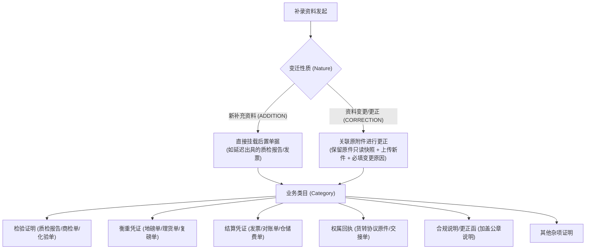

# 出入库流程完结后补充资料与审批记录关联设计方案（讨论草稿）

> **归档路径**：`00-草稿对话/2026.10.15 出入库流程后补充资料与审批记录关联设计方案.md`  
> **更新时间**：2026-10-15  
> **关联业务模块**：  
> • `02-仓储 / 09-入库管理-入库记录` & `10-出库管理-出库记录`  
> • `07-审批中心 / 03-业务审批`（入库审核、出库审核）  
> • 对标复用真源：`03-融资监管 / 07-抵质押业务-抵质押业务管理 / 22-资料管理`  
> **前序讨论承接**：[出入库单据增加节点中的补充资料.md](./出入库单据增加节点中的补充资料.md)

---

## 1. 需求背景与客户核心诉求

### 1.1 业务背景与痛点
在大宗商品（电解铜、热轧卷板、铝锭、冻品等）仓储履约现场，出入库操作及初审审批通常依赖现场出入库单、地磅单与随车清单完成。审批通过后，库存已生成或扣减，单据归档生效。
但在实际履约后，存在大量“后置单据/后补资料”：
1. **质检商检报告**：第三方 SGS/化验分析、出厂质保、动植物检疫报告通常在作业后 2~5 天才出具；
2. **衡重计量纠偏**：原随车磅单车牌少录一位或称重有微调，地磅站重新开具更正证明并加盖公章；
3. **结算凭证发票**：后补的仓储费结算单、对账单与运输发票；
4. **权属交接回执**：货转协议原件盖章件、出库交接单签字回执。

### 1.2 客户明确提出的诉求
1. **流程完结后补录**：出入库流程走完（已审批通过、已归档台账）后，允许补充资料；
2. **精准关联当时审批记录**：希望能穿透关联到当时的那笔出入库审批记录；
3. **区分资料类型**：补充资料时可以区分类型，特别是明确**“是变更之前的还是新补充的资料”**。

---

## 2. 系统现有标杆对比与复用：抵质押业务【22-资料管理】

本方案与系统现有的 **[07-22 抵质押业务-资料管理](../02-PRD文档/🌟🌟🌟-最新基准版/B端PC/03-融资监管/07-抵质押业务-抵质押业务管理/操作业务/22-资料管理/资料管理主PRD.md)** 底层架构理念完全同源，核心规则可直接复用并场景化增强：

### 2.1 可直接复用的成熟规范
1. **不可逆追加机制 (`DZY-R22 Append-Only Versioning`)**：
   - 流程通过后，已归档单据**严禁直接物理删除或覆盖原文件**；
   - 纠偏与补录只能通过“追加新版本（`V1.0` → `V1.1`）”或“追加新分类文件”，确保金融担保与仓储监管证据链完整。
2. **分类目录机制**：标准化归档类目（检验证明、衡重计量、结算凭证、权属交接、合规说明等）。
3. **只读安全预览防泄密 (`DZY-R22a`)**：在线预览 PDF/图片时自动动态压印查看人姓名、工号、时间的防截屏水印。
4. **存证数据快照**：固化操作人、时间戳、文件大小、SHA-256 数字指纹，符合司法存证要求。

### 2.2 出入库业务的特化与增强对比

| 对比维度 | 抵质押业务【22-资料管理】(现有) | 出入库记录补充资料 (本方案) |
| :--- | :--- | :--- |
| **主体对象** | 抵质押主订单 (`order_no`) | **出入库单号 (`biz_order_no`) + 审批流水单号 (`approval_id`)** |
| **变迁表达** | 抽象的 `V1.0 / V1.1` 版本号 | 页面翻译为：**【新补充资料】** vs **【变更/更正原资料 (级联原件升版本)】** |
| **双向穿透** | 仅在订单抽屉中查看 | **仓储出入库台账详情 + 审批中心已办履历时间轴双向穿透** |
| **呈现载体** | 行操作呼出右侧抽屉 | **详情页【资料管理 / 后置补充资料】独立 Tab + 弹窗录入** |

---

## 3. 分类模型设计：双维度结构

针对客户提出的“类型”诉求，采用**“变迁性质 + 业务类目”双维度**：



1. **变迁性质（解决客户“新补还是变更”诉求）**：
   - `ADDITION` (**新补充资料**)：初审时未提交，事后新取得的文件，直接归档为 `V1.0`；
   - `CORRECTION` (**资料变更/更正**)：对初审已有的资料进行勘误或换单，级联选中被替换原件，新文件升级为 `V1.1`，支持版本对照。
2. **业务类目（标准化归档）**：
   - 检验证明、衡重凭证、结算凭证、权属回执、合规说明、其他。

---

## 4. 全流程 ASCII 交互与界面线框

### 4.1 业务流转与双向穿透时序全景

```text
  [ 仓储出入库审批阶段 ]
            │
            ▼
    ┌───────────────┐
    │ 提交出入库申请 │ (上传现场实物照片、初步随车资料 V1.0)
    └───────┬───────┘
            │
            ▼
    ┌───────────────┐
    │ 审批中心处理  │ (审批通过 APPROVED，库存生成/扣减，单据归档生效)
    │  SP2026052801 │ ─── 原始审批快照永久固化（不可修改、不可覆盖）
    └───────┬───────┘
            │
════════════╪══════════════════════════════════════════════════════════════════════
            │ (数天后：质检报告出具、复磅单盖章更正、发票送达...)
            ▼
  [ 事后资料补充阶段 ]
            │
            ├───────────────────────────────────────────────────────┐
            │                                                       │
            ▼ 【分支 A：新补充资料】                                  ▼ 【分支 B：变更/替换已有资料】
    ┌────────────────────────┐                             ┌────────────────────────┐
    │ 审批时原本没有的文件   │                             │ 审批时已有 V1.0 原始文件│
    │ (如：SGS第三方法检报告)│                             │ (如：原过磅单车牌有误) │
    └───────────┬────────────┘                             └───────────┬────────────┘
                │                                                      │ 关联选中原文件
                ▼                                                      ▼
    ┌────────────────────────┐                             ┌────────────────────────┐
    │  直接归档为 V1.0       │                             │  生成 V1.1 新版本      │
    │  (无历史变更对比)      │                             │  (强制录入更正说明)    │
    └───────────┬────────────┘                             └───────────┬────────────┘
                │                                                      │
                └──────────────────────────┬───────────────────────────┘
                                           ▼
                                ┌─────────────────────┐
                                │ 双向挂载持久化存储  │
                                │ • 出入库单号(RK...) │
                                │ • 关联审批号(SP...) │
                                │ • SHA-256 存证哈希  │
                                └──────────┬──────────┘
                                           │
            ┌──────────────────────────────┴──────────────────────────────┐
            ▼                                                             ▼
  [ 仓储端：出入库记录详情页 ]                                   [ 审批端：审批中心-已办详情页 ]
  ┌─────────────────────────────────────┐                       ┌─────────────────────────────────────┐
  │ 标签页：[ 资料管理 (补充凭证) ]     │                       │ 审批流转时间轴底部：                │
  │ • 查看新补充资料                    │                       │ ● [库管审核通过] 2026-05-28 15:20    │
  │ • 查看变更历史并支持【版本对比】     │                       │ │                                   │
  │   (左侧原件快照 vs 右侧更正新件)    │                       │ └─ 📎 后置补录：SGS质检报告 (6-03)   │
  └─────────────────────────────────────┘                       │ └─ 📎 后置变更：复磅更正单 (6-01)   │
                                                                └─────────────────────────────────────┘
```

---

### 4.2 仓储详情页：资料管理 Tab 与入口线框

```text
+-----------------------------------------------------------------------------------------------------------------------------------+
| [Logo] 森云科技 SYZC   工作中心  [ 仓储 ]  融资/监管  交易  风控  统计/看板  配置管理                                         黄k v|
+-----------------------------------------------------------------------------------------------------------------------------------+
|  首页 x  | 入库记录 x  | [ 入库单详情 — 2059897000077811713 x ]                                                                 v |
+-----------------------------------------------------------------------------------------------------------------------------------+
|                                                                                                                                   |
|  +-- 单据头部概览 --------------------------------------------------------------------------------- [ 补充资料 ]  [ 返 回 ] -+  |
|  | 入库单号: 2059897000077811713 [📋]    关联审批: SP202605280001 [查看审批]                   ┌───────────┐                 |  |
|  | 制单人:   lxy(四川享宇科技)           制单时间: 2026-05-28 15:18:12                         │  已 通 过 │ (绿色状态章)    |  |
|  | 货主名称: 李爱                       入库类型: 普通入库                                     └───────────┘                 |  |
|  | 仓库名称: 海霸王仓库-冻库1           入库日期: 2026-05-28 15:15:39                                                        |  |
|  +-----------------------------------------------------------------------------------------------------------------------------+  |
|                                                                                                                                   |
|  +-- 详情多标签页数据展示区 ----------------------------------------------------------------------------------------------------+  |
|  | 入库明细    审核记录    [ 资料管理 (2) ]    入库信息修改记录                                                                 |  |
|  +----------------------------------------------------------------------------------------------------------------------------+  |
|  |                                                                                                                             |  |
|  | 提示：本单据已审批归档，所有资料采用【版本追加】存证，严禁就地删除覆盖；新补充或更正资料已自动同步关联至审批单 SP202605280001。|  |
|  |                                                                                                                             |  |
|  | 序号 | 资料属性     | 资料类目 | 文件名称及版本        | 变更对应原件      | 补充/变更说明     | 操作人       | 归档时间         | 操作     |  |
|  |------+--------------+----------+-----------------------+-------------------+-------------------+--------------+------------------+----------|  |
|  |  1   | 资料变更更正 | 衡重计量 | 📄 重新过磅更正单.pdf | 📄 原现场磅单.pdf | 供应商更正车牌并  | 张三(仓管部) | 2026-06-01 10:20 | [预览]   |  |
|  |      |              |          |   版本：V1.1          |  (审批时V1.0原件) | 重新盖章确认      |              |                  | [版本对比]| |
|  |------+--------------+----------+-----------------------+-------------------+-------------------+--------------+------------------+----------|  |
|  |  2   | 新补充资料   | 检验证明 | 📄 SGS第三方化验单.pdf| ——                | 供应商出具的官方  | 李四(质检部) | 2026-06-03 14:15 | [预览]   |  |
|  |      |              |          |   版本：V1.0          |                   | 质检报告后置补录  |              |                  | [下载]   |  |
|  +----------------------------------------------------------------------------------------------------------------------------+  |
+-----------------------------------------------------------------------------------------------------------------------------------+
```

---

### 4.3 补充资料操作弹窗交互线框

#### 4.3.1 场景 A：【新补充资料】（无前置原件）

```text
┌────────────────────────────────────── 补充业务资料 ──────────────────────────────────────┐
│                                                                                          │
│  出入库单号：2059897000077811713                                                          │
│  关联审批单：SP202605280001（工作中心-入库审批-已通过）                                    │
│                                                                                          │
│  * 资料属性：  (●) 新补充资料 (审批后新取得的单据)    ( ) 变更/更正原资料 (对已有单据做勘误)     │
│                                                                                          │
│  * 资料分类：  [ 检验证明 (质检报告 / 商检证书 / 化验分析单)                          v ] │
│                                                                                          │
│  * 资料名称：  [ 请输入资料名称，如：SGS第三方铜锭化验分析单                            ] │
│                                                                                          │
│  * 上传文件：  ┌───────────────────────────────────────────────────────────────────────┐  │
│                │  [ + 点击上传图片或PDF ] 支持 JPG、PNG、PDF，单文件 ≤ 50MB             │  │
│                └───────────────────────────────────────────────────────────────────────┘  │
│                已选文件: 📄 SGS第三方铜锭化验分析单_盖章扫描件.pdf (2.4MB)   [重新选择]   │
│                                                                                          │
│  * 补充说明：                                                                            │
│  ┌─────────────────────────────────────────────────────────────────────────────────────┐  │
│  │ 供应商化验周期为出库后3个工作日，现收到正式纸质检测单扫描件，特予后置补录归档。(必填)│  │
│  └─────────────────────────────────────────────────────────────────────────────────────┘  │
│                                                                                          │
│                                                         [ 取 消 ]   [ 确认归档并同步审批 ]│
└──────────────────────────────────────────────────────────────────────────────────────────┘
```

#### 4.3.2 场景 B：【变更/更正原资料】（级联列出历史审批附件）

```text
┌────────────────────────────────────── 补充业务资料 ──────────────────────────────────────┐
│                                                                                          │
│  出入库单号：2059897000077811713                                                          │
│  关联审批单：SP202605280001（工作中心-入库审批-已通过）                                    │
│                                                                                          │
│  * 资料属性：  ( ) 新补充资料 (审批后新取得的单据)    (●) 变更/更正原资料 (对已有单据做勘误)     │
│                                                                                          │
│  * 被更正原件：[ 下拉选择：2026-05-28 现场过磅单.pdf (审批时 V1.0 快照)              v ] │
│                (系统将把新文件标记为 V1.1 版本，原 V1.0 快照永久保留备查)                │
│                                                                                          │
│  * 资料分类：  [ 衡重计量 (地磅单 / 复磅单 / 码单)                                    v ] │
│                                                                                          │
│  * 更正后新件：┌───────────────────────────────────────────────────────────────────────┐  │
│                │  [ + 上传更正后的盖章扫描件 ]                                         │  │
│                └───────────────────────────────────────────────────────────────────────┘  │
│                已选文件: 📄 20260601_海霸王地磅更正证明单_盖章件.pdf (1.8MB) [重新选择]   │
│                                                                                          │
│  * 变更原因：                                                                            │
│  ┌─────────────────────────────────────────────────────────────────────────────────────┐  │
│  │ 现场初审录入时随车地磅单车牌号少录一位，现附上地磅站重开并加盖公章的更正单据。(必填)│  │
│  └─────────────────────────────────────────────────────────────────────────────────────┘  │
│                                                                                          │
│                                                         [ 取 消 ]   [ 确认变更并留痕 ]    │
└──────────────────────────────────────────────────────────────────────────────────────────┘
```

---

### 4.4 变更前后的【版本对比与溯源】线框

```text
┌───────────────────────────────── 资料版本对比与变更溯源 ─────────────────────────────────┐
│ 文件名称：海霸王地磅单.pdf                                                               │
│ 对应单据：入库单 2059897000077811713  |  关联审批：SP202605280001                        │
├─────────────────────────────────────────┬────────────────────────────────────────────────┤
│ ◀ 变更前版本（V1.0 - 审批固化快照）     │ ▶ 变更后版本（V1.1 - 当前有效版本）            │
├─────────────────────────────────────────┼────────────────────────────────────────────────┤
│ 归档节点：入库审批申请时提交           │ 归档节点：事后补录变更                         │
│ 提交人员：lxy(四川享宇科技)             │ 变更人员：张三(仓管部)                         │
│ 提交时间：2026-05-28 15:18:12           │ 变更时间：2026-06-01 10:20:15                  │
│ 哈希指纹：d41d8cd98f00b204e98... [验真] │ 哈希指纹：e2fc714c4727ee9395f... [验真]        │
│                                         │                                                │
│ ┌─────────────────────────────────────┐ │ ┌─────────────────────────────────────┐      │
│ │ [PDF 在线预览区]                    │ │ │ [PDF 在线预览区]                    │      │
│ │                                     │ │ │                                     │      │
│ │   [ 图示：原磅单 ]                  │ │ │   [ 图示：更正盖章后的新磅单 ]      │      │
│ │   车牌号：川A·8888 (有误)           │ │ │   车牌号：川A·88889 (已更正)        │      │
│ │   (带当前用户动态安全水印)          │ │ │   (带当前用户动态安全水印)          │      │
│ └─────────────────────────────────────┘ │ └─────────────────────────────────────┘      │
├─────────────────────────────────────────┴────────────────────────────────────────────────┤
│ 变更说明：现场初审录入时随车地磅单车牌号少录一位，现附上地磅站重开并加盖公章的更正单据。 │
├──────────────────────────────────────────────────────────────────────────────────────────┤
│                                                                             [ 关 闭 ]    │
└──────────────────────────────────────────────────────────────────────────────────────────┘
```

---

### 4.5 审批中心【已办审批详情】穿透视图

```text
+-----------------------------------------------------------------------------------------------------------------------------------+
| 审批单详情 — SP202605280001 (入库审核)                                                                            [ 返 回 ]       |
+-----------------------------------------------------------------------------------------------------------------------------------+
| 单据类型: 仓储入库审批             关联业务单号: RK2026052800077811713 [查看入库单]            当前状态: [ 已通过 ]               |
| 申请人员: lxy(四川享宇科技)        申请时间:     2026-05-28 15:18:12                           终审时间: 2026-05-28 15:20:05     |
+-----------------------------------------------------------------------------------------------------------------------------------+
|                                                                                                                                   |
| +-- 审批流转履历与后置资料追溯时间轴 -------------------------------------------------------------------------------------------+ |
| |                                                                                                                               | |
| | ● [发起申请]  2026-05-28 15:18:12                                                                                            | |
| |   制单人：lxy(四川享宇科技有限公司)                                                                                            | |
| |   提交入库申请，已上传随车照片及初步地磅单 V1.0                                                                               | |
| |   │                                                                                                                           | |
| | ● [审核通过]  2026-05-28 15:20:05                                                                                            | |
| |   审核人：黄主管(四川享宇科技有限公司)                                                                                        | |
| |   意见：现场货品已核对，数量无误，准予入库生效。单据已终审归档。                                                              | |
| |   │                                                                                                                           | |
| | ═════════════════════════════════════════════════════════════════════════════════════════════════════════════════════════════ | |
| |   ▼ 【事后补充/变更资料记录】(后置增量挂载，不破坏原终审效力)                                                                  | |
| |   │                                                                                                                           | |
| | ├─ 📎 [资料变更更正]  2026-06-01 10:20:15                                                                                     | |
| | │    操作人：张三(仓管部)                                                                                                     | |
| | │    更正原件：📄 原现场磅单.pdf (V1.0)  ➔  更正后：📄 重新过磅更正单.pdf (V1.1)  [查看新件] [版本对比]                      | |
| | │    更正原因：随车地磅单车牌号补正盖章。                                                                                    | |
| | │                                                                                                                             | |
| | └─ 📎 [新补充资料]    2026-06-03 14:15:22                                                                                     | |
| |      操作人：李四(质检部)                                                                                                     | |
| |      新增附件：📄 SGS第三方化验单.pdf (V1.0)  [在线预览]  [下载]                                                              | |
| |      补充说明：SGS 检测周期出具后补录归档。                                                                                   | |
| |                                                                                                                               | |
| +-------------------------------------------------------------------------------------------------------------------------------+ |
+-----------------------------------------------------------------------------------------------------------------------------------+
```

---

## 5. 风控与权限建议

1. **权限控制 (`RBAC`)**：
   - 增加独立操作权限码：`R-WH-DOC-SUPPLEMENT`（仓储单据资料补充权）；
   - 仅授权角色（如现场主管、单证管理员、风控专员）可见 `[ 补充资料 ]` 按钮。
2. **金融单据边界防范**：
   - 严格继承 [出入库单据增加节点中的补充资料.md §1.2](./出入库单据增加节点中的补充资料.md) 的边界：
   - 仅普通入库/出库单开放此功能；质押、抵押、仓单类金融监管业务严格锁定，若有资料变更需走金融项下的【抵质押资料管理追加】流程，防止业务串道。
3. **通知联动**：
   - 补充资料提交成功后，系统向该出入库单的**原审批人与风控经理**推送知会消息：`“入库单 RK... 后置补录了 1 份资料【重新过磅更正单.pdf】，请知悉。”`
