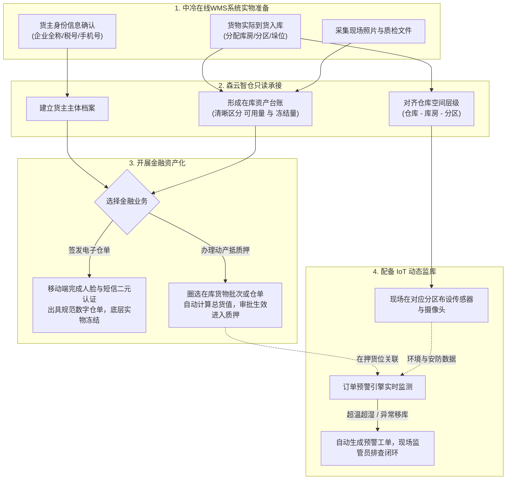

# 🛡️ 森云科技 · 森云智仓 供应链金融存货监管系统
# 中冷在线WMS系统与森云智仓数据对接方案（业务手册 + 研发接口规范）

> **版本**：V1.2 | **更新日期**：2026-10-16  
> **适用对象**：  
> - **业务人员 / 客户实施顾问**：阅读【第一篇：业务需求与字段对齐手册】  
> - **研发工程师 / 技术架构师**：阅读【第二篇：技术架构与接口规格说明】  

---

# 📖 第一篇：业务需求与字段对齐手册（对接沟通用）

## 一、 合作定位与对接原则

在供应链金融动产质押与存货监管业务中：
* **中冷在线WMS系统（实物真源）**：负责货物在仓库内的日常作业（入库验货、实际上架堆放、日常盘点与发货出库）。
* **森云智仓（金融与监管中枢）**：负责将实物转化为可融资的金融资产，承接**数字仓单开立、动产抵质押办理、货权登记公示、以及基于物联网设备（温湿度、摄像头、门禁）的动态监库**。

### 三大核心业务原则
1. **只读同步，页面防篡改**：中冷在线WMS系统负责维护货物和货主的基础信息，数据同步到森云智仓后全部锁定为只读，前台界面禁止人工修改或随意删除。
2. **位置必须明确到具体库区**：金融质押必须锁定具体的特定货物。中冷在线WMS系统同步时，必须明确货物存放在哪个仓库、哪个库房、哪个分区，并填写具体的垛位描述，不能只给一个总仓库存。
3. **质押状态双向互锁**：货物一旦在森云智仓发起或通过质押，系统内可用数量立即归零。此时中冷在线WMS系统必须配合进行锁定，**严禁擅自对在押货物办理发货出库**。

---

## 二、 端到端业务流转图



---

## 三、 纯业务作业字段清单

以下字段严格对照森云智仓前台作业界面，供业务团队与外部实施人员逐项对齐。

### 1. 货主主体业务信息
用于确认货权所有者。后续在开立仓单时作为存货人/持有人，在办理抵质押时作为借款货权方。

| 业务字段名称 | 界面控件形式 | 必填 | 业务规则与作业说明 |
| :--- | :--- | :---: | :--- |
| **货主类型** | 下拉单选 | **必填** | 选项：`企业货主` 或 `个人货主`。决定后续录入和展示的字段。 |
| **货主名称** | 文本输入/搜索 | **必填** | 企业填写营业执照公司法定全称；个人填写身份证上的真实姓名。 |
| **货主标识** | 纯文本展示 | **必填** | 企业为 **18 位统一社会信用代码**；个人为 **个人手机号**。系统中唯一识别客户的身份码。 |
| **联系电话** | 单行文本框 | **必填** | 货主预留手机号。后续开立仓单或抵质押提审时，**接收短信动态验证码的指定手机**（列表展示中间4位脱敏）。 |
| **货主身份证号** | 单行文本框 | 条件必填 | 仅个人货主必填（18位）。用于后续移动端**实名活体人脸识别比对**（列表展示隐藏中间8位）。 |

---

### 2. 仓库与存放空间业务信息
指明货物的具体存放位置。**决定了后续温湿度计、AI摄像头等监控设备安装在什么空间**。

| 业务字段名称 | 界面控件形式 | 必填 | 业务规则与作业说明 |
| :--- | :--- | :---: | :--- |
| **仓库名称** | 下拉选择/文本 | **必填** | 实体监管仓库的名称（如：海霸王监管仓库）。 |
| **仓库类型** | 标签多选 | **必填** | 仓库物理特性：`储罐`、`筒仓`、`通用/常温库`、`堆场`、`冷库`、`危化品仓库`、`其他`。 |
| **仓库地址** | 级联选择+文本 | 选填 | 包含省、市、区/县及详细门牌地址。多方核实资产真实位置。 |
| **库房名称** | 下拉单选/多选 | **必填** | 仓库下的二级独立库房（如：冻库1、常温2号库）。同仓内名称唯一。 |
| **出入库审核** | 单选标签(是/否) | **必填** | 标识该库房货物进出是否需要审核。同一张入库单所选的库房，审核属性必须完全一致。 |
| **分区名称** | 下拉单选 | **必填** | 库房内部划分的物理区域（如：A区、冷冻区）。**后续温湿度传感器、监控摄像头主要是绑定到分区维度**。 |
| **具体位置** | 自由文本输入 | 选填 | 垛位或货架详细描述（最多20字，如：`03垛位`、`北墙2号架`）。在理货分配和设备安装时现场填写。 |

---

### 3. 货物与实物批次业务信息（存货资产池）
外部货物进入系统后形成的库存台账，用于后续发起仓单或质押时勾选。

| 业务字段名称 | 界面控件形式 | 必填 | 业务规则与作业说明 |
| :--- | :--- | :---: | :--- |
| **货品名称 (SKU)** | 级联选择/反填 | **必填** | 货物基础规格。由三级组合构成：**所属大类**（如：有色金属） $\rightarrow$ **所属品类**（如：电解铜） $\rightarrow$ **规格型号**（如：Cu-CATH-1）。 |
| **计量参数** | 文本标签 | **必填** | 计量物理量维度：如 `重量`、`数量`。由货品主档预设，制单只读。 |
| **计量单位** | 文本标签（只读） | **必填** | 法定计量单位：如 `吨`、`千克`、`件`。随货品规格自动带出，不允许手动修改，确保金融试算准确。 |
| **入库数量** | 数字输入框 | **必填** | 实际到货并堆放完成的实物总量（保留4位小数，必须大于0）。 |
| **堆放数量** | 数字输入框 | **必填** | 分配到具体【库房-分区-具体位置】的数量。各个位置的堆放数量之和必须刚好等于入库总数，未分配完禁止提交。 |
| **存货条码 / 二维码** | 二维码/文本 | 选填 | 实物张贴的唯一条码。外部有则直接继承；外部无则入库审核通过后系统自动生成，用于现场 PDA 扫码核验。 |
| **现场照片** | 图片展示(≤10张) | **必填** | 卸货与码垛现场拍摄的照片。支持放大查看，作为资方核查底层资产真实性的直观依据。 |
| **补充资料** | 附件列表(≤10个) | 选填 | 随车的质检报告单、材质证明书、磅单原件（支持 PDF 与图片）。 |
| **入库日期** | 日期时间选择 | **必填** | 实际上架完成的时间（年月日时分秒，不可选未来时间）。 |
| **入库单号** | 纯文本展示 | **必填** | 系统生成的唯一业务流水号。外部系统的原始单号可填入**关联单号**或**备注**中，方便穿透对账。 |

---

## 四、 业务协同与实施配合要求

1. **货位精准度要求**：
   * 供应链金融质押要求担保物必须“特定化”。中冷在线WMS系统同步数据时，必须明确到具体的“库房和分区”，不能只给一个模糊的大仓总数。
2. **冻结机制与防擅自发货**：
   * 数据同步进入森云智仓后，初始为正常在库状态（可用数量 = 在库总数）；
   * 业务人员在森云智仓发起仓单申请或抵质押申请后，**对应货物的可用数量立刻扣减为 0**（转为冻结数量）；
   * 质押正式生效后，中冷在线WMS系统必须配合锁死该批实物，**在解除质押前严禁发货出库**。
3. **现场 IoT 监管设备配合**：
   * 中冷在线WMS系统无需采集温湿度或监控数据。现场监管员在森云智仓中把设备绑定到货物所在的分区，系统便能自动对该笔质押业务实施动态预警。

---

# 💻 第二篇：技术架构与接口规格说明（研发实现用）

## 一、 系统架构与安全网关协议

### 1.1 网关通信约定
* **通信协议**：HTTPS + RESTful API，报文统一采用 `application/json; charset=utf-8`。
* **时区与时间**：标准东八区（UTC+8），时间字符串格式统一为 `YYYY-MM-DD HH:mm:ss`，时间戳采用 13 位毫秒数值。
* **幂等控制**：所有同步接口均以外部业务主键建立唯一索引，相同数据重复推送时自动执行幂等更新（以最新修改时间戳为准），不产生脏数据。

### 1.2 认证与防重放签名 (Headers)
每次 HTTP 请求须在 Header 携带以下签名要素：

| Header 键名 | 类型 | 必填 | 说明 |
| :--- | :--- | :---: | :--- |
| `X-App-Key` | String | 是 | 租户在森云智仓平台申请的唯一接入凭证（如 `senyun_wms_prod_01`） |
| `X-Timestamp` | Long | 是 | 13 位毫秒级时间戳，服务端校验前后时间偏差不得超过 5 分钟 |
| `X-Nonce` | String | 是 | 32 位随机 UUID 字符串，防重放攻击 |
| `X-Sign` | String | 是 | 签名摘要。算法：`HMAC-SHA256(AppSecret, Method + "\n" + URI + "\n" + Timestamp + "\n" + Nonce + "\n" + Body)` |
| `X-Trace-Id` | String | 选填 | 外部调用链全局追踪 ID |

### 1.3 统一响应报文格式
```json
{
  "code": 200,
  "success": true,
  "message": "操作成功",
  "data": {},
  "trace_id": "tr_20261016_883921af"
}
```

---

## 二、 核心数据模型对应关系 (ER Mapping)

```
[中冷在线WMS 货主主体] ──1:1──> [森云智仓 合作方/货主档案表]
                                ├── 外部货主唯一标识
                                ├── 货主类型 (ENTERPRISE / INDIVIDUAL)
                                ├── 货主名称、统一社会信用代码/手机号、身份证号
                                └── 只读标记 = true

[中冷在线WMS 仓库架构] ──1:N──> [森云智仓 空间架构表]
                                ├── 仓库名称、仓库类型、详细地址
                                ├── 库房名称、是否需出入库审核 (Boolean)
                                └── 分区名称 (后续挂载温湿度与摄像头的空间实体)

[中冷在线WMS 库存明细] ──1:1──> [森云智仓 库存明细表]
                                ├── 外部库存批次唯一标识、外部入库单号
                                ├── 对应货品规格 (SKU)、计量单位
                                ├── 在库总数量、可用数量、冻结数量
                                ├── 所在仓库、库房、分区、具体位置描述
                                ├── 存货条码/二维码
                                └── 业务状态 (存货中 / 质押申请中 / 质押中 / 仓单冻结等)
```

---

## 三、 标准 API 接口规范

---

### 接口 1：货主主体档案同步
* **请求路径**：`POST /open/v1/wms/owner/sync`
* **功能说明**：中冷在线WMS系统同步企业或个人货主主档至森云智仓，用于开单反显与二元认证。

#### 请求示例 (Body)
```json
{
  "external_owner_id": "CUST_91440101MA59XXXX1A",
  "owner_type": "ENTERPRISE",
  "owner_name": "上海中冷生鲜供应链管理有限公司",
  "owner_code": "91440101MA59XXXX1A",
  "contact_phone": "13800138000",
  "id_card_no": "",
  "status": "ACTIVE",
  "sync_version": 1792116000000
}
```

#### 字段说明
* `external_owner_id` (String, 必填): 外部货主唯一主键。
* `owner_type` (String, 必填): 主体类型：`ENTERPRISE`（企业）、`INDIVIDUAL`（个人）。
* `owner_name` (String, 必填): 企业全称或个人姓名。
* `owner_code` (String, 必填): 企业为统一社会信用代码，个人为手机号。
* `contact_phone` (String, 必填): 预留联系电话（短信认证接收方）。
* `id_card_no` (String, 条件必填): 个人货主必填身份证号（加密传输）。
* `status` (String, 必填): 状态：`ACTIVE`（启用）、`DISABLED`（停用）。
* `sync_version` (Long, 必填): 外部修改时间戳（服务端校验防旧版本覆盖）。

---

### 接口 2：仓库空间拓扑同步
* **请求路径**：`POST /open/v1/wms/warehouse/sync`
* **功能说明**：中冷在线WMS系统同步仓库、库房与分区三级空间，作为实物堆放与 IoT 挂载的空间底座。

#### 请求示例 (Body)
```json
{
  "warehouse_name": "中冷成都安德保税冷链仓库",
  "warehouse_type": ["COLD", "GENERAL"],
  "address": "四川省成都市郫都区安德街道海霸王路88号",
  "storehouses": [
    {
      "storehouse_name": "冷库1号仓间",
      "audit_required": true,
      "zones": [
        {
          "zone_name": "A区冷冻肉品区"
        },
        {
          "zone_name": "B区恒温保鲜区"
        }
      ]
    }
  ]
}
```

#### 字段说明
* `warehouse_name` (String, 必填): 仓库名称。
* `warehouse_type` (Array, 必填): 类型列表：`FLAT`（平面仓）、`STEREO`（立体仓）、`COLD`（冷库）、`GENERAL`（常温库）、`OPEN_YARD`（堆场）、`DANGER`（危化品）、`OTHER`（其他）。
* `address` (String, 选填): 仓库物理地址。
* `storehouses[].storehouse_name` (String, 必填): 库房名称。
* `storehouses[].audit_required` (Boolean, 必填): 是否开启出入库审核。
* `storehouses[].zones[].zone_name` (String, 必填): 分区名称。

---

### 接口 3：货物在库批次明细同步
* **请求路径**：`POST /open/v1/wms/inventory/batch-sync`
* **功能说明**：中冷在线WMS系统同步货物在库实物批次至森云智仓，建立可用库存，供金融业务圈选。

#### 请求示例 (Body)
```json
{
  "sync_type": "INCREMENT",
  "batches": [
    {
      "external_batch_id": "WMS_BAT_20261016_001",
      "external_inbound_no": "RK-20261016-0088",
      "external_owner_id": "CUST_91440101MA59XXXX1A",
      "category_name": "冷冻食品",
      "sub_category_name": "冻牛肉",
      "specification": "进口去骨牛霖 A级",
      "measure_unit": "吨",
      "inbound_qty": 50.2500,
      "warehouse_name": "中冷成都安德保税冷链仓库",
      "storehouse_name": "冷库1号仓间",
      "zone_name": "A区冷冻肉品区",
      "specific_location": "03排02垛位",
      "barcode": "TM202610160012",
      "photos": [
        "https://oss.senyun.com/wms/20261016/photo_01.jpg"
      ],
      "documents": [
        "https://oss.senyun.com/wms/20261016/quality_report.pdf"
      ],
      "inbound_time": "2026-10-16 09:30:00",
      "sync_version": 1792116000000
    }
  ]
}
```

#### 字段说明
* `external_batch_id` (String, 必填): 外部库存批次唯一主键。
* `external_inbound_no` (String, 必填): 外部原始入库单号。
* `external_owner_id` (String, 必填): 所属货主外部主键。
* `category_name`, `sub_category_name`, `specification` (String, 必填): 货品大类、品类、规格型号。
* `measure_unit` (String, 必填): 计量单位（如：吨）。
* `inbound_qty` (Decimal, 必填): 入库数量（保留4位小数）。
* `warehouse_name`, `storehouse_name`, `zone_name` (String, 必填): 存放仓库、库房、分区。
* `specific_location` (String, 选填): 垛位现场描述（最多20字）。
* `barcode` (String, 选填): 实物条码。
* `photos` (Array, 必填): 现场实物照片列表（最多10张）。
* `documents` (Array, 选填): 质检证明等文件列表（最多10个）。
* `inbound_time` (String, 必填): 业务入库时间。

---

### 接口 4：森云智仓质押锁定/释放反向通知中冷在线WMS系统
* **请求路径**：`POST {中冷在线WMS域名}/api/stock/pledge-status-notify`
* **功能说明**：森云智仓质押审批生效或解除质押时，主动通知中冷在线WMS系统变更实物管控状态，阻断非法发货。

#### 请求示例 (森云智仓 Push 给中冷在线WMS系统)
```json
{
  "external_batch_id": "WMS_BAT_20261016_001",
  "pledge_status": "PLEDGED",
  "lock_reason": "已在森云智仓发起流动质押贷款 (质押单号: DZY202610160001)，全额锁定禁止出库",
  "pledge_order_no": "DZY202610160001",
  "pledgee_name": "中国工商银行股份有限公司成都分行",
  "timestamp": 1792116800000
}
```

#### 状态枚举与中冷在线WMS系统动作
* `PLEDGED`（已质押锁定）：中冷在线WMS系统必须将该批实物标记为**金融质押管控态，阻断生成出库单**。
* `RELEASED`（已解除质押）：中冷在线WMS系统解除管控，恢复正常出库。

---

## 四、 全局错误码定义

| 错误码 | 错误提示说明 | 建议排查方法 |
| :--- | :--- | :--- |
| `200` | 操作成功 (SUCCESS) | 正常处理 |
| `40101` | 签名验证失败 (Sign Mismatch) | 检查密钥配置是否正确、参数拼接顺序是否合规 |
| `40102` | 请求已过期 (Timestamp Expired) | 检查客户端服务器时钟，时间偏差不得超过 5 分钟 |
| `40103` | 重复的请求 (Nonce Replayed) | 每次请求必须重新生成独立的随机 Nonce |
| `40401` | 关联货主不存在 (Owner Not Found) | 必须先调用货主接口建档，再推送货物库存 |
| `40402` | 目标空间节点不存在 (Zone Not Found) | 仓库、库房或分区未对齐，请先核查空间配置 |
| `40901` | 货物正在质押中禁止操作 (Batch Locked) | 该批货物处于在押或冻结状态，系统阻断变更 |
| `40902` | 版本乱序冲突 (Version Conflict) | 推送的修改时间戳早于系统中已存储的时间戳 |

---

## 五、 联调落地四步法

```
第 1 步【网关调通】：双方调通 AK/SK 鉴权与签名校验。
第 2 步【主体与空间】：调用接口 1 与接口 2，完成货主档案与仓库三级空间树建账。
第 3 步【存货同步】：调用接口 3，同步首批在库货物，在森云智仓【库存明细】中核对可用数量与现场照片。
第 4 步【金融互锁演练】：在森云智仓发起一笔质押单，审批生效后触发接口 4，验证中冷在线WMS系统成功阻断出库。
```
