# 货品规格管理 — 入库收集项配置：结构化交互与视觉升级方案

> **文件定位**：交互与视觉方案草稿（适配 SYZC 现有 PC 端 UI 风格与规范真源）  
> **归属模块**：`配置管理 → 货品规格管理 → 入库收集项配置`（6.3 基础主数据底座）  
> **编写时间**：2026-10-29  
> **责任团队**：森云科技（Senyun Technology）产品与设计团队  
> **关联依据**：[入库收集项配置主PRD.md](file:///Users/robert/Desktop/SYZC/02-PRD文档/B-迭代需求/6.3版本（2026.09）/07-货品规格管理-入库收集项配置/入库收集项配置主PRD.md) · [入库收集项配置字段清单.md](file:///Users/robert/Desktop/SYZC/02-PRD文档/B-迭代需求/6.3版本（2026.09）/07-货品规格管理-入库收集项配置/入库收集项配置字段清单.md) · [入库收集项配置业务规则规格.md](file:///Users/robert/Desktop/SYZC/02-PRD文档/B-迭代需求/6.3版本（2026.09）/07-货品规格管理-入库收集项配置/入库收集项配置业务规则规格.md)  
> **UI 规范对齐**：[02-PC端列表页与筛选区规范.md](file:///Users/robert/Desktop/SYZC/03-前端原型demo/样式规范-%20PC端/02-PC端列表页与筛选区规范.md) · [03-PC端详情页子板块规范.md](file:///Users/robert/Desktop/SYZC/03-前端原型demo/样式规范-%20PC端/03-PC端详情页子板块规范.md) · [原型页面布局速查.md](file:///Users/robert/Desktop/SYZC/03-前端原型demo/原型页面布局速查.md)

---

## 一、 当前页面痛点剖析与升级目标

### 1.1 现状痛点诊断
目前系统中的【入库收集项配置】列表页采用的是传统的**单页平铺大表格（Flat Table）**，存在以下核心体验瓶颈：

1. **业务属性混杂无序，认知负荷大**：
   - 存量的 20 个收集项（保质期、生产日期、过期时间、批次号、炉号、生产企业、产地、质量等级、检验日期、水分含量、杂质率、温度要求、湿度要求、包装外观等）扁平平铺在同一张表格里；
   - 用户无法一眼建立业务域心智（如哪些是“效期时间类”、哪些是“质检理化类”、哪些是“冷链温控类”），在大宗商品存货监管场景下容易看漏、看串。
2. **“盲盒式”预览，交互链路繁琐**：
   - 用户要了解字段在仓储作业现场长什么样，必须在表格操作列逐个点击【预览】弹窗，看一个关一个，无法形成连贯的表单形态认知。
3. **缺乏下游血缘与价值感知**：
   - 管理员在考虑停用或调整某个指标时，无法直观获知该字段已经被哪些大宗品类（如电解铜、热轧卷板、大豆、花椒）或多少个 SKU 引用，缺乏安全感知。
4. **系统核心与自定义扩展同权混排**：
   - 不可删除的底层核心（保质期、生产日期等）与租户自定义项完全混排，视觉层级扁平。

### 1.2 改造目标
* **结构化（Structure）**：建立符合大宗供应链仓储业务本质的分层分类体系，提供清晰的树状/分舱导航；
* **直观化（Visual Clarity）**：所见即所得，支持免弹窗直接查看“仓储入库单现场填报模拟效果”；
* **穿透化（Traceability）**：直观透出字段被下游品类和货品引用的血缘信息，保障风控与运维安全。

---

## 二、 适配 SYZC 现有 UI 风格规范要求

为保证改版与全站现有风格严丝合缝，方案一严格遵循下列 **SYZC PC 端 UI 规范**：

1. **全局容器与外壳**：
   - 顶部导航栏（包含 Logo、工作中心、仓储、配置管理等主菜单，当前【配置管理】激活高亮）；
   - 多页签 Tab 栏（`首页 x | [ 入库收集项配置 x ] v`）；
   - 左侧二级折叠侧边栏（`货品规格管理` 展开，`入库收集项配置` 处于选中态）。
2. **筛选区规范（WarningFilterHeader + 4 列栅格）**：
   - 筛选区独立置于白底 `Card` 内；
   - 采用标准筛选头 `WarningFilterHeader`：左侧「筛选条件」，右侧顺序排列 `[ 重置 ]` · `[ 查询 ]` · `[ + 新增收集项 ]`；
   - 筛选项严格遵循 `grid gap-4 lg:grid-cols-4` 一行 4 项黄金排布（收集项名称、控件类型、状态、创建时间范围）。
3. **左侧树 Card 规范（对齐货品管理 SKU 标杆）**：
   - 独立白底 `Card`，宽度约 260px，带顶部搜索框 `[ Q 请输入分类或属性... ]`；
   - 节点高亮采用 `bg-primary/10 text-primary font-medium`；
   - 节点支持数量徽章与核心锁标识 `🔒`，底部带 `[√] 显示已停用收集项`。
4. **表格与操作列规范**：
   - 表头实色无穿透，正文字体全站强制苹方（`PingFang SC`），禁止滥用 `font-mono`；
   - 状态列使用标准徽章组件 `StatusBadge`（`🟢 启用` / `⚪ 停用`）；
   - 操作列规范采用 `TableRowActionPanel`（`[详情]` `[预览]` `[编辑]` `[配置单位]` `[停用]` `[删除]`）；
   - 单击行高亮激活（Active Row），联动驱动预览渲染。
5. **即时效果预览面板（DetailSection 风格）**：
   - 遵循 `DetailSection` 规范，标题声明「入库单录入样式 · 仓储入库单示意（只读）」，内嵌实际录入控件，浅灰占位说明，绝不作为上线最终表单，只做配置核对。

---

## 三、 方案一（首选推荐）：适配当前 UI 风格的 ASCII 线框表达

为了满足不同屏幕分辨率（1080P 笔记本 vs 2K 宽屏显示器），方案一提供 **形态 A（下置联动卡片式 · 经典推荐）** 与 **形态 B（三栏侧边联动式 · 宽屏模式）** 两种同构展现：

### 3.1 形态 A（经典推荐）：左侧属性树 Card + 右侧主工作区 (筛选Card + 表格Card + 下置预览Card)

> **特点**：完美贴合现有 `InboundCollectListPage.tsx` 代码结构，在保留 4 列标准筛选区与完整宽表格的基础上，左侧嵌入业务分类树，右侧表格下方嵌入 `DetailSection` 风格的即时预览面板，布局稳重，无横向挤压。

```text
+----------------------------------------------------------------------------------------------------------------------------------------------------------------------------------------+
| [Logo] 森云科技 SYZC       工作中心     仓储管理     融资/监管     设备与预警管理     合作方管理     统计/看板     结算     [ 配置管理 ]                                                    黄k v|
+--------------------------+-------------------------------------------------------------------------------------------------------------------------------------------------------------+
| v 货品规格管理           |  首页 x  | [ 入库收集项配置 x ]                                                                                                                         v  |
|   > 货品管理 (SKU)       +-------------------------------------------------------------------------------------------------------------------------------------------------------------+
|   > 入库收集项配置(当前) |                                                                                                                                                             |
|     品类管理             |  ### 入库收集项配置                                                                                                                        [ + 新增收集项 ]     |
| > 平台管理               |  维护全租户通用的货品入库数据采集标准池，规范控件类型与保质期度量单位，为下游品类与货品主档提供标准元数据底座                                                               |
| > 仓库管理               |                                                                                                                                                             |
|                          |  +-- [左侧树 Card] ------------------+  +-- [右侧主工作区: 筛选 Card] ---------------------------------------------------------------------------------------+  |
|                          |  | [ Q 请输入业务分类或属性...     ]  |  | 筛选条件                                                                 [ 重置 ] [ 查询 ] [ + 新增收集项 ]          |  |
|                          |  | ---------------------------------- |  | ------------------------------------------------------------------------------------------------------------- |  |
|                          |  | 🌐 全部收集项 (20)                 |  | 收集项名称: [ 请输入收集项名称        ]  控件类型: [ 全部控件类型 v ]  状态: [ 全部状态 v ]                           |  |
|                          |  |                                    |  | 创建时间范围: [ 年/月/日 ] 至 [ 年/月/日 ]                                                                     |  |
|                          |  | v 🕒 时间与效期属性 (3) [🔒核心]   |  +---------------------------------------------------------------------------------------------------------------+  |
|                          |  |     保质期                         |                                                                                                                 |
|                          |  |     生产日期                       |  +-- [右侧主工作区: 收集项数据表格 Card] ------------------------------------------------------------------------+  |
|                          |  |     过期时间                       |  | 序号 | 收集项名称   | 业务归属 | 控件类型       | 度量单位/选项摘要    | 下游引用 | 状态    | 操作                     |  |
|                          |  |                                    |  | ----+--------------+----------+----------------+----------------------+----------+---------+--------------------------|  |
|                          |  | > 🏷️ 生产溯源与身份 (4)            |  | 1    | 保质期       | 时间效期 | 周期组合项     | 支持: 月 / 天 / 年   | 28个品类 | 🟢 启用 | [详情][编辑][单位][停用] |  |
|                          |  |                                    |  | 2    | 生产日期     | 时间效期 | 日期选择器     | —                    | 28个品类 | 🟢 启用 | [详情][编辑][停用][锁🔒] |  |
|                          |  | > 🔬 质检与理化指标 (5)            |  | 3    | 过期时间     | 时间效期 | 日期选择器     | —                    | 28个品类 | 🟢 启用 | [详情][编辑][停用][锁🔒] |  |
|                          |  |                                    |  | 4    | 温度要求 ▶   | 仓储环境 | 数字区间框     | ℃                    | 4 个品类 | 🟢 启用 | [详情][预览][编辑][停用] |  |
|                          |  | v 🌡️ 仓储环境与安全 (4) (已选中)   |  | 5    | 湿度要求     | 仓储环境 | 数字区间框     | %RH                  | 3 个品类 | 🟢 启用 | [详情][预览][编辑][停用] |  |
|                          |  |   > 温度要求 (选中行)              |  | 6    | 存储方式     | 仓储环境 | 下拉单选框     | 常温, 冷藏, 恒温...  | 8 个品类 | 🟢 启用 | [详情][预览][编辑][停用] |  |
|                          |  |     湿度要求                       |  | 7    | 水分含量     | 质检理化 | 百分比数值框   | %                    | 6 个品类 | 🟢 启用 | [详情][预览][编辑][停用] |  |
|                          |  |     存储方式                       |  +---------------------------------------------------------------------------------------------------------------+  |
|                          |  |     危险品等级                     |                                                                                                                 |
|                          |  |                                    |  +-- [右侧主工作区: 现场录入效果即时预览卡片 (选行联动 · DetailSection 规范)] -----------------------------------+  |
|                          |  | > 📦 包装与物理形态 (4)            |  | 📱 仓储入库单现场填报示意 (只读 · 联动当前选中：温度要求)                                      [ 👁️ 独立弹窗预览 ]  |  |
|                          |  |                                    |  | ------------------------------------------------------------------------------------------------------------- |  |
|                          |  |                                    |  | 温度要求  *                                                                                                   |  |
|                          |  |                                    |  | [ -18 ]  至  [ -15 ]  ℃                                                                                       |  |
|                          |  |                                    |  | 提示占位：例如：-18 至 -15                                                                                    |  |
|                          |  |                                    |  |                                                                                                               |  |
|                          |  |                                    |  | ℹ️ 属性摘要：控件类型【数字区间框】 | 单位【℃】 | 已被【冷链电解铜、速冻食品等 4 个大宗品类】引用 | 编辑时锁定类型    |  |
|                          |  | ---------------------------------- |  +---------------------------------------------------------------------------------------------------------------+  |
|                          |  | [√] 显示已停用项                   |                                                                                                                 |
|                          |  | [ 切换视角: 业务分类 | 管控属性 ]  |  共 4 条记录        [ 10条/页 v ]     <  [ 1 ]  >       前往 [ 1 ] 页                                                   |  |
| <<                       |  +-----------------------------------+  +---------------------------------------------------------------------------------------------------------------+  |
+--------------------------+-------------------------------------------------------------------------------------------------------------------------------------------------------------+
```

---

### 3.2 形态 B（宽屏并列式）：左侧树 Card (260px) + 中间表格 Card (弹性) + 右侧即时预览抽屉 Card (320px)

> **特点**：三栏横向铺开，右侧预览卡片常驻右翼，点选中间表格任意行，右侧无延迟更新入库单形态与血缘信息；支持点击右上角 `[ ▶ 折叠 ]` 收起，收起后自动变为形态 A。

```text
+----------------------------------------------------------------------------------------------------------------------------------------------------------------------------------------+
| 平台管理 > 货品规格管理 > 入库收集项配置                                                                                                                   [ + 新增收集项 ]            |
+----------------------------------------------------------------------------------------------------------------------------------------------------------------------------------------+
|                                                                                                                                                                                        |
|  +-- [左侧树 Card] ----------+  +-- [中间主工作区 Card: 筛选 + 表格] ---------------------------------------------+  +-- [右侧预览 Card: 入库单模拟器 (320px)] [▶ 折叠] --------+  |
|  | [ Q 过滤业务分类...     ]  |  | 筛选: [ 请输入收集项名称 ]  状态: [ 全部 v ]           [ 重置 ] [ 查询 ]           |  |                                                           |  |
|  | -------------------------- |  +--------------------------------------------------------------------------------+  | 📱 仓储入库单现场填报示意 (只读)                          |  |
|  | 🌐 全部收集项 (20)         |  | 序号 | 收集项名称 | 控件类型   | 单位/选项摘要 | 下游引用 | 状态   | 操作       |  | --------------------------------------------------------- |  |
|  |  ├─ 🕒 时间效期 (3) [🔒]   |  | ----+------------+------------+---------------+----------+--------+------------|  | 当前选中项：【温度要求】                                  |  |
|  |  ├─ 🏷️ 生产溯源 (4)        |  | 1    | 保质期     | 周期组合项 | 支持:月/天/年 | 28个品类 | 🟢启用 | [详情][编] |  |                                                           |  |
|  |  ├─ 🔬 质检理化 (5)        |  | 2    | 生产日期   | 日期选择器 | —             | 28个品类 | 🟢启用 | [详情][编] |  | * 温度要求                                                |  |
|  |  ├─ 🌡️ 仓储环境 (4) <--选  |  | 3    | 温度要求 ▶ | 数字区间框 | ℃             | 4 个品类 | 🟢启用 | [详情][编] |  | ┌──────────────┐         ┌──────────────┐                 |  |
|  |  │    ├─ 温度要求 (当前)   |  | 4    | 湿度要求   | 数字区间框 | %RH           | 3 个品类 | 🟢启用 | [详情][编] |  | │ -18          │   至    │ -15          │  ℃              |  |
|  |  │    ├─ 湿度要求         |  | 5    | 存储方式   | 下拉单选框 | 常温,冷藏...  | 8 个品类 | 🟢启用 | [详情][编] |  | └──────────────┘         └──────────────┘                 |  |
|  |  │    └─ 危险品等级       |  +--------------------------------------------------------------------------------+  | 提示占位：例如：-18 至 -15                                |  |
|  |  └─ 📦 包装形态 (4)        |                                                                                    |                                                           |  |
|  |                            |                                                                                    | --------------------------------------------------------- |  |
|  | -------------------------- |                                                                                    | ℹ️ 字段血缘与规则：                                       |  |
|  | [√] 显示已停用项           |                                                                                    | • 字段类型: 租户自定义扩展项                              |  |
|  | [ 业务分类 | 管控属性 ]    |  共 4 条记录        [ 10条/页 v ]     < [ 1 ] >                                    | • 下游引用: 4 个大宗品类                                  |  |
|  |                            |                                                                                    | • 控件锁定: 已被引用，编辑时锁定控件类型                  |  |
|  +----------------------------+  +--------------------------------------------------------------------------------+  +-----------------------------------------------------------+  |
+----------------------------------------------------------------------------------------------------------------------------------------------------------------------------------------+
```

---

## 四、 20 个字段在左侧树中的标准映射真源

对齐 6.3 现存 mock 与业务规则，左侧 5 大业务域树节点映射如下：

```mermaid
flowchart TD
    Root["🌐 全部入库收集项 (20)"]
    
    Root --> G1["🕒 时间与效期属性 (3)<br/>[🔒系统核心内置 · 永久不可删除]"]
    G1 --> F01["保质期 (周期组合项 · 月/天/年)"]
    G1 --> F02["生产日期 (日期选择器)"]
    G1 --> F03["过期时间 (日期选择器)"]

    Root --> G2["🏷️ 生产溯源与身份 (4)"]
    G2 --> F04["批次号 (单行文本输入框)"]
    G2 --> F05["炉号 / 轧号 (单行文本输入框)"]
    G2 --> F06["生产企业 (单行文本输入框)"]
    G2 --> F07["产地 (省市区三级联动)"]

    Root --> G3["🔬 质检与理化指标 (5)"]
    G3 --> F08["质量等级 (下拉单选框)"]
    G3 --> F09["水分含量 (百分比数值框 · %)"]
    G3 --> F10["杂质率 (百分比数值框 · %)"]
    G3 --> F11["检验日期 (日期选择器)"]
    G3 --> F12["出厂检验员 (单行文本输入框)"]

    Root --> G4["🌡️ 仓储环境与安全 (4)"]
    G4 --> F13["温度要求 (数字区间框 · ℃)"]
    G4 --> F14["湿度要求 (数字区间框 · %RH)"]
    G4 --> F15["存储方式 (下拉单选框)"]
    G4 --> F16["危险品等级 (下拉单选框)"]

    Root --> G5["📦 包装与物理形态 (4)"]
    G5 --> F17["包装方式 (下拉单选框)"]
    G5 --> F18["包装外观等级 (下拉单选框)"]
    G5 --> F19["检验机构 (单行文本输入框)"]
    G5 --> F20["检验报告编号 (单行文本输入框)"]

    style G1 fill:#fff1f0,stroke:#ff4d4f,stroke-width:2px
    style G2 fill:#e6f7ff,stroke:#1890ff
    style G3 fill:#f6ffed,stroke:#52c41a
    style G4 fill:#fff7e6,stroke:#fa8c16
    style G5 fill:#f9f0ff,stroke:#722ed1
```



---

## 五、 组件与原型代码适配方案（给研发与原型落地参考）

若采纳形态 A / B，在前端原型工程（`03-前端原型demo/B端PC/src/features/goods-specifications/`）中将实现如下极简适配：

1. **新增左侧树组件**：`components/InboundCollectCategoryTree.tsx`
   - 复用货品管理的树状搜索与节点样式；
   - 监听选中分类 `selectedDomain`，驱动过滤主列表。
2. **列表筛选栏复用**：保留现有 `WarningFilterHeader`，支持：
   - 收集项名称输入框；
   - 控件类型下拉选择；
   - 启用/停用状态选择；
   - 创建时间日期范围（收起/展开）。
3. **新增即时预览组件**：`components/InboundCollectInlinePreview.tsx`
   - 复用现有的 `InboundCollectPreviewDialog.tsx` 中的 7 种控件渲染器逻辑；
   - 改为卡片内嵌渲染，当列表某一行触发 `onClick` 时，将该行设为 `activeField`，预览区即时响应渲染。
4. **保持既有规则无缝兼容**：
   - 保质期行专属 `【配置单位】` 弹窗（R05）原样保留；
   - 核心字段保护拦截（R02）置灰原样保留；
   - 两阶段安全删除拦截（R04）弹窗原样保留。

---

## 六、 业务决策与结构收敛（去自主观业务分类）

### 6.1 决策背景
在方案 A 评审过程中，我们深入推演了“写死 5 个业务分类（时间效期、生产溯源、质检理化、仓储环境、包装形态）”带来的潜在业务风险：
- **无法满足多行业动态扩展**：不同租户、不同大宗商品品种（如有色金属、农产品、化工能源、跨境保税）对字段属性的定义维度差异极大，若由系统写死一套不可增删改的业务分类，会严重限制用户未来的实际业务；
- **新增字段无处归类**：用户自建扩展字段时无法契合固定分类。

### 6.2 最终定型方案
- **去掉左侧业务分类树 Card**：不引入不可配置的业务域分类，保持元数据底座的纯粹性与通用性；
- **去掉表格【业务归属】列**：避免在数据资产中增加多余的主观分类字段；
- **全宽保留核心创新价值**：
  1. 采用全宽标准 4 列筛选 Card (`WarningFilterHeader`)；
  2. 采用结构化 8 维主表格 Card（保留「下游引用」品类统计列，提供删除与停用的安全感知）；
  3. 保留「下置仓储入库单现场填报示意」即时联动预览 Card（DetailSection 规范，表格单击选行无缝联动渲染 7 种真实录入控件形态，彻底解决盲盒弹窗痛点）。

---

> **更新总结**：三件套与原型已收敛定型为全宽 4 列筛选 Card + 8 维主表格 Card + 下置现场录入效果即时预览 Card。您可以在编辑器中查看本草稿文件：[2026.10.29 入库收集项配置-结构化交互与视觉方案(左树右表).md](file:///Users/robert/Desktop/SYZC/00-草稿对话/2026.10.29%20入库收集项配置-结构化交互与视觉方案(左树右表).md)。
