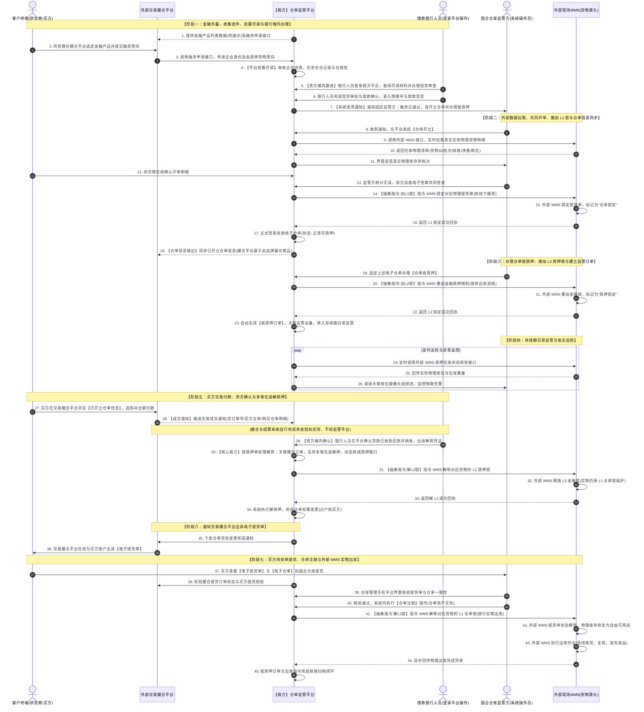
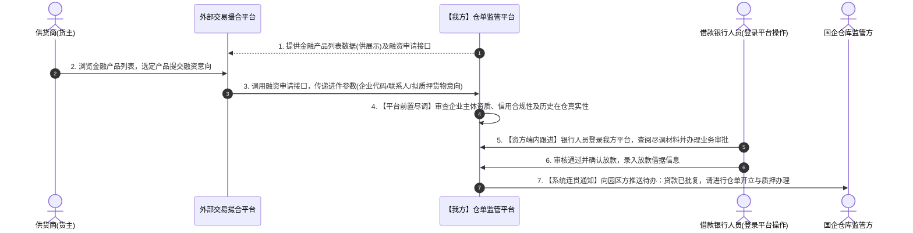
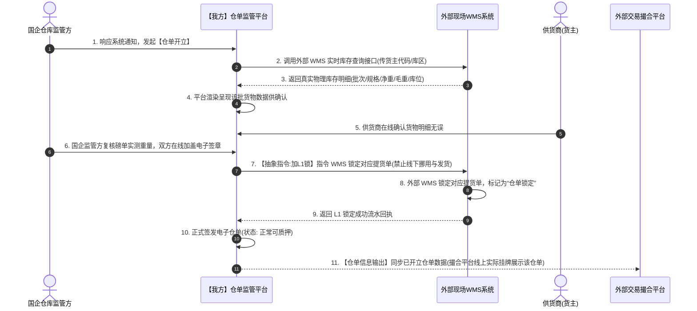
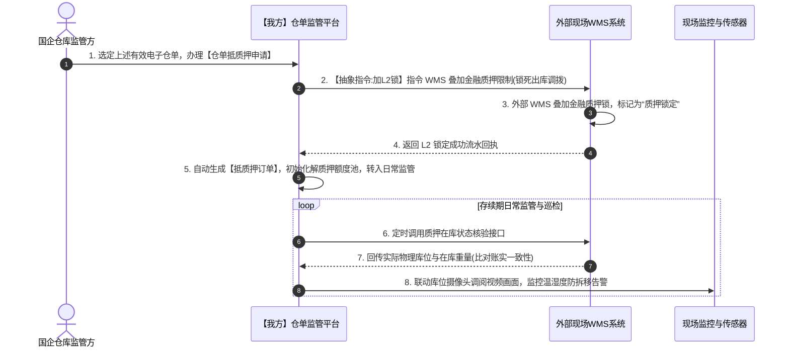
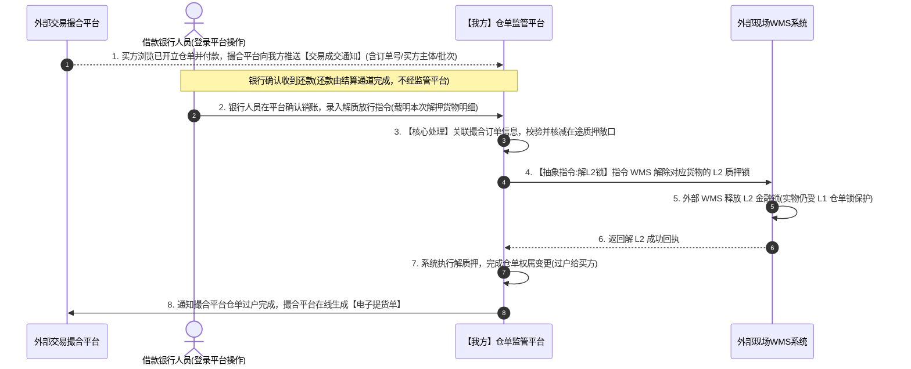
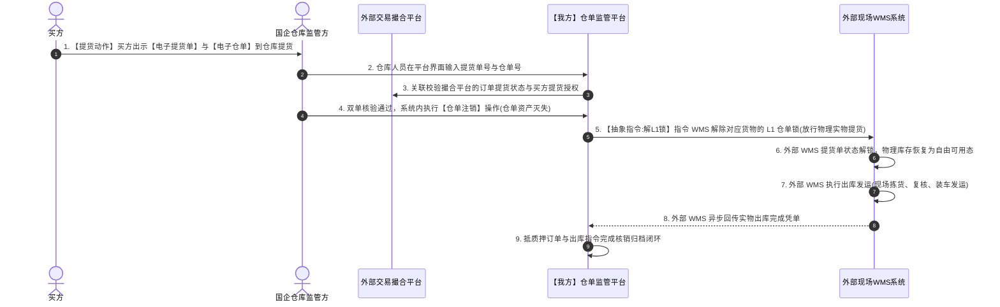

# 仓单监管平台业务对接核心内容梳理
> **文档性质**：会议同步与技术对接专用方案（内部拉通、方案汇报与多方对接评审）  
> **编制立场**：仓单监管平台建设方（系统提供方）  
> **核心议题**：基于已有成熟平台进行对接改造，厘清商业本质、主体权责、**L1/L2双层锁控抽象逻辑**、**资方系统断层下的平台内闭环跟进办理**、**同一抵质押单支持多笔在途解质押**及核心场景交互  
> **更新时间**：2026-11-02  

---

## 一、 背景与建设定位（已有系统现状 vs 对接改造诉求）

### 1.1 我方已有系统现状（成熟中台底座）
我方作为仓单监管平台的建设方，拥有**成熟的仓单监管系统**，系统底层内嵌了完备的业务与风控中台能力：
* **基础 WMS 能力**：支持货物的常规入库、在库盘点、出库发运管理；
* **电子仓单全流程**：支持基于在库货物生成电子仓单、仓单生命周期管理与背书过户；
* **抵质押风控引擎**：支持质押确权、L1/L2 双层锁控抽象指令调度；
* **存续期日常监管**：支持现场视频调阅、物联传感异常预警与定时账实巡检；
* **自营货主门户与金融中心**：原系统中包含货主注册认证中心，以及可供货主浏览金融产品、发起融资申请的“金融商超”。

### 1.2 本次对接改造核心诉求（从“自闭环”转向“被集成”）
在新业务场景中，我方系统不再以“自闭环”方式独立运转，而是**作为中枢系统嵌入到整个供应链生态体系中**。
结合最新的业务共识与实际系统集成边界，系统的核心职责与改造重点明确如下：

```
┌────────────────────────────────────────────────────────────────────────────────────────┐
│                               仓单监管平台的纯粹系统职责边界                            │
├─────────────────┬─────────────────┬───────────────────────────┬────────────────────────┤
│  1. 金融产品    │  2. 进件与审核  │         3. 仓单管理       │    4. 抵质押单日常监管  │
├─────────────────┼─────────────────┼───────────────────────────┼────────────────────────┤
│ • 维护银行产品  │ • 接收外部申请  │ • WMS 查库(数据100%来自现场)│ • 办理质押确权登记     │
│ • 产品列表外露  │ • 平台前置尽调  │ • 国企仓储与货主共同签发  │ • 指令 WMS 加 L2 质押锁 │
│ • 撮合平台集成  │ • 银行人员登录  │ • 指令 WMS 加 L1 仓单锁   │ • 存续期视频/物联/巡检 │
│                 │   系统跟进办理  │ • 关联撮合订单,过户给买方 │ • 【核心】同一抵质押单 │
│                 │ • 办理通过后通知│ • 关联撮合订单,核验注销仓单│   允许多笔在途解质押   │
│                 │   园区开单/质押 │ • 指令 WMS 解 L1 锁出库   │ • 指令 WMS 解 L2 质押锁 │
└─────────────────┴─────────────────┴───────────────────────────┴────────────────────────┤
│ 【明确边界 1】：一级与二级清分结算规则与监管平台无关，平台不参与资金流划拨与计算      │
│ 【明确边界 2】：资方系统目前断层(无直连API)，银行人员在我方系统内跟进办理、放款与解质 │
└────────────────────────────────────────────────────────────────────────────────────────┘
```

具体落实到技术改造上，包含以下 6 大核心改造项：
1. **L1/L2 双层锁控抽象概念明确与 WMS 对接**：
   * **概念本质**：L1 与 L2 锁是我方仓单监管系统对接外部 WMS 时，**抽象出的锁控指令规范**，用于明确告知外部现场 WMS 必须在什么业务节点、对哪些物理货物执行锁定、不允许现场进行何种作业；
   * **L1 仓单锁（实物防挪用锁）**：在**货物开立仓单的时候**触发，指令外部 WMS 锁定对应货物的提货单，严禁线下随意挪用、发货或转移；
   * **L2 质押锁（金融风控锁）**：在**仓单进行抵质押的时候**触发，指令外部 WMS 叠加金融质押限制，锁死一切出库与转移；
2. **金融产品外露展示与融资申请接口输出**：
   * 货主不再专门登录我方自营门户注册认证；
   * **仓单监管平台提供金融产品列表数据给交易撮合平台进行展示**；
   * **仓单监管平台提供融资申请接口**，供交易撮合平台的客户在前端浏览金融产品后直接调用发起申请，数据无缝沉淀至我方平台；
3. **资方断层下的“前置尽调 + 银行端内跟进办理”业务流重构**：
   * **现状事实**：目前与借款银行的核心系统**暂无直连接口（接口断层）**；
   * **落地闭环方案**：我方仓单监管系统负责**收集进件信息**，并在系统内完成**前置尽调审核**；随后由**银行方业务人员登录我方仓单监管系统**进行后续的信贷跟进、审批与办理；银行方在系统内审核通过并确认放款后，**由系统通知园区方（国企仓储方）开展仓单开立与抵质押申请**，形成连贯的业务操作闭环；
4. **货物数据源 100% 外接现场 WMS**：
   * 现场已有独立的 WMS 仓储系统，我方**屏蔽自带的入库录入功能**，开立仓单时直接调用外部 WMS 接口实时拉取真实在库物理货物明细；
5. **【核心系统重构】同一抵质押单支持多笔在途解质押申请**：
   * **原系统局限**：原系统仅支持单笔串行解押，无法应对大宗商品分批销售场景；
   * **新系统能力**：**重构抵质押订单状态机与额度/库存校验引擎**，**支持同一抵质押单下允许多笔在途解质押申请并行流转**，动态精细化管控在途解押份额与剩余质押敞口；
6. **撮合平台挂牌展示【已开立仓单信息】与交易成交协同**：
   * **仓单信息挂牌展示**：**交易撮合平台线上实际展示的大宗现货，是【仓单监管平台已经开立的仓单信息】**。仓单监管平台将开立好的仓单明细（货物规格、批次、在库重量、保管仓库等）提供给交易撮合平台进行前端展示与挂牌；
   * **成交通知推送**：买方选购仓单货物并付款后，**交易撮合平台向仓单监管平台推送交易成交通知**（包含成交订单号、买方主体信息、购买货物仓单批次及成交明细）；
   * **提货与出库闭环**：在执行解抵质押与注销仓单时，系统轻量关联撮合交易订单信息，买方持**“提货单 + 仓单”**到仓库提货，仓库核验双单、注销仓单并解 L1 锁出库。

---

## 二、 核心商业关系与系统定位（穿透业务本质）

为了让参会各方快速建立统一步调，穿透整个项目的商业逻辑、软件出资关系与实际使用边界：

```
                     ┌─────────────────────────────────────────────────────────┐
                     │               外部交易撮合平台 (前端渠道)                 │
                     │  • 挂牌展示仓单监管平台【已开立的仓单信息】             │
                     │  • 获取并展示仓单监管平台提供的【金融产品列表数据】     │
                     │  • 调用【融资申请接口】提交融资意向，撮合买卖交易       │
                     │  • 软件系统的【出资采购方】(为了做大交易规模与生态赋能) │
                     │  • 接收过户通知，在线为买方生成【电子提货单】           │
                     └────────────────────────────┬────────────────────────────┘
                                                  │ 采购部署 / 金融商超外露集成
                                                  ▼
┌───────────────────────────────┐ 存货与融资申请  ┌─────────────────────────────────────────┐
│        供货商 (货主)          ├───────────────►│      国企园区仓库保管监管方 (实体仓库)   │
│ • 将大宗实物存入国企园区仓库  │                │  • 对在库货物负有【法定保管与监管责任】 │
│ • 在撮合平台直接提交融资意向  │ 共同在线签发仓单│  • 核心收益：【仓储保管费】+【监管服务费】│
│ • 清分结算后收取货款结余      │◄───────────────┤  • 仓单监管平台的【实际运营使用方】     │
└───────────────────────────────┘                │  • 【现场核验买方提货单与仓单并出库】    │
                                                 └────────────────────┬────────────────────┘
                                                                      │ 收到银行办理通过通知后
                                                                      │ 发起开立(加L1)与质押(加L2)
                                                                      ▼
┌───────────────────────────────────────────────────────────────────────────────────────────┐
│                           【我方核心】仓单监管平台 (数字化风控工作台中枢)                    │
│  • 收集进件信息 ──► 开展平台【前置尽调审核】                                              │
│  • 【银行人员登录我方平台】进行后续跟进、审批与办理 ──► 办理通过后通知园区方开单与质押    │
│  • 银行人员在平台确认还款销账 ──► 触发解除 L2 质押锁(支持多笔在途) ──► 仓单过户给买方     │
└─────────────────────────────────────┬─────────────────────────────────────────────────────┘
                                      │ 银行方人员在平台操作 / [资金结算层独立闭环]
                                      ▼
┌───────────────────────────────────────────────────────────────────────────────────────────┐
│                                   资金方 (借款银行人员)                                    │
│  • 使用我方平台跟进融资业务、办理授信审批与放款确认                                        │
│  • 线下/独立通道收妥二级清分直接还贷，在平台内出具解质凭证                                 │
└───────────────────────────────────────────────────────────────────────────────────────────┘
```

---

## 三、 核心参与各方的权责与收益定义

| 参与方 | 商业定位 | 核心职责与操作边界 | 核心收益来源 |
| :--- | :--- | :--- | :--- |
| **第一方：供货商<br/>（存货人 / 借款人）** | 资产所有者与融资借款人 | 1. 将大宗实物存入国企园区仓库，由现场 WMS 录入入库；<br>2. 在交易撮合平台（外露的金融服务入口）直接提交融资申请意向；<br>3. 银行审批通过后，与国企仓储方共同在仓单平台内完成仓单签署与质押；<br>4. 交易达成并完成还贷后，接收结余货款。 | 获得实物变现前的信贷流动性支持；货物售出结清贷款后的资金净结余。 |
| **第二方：国企园区仓库保管监管方<br/>（实体仓库管理方）** | **实物保管人与监管责任方**<br/>**（系统的实际使用者）** | 1. 负责货物的物理在库保管、盘点与现场作业；<br>2. **对在库货物承担法定保管责任与金融质押监管责任**，确保账实严格相符；<br>3. 收到银行办理通过通知后，在平台发起仓单开立与质押，指令 WMS 施加 L1/L2 锁；<br>4. **现场审核买方出示的双单（提货单+仓单），核验撮合订单后注销仓单、解 L1 锁并执行出库**。 | **仓储保管费**<br>+<br>**金融监管服务费** |
| **第三方：交易撮合平台<br/>（平台运营方）** | **交易撮合中枢**<br/>**（系统的出资购买方）** | 1. 出资采购我方“仓单监管平台”，赋能国企仓储方；<br>2. **获取并展示仓单监管平台提供的【金融产品列表数据】，调用【融资申请接口】供客户发起申请**；<br>3. **线上实际挂牌展示【仓单监管平台已经开立的仓单信息】**，撮合现货交易；<br>4. **买方付款后，向仓单监管平台推送交易成交通知**；<br>5. 收到仓单过户通知后，**在线为买方生成【电子提货单】**。 | **交易撮合服务佣金** |
| **第四方：资金方<br/>（借款银行 / 资方）** | 信贷资金提供方与审批方 | 1. **银行人员登录我方仓单监管平台**，查阅前置尽调材料，跟进信贷审核与办理；<br>2. 办理成功后在系统内确认放款，触发系统通知园区方开单与质押；<br>3. 收到还款入账核销后，在系统内确认还款并出具解抵质押指令。 | 贷款利息收益 |
| **第五方：买方<br/>（大宗现货采购商）** | 货物最终购买者 | 1. 在交易撮合平台**浏览已开立的仓单商品信息**，下单并支付采购款；<br>2. 银行销账解质后，系统完成仓单过户，安全获得无质押电子仓单所有权；<br>3. 交易撮合平台在线生成电子提货单；<br>4. **拿着【电子提货单】与【电子仓单】，向国企园区仓库方发起提货出库**。 | 获得真实有效、权属清晰的大宗现货资产 |

---

## 四、 端到端全业务流程时序图总览（Mermaid）

以下时序图展示了平台聚焦于**“金融外露 $\rightarrow$ 收集进件 $\rightarrow$ 平台前置尽调 $\rightarrow$ 银行端内跟进审批 $\rightarrow$ 通知园区开单(加L1锁) $\rightarrow$ 质押确权(加L2锁) $\rightarrow$ 存续期监管 $\rightarrow$ 银行解质(支持多笔在途) $\rightarrow$ 仓单过户出提货单 $\rightarrow$ 持双单核验注销解L1锁出库”**的全链路：



---

## 五、 拆分核心场景交互时序图（专题评审）

### 场景一：金融商超外露、平台前置尽调与银行端内跟进办理
* **业务焦点**：我方提供金融产品列表数据供撮合平台展示，并提供融资申请接口；监管平台收集信息并开展前置尽调审核；银行人员登录我方平台跟进审批放款；通过后系统连贯通知园区方。



---

### 场景二：外部 WMS 数据拉取、共同开立仓单、施加 L1 锁与仓单信息同步
* **业务焦点**：园区方收到通知后触发开单；底层实物数据 100% 来源于外部现场 WMS；双方共同签发；下发抽象指令施加 **L1 仓单锁（锁定提货单）**；**同步已开立仓单信息给撮合平台挂牌展示**。



---

### 场景三：办理仓单抵质押、施加 L2 锁与建立监管订单
* **业务焦点**：开单后紧接着办理仓单抵质押；下发抽象指令施加 **L2 质押锁（金融冻结）**；自动建立存续期监管订单，准备好支持多笔在途解质押。



---

### 场景四：成交通知接收、银行端内放行、多笔在途解押与权属变更
* **业务焦点**：买方浏览已开立仓单并付款后撮合平台推送成交通知；银行人员在平台确认还款与解质放行；系统底层支持**同一抵质押单下多笔在途解押流转**；解押时关联撮合订单信息；指令外部 WMS 解开 L2 锁并过户买方。



---

### 场景五：双单提货核验、订单信息协同、注销仓单与解 L1 锁出库
* **业务焦点**：买方持双单到仓库提货；核验双单与撮合订单一致性；**先注销仓单，后解 L1 锁出库**，订单归档闭环。



---

## 六、 仓单监管平台技术改造与系统对接清单（技术落地抓手）

作为平台建设方，聚焦于“产品、进件、仓单、抵质押监管”四大核心主业，我方系统的改造清单如下：

| 系统模块 | 涉及对接方 | 改造类型 | 详细改造说明 |
| :--- | :--- | :--- | :--- |
| **抵质押风控引擎<br/>（重大内部重构）** | 内部状态机引擎 | **重大功能升级** | **核心改造点**：原系统仅支持单笔串行解质押。本次需**重构抵质押单状态机**，**支持同一抵质押单下发起并处理多笔在途解质押申请**；实现解押数量、解押货值、锁定库存的动态在途额度池管控与并发校验，避免超额解质押。 |
| **资方跟进与前置尽调模块** | 借款银行人员 | **流程与工作台改造** | 1. 建立**前置尽调审核工作流**，支持监管方初审企业资质与在仓真实性；<br>2. 为银行人员开辟**专属信贷跟进工作台**，支持端内审查进件、录入借据号与放款确认；<br>3. 放款确认后，自动触发**通知国企仓储方开立仓单与办理质押**的连贯流程；<br>4. 支持银行人员在系统内录入销账凭据并确认解质放行。 |
| **外部货物适配模块** | 外部现场 WMS | **新增对接** | 1. 开发在库物理库存实时查询适配器，统一货物字段格式；<br>2. 屏蔽原自建入库录入界面，改为调用外部 WMS 实时拉取展示。 |
| **双层锁控调度引擎** | 外部现场 WMS | **核心改造** | 1. 确立抽象锁规范：开单时下发 L1 锁（锁定提货单），质押时下发 L2 锁（金融冻结）；<br>2. 解锁指令调度：银行确认放行下发解 L2 锁，提货注销下发解 L1 锁；<br>3. 适配按批次货物精确调度外部 WMS 锁状态。 |
| **金融能力外露网关** | 外部交易撮合平台 | **服务化外露** | 1. **提供金融产品列表数据接口**，输出合作银行金融产品要素供交易撮合平台进行前端展示；<br>2. **提供融资申请接口**，供交易撮合平台直接调用发起融资申请，接收外部推送的企业与货物意向数据。 |
| **交易协同与提货联动** | 外部交易撮合平台 | **核心协同** | 1. **提供已开立仓单信息输出接口**：向交易撮合平台输出已开立仓单数据，**撮合平台线上实际挂牌展示该仓单信息**供买方选购；<br>2. 接收买方付款后撮合平台推送的交易成交通知；<br>3. 仓单权属变更完成后，触发异步通知撮合平台生成【电子提货单】；<br>4. 在解抵质押与注销仓单时，轻量获取并关联撮合订单信息，支撑业务追溯与双单核验。 |
| **存续期监管与巡检中枢** | 外部现场 WMS + 物联设备 | **中台复用** | 1. 定时调用 WMS 巡检接口执行账实比对；<br>2. 绑定库位关联摄像机与传感器，风控大屏呈现异常报警。 |

---

## 七、 会议同步与答疑核心要点（一分钟说透核心）

在向电商撮合方领导、国企园区仓储方领导及银行人员汇报时，可直接使用以下 4 点定调：

1. **“平台是现成的，本次核心是打通连接器，融入园区生态”**：
   我方系统已经具备完备的仓单与质押监管底层能力。**我方提供金融产品列表数据与申请接口供撮合平台集成；撮合平台线上实际挂牌展示的是我方已开立的仓单信息**；本次核心工作是把系统的“进件端”、“实物锁控端”分别与交易撮合平台和现场 WMS 无缝拼接。
2. **“资方系统断层有解法：平台前置尽调，银行端内跟进，通过后无缝通知开单质押”**：
   因银行系统暂无直连 API，由我方平台完成进件收集与前置尽调；**银行人员直接登录我方平台进行后续跟进、审查与放款确认**；一旦放款通过，系统自动通知园区仓储方，园区方顺畅完成 WMS 查库、共同签发仓单并办妥抵质押！
3. **“L1/L2 是告知外部 WMS 的锁控规范，同一抵质押单支持多笔在途解押”**：
   明确 L1/L2 锁的抽象含义（开单锁提货单，质押锁死金融出库）；**平台重点升级支持同一抵质押单下允许多笔在途解质押并行流转**，解押时轻量关联撮合订单信息，资方确认一笔、平台解押过户一笔。
4. **“改完货权出提货单，买方持双单到仓库提货注销核销”**：
   仓单过户后，撮合平台生成提货单；买方同时拿**【电子提货单】**与**【电子仓单】**到国企园区仓库提货；仓库人员在平台核验双单与撮合订单一致性，**先注销仓单，后解 L1 锁出库**，完成全流程闭环！
