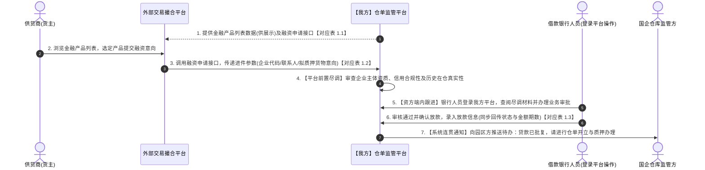
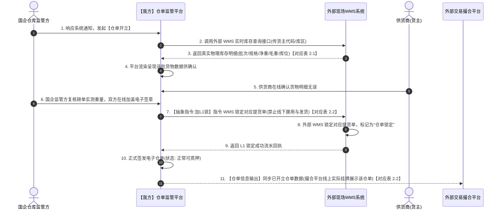
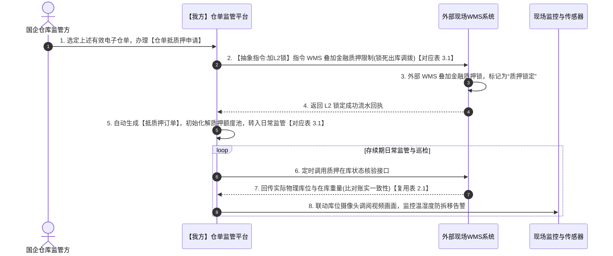
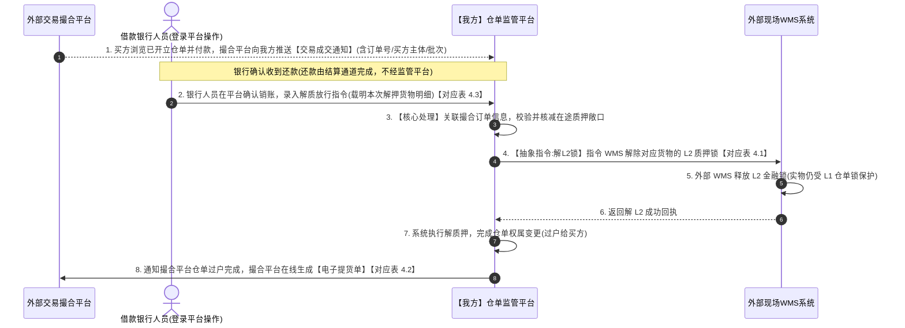
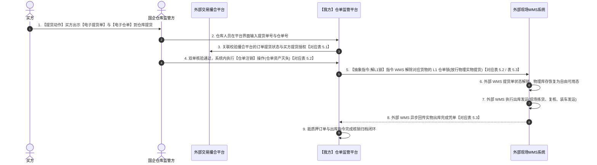

# 五场景 · 对外对接业务字段清单（已剥离内部字段 · 纯跨系统交互版）

> **用途**：交易撮合平台 / 外部现场 WMS 与 SYZC（仓单监管平台）对接时，**SYZC 系统内已有且真正需要跨系统传递的业务字段**。  
> **裁剪原则**：
> 1. **仅保留跨系统交互字段**：银行人员、国企监管方、开单供货商均直接登录 SYZC 平台端内操作；正文中已**彻底剔除** SYZC 内部运营审计（创建人/制单人/操作人/处理时间）、内部派单流转（前置尽调指派/重派资方/关联总流程）、内部风控盯市机密指标（货值安全线/评估价值/行业参考价/质押率/风险状态）、内部签署过程（人脸识别/短信验证码/协议号/4位核销码）及中仓登三方通道字段。
> 2. **标明交互方向**：每个子表头均明确标注数据流向（`SYZC → 交易撮合平台`、`交易撮合平台 → SYZC`、`外部现场 WMS → SYZC`、`SYZC → 外部现场 WMS`）。
> 3. **必填列含义**：指**对外接口协同**时是否必须携带或回传。**条件** = 特定主体类型（个人/企业）或特定业务阶段（如已批复、已放款）下必填；**否** = 选填或扩展项。

---

## 0. 全局主体与机构传递口径

| 业务对象 | 对外传递口径 |
|----------|--------------|
| **资金方机构** | 仅传递 **资方机构名称**（如用于向撮合平台展示批复/放款资方），不暴露 SYZC 内部机构主键与组织树 |
| **业务参与主体（供货商 / 存货人 / 持有人 / 提货人）** | 统一传递 **主体类型 + 主体名称 + 身份标识 + 证件/联系电话**，不传递 SYZC 内部合作方档案编码 |

| 字段名称 | 取值说明 | 必填 |
|----------|----------|------|
| 主体类型 | 个人、企业 | 是 |
| 主体名称 | 个人真实姓名或企业工商注册全称 | 是 |
| 身份标识 | 企业为 18 位统一社会信用代码；个人为 11 位手机号 | 是 |
| 身份证号 | 个人主体 18 位身份证号 | 条件 |
| 联系电话 | 11 位手机号 | 条件 |

---

## 场景一：金融商超外露、平台前置尽调与银行端内跟进办理

> **跨系统交互边界**：
> 1. SYZC 向交易撮合平台输出**已上架**的金融产品列表及详情要素；
> 2. 供货商在撮合平台发起申请，撮合平台调用 SYZC 接口**推送融资申请进件**；
> 3. 平台前置尽调、分配资方及银行人员审批放款均在 SYZC 端内完成，SYZC 将**审批状态及批复的授信/贷款金额与期数**回传给交易撮合平台展示给供货商。

### 1.1 金融产品外露数据
* **交互方向**：`SYZC → 交易撮合平台`（仅同步已上架产品）
* **系统来源**：配置管理 → 门户管理 → 融资产品配置

| 字段名称 | 取值说明 | 必填 |
|----------|----------|------|
| 产品名称 | 门户配置的标准化融资产品名称（最长 50 字） | 是 |
| 推荐标识 | 推荐、不推荐（供撮合平台前端置顶或高亮展示） | 条件 |
| 申请对象 | 多选标签：个人、企业 | 是 |
| 贷款额度 | 数值，固定单位：万元 | 是 |
| 贷款期限类型 | 单选：固定期限、区间期限 | 是 |
| 贷款期限 | 期限具体数值或区间描述（单位：月） | 是 |
| 年利率 | 年化利率数值或区间说明 | 是 |
| 还款方式 | 多选：等额本金、等额本息、等本等息、先息后本、到期还本、其他（选「其他」时含自定义说明） | 是 |
| 支持类型 | 单选/多选：存货、仓单 | 是 |
| 产品详情（多组） | 动态分组结构，每组包含：**标题**（最长 50 字）、**标题图标**、**富文本内容**（产品介绍、准入条件、所需材料等） | 是 |

---

### 1.2 融资申请进件推送
* **交互方向**：`交易撮合平台 → SYZC`
* **系统来源**：客户管理 → 客户融资需求线索（新增进件与详情弹窗）

| 字段名称 | 取值说明 | 必填 |
|----------|----------|------|
| 产品名称 | 客户选购的门户标准化融资产品名称 | 是 |
| 申请时间 | 客户提交申请时间，格式 YYYY-MM-DD HH:mm:ss | 是 |
| 申请类型 | 个人、企业 | 是 |
| 申请人名称 | 个人真实姓名或企业工商注册全称 | 是 |
| 申请人手机号 | 个人申请人必填，11 位手机号 | 条件 |
| 身份证号 | 个人申请人必填，18 位身份证号 | 条件 |
| 统一社会信用代码 | 企业申请人必填，18 位统一社会信用代码 | 条件 |
| 营业执照 | 企业申请人必填，营业执照图片列表 | 条件 |
| 经办人姓名 | 企业申请人必填，企业融资经办人姓名 | 条件 |
| 经办人手机号 | 企业申请人必填，11 位手机号 | 条件 |
| 经办人证件号 | 企业申请人必填，经办人 18 位身份证号 | 条件 |
| 意向融资金额 | 数值，单位：元 | 是 |
| 意向融资期数 | 正整数，单位：期 | 是 |
| 抵/质押物（货物类型） | 枚举：存货、仓单 | 是 |
| 存货（标的明细） | 当抵/质押物为「存货」时传递：`大类-品类-规格-可用数量(单位)` 列表；未选定可传空（系统展示「暂不确定」） | 条件 |
| 仓单（标的明细） | 当抵/质押物为「仓单」时传递：拟质押的 **仓单编码** 列表；未选定可传空（系统展示「暂不确定」） | 条件 |
| 附件资料 | 客户补充上传的图片或 PDF 资料列表 | 否 |

---

### 1.3 融资审批与放款结果状态回传
* **交互方向**：`SYZC → 交易撮合平台`（供撮合平台向供货商展示融资进度与批复结果）
* **系统来源**：客户融资需求线索 / 融资分配 / 线上抵质押办理

| 字段名称 | 取值说明 | 必填 |
|----------|----------|------|
| 产品名称 | 原申请对应的融资产品名称 | 是 |
| 申请人名称 / 身份标识 | 对应原申请主体（企业全称+信用代码，或个人姓名+手机号） | 是 |
| 申请时间 | 原申请提交时间（用于与进件组合唯一匹配） | 是 |
| 状态（融资状态） | 枚举：`待受理`、`已受理`、`申请成功`（已授信）、`申请失败`、`处理中`、`已放款`、`已结清` | 是 |
| 所属资方机构名称 | 实际受理/批复该笔融资的合作银行（资方）机构名称 | 条件 |
| 授信金额 | 银行确认「申请成功」时录入的批复金额，单位：元 | 条件 |
| 授信期数 | 银行确认「申请成功」时录入的批复期数，单位：期 | 条件 |
| 贷款金额 | 银行确认放款（或录入贷款结果）后回写的实际放款金额，单位：元 | 条件 |
| 贷款期数 | 银行确认放款（或录入贷款结果）后回写的实际放款期数，单位：期 | 条件 |
| 原因（拒绝原因） | 当状态为「申请失败」时，回传不通过/拒绝原因说明（最多 200 字） | 条件 |

---

## 场景二：外部 WMS 数据拉取、共同开立仓单、施加 L1 锁与仓单信息同步

> **跨系统交互边界**：
> 1. SYZC 从外部现场 WMS 实时拉取真实在库货物批次明细；
> 2. 供货商与监管方在 SYZC 端内完成共同签发后，SYZC 向外部现场 WMS 下发 **加 L1 仓单锁指令**；
> 3. SYZC 将已开立成功的有效电子仓单（含底层货物批次明细）同步给**交易撮合平台**进行线上挂牌展示。

### 2.1 在库实物批次明细拉取
* **交互方向**：`外部现场 WMS → SYZC`
* **系统来源**：仓储管理 → 库存查询 → 库存明细

| 字段名称 | 取值说明 | 必填 |
|----------|----------|------|
| 入库单号 | 关联的源头入库单唯一编号 | 是 |
| 入库类型 | 普通入库、仓单入库、质押入库、抵押入库、退货入库等 | 条件 |
| 入库时间 | 实物入库业务时间，格式 YYYY-MM-DD HH:mm:ss | 是 |
| 货主（名称与标识） | 存货人企业全称+统一社会信用代码，或个人姓名+手机号 | 是 |
| 货物名称 | 三段式规格：`大类-品类-规格型号` | 是 |
| 期初堆放数量 | 入库时分配到该库位的初始数量 + 计量单位（最多 4 位小数） | 条件 |
| 可用数量 | 当前可自由开立仓单/出库的净可用数量 + 计量单位 | 是 |
| 冻结数量 | 当前已被仓单、质押或出库占用的数量 + 计量单位 | 条件 |
| 仓库 / 库房 / 分区 | 三级物理存储空间名称（仓库名称、库房名称、分区名称） | 是 |
| 具体位置 | 四级具体垛位或货架编号 | 条件 |
| 存货条码 | 批次级全局唯一条码编码（作为后续加解锁与出库核销的批次主键） | 是 |
| 其他信息 | 入库批次自定义扩展属性键值对（如保质期、生产日期、入库车牌号等） | 否 |
| 货品状态 | 在库状态：`存货中`、`仓单中`、`质押中`、`抵押中`、`出库申请中` | 是 |
| 备注信息 | 入库单备注说明 | 否 |

---

### 2.2 仓单开立加 L1 锁指令 & 已开立仓单挂牌信息输出
* **交互方向**：
  * **指令加 L1 锁**：`SYZC → 外部现场 WMS`（传递仓单主表信息 + 仓单货物批次明细，按批次锁定对应实物与数量）
  * **挂牌展示同步**：`SYZC → 交易撮合平台`（传递仓单主表信息 + 仓单货物批次明细，供线上挂牌展示）
* **系统来源**：仓储管理 → 仓单管理（列表与详情）

#### （1）仓单主表信息
| 字段名称 | 取值说明 | 必填 |
|----------|----------|------|
| 仓单编码 | 平台电子仓单唯一编号（`CD` + 19 位数字） | 是 |
| 存货人(货主名称) | 仓单记名原始存货人全称 | 是 |
| 存货人标识 | 存货人 18 位统一社会信用代码或 11 位手机号 | 是 |
| 持有人 | 当前仓单合法持有人全称（开立初期等于存货人，过户后更新为买方） | 是 |
| 持有人标识 | 当前持有人 18 位统一社会信用代码或 11 位手机号 | 是 |
| 仓库名称 | 承储实体监管仓库全称 | 是 |
| 货物名称（摘要） | 汇总展示：`大类-品类-规格-数量及单位` | 是 |
| 开立时间 | 仓单正式签发生效时间，格式 YYYY-MM-DD HH:mm:ss | 是 |
| 仓单状态 | 枚举：`审批中`、`正常`、`冻结`、`注销`（挂牌与加 L1 锁时为 `正常`） | 是 |

#### （2）仓单货物批次明细表（挂牌展示与外部 WMS 加 L1 锁直接依据）
| 字段名称 | 取值说明 | 必填 |
|----------|----------|------|
| 存货条码 | 批次唯一条码编码（与 2.1 库存明细 `存货条码` 一一对应） | 是 |
| 货物名称 | 格式：`大类-品类-规格` | 是 |
| 位置 | 三级存储空间：`仓库-库房-分区` | 是 |
| 具体位置 | 四级具体垛位/货架编号 | 条件 |
| 入库时间 | 该批次原始入库时间，格式 YYYY-MM-DD HH:mm:ss | 是 |
| 其他信息 | 入库批次扩展属性键值对（如生产日期、批次号、保质期等） | 否 |
| 开立数量 | 该具体库位批次被本张仓单锁定的数量 + 计量单位（最多 4 位小数） | 是 |

---

## 场景三：办理仓单抵质押、施加 L2 锁与建立监管订单

> **跨系统交互边界**：
> 1. 园区与银行在 SYZC 端内完成抵质押确权建单（风控估值、安全线、质押率等均留在 SYZC 内部盯市，不外露）；
> 2. **向外部现场 WMS 下发加 L2 质押锁指令**（锁定在押仓单或存货批次）；
> 3. **向交易撮合平台同步仓单状态变更**（仓单状态由 `正常` 变为 `冻结`/在押状态，防止无权处分）。

### 3.1 抵质押确权加 L2 锁指令 & 在押状态同步
* **交互方向**：
  * **指令加 L2 锁**：`SYZC → 外部现场 WMS`（传递抵质押单基础信息 + 在押标的批次锁定明细）
  * **状态联动同步**：`SYZC → 交易撮合平台`（同步关联仓单状态更新为 `冻结`，以及关联融资申请的放款金额/期数更新）
* **系统来源**：融资监管 → 抵质押业务管理（列表与详情）

#### （1）抵质押订单基础标识信息
| 字段名称 | 取值说明 | 必填 |
|----------|----------|------|
| 抵押单号 / 质押单号 | 抵质押订单 19 位唯一编号 | 是 |
| 抵押时间 / 质押时间 | 抵质押确权生效时间，格式 YYYY-MM-DD HH:mm:ss | 是 |
| 抵押状态 / 质押状态 | 订单状态（如：`抵押中`、`质押中`、`解抵押`、`解质押`） | 是 |
| 货主类型 / 货主名称 / 货主标识 | 出质人（借款供货商）主体三要素 | 是 |
| 抵押权人类型 / 抵押权人名称 / 抵押权人证件号 | 质权人（贷款银行/资金方）主体三要素 | 是 |
| 合同编号 | 关联的信贷主合同或质押担保合同编号 | 条件 |

#### （2）在押标的批次锁定明细表（指令外部 WMS 加 L2 锁的核心依据）
| 字段名称 | 取值说明 | 必填 |
|----------|----------|------|
| 仓单编号 | 仓单质押时必填：被质押的电子仓单唯一编码（`CD` + 19 位数字）；普通存货抵质押时为空 | 条件 |
| 存货条码 | 底层实物批次唯一条码编码（与 2.1 库存明细、2.2 仓单批次条码一致） | 是 |
| 货物名称 | 格式：`大类-品类-规格` | 是 |
| 位置 | 三级存储空间：`仓库-库房-分区` | 是 |
| 具体位置 | 四级具体垛位/货架编码 | 条件 |
| 入库时间 | 底层货物原始入库时间，格式 YYYY-MM-DD HH:mm:ss | 是 |
| 其他信息 | 入库批次扩展属性键值对（如生产日期、批次号、保质期等） | 否 |
| 数量 | 该具体库位批次本次施加 L2 质押锁定的数量 + 计量单位 | 是 |

---

## 场景四：成交通知接收、银行端内放行、多笔在途解押与权属变更

> **跨系统交互边界**：
> 1. 买方在撮合平台付款后，撮合平台向 SYZC 推送成交与买方主体信息（跨系统新增成交字段见附录 B）；
> 2. 银行人员在 SYZC 端内完成部分结清或解质押确认后，SYZC **向外部现场 WMS 下发解 L2 质押锁指令**；
> 3. SYZC 完成仓单解押与权属变更后，**向交易撮合平台下发仓单过户完成通知**（供撮合平台为买方生成电子提货单），并同步更新供货商融资单的贷款余额/结清状态。

### 4.1 解除 L2 质押锁指令（整单解押 / 分批提货解押）
* **交互方向**：`SYZC → 外部现场 WMS`
* **系统来源**：抵质押业务管理（解除抵押/质押、关联质押出库）

| 字段名称 | 取值说明 | 必填 |
|----------|----------|------|
| 抵押单号 / 质押单号 | 关联的 19 位抵质押订单编号 | 是 |
| 抵押状态 / 质押状态 | 整单解押后变更为 `解抵押` / `解质押`；分批解押时仍为 `抵押中` / `质押中` | 是 |
| 关联单号（仓单编码） | 仓单质押解押时，传递对应的 `CD` 仓单编码 | 条件 |
| 存货条码 | 本次解除 L2 质押锁的具体货物批次唯一条码 | 是 |
| 仓库 / 库房 / 分区 / 具体位置 | 本次解锁货物所在的四级物理库位 | 是 |
| 解锁数量（或出库释放数量） | 本次从 L2 质押锁中释放的具体批次数量 + 计量单位（整单解押为全量在押数，分批解押为本次核减数） | 是 |

---

### 4.2 仓单权属变更（过户给买方）完成通知
* **交互方向**：`SYZC → 交易撮合平台`（触发撮合平台为买方出具电子提货单）
* **系统来源**：仓储管理 → 仓单管理（主表与详情变更记录）

| 字段名称 | 取值说明 | 必填 |
|----------|----------|------|
| 仓单编码 | 完成解押并过户的电子仓单唯一编号（`CD` + 19 位数字） | 是 |
| 仓单状态 | 解押恢复为 `正常` | 是 |
| 原存货人 / 存货人标识 | 原始卖方（供货商）名称及统一社会信用代码/手机号 | 是 |
| 持有人（新买方名称） | 变更后的新仓单持有人（买方）企业全称或个人真实姓名 | 是 |
| 持有人标识（新买方标识） | 变更后的新仓单持有人（买方）18 位统一社会信用代码或 11 位手机号 | 是 |
| 变更时间 | 权属变更（过户）正式生效时间，格式 YYYY-MM-DD HH:mm:ss | 是 |
| 关联单号 | 关联的源头质押单号或业务单号 | 条件 |

---

### 4.3 融资还款/结清进度状态同步（可选回传供货商）
* **交互方向**：`SYZC → 交易撮合平台`（当银行在端内录入贷款结果、部分结清或全部结清时，同步给撮合平台供货商端展示）
* **系统来源**：抵质押业务管理 → 贷款结果录入弹窗 / 部分结清弹窗

| 字段名称 | 取值说明 | 必填 |
|----------|----------|------|
| 抵押单号 / 质押单号 | 关联的抵质押订单号 | 是 |
| 贷款金额 | 实际放款总本金，单位：元 | 是 |
| 贷款期数 | 实际放款期数，单位：期 | 是 |
| 结清金额 | 本次部分结清归还的本金金额，单位：元（发生部分结清时传递） | 条件 |
| 贷款余额 | 扣减已结清金额后的实时剩余待还本金，单位：元（全部结清后为 0） | 是 |
| 融资状态 | 联动更新为 `已放款` 或 `已结清` | 是 |

---

## 场景五：双单提货核验、订单信息协同、注销仓单与解 L1 锁出库

> **跨系统交互边界**：
> 1. 买方持【电子提货单】与【电子仓单】到国企仓库提货，SYZC 与交易撮合平台交互核验**提货单与提货人主体信息**；
> 2. 仓库在 SYZC 端内完成双单核验并执行**仓单注销**后，SYZC **向外部现场 WMS 下发解 L1 仓单锁与实物出库指令**；
> 3. 外部现场 WMS 完成拣货装车后，**向 SYZC 回传实物出库完成结果**，并由 SYZC 同步交易撮合平台完成全链路归档。

### 5.1 电子提货单与提货人核验信息
* **交互方向**：`交易撮合平台 ↔ SYZC`（同步提货单授权信息，并回传现场提货状态）
* **系统来源**：仓储管理 → 提货单

#### （1）提货单主表与状态字段
| 字段名称 | 取值说明 | 必填 |
|----------|----------|------|
| 出库单号 | 关联的 19 位出库单唯一编号 | 条件 |
| 关联单号（仓单编码） | 提货对应的 `CD` 电子仓单编码 | 是 |
| 货主 | 当前货权人（买方）名称 + 统一社会信用代码或手机号 | 是 |
| 货物 | 提货货物明细摘要：`货品大类-品类-规格-数量及单位` | 是 |
| 出库类型 | 枚举：`仓单出库`、`质押出库`、`抵押出库`、`普通出库` | 是 |
| 状态（提货状态） | 枚举：`未提货`、`已提货`、`已取消` | 是 |
| 时间 / 提货时间 | 提货单生成时间及现场实际提货完成时间（YYYY-MM-DD HH:mm:ss） | 是 |

#### （2）提货人（买方及现场提货经办人）身份核验字段
| 字段名称 | 取值说明 | 必填 |
|----------|----------|------|
| 提货人类型 | 个人、企业 | 是 |
| 企业名称 | 企业提货必填：买方企业工商登记全称 | 条件 |
| 企业标识 | 企业提货必填：买方 18 位统一社会信用代码 | 条件 |
| 经办人/提货人姓名 | 个人为提货人本人姓名；企业为到场提货经办人姓名 | 是 |
| 提货人手机号 | 到场提货人 11 位手机号 | 是 |
| 提货人身份证号 | 到场提货人 18 位身份证号（用于现场核验身份） | 条件 |
| 车牌号 | 提货运输车辆车牌号 | 否 |

---

### 5.2 仓单注销通知与解 L1 锁指令
* **交互方向**：`SYZC → 外部现场 WMS`（指令解 L1 锁放行出库）& `SYZC → 交易撮合平台`（同步仓单已注销终态）
* **系统来源**：仓储管理 → 仓单管理（仓单注销）

| 字段名称 | 取值说明 | 必填 |
|----------|----------|------|
| 仓单编码 | 已核验并执行注销的 `CD` 电子仓单编号 | 是 |
| 仓单状态 | 变更为终态：`注销` | 是 |
| 注销时间 | 仓单注销生效时间戳，格式 YYYY-MM-DD HH:mm:ss | 是 |
| 注销原因 | 注销事由说明（如提货出库注销，最多 140 字） | 否 |

---

### 5.3 实物出库指令下发与出库完成回执
* **交互方向**：`SYZC ↔ 外部现场 WMS`（SYZC 下发出库批次明细与解 L1 锁指令，外部 WMS 执行装车发运后回传实际出库完成凭单）
* **系统来源**：仓储管理 → 出库管理 → 出库记录

#### （1）出库单主表信息
| 字段名称 | 取值说明 | 必填 |
|----------|----------|------|
| 出库单号 | 19 位出库单据唯一编号 | 是 |
| 出库类型 | `仓单出库`、`质押出库`、`抵押出库`、`普通出库`、`转让出库`、`移库出库` | 是 |
| 关联单号 | 关联的仓单编码（`CD...`）或抵质押单号 | 条件 |
| 货主类型 / 货主名称 / 货主标识 | 出库货主主体三要素 | 是 |
| 仓库名称 | 出库货物所在实体监管仓库全称 | 是 |
| 货物名称 | `大类-品类-规格` 摘要 | 是 |
| 出库数量 | 本单出库总数量 + 计量单位 | 是 |
| 出库日期 | 实际完成出库日期时间，格式 YYYY-MM-DD HH:mm:ss | 是 |
| 备注 | 出库补充说明（最多 140 字） | 否 |

#### （2）出库批次与库位扣减明细（解 L1 锁与扣减物理库存直接依据）
| 字段名称 | 取值说明 | 必填 |
|----------|----------|------|
| 存货条码 | 被扣减出库的批次全局唯一存货条码（与 2.1 库存明细、2.2 仓单批次条码一致） | 是 |
| 货物名称 | `大类-品类-规格` | 是 |
| 仓库 / 库房 / 分区 / 具体位置 | 出库货物所属的四级物理库位 | 是 |
| 入库时间 | 被扣减批次的原始入库时间 YYYY-MM-DD HH:mm:ss | 条件 |
| 其他信息 | 批次扩展属性键值对 | 否 |
| 出库数量 | 该具体库位批次本次实际解锁并出库的数量 + 计量单位 | 是 |

---

## 附录 A · 跨系统关联核心业务主键汇总

| 业务主键 | 关联场景与用途 | 交互系统 |
|----------|----------------|----------|
| **产品名称** | 场景一：金融产品外露与融资申请进件关联匹配 | SYZC ↔ 交易撮合平台 |
| **产品名称 + 申请人标识 + 申请时间** | 场景一：融资申请进件与审批/放款状态回传匹配 | SYZC ↔ 交易撮合平台 |
| **存货条码** | 场景二、三、四、五：物理库存批次唯一标识，贯穿查库、加解 L1 锁、加解 L2 锁、批次出库核销 | SYZC ↔ 外部现场 WMS / 交易撮合平台 |
| **仓单编码（`CD...`）** | 场景二、三、四、五：电子仓单全生命周期（签发挂牌、质押冻结、解押过户、注销提货） | SYZC ↔ 交易撮合平台 / 外部现场 WMS |
| **抵押单号 / 质押单号** | 场景三、四：抵质押订单施加 L2 锁、分批/整单解 L2 锁及还款余额同步 | SYZC ↔ 外部现场 WMS / 交易撮合平台 |
| **出库单号** | 场景五：提货单关联、解 L1 锁与实物出库核销回执 | SYZC ↔ 外部现场 WMS / 交易撮合平台 |

---

## 附录 B · 后续单独立项（不在现网已有字段内的跨系统新增字段）

以下字段属于 `2026.11.02业务对接流程梳理.md` 中新引入的跨系统交互概念，**现网 SYZC 尚未内置**，需在接口协议设计阶段作为新增扩展字段定义：
1. **外部 WMS 锁控指令专属字段**：锁控动作类型枚举（`LOCK_L1` / `UNLOCK_L1` / `LOCK_L2` / `UNLOCK_L2`）、外部 WMS 锁定流水回执号、锁状态枚举（`L1已锁` / `L2已锁`）；
2. **外部交易撮合平台成交通知专属字段**：撮合成交订单号、买方成交单价/总金额、撮合平台生成的外部电子提货单号；
3. **同一抵质押单多笔在途解质押重构字段**：在途解押子单号、在途解押冻结额度、剩余可解押敞口数量。

---

*2026-11-03 · 五场景对外对接业务字段清单 v5（已剥离 SYZC 内部运营/审计/风控/签署过程字段，按跨系统实际交互方向收敛）*
