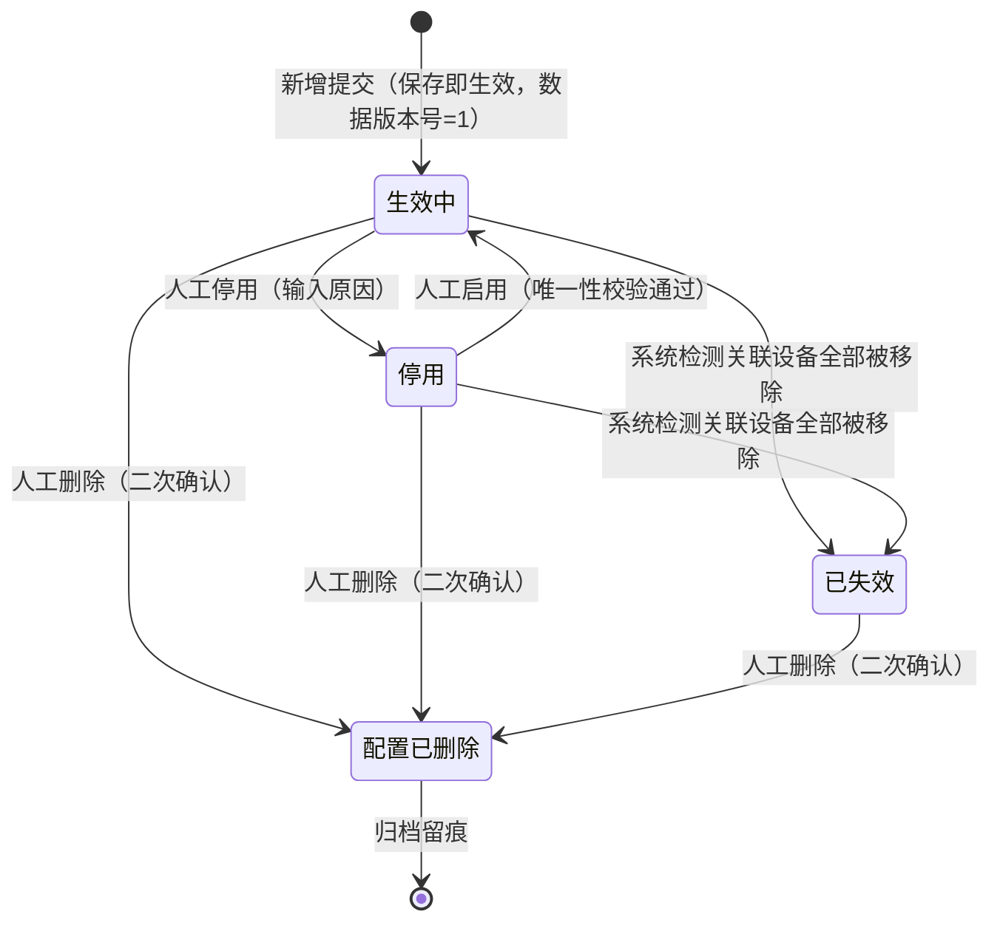
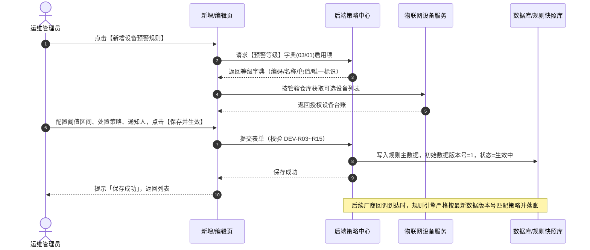
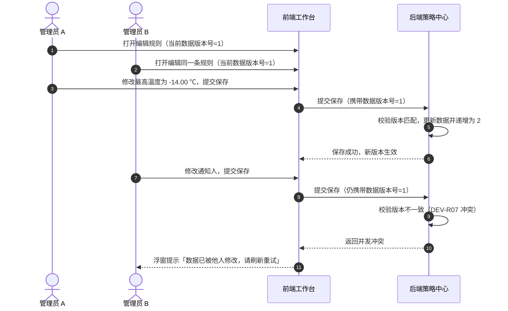

# 设备预警配置 业务规则规格

> **文档定位**：**三件套核心**——状态机、动作约束、校验规则、计算联动、处置策略矩阵及并发控制的**唯一定义来源**。配套文档：[设备预警配置主PRD.md](./设备预警配置主PRD.md)（业务与页面交互）、[设备预警配置字段清单.md](./设备预警配置字段清单.md)（字段字典）。端侧 ASCII 线框与 Demo 为衍生输入，仅引用本文件规则 ID，不重复定义规则本体。  
> **模块类型**：配置策略类（范式 A 裁剪版——具有完整生命周期状态机，保存即生效，无审批流）  
> **版本**：V4.9 | **更新时间**：2026-09-28 | **责任人**：森云科技（Senyun Technology）  
> **表述约定**：本文档仅使用页面与业务中文名；状态机编码、表名字段标识、接口参数等研发约定见单独的数据字典/接口规格，不在此重复。  
> **参考依据**：[《00-全局契约与RBAC权限矩阵》](../../00-全局契约与RBAC权限矩阵.md)第四章 §1、[预警等级配置业务规则规格（03/01）](../01预警等级/预警等级业务规则规格.md)

---

## 一、单据与能力定位

| 项目 | 内容 |
| :--- | :--- |
| **模块层级** | **【配置策略层】**（物理设备资产告警管控规则配置，非底层业务单据） |
| **菜单路径** | `预警配置 → 设备预警配置` |
| **核心职责** | 集中定义与维护 5 大类硬件设备的预警策略；精准配置物理指标阈值区间、预警等级外键绑定、三档处置策略模式、多渠道通知人及超时升级阶梯；接收厂商预过滤后的设备事件回调并完成实时策略匹配 |
| **规则来源** | 经授权的管理人员通过 PC 端表单新增/编辑生成（保存即生效） |
| **上游依赖** | **【预警等级】字典（菜单：预警配置 → 预警等级，代号 03/01）**：读取当前租户启用等级列表，保存所选等级的**字典唯一标识**及严重度**排序权重**快照，用于后续比较严重度； **设备台账主数据**：提供设备唯一标识、分类、系统内名称及绑定仓库/库房/分区； **仓库档案与数据权限**：设备穿梭框、规则列表与详情均严格按操作人管辖实体仓库范围过滤。 |
| **下游影响** | **规则版本递增**：保存/编辑成功后，规则状态为**生效中**，**数据版本号**递增；生效中规则即刻对后续设备事件生效； **流水落账与快照固化**：设备回调命中生效规则时，【设备预警信息】台账（菜单：预警信息 → 设备预警信息，代号 02/01）写入流水，不可变固化触发时刻的数据版本号、阈值、等级快照及通知/升级对象； **配置变更隔离（C08）**：规则修改**严格不回写**存量未结案流水，后续回调严格按最新数据版本号落账； **跨域穿透**：等级快照开启订单穿透且设备空间匹配在押订单时，向【押品预警信息】台账（代号 02/02）投递物联穿透告警。 |
| **审核流边界** | **无审批流**——配置策略类保存即生效（状态直接为【生效中】），表单无状态下拉选择框，不设草稿态与待审核态 |

---

## 二、指标与计算口径隔离表

| 口径名称 | 应用维度 | 业务含义与计算公式 / 判定条件 | 约束与边界说明 |
| :--- | :--- | :--- | :--- |
| **数值阈值区间** | 持续型子类型配置 | 正常安全运行时，监测值应落在**最低阈值**与**最高阈值**构成的闭区间内（含两端）。 | **严格递增**：最低阈值须小于最高阈值；支持 2 位小数；二氧化碳示例闭区间 400.00～1500.00 ppm。 |
| **越限告警判定** | 设备回调实时计算 | 厂商上报的当前监测值**低于最低阈值**，或**高于最高阈值**，即判定越限。 | 判定命中后触发生成【设备预警信息】（02/01）告警流水。 |
| **自动恢复判定** | 恢复结案实时计算 | 仅限白名单子类型且处置策略为**恢复自动结案**；当前监测值**不低于最低阈值且不高于最高阈值**（回到正常闭区间）时，判定可自动恢复。 | 指标回到正常区间并稳定后，系统自动结案，流水更新为【已结案 · 有效】。 |
| **超时升级时间** | 超时升级定时引擎 | **升级触发时刻** = 告警实际发生时刻 + **升级预警天数** × 86400 秒（自事件发生时刻起算）。 | 升级预警天数为 1～30 的正整数天；仅当告警为**待处置**且当前时刻不早于升级触发时刻时，触发短信升级。 |
| **数据版本号** | 乐观锁并发控制 | 每次编辑保存成功后，规则**数据版本号**在保存前版本基础上加 1。 | 新增初始为 1；保存原子递增；提交时若客户端版本与库内不一致则强阻断。 |
| **有效规则唯一性** | 规则防重约束 | 同一租户、同一物理设备、同一预警子类型下，处于**生效中**或**停用**的有效规则合计**最多 1 条**。 | 超出时强阻断保存或启用（含停用态占位）。 |

---

## 三、单据状态机与流转定义

### 3.1 状态定义
规则生命周期共包含 4 种状态，不设草稿与审批态，核心生命周期在列表与详情页流转：

| 状态名称 | 业务含义 | 是否终态 | 列表可见性 | 进入条件 | 退出条件 |
| :--- | :--- | :---: | :---: | :--- | :--- |
| **生效中** | 规则正常运行，对设备回调事件生效，命中可触发流水 | 否 | 可见 | 新增保存成功；自停用态人工启用 | 人工停用；系统自动失效；软删除 |
| **停用** | 人工主动暂停，配置保留，停止监听和匹配新事件 | 否 | 可见 | 人工点击停用 | 人工重新启用；系统自动失效；软删除 |
| **已失效** | 关联设备全部被解绑移除，系统自动失效，不可恢复 | **是** | 可见 | 系统任务检测到无关联可用设备 | 软删除（仅可删除） |
| **配置已删除** | 规则已被软删除，退出策略库，保留底层审计镜像 | **是** | **不可见** | 人工二次确认删除 | —（不可逆终态） |

### 3.2 状态流转图

---

## 四、动作能力与流转控制矩阵

| 触发动作 | 操作入口 | 适用角色 | 前置业务校验条件 | 结果状态 | 联动后置影响 | 失败阻断提示 |
| :--- | :--- | :--- | :--- | :--- | :--- | :--- |
| **新增保存** | 新增页【保存并生效】按钮 | 物联网运维管理员 | ① 规则名称租户内唯一（R03）； ② 设备与子类型唯一（R04/R05）； ③ 设备上线子类型互斥（R14）； ④ 处置策略白名单有效（R15/R15c）； ⑤ 数值阈值最低须严格小于最高（R09）。 | 生效中 | ① 写入规则主数据，初始数据版本号=1； ② 规则即时生效，监听设备事件； ③ 记录新增操作审计日志。 | 「保存失败：{字段名}校验未通过」 「保存失败：该设备已存在同类型有效预警规则」 |
| **编辑保存** | 编辑页【保存并生效】按钮 | 物联网运维管理员 | ① 不可变字段未变更（R06）； ② 携带打开页时的数据版本号且与库内一致（R07）； ③ 满足新增全部表单校验项。 | 生效中 / 停用（保持原态） | ① 数据版本号递增； ② **不回写**既有未结案流水（C08）； ③ 后续事件按最新数据版本号匹配落账； ④ 记录编辑操作审计日志。 | 「数据已被他人修改，请刷新重试」 「保存失败：不可变字段禁止修改」 |
| **停用规则** | 列表/详情行操作【停用】 | 物联网运维管理员 | 规则处于生效中状态；强制输入停用原因（不超过 200 字） | 停用 | ① 停止匹配新事件； ② 存量未处理流水**不置作废**，继续允许处理； ③ 记录停用操作审计日志。 | 「停用失败：规则状态已发生变迁」 |
| **启用规则** | 列表/详情行操作【启用】 | 物联网运维管理员 | 规则处于停用状态；重新执行【设备子类型唯一性】校验（R04/R05） | 生效中 | ① 恢复生效，重新监听设备事件； ② 记录启用操作审计日志。 | 「启用失败：该设备已绑定其他同类型有效规则」 |
| **删除规则** | 列表/详情行操作【删除】 | 物联网运维管理员 | 规则处于生效中、停用或已失效；二次确认弹窗输入删除理由 | 配置已删除 | ① 执行软删除，列表不可见； ② 级联将该规则产生的所有未结案流水置为【已作废】（C01）； ③ 取消关联的所有进行中超时升级任务（C04）。 | 「删除失败：规则已被他人删除」 |
| **查看详情** | 列表行操作【查看详情】 | 具备设备预警配置查看权限的角色 | 规则处于生效中、停用或已失效 | 状态不变 | 只读打开详情页，展示完整策略快照、当前数据版本号及审计日志 | — |
| **规则导出** | 列表上方【导出】按钮 | 具备设备预警配置查看权限的角色 | 列表有符合筛选条件的数据 | 状态不变 | 异步导出规则策略清单 Excel 文件；记录审计日志 | 「导出失败：系统繁忙，请稍后重试」 |

---

## 五、核心业务规则清单 (DEV-R01 ~ DEV-R15)

### 5.1 唯一性约束与版本并发控制

#### 【规则名称租户内唯一】(DEV-R03)
* **业务红线**：规则名称必填，最大长度不超过 50 个字符。同一租户内严禁存在重名规则（已软删除规则不计入重名校验）；
* **强校验时机**：表单失去焦点即时校验，点击【保存并生效】时服务端前置拦截，重复时提示「规则名称已存在，请重新输入」。

#### 【同一设备同一预警子类型唯一规则约束】(DEV-R04)
* **业务红线**：同一物理设备与同一预警子类型，在租户内**仅允许绑定 1 条有效规则**（有效规则包含【生效中】与【停用】，不含【配置已删除】与【已失效】）；
* **设计目标**：杜绝同一设备针对同一指标被重复配置，避免触发重叠告警与冲突风暴；
* **校验动作**：新增、编辑及停用恢复【启用】时均执行强校验，违规时阻断并提示「该设备已存在同类型有效预警规则」。

#### 【全局新设备规则唯一性约束】(DEV-R05)
* **单例配置位**：当勾选「仅针对新设备」时，同一预警类型（如 `设备图像识别预警`、`设备物联预警` 等 5 大类之一）在租户内**仅允许存在 1 条有效全局规则**（含生效中、停用；不含已删除、已失效）；
* **占位与释放**：创建时即行校验；若需更换全局策略，管理人员必须**编辑**既有规则或将既有规则**删除**（释放单例槽位）后方可新建。

#### 【编辑时不可变字段锁定】(DEV-R06)
* **锁定范围**：规则进入编辑页后，**规则名称、预警大类、预警子类型** 三个核心字段强制锁定置灰只读，严禁变更；
* **防呆机制**：若业务上需要变更监控类型，必须废弃该规则并新建，防止下游快照语义混淆。

#### 【数据版本乐观锁并发控制】(DEV-R07)
* **并发控制**：编辑保存提交时，请求必须携带打开编辑页时展示的**数据版本号**；
* **冲突阻断**：服务端在事务内对比当前库内版本：
  * 若一致：执行更新并将数据版本号原子递增 1；
  * 若不一致：强阻断更新，浮窗提示「数据已被他人修改，请刷新重试」。

---

### 5.2 触发条件与指标计算规范

#### 【关联设备非空校验】(DEV-R08)
* 当未勾选「仅针对新设备」时，关联设备列表**必须选择至少 1 台**有效物理设备；
* 勾选「仅针对新设备」时，前端自动隐藏设备选择穿梭框，服务端将设备关联列表持久化为空集合。

#### 【数值型区间逻辑有效性】(DEV-R09)
* **区间递增校验**：针对温度、湿度、有害气体等持续型数值子类型，最低阈值与最高阈值均为必填项，且**最低阈值须严格小于最高阈值**。
* **物理边界保护**：
  * 湿度指标须落在 0.00～100.00%RH 闭区间内；
  * 二氧化碳最低阈值不得小于 0 ppm，推荐默认闭区间 400.00～1500.00 ppm；
  * 违反校验时阻断提交，提示「阈值区间设置不正确，最低值必须严格小于最高值」。

#### 【预警等级引用与外键快照】(DEV-R10)
* **字典引用**：预警等级下拉列表仅读取【预警等级】字典（03/01）中状态为【启用】的等级项；
* **快照存储**：规则主数据仅保存【预警等级】字典的**唯一标识**及当时等级名称、色块、排序权重等快照，禁止仅写死展示文案；严重度比较与跨模块判定严格按排序权重数值。

#### 【设备上线子类型互斥规范】(DEV-R14)
* **互斥红线**：5 大类均含统一子类型「设备上线」（附录 A），属于资产入网运维通知，**严禁与温度异常、行人入侵、锁杆被剪等任何运营/安防告警子类型混选在同一规则中**；
* **交互联动**：
  * 用户点击勾选「设备上线」时，系统自动取消已勾选的其他子类型并置灰；
  * 用户勾选「仅针对新设备」时，子类型自动限定为「设备上线」单选（与当前预警类型绑定）。

---

### 5.3 处置策略模式与能力矩阵白名单

#### 【处置策略模式配置规范】(DEV-R15)
* **策略三档定义**（页面展示名与字段清单「处置策略」一致）：
  1. **触发即结案**：适用于瞬态通知类事件，告警产生后系统自动结案，初态直接为【已结案 · 有效】；
  2. **人工解除结案**：适用于需现场干预的安防或严重违规事件，初态为【待处置 · 有效】，强制人工现场核验销警；
  3. **恢复自动结案**：适用于可自愈的环境监测指标，初态为【待处置 · 有效】，指标正常后系统自动结案。

#### 【触发即结案禁配超时升级】(DEV-R15a)
* 当处置策略配置为 **触发即结案** 时，该事件无需人工跟进，系统自动隐藏超时升级配置区，并强制将升级预警天数置为 0，禁止注册升级定时任务。

#### 【下沉流水落账联动机制】(DEV-R15b)
* 规则配置中的处置策略模式在告警触发时 100% 固化入流水快照，作为【设备预警信息】台账（菜单：`预警信息 → 设备预警信息`，代号 02/01）执行前置核销校验的唯一标准，不受后续规则修改影响。

#### 【恢复自动结案能力矩阵白名单】(DEV-R15c)
* **白名单强控**：仅当规则内**所有**选中的子类型均属于附录 A 白名单（如温湿度异常、有害气体、离线后重新上线）时，才允许选择【恢复自动结案】；
* **GPS 行车事件禁配**：进围栏、出围栏、普通限速、怠速滞留、路线偏离、非法拆除等 GPS 行车/安防事件，**三方接入层不提供恢复自动结案回调**，禁止配置【恢复自动结案】，系统推荐【人工解除结案】；
* **安防红线**：对于非法剪杆、非法开锁、密码连续错误、图像入侵、设备非法拆除等安防破坏事件，**绝对禁止**配置自动恢复，违规保存时系统强阻断。

---

### 5.4 通知渠道与超时升级阶梯

#### 【通知渠道与预警对象完整性】(DEV-R11)
* **按需展开**：通知渠道提供多选复选框（短信、邮件）。未勾选任何渠道时，系统隐藏预警对象与超时升级配置区；
* **非空约束**：一旦勾选短信或邮件，**预警对象**（首次通知人）必填；若开启超时升级且**升级预警天数大于 0**，**升级预警对象** 必填；
* **升级短信专道**：超时升级预警统一通过**短信通道**上报，不受首次通知是否勾选邮件影响。

#### 【全局新设备规则禁配升级】(DEV-R13)
* 当勾选「仅针对新设备」全局监听时，该规则定位为基础入网通知，系统强制隐藏超时升级配置区，**升级预警天数**强制为 0。

---

### 5.5 仓库数据权限与生命周期联动

#### 【管辖仓库数据权限强隔离】(DEV-R12)
* 操作员在新增或编辑规则选择物理设备时，系统强制基于其组织架构分配的实体仓库范围进行过滤，严禁越权返回未经授权仓库的设备。

#### 【规则删除级联流水作废】(DEV-C01)
* 当规则被软删除时，系统在同一原子事务内，级联检索出该规则产生的全部处于【待处置 · 有效】的历史告警流水，批量更新为【已作废】（作废原因记为「关联规则已被删除」），并同步终止其所有待执行的超时升级任务。

#### 【配置变更版本生效与历史隔离】(DEV-C08)
* 规则编辑保存后数据版本号递增生效；系统**严格不回写**既有未结案告警流水；后续新设备事件回调严格按最新数据版本号匹配落账，保证每条历史告警的规则快照与司法存证证据效力永久真实不变。

---

## 六、异常与边界控制矩阵 (DEV-C01 ~ DEV-C08)

| 异常编号 | 异常场景 | 系统判定与控制动作 | 前端反馈与提示 |
| :--- | :--- | :--- | :--- |
| **【规则删除级联作废】(DEV-C01)** | 规则软删除时存在未结案流水 | 检索该规则下全部待处置流水，原子置为【已作废】并注销升级任务 | 二次确认弹窗提示：「删除后该规则产生的未处理预警将全部置为已作废，确认删除？」 |
| **【规则停用回调拒识】(DEV-C02)** | 规则处于停用状态下接收设备事件 | 规则版本已停用，事件匹配引擎直接忽略跳过，不落流水 | 服务端静默记录忽略日志，前端列表保持停用 |
| **【规则版本生效控制】(DEV-C03)** | 规则启停或失效变迁 | 生效中时激活当前版本策略监听；停用、失效或删除时注销监听 | 列表状态即时刷新，浮窗提示：「操作成功」 |
| **【删除终止升级任务】(DEV-C04)** | 规则删除取消调度 | 调度引擎按规则唯一标识扫描未触发的延迟升级任务，全量撤销 | 服务端异步取消，防止幽灵短信打扰 |
| **【快照字段固化隔离】(DEV-C05)** | 事件命中时生成流水快照 | 一次性固化触发时刻的数据版本号、阈值区间、预警等级全套字段与通知责任人 | 详情页展示触发时刻原始数据，不受后续修改影响 |
| **【关联设备全解绑失效】(DEV-C06)** | 设备台账解绑导致规则无设备 | 规则关联设备列表有效设备数为 0 时，系统自动将规则变迁为【已失效】 | 规则状态变更已失效，操作列置灰仅保留删除 |
| **【移动端红点自动联动】(DEV-C07)** | 告警产生后移动端同步 | 设备告警流水落账时，系统自动更新移动端「设备预警信息」待办红点角标 | 移动端工作台即时渲染待办红点 |
| **【配置变更不回写历史】(DEV-C08)** | 修改阈值后存在历史未结案流水 | 数据版本号递增生效，严格不回写既有流水；新回调按新版本落账 | 保存成功，历史详情页明确显示为历史快照版本 |

---

## 七、业务时序推演与跨模块联动

### 7.1 规则创建与版本生效时序

### 7.2 编辑乐观锁并发冲突时序

---

## 八、规则全景速查索引表

| 规则编码 | 规则全称 | 核心控制逻辑摘要 | 违规/异常反馈 |
| :--- | :--- | :--- | :--- |
| **DEV-R03** | 规则名称租户内唯一 | 最多 50 字；租户内唯一 | 阻断，提示名称已存在 |
| **DEV-R04** | 同一设备同一子类型唯一有效规则 | 同一物理设备 + 同一预警子类型限 1 条有效规则 | 阻断，提示同类型规则已存在 |
| **DEV-R05** | 全局新设备规则大类唯一性 | 每预警大类仅 1 条有效全局规则（含停用占位） | 阻断，提示编辑或删除原规则 |
| **DEV-R06** | 编辑时不可变字段锁定 | 名称、大类、子类型置灰只读 | 服务端拦截篡改传参 |
| **DEV-R07** | 数据版本乐观锁并发控制 | 提交携带数据版本号；版本冲突拦截 | 阻断，提示数据已被他人修改 |
| **DEV-R08** | 关联设备非空校验 | 非全局新设备时，须至少选择 1 台关联设备 | 阻断，提示请选择关联设备 |
| **DEV-R09** | 数值型区间逻辑有效性 | 最低阈值须严格小于最高阈值 | 阻断，提示阈值区间设置不正确 |
| **DEV-R10** | 预警等级引用与快照 | 下拉仅读【预警等级】字典（03/01）启用项；保存等级唯一标识及快照 | 阻断，提示请选择有效等级 |
| **DEV-R11** | 通知渠道与预警对象完整性 | 勾选渠道时首次通知人必填；升级天数大于 0 时升级人必填 | 阻断，提示请配置预警对象 |
| **DEV-R12** | 仓库数据权限强隔离 | 物理设备受限于管辖仓库权限 | 越权设备物理不可见 |
| **DEV-R13** | 全局新设备规则禁配升级 | 全局新设备隐藏升级；升级预警天数=0 | 服务端阻断非法升级天数 |
| **DEV-R14** | 设备上线子类型互斥规范 | 设备上线单独成规；禁止与常规子类型混选 | 阻断，自动取消互斥项并提示 |
| **DEV-R15** | 处置策略三档模式配置 | 三档单选；触发即结案/人工结案/自动结案 | 阻断空值 |
| **DEV-R15a**| 触发即结案禁配升级 | 触发即结案时隐藏升级区，升级天数强制为 0 | 服务端阻断非法升级配置 |
| **DEV-R15b**| 下沉流水落账联动 | 处置策略 100% 固化入流水触发快照 | 【设备预警信息】台账（02/01）按快照执行核销门控 |
| **DEV-R15c**| 恢复自动结案白名单矩阵 | 仅限附录 A 白名单子类型可选自动结案；GPS 围栏/限速/怠速/偏离/拆除因三方无恢复回调禁止 | 阻断，提示无自动恢复信号 |

---

## 附录 A：预警子类型权威枚举与处置策略能力矩阵

> **对齐说明**（与 [设备预警配置字段清单](./设备预警配置字段清单.md)「预警类型 / 预警子类型」、PC 原型新增/编辑页展示一致）：  
> - **预警类型**为 5 档：`设备图像识别预警`、`设备物联预警`、`智能挂锁预警`、`人脸门禁预警`、`设备GPS预警`；  
> - **预警子类型**为配置页、筛选级联、列表触发条件摘要使用的**业务展示名**（非 6.1 别名如「摄像头离线」「监控设备上线」）；同一子类型名在不同预警类型下语义独立（如各类型均含「设备离线」，按所属类型区分资产）。  
> - **系统推荐处置策略**为三档页面选项：触发即结案、人工解除结案、恢复自动结案；用户可改配，偏离推荐时二次确认（DEV-R15）。  
> - **恢复自动结案白名单**列（DEV-R15c）表示是否允许在规则级选择【恢复自动结案】；**恢复信号摘要**与 [设备预警信息业务规则规格](../../02-预警信息/01设备预警信息/设备预警信息业务规则规格.md) 自动恢复口径一致。  
> - 子类型持久化标识、厂商回调编码等**研发接口约定**不在本产品规格中展开，由接口/数据字典文档维护。

| 预警类型 | 预警子类型 | 指标类型 | 系统推荐处置策略 | 是否允许配置【恢复自动结案】（DEV-R15c） | 恢复信号摘要 |
| :--- | :--- | :--- | :--- | :---: | :--- |
| **设备图像识别预警** | 行人入侵 | 事件型 | 人工解除结案 | ❌ 禁止 | 无（须人工核查） |
| **设备图像识别预警** | 车辆入侵 | 事件型 | 人工解除结案 | ❌ 禁止 | 无（须人工核查） |
| **设备图像识别预警** | 物品形态变化 | 事件型 | 人工解除结案 | ❌ 禁止 | 无（须人工核查） |
| **设备图像识别预警** | 设备离线 | 事件型 | 恢复自动结案 | **✅ 允许** | 设备重新上线 |
| **设备图像识别预警** | 设备上线 | 事件型 | 触发即结案 | ❌ 禁止（通知类） | 无（触发即完成） |
| **设备图像识别预警** | 设备移除 | 事件型 | 触发即结案 | ❌ 禁止（通知类） | 无（资产移除留痕） |
| **设备物联预警** | 温度异常 | 数值型 | 恢复自动结案 | **✅ 允许** | 采集值回到阈值内并稳定 1 分钟 |
| **设备物联预警** | 湿度异常 | 数值型 | 恢复自动结案 | **✅ 允许** | 采集值回到阈值内并稳定 1 分钟 |
| **设备物联预警** | 烟感异常 | 事件型 | 恢复自动结案 | **✅ 允许** | 烟感恢复事件 |
| **设备物联预警** | 二氧化碳异常 | 数值型 | 恢复自动结案 | **✅ 允许** | 采集值回到阈值内并稳定 1 分钟 |
| **设备物联预警** | 氧气异常 | 数值型 | 恢复自动结案 | **✅ 允许** | 采集值回到阈值内并稳定 1 分钟 |
| **设备物联预警** | 设备离线 | 事件型 | 恢复自动结案 | **✅ 允许** | 设备重新上线 |
| **设备物联预警** | 设备上线 | 事件型 | 触发即结案 | ❌ 禁止（通知类） | 无（触发即完成） |
| **设备物联预警** | 设备移除 | 事件型 | 触发即结案 | ❌ 禁止（通知类） | 无（资产移除留痕） |
| **智能挂锁预警** | 拆壳 | 事件型 | 人工解除结案 | ❌ 禁止 | 无（须人工核查） |
| **智能挂锁预警** | 锁舌被卡 | 事件型 | 人工解除结案 | ❌ 禁止 | 无（须人工核查） |
| **智能挂锁预警** | 锁杆被剪 | 事件型 | 人工解除结案 | ❌ 禁止 | 无（须人工核查） |
| **智能挂锁预警** | 非法开箱 | 事件型 | 人工解除结案 | ❌ 禁止 | 无（须人工核查） |
| **智能挂锁预警** | 拆卡报警 | 事件型 | 人工解除结案 | ❌ 禁止 | 无（须人工核查） |
| **智能挂锁预警** | 密码错误 | 事件型 | 人工解除结案 | ❌ 禁止 | 无（须人工核查） |
| **智能挂锁预警** | 关锁异常 | 事件型 | 人工解除结案 | ❌ 禁止 | 无（须人工核查） |
| **智能挂锁预警** | 电量低于20% | 事件型 | 人工解除结案 | ❌ 禁止 | 无电量恢复信号（须人工或换电后人工解除） |
| **智能挂锁预警** | 开锁通知 | 事件型 | 触发即结案 | ❌ 禁止（通知类） | 无（不与关锁配对结案） |
| **智能挂锁预警** | 关锁通知 | 事件型 | 触发即结案 | ❌ 禁止（通知类） | 无（不与开锁配对结案） |
| **智能挂锁预警** | 设备上线 | 事件型 | 触发即结案 | ❌ 禁止（通知类） | 无（触发即完成） |
| **智能挂锁预警** | 设备移除 | 事件型 | 触发即结案 | ❌ 禁止（通知类） | 无（资产移除留痕） |
| **人脸门禁预警** | 门未关 | 事件型 | 人工解除结案 | ❌ 禁止 | 无门关闭恢复信号（须人工解除） |
| **人脸门禁预警** | 密码错误 | 事件型 | 人工解除结案 | ❌ 禁止 | 无（须人工核查） |
| **人脸门禁预警** | 设备离线 | 事件型 | 恢复自动结案 | **✅ 允许** | 设备重新上线 |
| **人脸门禁预警** | 开锁通知 | 事件型 | 触发即结案 | ❌ 禁止（通知类） | 无（不与关锁配对结案） |
| **人脸门禁预警** | 关锁通知 | 事件型 | 触发即结案 | ❌ 禁止（通知类） | 无（不与开锁配对结案） |
| **人脸门禁预警** | 设备上线 | 事件型 | 触发即结案 | ❌ 禁止（通知类） | 无（触发即完成） |
| **人脸门禁预警** | 设备移除 | 事件型 | 触发即结案 | ❌ 禁止（通知类） | 无（资产移除留痕） |
| **设备GPS预警** | 进围栏 | 事件型 | 人工解除结案 | ❌ 禁止 | 无（三方不提供恢复自动结案回调） |
| **设备GPS预警** | 出围栏 | 事件型 | 人工解除结案 | ❌ 禁止 | 无（三方不提供恢复自动结案回调） |
| **设备GPS预警** | 普通限速 | 事件型 | 人工解除结案 | ❌ 禁止 | 无（三方不提供恢复自动结案回调） |
| **设备GPS预警** | 怠速滞留 | 事件型 | 人工解除结案 | ❌ 禁止 | 无（三方不提供恢复自动结案回调） |
| **设备GPS预警** | 路线偏离 | 事件型 | 人工解除结案 | ❌ 禁止 | 无（三方不提供恢复自动结案回调） |
| **设备GPS预警** | 非法拆除 | 事件型 | 人工解除结案 | ❌ 禁止 | 无（安防破坏类；三方不提供恢复自动结案回调） |
| **设备GPS预警** | 设备离线 | 事件型 | 恢复自动结案 | **✅ 允许** | 设备重新上线 |
| **设备GPS预警** | 设备上线 | 事件型 | 触发即结案 | ❌ 禁止（通知类） | 无（触发即完成） |
| **设备GPS预警** | 设备移除 | 事件型 | 触发即结案 | ❌ 禁止（通知类） | 无（资产移除留痕） |

---

## 修订记录

| 日期 | 版本 | 变更内容说明 | 影响范围 | 修订人 |
| :--- | :--- | :--- | :--- | :--- |
| 2026-09-11 | V4.0 | 确立三件套核心定位，规范 R/C/P 规则编号自解释语义。 | 全文 | AI PM / 森云科技 |
| 2026-09-16 | V4.1 | 汉化交互词汇，规范处置策略三档模式与白名单机制。 | 规则清单 | AI PM / 森云科技 |
| 2026-09-18 | **V4.3** | **全面对齐《入库记录》《出库记录》标杆业务规格排版**： 1. 确立《一、单据与能力定位》6 大维度标准表格； 2. 新增《二、指标与计算口径隔离表》，严格以 LaTeX 公式定义区间判定、自动恢复与升级计时算法； 3. 落地 7 列全景动作控制矩阵（前置条件、后置联动、失败文案）； 4. 核心规则清单条目化重构，落地黑体重点引导词； 5. 完善时序推演与附录 A 能力矩阵。 | 业务规则规格全文 | AI PM / 森云科技 |
| 2026-09-20 | **V4.4** | **GPS 行车事件退出 R15c 白名单**：进围栏、出围栏、普通限速、怠速滞留、路线偏离、非法拆除因三方不提供恢复自动结案回调，禁止配置【恢复自动结案】，系统推荐【人工解除结案】；GPS 设备离线仍允许重新上线自动结案。 | DEV-R15c、附录 A GPS 矩阵 | AI PM / 森云科技 |
| 2026-09-28 | **V4.5** | **附录 A 全量对齐 PC 原型与字段清单**：预警类型改为 5 档正式枚举；子类型中文名、挂锁/门禁/GPS/图像全量枚举与「设备上线/离线/移除」统一命名；系统推荐策略与 R15c 白名单对齐原型（含烟感异常允许恢复自动结案、门未关推荐人工解除等）。 | 附录 A、DEV-R05、DEV-R14 | AI PM / 森云科技 |
| 2026-09-28 | **V4.6** | **附录 A 产品化表述**：移除预警子类型英文编码列及处置策略研发枚举；DEV-R15/R15a 改为页面中文档名；补充「研发接口约定另文维护」说明。 | 附录 A、DEV-R15 | AI PM / 森云科技 |
| 2026-09-28 | **V4.7** | **全文汉化研发向表述**：状态表去掉 ACTIVE 等编码列；Version/severity_level_id/sort_order/iot 表名等改为中文业务名；时序图与动作矩阵同步。 | 全文 | AI PM / 森云科技 |
| 2026-09-28 | **V4.8** | **第二节口径表产品化**：「指标与计算口径隔离表」判定条件列改为纯中文判定句，移除 LaTeX 公式与数学符号表述。 | §二 | AI PM / 森云科技 |
| 2026-09-28 | **V4.9** | **全文口径与矩阵汉化收尾**：动作矩阵、DEV-R09/R11、规则速查索引等残留 LaTeX 与符号表述改为纯中文判定句。 | §四～§八 | AI PM / 森云科技 |
