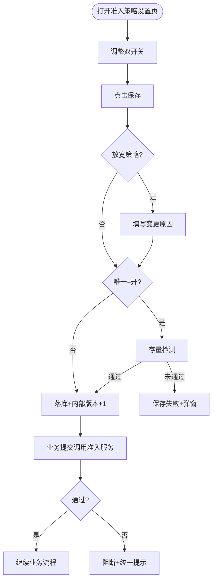

# 合作方准入规则-业务流程推演

> **版本**：V2.0（A 方案） | **更新时间**：2026-10-09  
> **参考**：[主PRD](./合作方准入规则主PRD.md) · [业务规则规格](./合作方准入规则业务规则规格.md) · [字段清单](./合作方准入规则字段清单.md)

---

## 一、概述

- **入口**：`配置管理 → 平台管理 → 合作方准入规则` → **设置页**（无列表）。
- **可配项**：个人货主 **证件地址必填**、**证件地址唯一校验**。
- **企业货主**：页内只读说明；不参与个人双开关。
- **生效**：**保存即生效**；无启停/草稿。
- **唯一=开**：保存前存量检测；冲突则保存失败。
- **运行时**：各业务入口调用统一准入服务；冲突同步阻断（PAR-R07）。

---

## 二、端到端流程

---

## 三、角色

| 主体 | 职责 |
| :--- | :--- |
| 平台超级管理员 | 修改并保存策略 |
| 业务运营 | 只读查看说明 |
| 各业务菜单 | 提交前调用准入服务 |
| 审计 | 记录双开关变更与原因 |

---

## 四、默认预置

| 项 | 值 |
| :--- | :--- |
| 证件地址必填 | 是 |
| 证件地址唯一校验 | 开 |
| 每租户策略条数 | 1 |

---

## 五、关键分支

1. **存量冲突**：唯一=开且检测未通过 → 不能保存。
2. **C08**：保存后新业务用新双开关；历史单据快照不变。
3. **企业货主**：不套用个人双开关；按档案/认证校验证件地址。
4. **空地址 + 必填否 + 唯一开**：空不参与唯一比对（PAR-R04）。

---

## 六、修订记录

| 日期 | 版本 | 说明 |
| :--- | :---: | :--- |
| 2026-09-20 | V1.3 | 多规则版 |
| 2026-10-09 | **V2.0** | A 方案单页推演 |
