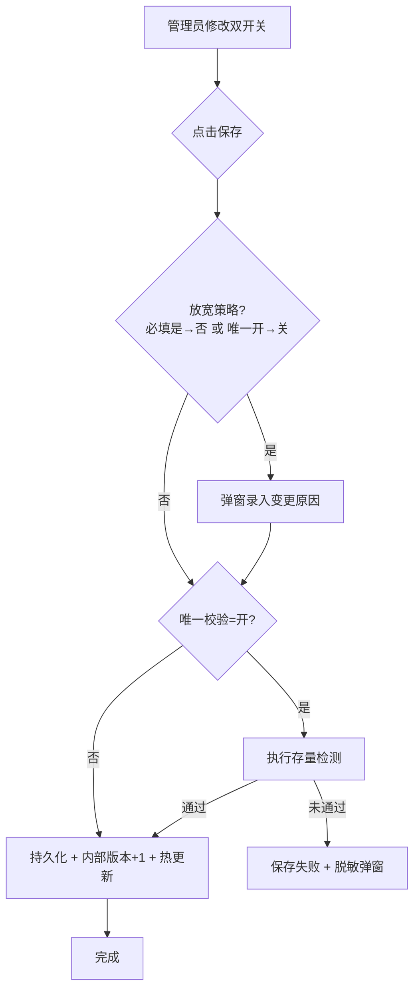

# 合作方准入规则业务规则规格

> 📦 **【归档 · 非页面 SSOT】** 配置页与规则已合并至 [基础配置](../02-平台管理-基础配置/) 三件套，**唯一编号 P01~P09**。本文件保留历史正文（文中 PAR-R 编号见 [README 迁移表](./README.md)）；变更须 **先改 02 三件套**，再按需同步本归档。

> **模块定位**：统一准入服务历史规则与 API 附录（**对外请只用 P01~P09**）。  
> **范式类型**：范式 C · 租户单策略配置（**保存即生效**；内部版本递增；无审批流；P0 无列表/启停）  
> **参考文档**：[基础配置业务规则规格.md](../02-平台管理-基础配置/基础配置业务规则规格.md) · [合作方档案业务规则规格.md](../04-合作方档案/合作方档案业务规则规格.md)  
> **版本**：V2.0（归档） | **更新时间**：2026-10-10 | **责任人**：森云科技（Senyun Technology）  
> **页面线框（真源）**：[基础配置_ASCII_配置页 第3节](../02-平台管理-基础配置/基础配置_ASCII_配置页.md)

---

## 一、单据与能力定位

| 项目 | 内容规格 |
| :--- | :--- |
| **单据层级** | 【配置策略层】租户级单条策略 |
| **菜单路径** | `配置管理 → 平台管理 → 基础配置` → 左侧 **合作方准入策略**（**无**独立二级菜单） |
| **核心职责** | 维护个人货主 **证件地址必填 / 证件地址唯一校验**；向统一准入服务提供当前策略及内部版本；保存前存量检测门禁 |
| **P0 固定口径** | 角色=货主；场景=字段清单 6.2 节 全量；冲突=同步阻断（PAR-R07）；企业货主不参与个人双开关（PAR-R03） |
| **数据存储** | 每租户 1 条策略主记录 + 版本审计（界面不展示版本树） |
| **数据隔离** | 租户物理隔离（PAR-P01） |

---

## 二、策略生效模型（P0）

| 项目 | 规格 |
| :--- | :--- |
| **生效方式** | 保存成功即生效；**无**草稿、停用、启用按钮 |
| **记录数量** | 每租户 **1 条**；开通时系统自动初始化 |
| **内部版本** | 每次保存成功内部版本号 +1（PAR-R01）；**设置页不展示** |
| **物理删除** | 禁止 DELETE；仅允许更新双开关 |

---

## 三、保存与存量检测流程

### 3.1 保存动作流转图

### 3.2 动作表

| 触发动作 | 角色 | 前置校验 | 二次确认 | 后置 | 失败提示 |
| :--- | :--- | :--- | :--- | :--- | :--- |
| **保存策略** | 平台超级管理员 | 双开关合法；唯一=开须检测通过；放宽须变更原因 | 放宽时变更原因弹窗 | 内部版本+1；审计；服务热更新 | 见 「九、」 |
| **检测存量数据** | 同上 | 唯一=开 | 弹窗展示结果 | 不单独升版 | 系统繁忙 |
| **表单内改状态/删策略** | — | — | **禁止** | — | 接口拦截 |

---

## 四、动作能力矩阵（P0 界面）

| 业务动作 | 是否提供 |
| :--- | :---: |
| 打开设置页查看/编辑双开关 | ✅ |
| 保存（保存即生效） | ✅ |
| 检测存量数据 | ✅（唯一=开） |
| 规则列表 / 详情 / 新增第二条 | ❌ |
| 启用 / 停用 / 草稿 | ❌ |
| 配置适用场景 / 角色 / 主体类型 | ❌（固定口径） |

---

## 五、核心业务规则 (PAR-R01 ~ PAR-R09)

#### 【规则版本递增与存量不回写】(PAR-R01 / C08)
* 策略每次 **保存成功**，内部版本原子递增；
* **严禁回写**已完成单据与固化快照；
* 在途单据按提交时固化的策略主键与内部版本复检。

#### 【租户默认策略加载】(PAR-R02)（P0 简化）
* 运行时按 **当前租户唯一策略** 加载双开关；**不做** 多规则场景竞争；
* 调用方仍须上送 `scene` 供审计与扩展；P0 不据此切换不同策略包；
* 二期若支持多规则，再恢复场景优先匹配语义。

#### 【个人货主地址双开关作用域】(PAR-R03)
* 双开关 **仅** 对 `个人 + 货主` 生效；
* **企业货主**：证件地址按认证/档案；**不** 校个人一人一址；设置页以只读说明区展示；
* 非货主角色不校地址唯一。

#### 【地址双开关组合行为】(PAR-R04)
* 四象限矩阵见 [字段清单 「五、」](./合作方准入规则字段清单.md#五地址双开关组合行为规范表)。

#### 【历史冲突检查拦截规则】(PAR-R05)
* **触发**：保存时唯一=开（含由关变开）；或用户点击【检测存量数据】；
* **未通过**：**保存失败**，配置不落库；
* 扫描范围与 PA-R06 活跃池同源；弹窗脱敏（PAR-R07 隐私）。

#### 【统一准入服务调用规则】(PAR-R06)
* 各业务入口 **必须** 调用统一服务；禁止私有校验逻辑。

#### 【冲突同步阻断不进审批规则】(PAR-R07)
* 冲突/缺必填：同步阻断；**不进审批中心**；统一文案见字段清单 6.3 节。

#### 【历史缺地址补录窗口规则】(PAR-R08)
* 必填由否改是时，可提示缺地址存量；限制新发个人货主直至治理（不 backfill 历史单据）。

#### 【并发与审计规则】(PAR-R09)
* 保存乐观锁；启停/delete 接口关闭；变更与变更原因全量审计。

---

## 六、运行时校验与档案字段映射

| 被校验档案字段 | 个人货主 | 企业货主 | 其他角色 |
| :--- | :--- | :--- | :--- |
| **证件登记地址** | PAR-R04 | 认证/档案必填；不校个人唯一 | 不校唯一 |

时序：**准入校验 →（通过后）入库等场景的短信二元核验**；准入失败 **不得** 发短信（R03）。

---

## 七、权限 (PAR-P01 ~ PAR-P02)

| 角色 | 查看设置页 | 保存 | 检测存量 |
| :--- | :---: | :---: | :---: |
| 平台超级管理员 | ✅ | ✅ | ✅ |
| 业务运营 | ✅ 只读 | ❌ | ❌ |

租户隔离：PAR-P01。

---

## 八、异常与提示

| 场景 | 提示 |
| :--- | :--- |
| 存量未通过仍保存 | 「历史数据存在地址冲突，请先完成治理后再开启唯一校验」 |
| 放宽未填原因 | 「请填写变更原因」 |
| 并发冲突 | 「配置已被他人修改，请刷新后重试」 |
| 运行时地址冲突 | 「已有相同证件地址，不能绑定为该个人货主」 |

---

## 九、验收用例索引

| 编号 | 场景 | 预期 |
| :--- | :--- | :--- |
| PAR-V01 | 新租户开通 | 设置页双开关默认 必填=是、唯一=开 |
| PAR-V02 | 开唯一且存量冲突 | 保存失败 + 脱敏弹窗 |
| PAR-V03 | 多端录入冲突地址 | 统一错误文案 |
| PAR-V04 | 出库提货经办人 | 不触发货主唯一 |
| PAR-V05 | 保存升版后查历史单据 | 快照版本不变 (C08) |
| PAR-V06 | 保存后入库校验 | 读取最新双开关 |
| PAR-V07 | 必填否+唯一开+空地址 | 通过且不比对空地址 |
| PAR-V08 | 入库冲突货主 | 不发短信 |

---

## 十、统一准入校验 API 契约（PAR-R06 附录）

> P0 匹配 **租户唯一策略**。

### 10.1 请求 `POST /api/v1/partner-admission/validate`

| 字段 | 类型 | 必填 | 说明 |
| :--- | :--- | :---: | :--- |
| `tenant_id` | string | 是 | 服务端注入 |
| `scene` | enum | 是 | 字段清单 6.2 节 |
| `role` | enum | 是 | 默认 `货主` |
| `subject_type` | enum | 是 | `个人` / `企业` |
| `partner_id` | string | 否 | 改址排除自身 |
| `id_no` / `credit_code` | string | 条件 | 身份标识 |
| `cert_address_raw` | string | 条件 | 证件地址原文 |
| `rule_version_hint` | string | 否 | 在途复检 |

### 10.2 响应

`passed`、`error_code`、`message`、`matched_rule_id`、`matched_rule_version`（内部版本）。

### 10.3 错误码

`ADDR_CONFLICT` / `ADDR_REQUIRED` / `SUBJECT_EXISTS` — 同步阻断，不审批，冲突不发短信。

---

## 十一、修订记录

| 日期 | 版本 | 变更说明 |
| :--- | :--- | :--- |
| 2026-09-20 | V1.5 | 多规则状态机版 |
| 2026-10-08 | V1.6 | API 契约 |
| 2026-10-09 | **V2.0** | **A 方案**：保存即生效；取消列表/启停/草稿；PAR-R02 P0 单策略；存量检测合并保存流 |
