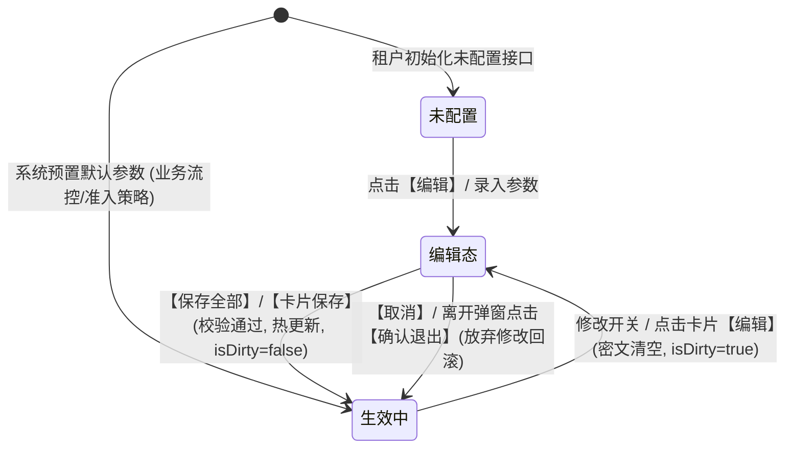
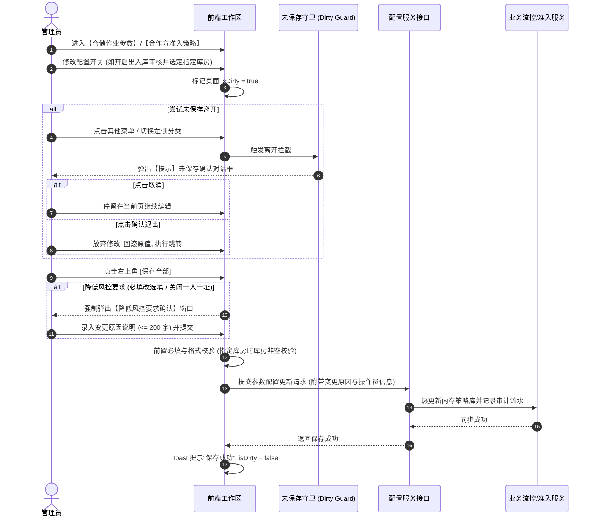
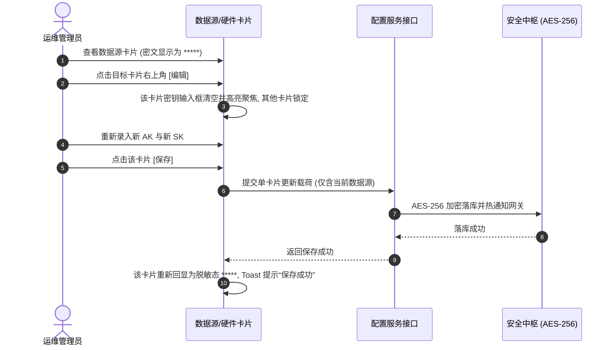
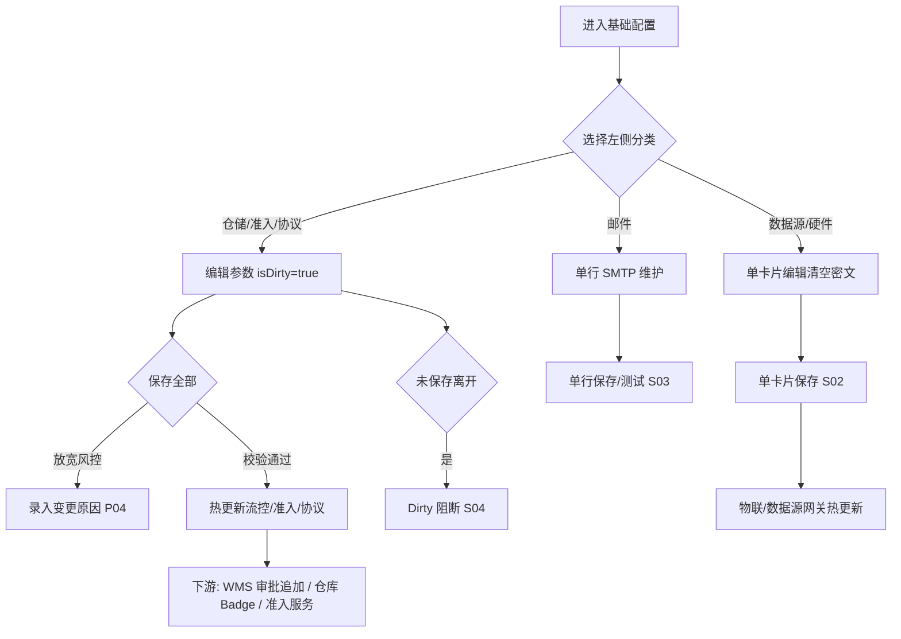

# 基础配置 业务规则规格

> **文档定位**：**三件套核心**——参数状态机、动作约束、校验规则、跨模块联动、权限与业务契约的**唯一定义来源**。配套：[主PRD](./基础配置主PRD.md)（业务与**页面功能说明**）、[字段清单](./基础配置字段清单.md)（字段）。ASCII/Demo 为衍生，只引用本文件规则 ID，不重复定义规则本体。  
> **范式类型**：范式 C · 参数配置类（保存即热生效；敏感凭据脱敏与清空重录；Dirty 离开守卫）  
> **统一引用规范**：
> - 本台账：【基础配置】（菜单：配置管理 → 平台管理 → 基础配置）
> - **本文件规则编号**：**R01~R02**、**P01~P09**、**S01~S05**、**C01~C02**（定义见第 6~8 节）；对外 PRD、字段清单、原型打点仅用上述简略 ID，禁止 PAR-R、CFG-PAR 等别名
> - 跨模块：其他菜单引用仓储作业规则时写 **R02** 即可
> - 下游空间：【仓库管理】F13 只读透出 R02；入库 R06 与 Badge 同源
> - 合作方准入：**仅使用 P01~P09**（本文件 6.2 节）；`01-合作方准入规则` 目录为历史推演归档，不再使用 PAR-R 编号
>
> **版本**：V2.7（统一准入 P08 改造为跨模块业务契约 · 剥离研发代码细节） | **更新时间**：2026-10-10 | **责任人**：森云科技（Senyun Technology）

---

## 一、单据与能力定位

| 项目 | 内容规格 |
| :--- | :--- |
| **单据层级** | **【系统底座层 · 平台全局参数与风控中枢】**（全系统运行底座与策略总控中心） |
| **核心职责** | 集中统管仓储作业审批门禁与需要审核的库房名单、合作方个人货主证件地址准入规则（一人一址防重复直接拦截）、系统业务协议附件、9 大数据源调用凭据、9 大物联网硬件网关协议及发信邮箱（SMTP）通知集群。 |
| **单据来源** | 平台管理员或机构系统管理员在线集中配置维护；初始参数由租户初始化时自动预置默认值。 |
| **上游依赖** | **机构与权限中枢**：当前登录操作员具备的基础配置编辑与查看权限（RBAC）； **仓库物理空间台账**：有效库房节点树数据，供出入库审核指定库房勾选。 |
| **下游影响** | **仓储模块**：控制普通货物出入库审核追加及移库审批触发； **合作方与准入服务**：向统一准入校验服务提供生效的必填与一人一址策略，执行前置直接拦截； **风控与物联中台**：热更新数据源 AK/SK 与硬件网关通讯凭据； **预警通知中心**：调度有效发信邮箱投递预警升级告警邮件。 |
| **数据隔离机制** | 参数按**租户**物理隔离；各租户独立维护自己的流控开关、准入策略与三方密钥；互不干扰。 |

---

## 二、状态模型与流转定义

基础配置各项参数在系统中经历三态生命周期流转：
1. **未配置**：初次开通或被主动清空，系统处于缺省免验或接口不可用状态；
2. **生效中 (查看态)**：配置已持久化并在中台服务热生效，敏感凭据全量以 `*****` 脱敏隐藏只读展示；
3. **编辑态 (修改中)**：管理员主动修改表单，敏感字段清空重新录入，表单处于内存暂存状态并触发 Dirty 守卫。

### 2.1 配置项状态定义表

| 状态名称 | 适用范围 | 业务含义 | 页面可见特征 | 离开条件 |
| :--- | :--- | :--- | :--- | :--- |
| **未配置** | 数据源/硬件/邮件 | 当前项尚未录入有效鉴权凭据 | 输入框为空或显示占位符提示“请输入...” | 录入并保存成功 → 生效中 |
| **生效中 (查看态)** | 全分类所有项 | 配置已持久化，系统正在调用执行 | 密钥脱敏显示为 `*****`，开关与下拉正常回显 | 点击【编辑】或修改控件 → 编辑态 |
| **编辑态 (修改中)** | 全分类所有项 | 用户主动修改，处于内存草稿状态 | 密钥输入框清空，表单激活高亮，产生 Dirty 标记 | 点击【保存】校验通过 → 生效中；点击【取消】/放弃 → 生效中 |

#### 状态二问 · 生效中 (查看态)
- **阶段**：参数已生效，下游业务实时读取当前版本；
- **允许**：查看明文配置项、切换左侧分类、点击卡片【编辑】、发送连通性测试邮件；
- **禁止**：直接改动已脱敏只读的密钥框（必须先点编辑进入编辑态）。

#### 状态二问 · 编辑态 (修改中)
- **阶段**：用户正在录入或修改参数，数据尚未落库；
- **允许**：录入新数据、上传替换协议文件、选择审核库房、保存全部或单卡片保存；
- **禁止**：未保存直接静默离开（守卫强阻断拦截）。

---

## 三、状态流转图

---

## 四、生命周期时序图

### 4.1 业务参数与准入策略保存时序图

### 4.2 敏感数据源与硬件卡片独立保存时序图

---

## 五、状态与动作能力矩阵

| 交互动作 | 仓储作业参数 | 合作方准入策略 | 协议配置 | 数据源参数 | 物联网硬件参数 | 邮件通知配置 |
| :--- | :---: | :---: | :---: | :---: | :---: | :---: |
| **右上角保存全部** | ✅ 统一提交 | ✅ 统一提交 | ✅ 统一提交 | ❌ 禁用 | ❌ 禁用 | ❌ 禁用 |
| **卡片独立编辑** | ❌ | ❌ | ❌ | ✅ 清空密文 | ✅ 清空密文 | ❌ |
| **卡片独立保存** | ❌ | ❌ | ❌ | ✅ 校验并热更 | ✅ 校验并热更 | ❌ |
| **单行测试与保存** | ❌ | ❌ | ❌ | ❌ | ❌ | ✅ 独立测试保存 |
| **历史重复地址排查** | ❌ | ✅ 冲突弹窗 | ❌ | ❌ | ❌ | ❌ |
| **Dirty 守卫拦截** | ✅ | ✅ | ✅ | ✅ | ✅ | ✅ |

---

## 六、核心业务规则规格

### 6.1 仓储作业参数规则 (R 系列)

#### 【移库审核全局拦截规则】(R01)
- **配置项**：`移库是否需要审核`（枚举：`是`、`否`，默认 `是`）；
- **界面提示**：“开启后，移库任务必须走审批流，审批通过后方可下发执行移库。”；
- **联动逻辑**：
  - 当配置为“是”时：下游监管员在发起移库任务时，系统强制生成移库审批单进入工作中心，审批通过前仓储货位与质押状态严格冻结；
  - 当配置为“否”时：监管员提交移库申请后，系统直接放行更新货位，无需人工审批，同步写入免审直通审计日志。

#### 【出入库审核与受控库房范围联动规则】(R02)
- **配置项**：
  - `出入库是否需要审核`（枚举：`是`、`否`，默认 `是`）；
  - `审核库房范围`（枚举：`全部库房`、`指定库房`，默认 `全部库房`）；
  - `需要审核的库房`（有效库房节点列表）；
- **界面提示**：“仅上方清单内的库房在普通货物出入库需要审批；未选库房免审直通。”；
- **联动控制与校验逻辑**：
  1. **总开关为“否”**：全系统所有仓库、库房的出入库作业均免审直通，范围与审核库房折叠隐藏；
  2. **总开关为“是”且范围为“全部库房”**：全系统当前存量库房以及**未来所有新建库房**均自动强制纳入出入库审核；
  3. **总开关为“是”且范围为“指定库房”**：
     - 必须至少选择 1 个有效库房（若清单为空，点击保存强阻断拦截：*“请至少选择一个需要审核的库房”*）；
     - 未来新建库房默认**不纳入**审核，除非管理员在此处手动追加至清单；
  4. **下游业务拦截**：
     - 在普通货物出入库单办理、货权转让流程中，系统校验货品所在库房是否命中“需要审核的库房”：
       - **命中受控**：强制追加出入库审批岗审批节点，未经审批禁止下发电子出库凭证；
       - **未命中受控**：免审直通；
  5. **仓库管理端只读联动**：在【仓库管理 / 仓库管理】的库房详情及列表中，库房的【出入库审核】状态调整为**只读标签**（显示：“受控”或“免审”），不再支持单库房分散修改，统一以基础配置为唯一真源（SSOT）。

---

### 6.2 合作方准入策略规则 (P 系列)

#### 【合作方档案证件地址必填校验规则】(P01)
- **配置项**：`证件地址是否必填`（枚举：`是`、`否`，默认 `是`）；
- **界面提示**：“开启后，在【合作方档案】新增、编辑、补全资料、追加角色、改址保存时，**个人与企业**均须填写证件登记地址；**不影响**入库、出库、仓单、转让等仓储与货权作业单据对货主的引用与提交。”；
- **作用域**：**仅**在「用户中心 → 合作方管理 → 合作方档案」（PC/H5 档案菜单内）执行保存/补全/改址时生效；**不含**仓储作业页嵌入的「入库/出库快捷建档」Sheet、**不含**入库/出库/预约/仓单/转让/融资等单据的制单提交、审批通过与货主引用复检。
- **联动逻辑**：当配置为“是”时，在上述档案管理保存节点，系统强制校验主体 **证件登记地址** 非空且长度不少于 5 个字符；个人填身份证登记地址，企业填营业执照登记地址；若为空则同步直接拦截，**不进审批中心**。
- **与仓储作业边界**：货主主档证件地址为空或历史缺址时，仓储、仓单、转让等模块**仍允许**按各模块既有规则（角色状态、冻结、联系手机核验 **PA-R04b** 等）引用并办理业务；作业侧**不得**因 P01 单独追加「请先补全证件地址」类阻断。
- **必填由否改是（存量治理）**：管理员将「证件地址是否必填」由「否」改为「是」并保存成功后，系统可提示仍存在证件地址缺失的合作方主体清单，引导在**档案台账**内补录；**不**限制仓储作业发单，不回写历史单据快照。

#### 【证件登记地址防重复唯一校验与同步阻断规则】(P02)
- **配置项**：`证件地址防重复(一人一址)`（枚举：`开启`、`关闭`，默认 `开启`）；
- **界面提示**：“开启后，租户内**个人货主**与**企业货主**均实行「一址一主体」（按主体类型分池比对）：同一证件登记地址在同一类型下仅允许绑定一个货主。冲突时在合作方档案保存或作业快捷建档绑货主时直接拦截。”；
- **联动逻辑**：
  - 开启状态下，租户内 **个人货主** 之间、**企业货主** 之间分别**严禁**重复相同证件登记地址（个人与企业**分池**比对，互不混比）；
  - **同步直接拦截**：调用统一准入服务排查；个人冲突提示 *“已有相同证件地址，不能绑定为该个人货主”*；企业冲突提示 *“已有相同证件地址，不能绑定为该货主企业”*；**绝不进审批中心**；
  - **关闭状态**：允许同类型多主体登记相同地址，后台仍记录相似度预警日志。

#### 【存量数据检测排查规则】(P03)
- 当防重复开关处于“开启”状态时，管理员可随时点击【🔍 排查历史重复地址】；
- 系统异步拉取当前租户全量有效 **个人货主与企业货主**，按主体类型分池执行证件地址去重扫描；若发现冲突，弹窗展示冲突地址、主体名称/证件号及关联单据数，指导管理员完成主数据治理。
- **保存门禁**：保存时若「证件地址防重复」为开启（含由关改开），须通过与本节同源的存量检测；**未通过则保存失败**，配置不落库。

#### 【策略放宽强控变更原因审计规则】(P04)
- **界面提示**：“降低风控要求（由必填改为选填、或关闭一人一址）时，保存须填写变更原因。”；
- 若管理员执行以下任一放宽操作：
  1. 将【证件地址是否必填】由“是”调为“否”；
  2. 将【证件地址防重复(一人一址)】由“开启”调为“关闭”；
- 点击【保存全部】时，系统必须弹出二次确认窗，**强制录入变更原因（必填，最多 200 字）**，并记录入系统不可变审计流水；若未输入原因则禁止提交。

#### 【企业货主准入边界隔离规则】(P05)
- **说明文案**：“企业货主以营业执照统一社会信用代码实名；个人货主以公民身份证号实名。**P02 地址防重复**在个人池与企业池**分别**生效，两池互不混比。”；
- **【证件地址必填 (P01)】**：配置为“是”时，**个人与企业**均在 **合作方档案** 保存时校验证件登记地址非空（见 P01）。
- **【地址防重复 (P02)】**：对「个人 + 货主」「企业 + 货主」分别校验证件登记地址在**同类型活跃池**内唯一；非货主角色不校地址唯一。

#### 【策略内部版本递增与存量不回写】(P06)
- 合作方准入策略每次【保存全部】成功，内部版本号原子 +1（界面不展示 V1/V2）；与平台不可变快照原则一致。
- **严禁回写**已完成单据与固化快照；在途单据按提交时固化的 `matched_rule_id` 与内部版本复检。

#### 【租户唯一策略加载】(P07)
- 每租户 **仅 1 条** 有效准入策略；运行时加载当前租户双开关，不做多规则竞争（P0 无列表/启停第二条）。
- 调用方仍上送 `scene` 供审计；二期若支持多规则再扩展匹配语义。

#### 【统一准入服务强制调用】(P08)
- 字段清单「八、」**8.3** 所列业务入口在涉及 **证件地址防重复 (P02)** 或 **档案域证件地址必填 (P01)** 时 **必须** 调用统一准入服务（见 **「九、」 业务契约**）；禁止各模块私有地址校验逻辑。
- **P01 与 P08**：仅 **合作方档案** 保存类场景（见 8.3）调用并执行 P01；仓储/仓单/转让等作业引用货主 **不** 因 P01 调用准入。
- 校验顺序：**准入（P08）通过** → 方可触发短信二元核验或写审批；**P02** 地址冲突 / **P01** 档案域缺必填 **同步阻断**，**不进审批中心**（与 P02 一致）。

#### 【保存并发锁与全量审计】(P09)
- 策略保存带乐观锁版本戳；并发冲突提示「配置已被他人修改，请刷新后重试」。
- 双开关变更、放宽原因（P04）、操作人/IP/前后镜像写入不可变审计；禁止 DELETE 策略主记录，仅允许更新双开关。

#### 【统一准入运行时校验时序】（P08 × P01/P02）

**合作方档案保存**及 **8.3 所列 P02 场景**须：**先调用统一准入服务（P08）** → 通过后方可触发短信二元核验或落库；准入失败 **不得** 发短信、**不得** 进审批中心。  
**仓储/仓单/转让等作业单据**提交与货主引用：**不**因 P01 调用准入；若模块规格另有 **PA-R04b** 联系手机核验、**PA-R01** 角色/冻结拦截，按各模块规则执行，与 P01 无关。

---

### 6.3 协议与安全密钥规则 (S 系列)

#### 【协议展示触点与多组文件规则】(S01)
- 协议展示位置限定在 `登录页面`、`仓单开立页面` 枚举白名单中；
- 协议名称必填且 最多 50 字符，协议文件仅支持 JPG/PNG/PDF 格式，单文件 不超过 20MB；
- 至少保留 1 组有效协议；最多支持配置 20 组；保存时系统全量校验文件对象有效性。

#### 【敏感密钥脱敏展示与全量重录防泄漏规则】(S02)
- **安全提示**：“为保障接口安全，已保存的密钥统一脱敏隐藏。点击【编辑】时需重新输入新密钥后再点击【保存】。”；
- 外部数据源（9 大类）与硬件网关密钥（AK/SK/Token）在数据库中采用 AES-256 加密落库；
- 查看态统一强制返回 `*****` 掩码脱敏隐藏；
- 点击卡片【编辑】时，密钥类字段必须清空，强制要求管理员输入最新密钥后提交保存；保存成功后立即重新掩码展示。

#### 【SMTP 邮件通道连通性测试规则】(S03)
- 支持配置 1~N 个发信邮箱（SMTP）；
- 点击【发送测试邮件】时，系统使用该行配置的 SMTP 服务器、端口、发件人账号及授权码，现场向输入的测试收件邮箱发起网络连接并发送测试邮件；超时（10 秒）或鉴权失败反馈详细排查指引。

#### 【未保存离开强阻断与脏检查守卫】(S04)
- 在任何分类处于编辑模式且存在未保存修改（`isDirty=true`）时，用户切换左侧分类、点击外部系统菜单或关闭页面，系统强制弹出阻断确认框：
  > *“您有配置内容未保存，若直接退出编辑内容将丢失，请确认是否退出？”*
- 必须明确点击【确认退出】后方可执行路由跳转或重置数据。

#### 【租户数据隔离与操作审计留痕】(S05)
- 所有基础配置严格以当前登录用户的租户标识（`tenant_id`）为物理隔离键；
- 任何参数的新增、修改、清空与删除操作，系统在提交事务内记录审计流水（包含操作人、操作时间、客户端 IP、变更前后配置快照）。

---

## 七、通用交互与防护规则

1. **防重复提交**：保存按钮点击后即时置灰并展示 Loading 动效，等待服务端响应返回后恢复，防止并发重复提交；
2. **乐观锁并发控制**：配置记录带有版本号戳，若多管理员并发保存，后提交者被拦截并提示：“配置已被他人修改，请刷新后重试”；
3. **脱敏字段不可篡改**：前端回显的 `*****` 字符串禁止直接提交落库，若检测到 payload 含有纯星号视为未修改。

---

## 八、权限与隔离规则

### 8.1 租户与项目数据隔离规则 (C01)
- 基础配置严格按租户物理隔离；租户间参数互不干扰，准入策略与白名单各自独立生效。

### 8.2 基础配置操作权限矩阵 (C02)

| 功能操作项 | 平台管理员 (Platform-Admin) | 机构系统管理员 (Org-Admin) | 风控合规主管 (Risk-Mgr) | 仓储业务员 (Wh-Operator) |
| :--- | :---: | :---: | :---: | :---: |
| **查看基础配置全貌** | ✅ | ✅ | ✅ | ❌ |
| **修改仓储作业参数** | ✅ | ✅ | ❌ | ❌ |
| **修改合作方准入策略** | ✅ | ✅ | ✅ | ❌ |
| **降低风控要求 (录入原因)**| ✅ | ✅ | ✅ | ❌ |
| **编辑业务协议文件** | ✅ | ✅ | ❌ | ❌ |
| **编辑数据源与硬件密钥** | ✅ | ✅ | ❌ | ❌ |
| **管理发信邮箱** | ✅ | ✅ | ❌ | ❌ |
| **发送测试邮件** | ✅ | ✅ | ❌ | ❌ |

---

## 九、统一准入校验业务契约与跨模块规格（P08）

> 与 **P07** 租户唯一策略、**P01~P05** 双开关配置联动。**P01** 仅档案域；**P02** 按 8.3 场景；仓储作业引用货主不因 **P01** 前置调用。具体实现形式由研发架构设计，业务侧遵循以下契约。

### 9.1 业务输入要素（调用方须提供）

| 业务要素名称 | 是否必填 | 业务含义与规则要求 |
| :--- | :---: | :--- |
| **租户标识** | 是 | 区分租户，多租户物理隔离（系统上下文自动注入）。 |
| **适用业务场景** | 是 | 标识发起场景，见 [基础配置字段清单 「八、」 8.3](./基础配置字段清单.md#83-统一准入服务调用场景p02-与档案域-p01)。 |
| **主体角色** | 是 | P02 场景固定为【货主】；档案域 P01 保存时按表单实际角色，不强制货主。 |
| **主体类型** | 是 | 【个人】或【企业】；P01、P02 均按类型分池（个人货主对个人池，企业货主对企业池）。 |
| **排除主体标识** | 条件必填 | **档案改址场景必填**：传入当前合作方编号，查重时排除自身，防止本人因地址未变更被误判为冲突。 |
| **证件号码** | 条件必填 | 身份标识，个人填身份证号，企业传统一社会信用代码。 |
| **证件地址原文** | 条件必填 | **档案域**且 P01=是时必填；**P02** 开启且货主需比对唯一时必填；用于去重比对。 |
| **核验依据版本号** | 选填 | 历史在途单据审批复核时传入制单时的版本号，执行不可变快照复检（P06）。 |

### 9.2 业务校验结果与系统动作

系统执行统一规则校验后，向下游业务入口返回明确的处理结果：
1. **校验通过**：放行，下游单据允许继续保存、提交制单或发起实名二元短信核验，并记录当前命中的规则 ID 与内部版本号。
2. **校验阻断**：直接阻断当前业务操作，向操作员返回规范提示文案，并记录审计日志。

### 9.3 业务拦截类型与交互阻断规则

| 拦截类型 | 前端展示文案 | 业务强控与联动规则 |
| :--- | :--- | :--- |
| **地址唯一性冲突（个人）** | **已有相同证件地址，不能绑定为该个人货主** | **同步直接阻断**；不进审批中心；**严禁发短信** |
| **地址唯一性冲突（企业）** | **已有相同证件地址，不能绑定为该货主企业** | 同上 |
| **证件地址必填缺失** | **请补全证件登记地址** | **仅合作方档案**保存时同步阻断；地址输入框高亮；作业单据引用货主 **不** 展示本拦截。 |
| **主体已存在** | **该主体已存在，请前往详情追加角色配置** | 阻断重复建档，引导操作员前往已有主体详情页追加货主角色。 |

---

## 十、业务流程与联动

> 与第 2~4 节状态机、时序图配合阅读；规则 ID 以上文 **R / P / S** 为准。

---

## 十一、修订记录

| 日期 | 版本 | 变更内容说明 | 影响范围 | 修订人 |
| :--- | :--- | :--- | :--- | :--- |
| 2026-10-09 | V1.0 | **初始化基础配置业务规则规格**：确立移库审核、数据源掩码脱敏与邮件测试规则。 | 全模块 | AI PM / 森云科技 |
| 2026-10-09 | V2.0 | **规格大重构（对齐标杆模板结构与 6 大分类规格体系）**：交互升级为垂直导航，整合准入策略与出入库审核。 | 全文各章节 | AI PM / 森云科技 |
| 2026-10-09 | **V2.1** | **文案易读性与业务聚焦优化**：移除单据默认数量规则；出入库与移库审核文案大白话化；合作方准入改为“防重复(一人一址)”与“排查历史重复地址”；大类命名统一精简。 | 全文各章节 | AI PM / 森云科技 |
| 2026-10-10 | **V2.2** | **准入规则并入归档**：新增 P↔PAR-R 对照、统一准入 API 「九、」；原 `01-合作方准入规则` 降为归档附录。 | 6.2 节、「九、」 | AI PM / 森云科技 |
| 2026-10-10 | **V2.3** | 对齐 6.2 IoT 标杆三件套文头（三件套核心定位、统一引用规范）。 | 文头 | AI PM / 森云科技 |
| 2026-10-10 | **V2.5** | 合作方准入 **仅保留 P01~P09**；删除 P 与 PAR-R 对照表；原 PAR-R01/02/06/08/09 并入 P06~P09。 | 6.2 节、「九、」 | AI PM / 森云科技 |
| 2026-10-10 | **V2.6** | 全量走查精炼：单据层级大白话优化；统一 P02 阻断文案与字段清单一致；清除未定义 C08 与孤立 R03 引用；章节顺序规范（修订记录置于文末）。 | 文头、第 1 节、6.2 节、第 9 节、第 10~11 节 | AI PM / 森云科技 |
| 2026-10-10 | **V2.7** | **统一准入 P08 去技术化改造**：将「九、统一准入校验 API 契约」重构为「业务契约与跨模块规格」；剥离代码级 URL/英文变量/错误码，强化业务输入要素与交互阻断强控。 | 文头、6.2 节、「九、」 | AI PM / 森云科技 |
| 2026-10-19 | **V2.8** | **P01 作用域定稿**：证件地址必填 **仅合作方档案**（个人+企业）；仓储/仓单/转让等作业不因 P01 拦截；字段清单 8.2~8.4 场景拆分。 | 6.2 P01/P05/P08、「九、」 | 产品团队 |
