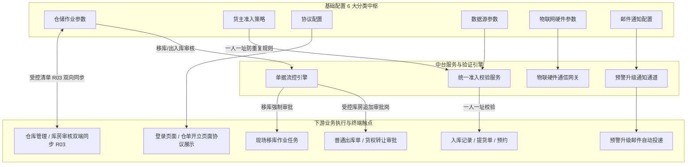

# 基础配置 主PRD

> **文档体系（三件套为核心）**：
>
> | 层级 | 文档 | 职责 | 真源 |
> | :--- | :--- | :--- | :---: |
> | **核心** | 本文（主 PRD） | 业务背景、痛点、功能范围、模块架构、**页面功能说明**、业务场景、状态机摘要、规则摘要、验收 | ✅ |
> | **核心** | [基础配置字段清单](./基础配置字段清单.md) | 字段定义、六类配置区与弹窗字段、展示顺序、必填性与控件规格 | ✅ |
> | **核心** | [基础配置业务规则规格](./基础配置业务规则规格.md) | 参数状态机、R/P/S 规则、动作矩阵、时序图、权限矩阵 | ✅ |
> | *衍生* | [基础配置_ASCII_配置页.md](./基础配置_ASCII_配置页.md) / Demo | 由三件套派生的可视化与原型输入，**非独立真源** | ❌ |
>
> **版本**：V3.1（货主准入策略 · P01/P02 仅 04-1 货主信息） | **更新时间**：2026-10-20 | **责任人**：森云科技（Senyun Technology）  
> **合作方交叉引用**：[04 合作方主数据索引](../04-合作方档案/README.md)（**用户中心 → 合作方档案 → 四子菜单**；本模块 **不** 维护合作方主档字段）  
> **读者**：研发工程师、测试工程师、产品复核  
> **字段基准**：[`基础配置字段清单.md`](./基础配置字段清单.md) 是本模块字段字典、控件与脱敏展示的唯一基准；状态流转与业务门禁见业务规则规格，不重复定义规则本体。  
> **权限基准**：[功能与数据权限清单](../../../🌟🌟🌟-最新基准版/00-功能与数据权限/功能与数据权限清单.csv)  
> **页面范围**：基础配置垂直分类设置页（6 大分类）、审核库房级联弹窗、历史重复地址排查、降低风控确认、SMTP 测试邮件弹窗。

---

## 1. 业务背景与业务痛点

### 1.1 业务背景
SYZC 供应链金融存货监管系统连接资金方（商业银行/保理公司）、监管方、核心企业及仓储现场硬件设施。系统日常运转依赖统一的业务审核门禁、货主准入规则、电子签章凭证、外部数据接口密钥以及物联网硬件通信通道。

此前系统中，移库审核在基础配置，出入库审核分散在具体库房主档，合作方准入规则单独占一个二级菜单，导致配置路径深、排查难度大、菜单结构零碎。本期将平台级全局策略与运行参数统一收敛至【基础配置】；**废止**独立「合作方准入规则」菜单，**货主证件地址准入（P01~P09）** 并入左侧第 2 类 **货主准入策略**，且 **仅作用于「用户中心 → 合作方档案 → 货主信息」**；提货人/资金方/服务方主档在对应子菜单维护（见 04 方案 B）。交互采用标准 ERP 级「左侧垂直分类导航 + 右侧独立卡片工作区」。

### 1.2 核心业务痛点
1. **配置分散与菜单层级过深**：此前合作方准入规则仅 2 个开关却占据独立二级菜单，各库房分散配置出入库审核，导致管理员难以掌握全系统受控全貌；
2. **全局风控统一与库房差异化流控冲突**：不同监管仓库及库房的监管风险等级不同（如高价值保税库 vs 常规露天堆场）。系统需要提供全局总控开关，并支持灵活圈定需要审核出入库的库房名单，兼顾全局权威性与库房差异化；
3. **个人货主虚假地址与冒用主体风险**：存货监管业务必须防范虚假货主与冒用主体风险。系统在基础配置中统合货主准入策略，支持配置个人货主证件地址必填、一人一址防重复绑定，冲突时直接拦截，不进入审批中心；并提供历史重复地址一键排查能力；
4. **核心接口密钥防泄露与独立热更新诉求**：三方数据源与硬件密钥属于核心资产，全量明文展示极易泄漏。系统推行脱敏隐藏（`*****`）与卡片独立编辑保存机制，防止因单个接口变动误覆盖全量密钥。

---

## 2. 功能范围

| 包含功能范围 | 不包含功能范围 |
| :--- | :--- |
| - **左侧垂直类型导航与多分类治理**：支持 6 大分类（仓储作业参数、货主准入策略、协议配置、数据源参数、物联网硬件参数、邮件通知配置）单选切换，右侧独立卡片工作区； - **仓储作业审批与审核库房联动**：支持【移库是否需要审核】全局开关；支持【出入库是否需要审核】开关联动展开全部库房/指定库房范围；提供级联穿梭弹窗维护需要审核出入库的库房名单； - **货主准入策略集中管控（仅货主域）**：个人/企业货主证件地址必填与一人一址双开关、存量排查与放宽审计；**不含**提货人/资金方/服务方配置； - **业务协议动态配置**：支持配置 1~20 组业务协议（登录页面 / 仓单开立页面），支持协议名称录入及 PDF/图片附件上传、在线预览与删除； - **9 大数据源凭证独立纳管**：企业四要素、营业执照 OCR、房产登记、个人二元、验证码短信、通知短信、地图、实人一体、电子签章；全字段脱敏隐藏与卡片独立保存； - **9 大物联网硬件通信网关配置**：赛达监控(掌宇)、赛达温湿度、赛达人脸门禁、赛达监控报警、赛达GPS、芯途温湿度、芯途锁、芯途监控、享宇智能挂锁；卡片独立编辑保存； - **多节点发信邮箱集群调度**：支持多行发信邮箱（SMTP）节点维护、行级编辑/保存/删除，支持即时唤起弹窗发送测试邮件验证连接正常； - **通用未保存 Dirty 守卫**：编辑中切换分类或离开菜单时强制弹出防误离开拦截确认窗。 | - **平台级底层硬件通信驱动编译**：本模块仅维护物联网网关通信密钥与接入参数，不提供硬件底层通信驱动程序的在线编译； - **法律协议在线富文本在线排版**：协议文件采用标准图片/PDF 格式上传托管，本期不提供内嵌 HTML 富文本在线排版编辑器； - **合作方主档字段维护**：货主/提货人/资金方/服务方在「用户中心 → 合作方档案」各子菜单维护；本模块 **仅** 配置 **货主域** 证件地址准入； - **具体库房物理空间参数配置**：仓库库房面积、货位及平面图在「仓库管理 / 仓库管理」中维护，本模块仅管理受控审核关系； - **参数历史版本一键回滚树**：本期参数保存即热生效并记录不可变操作审计日志，不提供历史参数一键回滚树。 |

---

## 3. 模块定位与系统链路

### 3.1 实体属性与规范

| 属性项目 | 规范要求 |
| :--- | :--- |
| **数据层级** | **【系统底座层 · 平台全局参数与风控中枢】**（全系统参数总控中枢） |
| **参数作用域** | 租户级全局生效；数据源与硬件参数热同步至风控底座与物联中台 |
| **保存模式分层** | **业务/准入/协议**：顶栏【保存全部】+【退出】；**数据源/硬件/邮件**：顶栏仅【刷新】，单卡片或单行独立保存 |
| **敏感字段脱敏** | 数据源密钥、硬件 AK/SK、邮箱密码统一展示为 `*****`；编辑时清空重新输入 |
| **未保存离开拦截** | 存在未保存修改时，切换分类或跳出路由触发全局 Dirty Guard 阻断弹窗 |

### 3.2 配置引用与系统链路拓扑图

### 3.3 跨模块数据互通与业务联动约定

| 协同模块 | 交互阶段与触发时机 | 具体数据联动行为与业务效力 |
| :--- | :--- | :--- |
| **【03-仓库管理】** | 基础配置保存 / 编辑库房弹窗 / 库房详情查看 | 1. **双端维护**：基础配置穿梭框与仓库管理 **【添加/编辑库房】** 单选写入 **同一份** 受控数据（【库房出入库审核双端同步与以最后修改为准规则】(R03)）； 2. **展示一致**：列表 **出入库审核标记：是/否** 与基础配置 Tag 自动对齐；冲突时 **以最后修改为准**。 |
| **【02-出库记录/货权转让】** | 出库制单 / 转让申请 | 1. **受控拦截**：校验货物所在库房是否命中需要审核的库房清单； 2. **节点追加**：命中受控强制追加出入库审批岗，未命中免审放行。 |
| **【07-移库记录】** | 现场发起移库任务 | 读取基础配置【移库是否需要审核】：为“是”强制生成移库审批流；为“否”直接更新货位并记审计。 |
| **【04-1 货主信息】** | 货主新增 / 编辑 / 补全 / 改址 | 读取【货主准入策略】：**P01** 为“是”时在 **货主信息** 保存时强校验个人/企业货主证件登记地址非空；**P02** 开启时分池校一址一主体。作业引用货主 **不受 P01 影响**。 |
| **【预警升级与通知中心】** | 触发重大预警升级 | 调度邮件通知配置中状态正常的 SMTP 邮箱，自动渲染邮件模板并外发至指定人员邮箱。 |

---

## 4. 业务场景与用户故事

| 场景编号与名称 | 触发角色 | 核心交互与风控约束 | 业务价值 |
| :--- | :--- | :--- | :--- |
| **场景 1【为指定保税库房开启出入库审核】(S01)** | 系统管理员 | 在【仓储作业参数】中开启出入库审核，范围选择“指定库房”，点击【➕ 选择库房】勾选深圳前海 1 号保税库房，点击右上角【保存全部】热生效。 | 实现重点高风险库房严格审批把关，同时保障普通堆场作业免审高效流转。 |
| **场景 8【仓库管理单库房开关与基础配置互相同步】(S08)** | **仓库监管员**（路径 A）/ **机构管理员**（路径 B） | A：仓库详情【关闭出入库审核】（二次确认，本期无 P04 原因）；B：基础配置 Tag 移除（C02）。 | R03 LWW；权限分轨；「全部库房」下单库关闭可降为「指定库房」。 |
| **场景 2【开启个人货主一人一址并排查重复】(S02)** | 平台管理员 | 在【货主准入策略】中打开“证件地址防重复(一人一址)”开关，点击【🔍 排查历史重复地址】排查无冲突后保存；后续个人货主建档同址冲突直接拦截。 | 根除虚假货主冒用地址风险，保障一人一址与司法存证效力。 |
| **场景 3【降低风控要求强控审计】(S03)** | 风控管理员 | 将准入防重复由“开启”切换为“关闭”，点击保存时系统强制弹出原因录入窗，录入 最多 200 字审批理由并写入不可变操作日志。 | 设立风控策略降级防线，确保放宽决策全流程审计留痕。 |
| **场景 4【上架仓单质押居间法律协议】(S04)** | 机构管理员 | 在【协议配置】中点击【➕ 添加协议】，选择“仓单开立页面”，录入协议名称并上传《仓单质押协议.pdf》，保存后终端用户开立仓单时展示。 | 规范终端用户法律确权流程，保障电子凭证合规签署。 |
| **场景 5【更新地图密钥脱敏重录】(S05)** | 运维工程师 | 切换至【数据源参数】，地图卡片密钥显示 `*****`；点击卡片【编辑】，输入框清空后全量录入新 AK 并点击【保存】，仅该卡片热更新，其他数据源不受影响。 | 保护核心商业密钥资产，防范全量误覆盖风险。 |
| **场景 6【新增发信邮箱与连通性验证】(S06)** | 运维工程师 | 在【邮件通知配置】中新增一行发信邮箱，录入地址、端口与授权码保存；点击【发送测试邮件】输入个人邮箱测试连接正常。 | 确保预警升级邮件通知通道高可用，防止告警漏发。 |
| **场景 7【编辑未保存离开阻断拦截】(S07)** | 机构管理员 | 在仓储作业参数修改审核库房但未保存，尝试切换左侧分类或点击外部菜单，系统弹出【未保存确认】对话框阻断跳转。 | 避免用户误触离开导致大量复杂参数修改丢失。 |

---

## 5. 状态机与动作能力矩阵

### 5.1 配置项状态定义表

| 状态名称 | 适用分类 | 业务含义 | 页面可见特征 | 允许操作 |
| :--- | :--- | :--- | :--- | :--- |
| **生效中 (查看态)** | 全分类所有项 | 配置已持久化，系统正在调用执行 | 密钥脱敏显示为 `*****`，开关与下拉正常回显 | 【编辑】、【删除】、【发送测试】 |
| **编辑态 (修改中)** | 全分类所有项 | 用户主动修改，处于内存草稿状态 | 密钥输入框清空，表单激活高亮，产生 Dirty 标记 | 【取消】、【保存】、【测试】 |
| **未配置** | 数据源/硬件/邮件 | 系统中尚未录入凭证 | 输入框为空或显示占位提示 | 【编辑】、【保存】 |

### 5.2 动作能力矩阵

| 动作名称 | 仓储作业参数 | 货主准入策略 | 协议配置 | 数据源参数 | 物联网硬件参数 | 邮件通知配置 |
| :--- | :---: | :---: | :---: | :---: | :---: | :---: |
| **右上角保存全部** | ✅ | ✅ | ✅ | ❌（走单卡片） | ❌（走单卡片） | ❌（走单行） |
| **卡片独立编辑/保存** | ❌ | ❌ | ❌ | ✅ | ✅ | ❌ |
| **单行编辑/保存/删除** | ❌ | ❌ | ❌ | ❌ | ❌ | ✅ |
| **即时发送连通性测试** | ❌ | ❌ | ❌ | ❌ | ❌ | ✅ |
| **历史重复地址排查** | ❌ | ✅ | ❌ | ❌ | ❌ | ❌ |
| **未保存离开拦截** | ✅ | ✅ | ✅ | ✅ | ✅ | ✅ |
| **顶栏保存全部与退出** | ✅ | ✅ | ✅ | ❌ | ❌ | ❌ |
| **顶栏刷新** | ❌ | ❌ | ❌ | ✅ | ✅ | ✅ |

---

## 6. 页面功能说明

> 本节描述**做什么、怎么交互**；各分类字段与控件见《[基础配置字段清单](./基础配置字段清单.md)》；保存模式、Dirty 守卫与 R/P/S 规则见《[基础配置业务规则规格](./基础配置业务规则规格.md)》。线框对照 [基础配置_ASCII_配置页.md](./基础配置_ASCII_配置页.md)。

### 6.1 仓储作业参数板块
- **页面路径**：`配置管理 → 平台管理 → 基础配置`（左侧默认选中第 1 项）
- **线框基准**：[基础配置_ASCII_配置页 第2节](./基础配置_ASCII_配置页.md#2-分类-1仓储作业参数)
- **核心规格**：
  - 聚焦【作业审批与流控】核心板块；
  - 移库审核单选框（是/否），提示文案：“开启后，移库任务必须走审批流，审批通过后方可下发执行移库。”；
  - 出入库审核单选框（是/否）；
  - 出入库选“是”平滑展开审核库房范围（全部库房/指定库房）；选“指定库房”展示需要审核的库房 Tag 栏与【➕ 选择库房】按钮；
  - 提示文案：“仅上方清单内的库房在普通货物出入库需要审批；未选库房免审直通。”；
  - 点击按钮唤起【选择需要审核出入库的库房】级联弹窗，支持按仓库展开、全选及关键词检索。

### 6.2 货主准入策略板块
- **页面路径**：`配置管理 → 平台管理 → 基础配置`（左侧选中第 2 项）
- **线框基准**：[基础配置_ASCII_配置页 第3节](./基础配置_ASCII_配置页.md#3-分类-2货主准入策略)
- **作用域**：**仅** `用户中心 → 合作方档案 → 货主信息`（**不含**提货人/资金方/服务方子菜单）。
- **核心规格**：
  - 【证件地址是否必填】单选框（是/否），提示：“开启后，在 **货主信息** 新增/编辑/补全/改址保存时，个人与企业货主均须填写证件登记地址；不影响入库、出库、仓单等作业。”；
  - 【证件地址防重复(一人一址)】开关，提示：“开启后，个人货主与企业货主 **分池** 一址一主体；冲突时在货主信息保存或快捷建档绑货主时直接拦截。”；
  - 开关开启时展示【🔍 排查历史重复地址】按钮，点击呼出排查结果弹窗展示重复地址与主体列表；
  - 降低风控要求保存时强制弹出【降低风控要求确认】对话框，录入 最多 200 字变更原因；
  - 企业货主说明卡片（只读）：企业货主以统一社会信用代码实名；**P02** 在企业货主池内一址一主体，与个人货主分池比对。

### 6.3 协议配置板块
- **页面路径**：`配置管理 → 平台管理 → 基础配置`（左侧选中第 3 项）
- **线框基准**：[基础配置_ASCII_配置页 第4节](./基础配置_ASCII_配置页.md#4-分类-3协议配置)
- **核心规格**：
  - 动态卡片列表，支持配置 1~20 组业务协议；
  - 字段：展示位置（下拉：登录页面 / 仓单开立页面）、协议名称（最多 50 字符）、协议文件上传（JPG/PNG/PDF，不超过 20MB）；
  - 提供【🗑 删除此项】与底部【➕ 添加协议】。

### 6.4 数据源参数板块
- **页面路径**：`配置管理 → 平台管理 → 基础配置`（左侧选中第 4 项）
- **线框基准**：[基础配置_ASCII_配置页 第5节](./基础配置_ASCII_配置页.md#5-分类-4数据源参数)
- **核心规格**：
  - 工作区顶栏仅【刷新】（无【保存全部】【退出】）；Dirty 时刷新前走 **【未保存离开强阻断与脏检查守卫】(S04)** 确认；
  - 置顶安全提示：“为保障接口安全，已保存的密钥统一脱敏隐藏。点击【编辑】时需重新输入新密钥后再点击【保存】。”；
  - 纵向陈列 9 大数据源独立卡片；卡片右上角提供独立【编辑】与【保存】按钮。

### 6.5 物联网硬件参数板块
- **页面路径**：`配置管理 → 平台管理 → 基础配置`（左侧选中第 5 项）
- **线框基准**：[基础配置_ASCII_配置页 第6节](./基础配置_ASCII_配置页.md#6-分类-5物联网硬件参数)
- **核心规格**：
  - 工作区顶栏仅【刷新】；
  - 置顶设备安全提示；纵向陈列 9 大硬件网关卡片；
  - 包含流媒体协议、存储模式、报警服务商及 AK/SK；卡片级独立编辑保存。

### 6.6 邮件通知配置板块
- **页面路径**：`配置管理 → 平台管理 → 基础配置`（左侧选中第 6 项）
- **线框基准**：[基础配置_ASCII_配置页 第7节](./基础配置_ASCII_配置页.md#7-分类-6邮件通知配置)
- **核心规格**：
  - 工作区顶栏仅【刷新】；
  - 多行发信邮箱卡片列表；单行提供【✉ 发送测试邮件】、【✏ 编辑】、【💾 保存】、【🗑 删除】；
  - 底部提供【➕ 添加发信邮箱】；点击发送测试呼出收件邮箱输入弹窗。

---

## 7. 核心业务规则索引

| 规则编码与名称 | 规则核心逻辑摘要 | 规则规格唯一定义章节 |
| :--- | :--- | :--- |
| **【移库审核全局拦截规则】(R01)** | 为“是”强制移库单审批通过后方可执行货位变更；为“否”免审直发并记入审计 | [业务规则规格 6.1 节](./基础配置业务规则规格.md#移库审核全局拦截规则r01) |
| **【出入库审核与受控库房联动规则】(R02)** | 控制普通货物出入库追加审批；指定库房白名单精确流控；未选库房免审直通 | [业务规则规格 6.1 节](./基础配置业务规则规格.md#出入库审核与受控库房范围联动规则r02) |
| **【库房出入库审核双端同步与以最后修改为准规则】(R03)** | 共享受控清单、LWW；**C02 管理员批量** + **监管员编辑库房弹窗（F13）**；关闭受控暂不叠加 P04 | [业务规则规格 6.1 节](./基础配置业务规则规格.md#库房出入库审核双端同步与以最后修改为准规则r03) |
| **【货主证件地址必填校验规则】(P01)** | 仅在 **货主信息** 子菜单保存时强制校验证件登记地址（个人与企业货主）；仓储/仓单等作业不因缺址拦截 | [业务规则规格 6.2 节](./基础配置业务规则规格.md#货主证件地址必填校验规则p01) |
| **【一人一址防重复直接拦截规则】(P02)** | 租户内个人一人一址；地址冲突业务入口直接拦截，严禁进入审批中心 | [业务规则规格 6.2 节](./基础配置业务规则规格.md#个人货主一人一址唯一校验与同步阻断规则p02) |
| **【历史重复地址排查规则】(P03)** | 开启防重复时支持一键排查；保存开启唯一时须存量检测通过 | [业务规则规格 6.2 节](./基础配置业务规则规格.md#存量数据检测排查规则p03) |
| **【降低风控要求变更原因审计规则】(P04)** | 必填改选填或关闭一人一址时强制弹窗录入最多 200 字原因，写入不可变审计日志 | [业务规则规格 6.2 节](./基础配置业务规则规格.md#策略放宽强控变更原因审计规则p04) |
| **【企业货主准入边界隔离规则】(P05)** | 企业登记地址由执照认证维护，物理隔离于个人一人一址策略之外 | [业务规则规格 6.2 节](./基础配置业务规则规格.md#企业货主准入边界隔离规则p05) |
| **【策略版本与不回写】(P06)** | 保存升内部版本；不回写历史单据快照 | [业务规则规格 6.2 节](./基础配置业务规则规格.md#策略内部版本递增与存量不回写p06) |
| **【租户唯一策略】(P07)** | 每租户 1 条策略，运行时加载双开关 | [业务规则规格 6.2 节](./基础配置业务规则规格.md#租户唯一策略加载p07) |
| **【统一准入服务调用】(P08)** | 业务入口必须走统一准入服务；禁止私有校验 | [业务规则规格 「九、」](./基础配置业务规则规格.md#九统一准入校验业务契约与跨模块规格p08) |
| **【保存并发与审计】(P09)** | 乐观锁 + 全量审计（含 P04 变更原因落库） | [业务规则规格 6.2 节](./基础配置业务规则规格.md#保存并发锁与全量审计p09) |
| **【协议展示触点与多组文件规则】(S01)** | 登录与仓单开立多触点挂载，严格校验协议名称长度与文件格式有效性 | [业务规则规格 6.3 节](./基础配置业务规则规格.md#协议展示触点与多组文件规则s01) |
| **【敏感密钥脱敏与清空重录规则】(S02)** | 数据源与硬件凭证掩码展示；编辑时清空重新录入；卡片独立热生效 | [业务规则规格 6.3 节](./基础配置业务规则规格.md#敏感密钥脱敏展示与全量重录防泄漏规则s02) |
| **【SMTP邮件通道连通性测试规则】(S03)** | 支持现场在线发送测试邮件，验证发件服务器端口与授权码可用性 | [业务规则规格 6.3 节](./基础配置业务规则规格.md#smtp-邮件通道连通性测试规则s03) |
| **【未保存离开强阻断守卫规则】(S04)** | 表单 Dirty 状态下切换分类或跳转路由强制弹出阻断确认框防误离开 | [业务规则规格 6.3 节](./基础配置业务规则规格.md#未保存离开强阻断与脏检查守卫s04) |
| **【租户数据隔离与操作审计留痕】(S05)** | 所有参数按租户物理隔离；参数调整记录操作人、IP、前后镜像版本留痕 5 年 | [业务规则规格 6.3 节](./基础配置业务规则规格.md#租户数据隔离与操作审计留痕s05) |

---

## 8. 非功能性需求

### 8.1 性能要求
- **页面首屏渲染时间**：左侧 6 大分类垂直导航与首屏【仓储作业参数】加载时间 不超过 0.5 秒；
- **分类切换响应时间**：点击左侧不同分类，右侧工作区切换渲染耗时 不超过 0.2 秒；
- **审核库房穿梭框检索耗时**：在租户 200 个库房体量下，关键词搜索过滤响应时间 不超过 100 毫秒；
- **SMTP 连通性测试握手超时控制**：测试邮件建立连接与投递超时阈值严格设定为 10 秒，超时自动切断并返回排查指引。

### 8.2 安全性与合规性
- **凭证落库加密**：外部数据源与硬件密钥在数据库底层采用 AES-256 标准对称加密存储；
- **前端脱敏传输**：接口在回显敏感密钥时仅返回固定 `*****` 掩码字符串，严禁在前端源码或网络载荷（Payload）中泄露历史真实明文；
- **合规审计留痕**：策略放宽原因、参数版本变迁及密钥修改均生成合规操作审计日志，保存 5 年以上不可篡改。

---

## 9. 修订记录

| 日期 | 版本 | 变更内容说明 | 影响范围 | 修订人 |
| :--- | :--- | :--- | :--- | :--- |
| 2026-10-09 | V1.0 | **初始化基础配置主 PRD**：确立基础参数、数据源、硬件与邮件四大横向页签结构。 | 全模块 | AI PM / 森云科技 |
| 2026-10-09 | V2.0 | **架构大重构（对齐标杆模板结构与 6 大分类垂直导航）**：交互升级为垂直导航，整合合作方准入与出入库审核。 | 全文各章节 | AI PM / 森云科技 |
| 2026-10-09 | **V2.1** | **文案易读性与业务聚焦优化**： 1. 移除不符合大宗监管实际的“单据默认数量”规则，聚焦作业审批与流控； 2. 规范移库与出入库审核提示文案，将“受控库房”通俗化为“需要审核的库房”； 3. 将“唯一校验”通俗化为“防重复(一人一址)”，新增“排查历史重复地址”直白按钮； 4. 将大类名称精简为协议配置、数据源参数、邮件通知配置。 | 全文各章节 | AI PM / 森云科技 |
| 2026-10-10 | **V2.3** | 对齐 6.2 IoT 标杆三件套文头（真源表、字段基准、页面功能说明章节命名）；与字段清单 V2.3、规则规格 V2.3 联动。 | 文头、第 6 节 | AI PM / 森云科技 |
| 2026-10-10 | **V2.4** | 规则编号简略化：全量采用简写 ID（R01~R02、P01~P09、S01~S05）。 | 第 7 节 | AI PM / 森云科技 |
| 2026-10-10 | **V2.5** | 准入规则统一口径：准入策略仅使用 P01~P09，明确统一准入 API 契约调用。 | 第 7 节 | AI PM / 森云科技 |
| 2026-10-10 | **V2.6** | 全量走查精炼：修复权限清单死链；业务背景、核心痛点与数据层级表述大白话精炼；校准规则索引章节至 6.1 节。 | 文头、第 1 节、第 3 节、第 7 节 | AI PM / 森云科技 |
| 2026-10-10 | **V2.7** | 规则索引校准：P08 链接文本与锚点对齐业务规则规格「九、统一准入校验业务契约与跨模块规格」。 | 第 7 节 | AI PM / 森云科技 |
| 2026-10-20 | **V3.0** | 左侧分类 **货主准入策略**；P01/P02 作用域收窄为 **04-1 货主信息**（不含提货人/资金方/服务方菜单）。 | 第 2、3、6 节 | 产品团队 |
| 2026-10-20 | **V3.1** | 文档债扫尾：背景写清准入并入基础配置 + 四子菜单；文头挂 04 索引。 | 文头、1.1 | 产品团队 |
| 2026-10-20 | **V2.8** | 评审定稿：新增 **R03** 双端同步场景 S08；与仓库管理 F13 对齐，废除「仓库管理只读」表述。 | 3.3、4、7 节 | 产品团队 |
| 2026-10-20 | **V2.9** | R03 权限分轨（Admin/C02 vs 仓库监管员/F13）；关闭受控不强制 P04 原因。 | 4 S08、7 R03 | 产品团队 |
| 2026-10-20 | **V3.0** | 数据源 / 物联网 / 邮件取消顶栏【保存全部】【退出】。 | 3.1、5.2、6.4~6.6 | 产品团队 |
| 2026-10-20 | **V3.1** | 后三类恢复顶栏【刷新】。 | 3.1、5.2、6.4~6.6 | 产品团队 |
