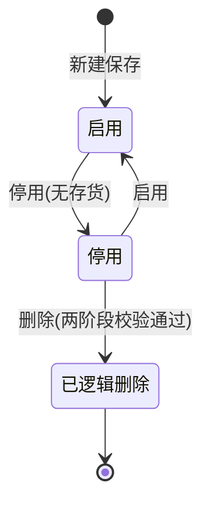
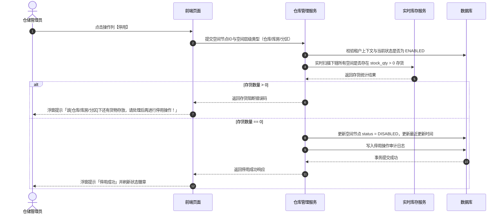
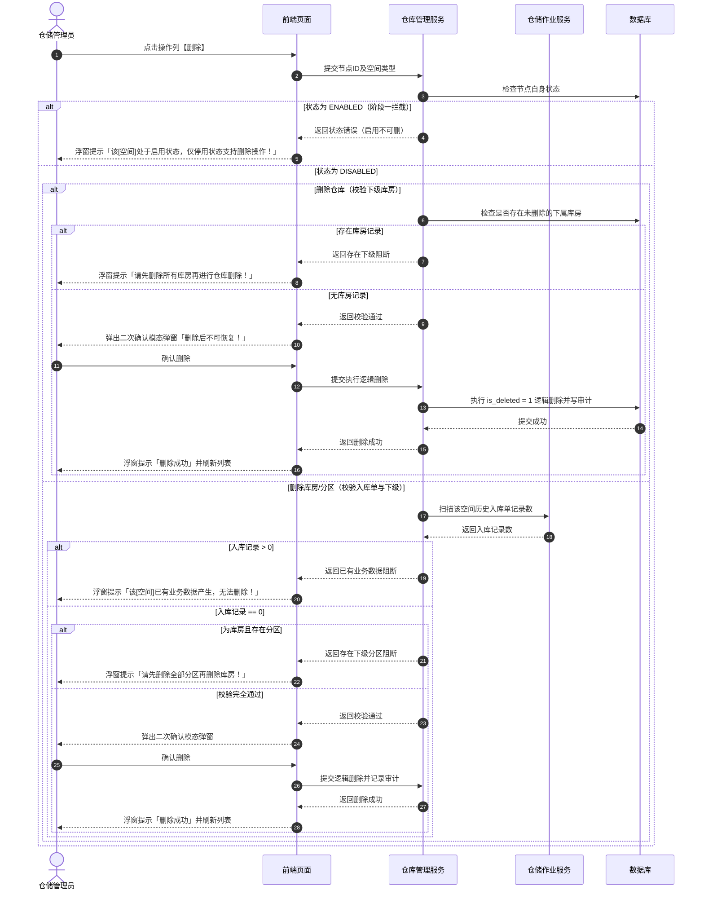
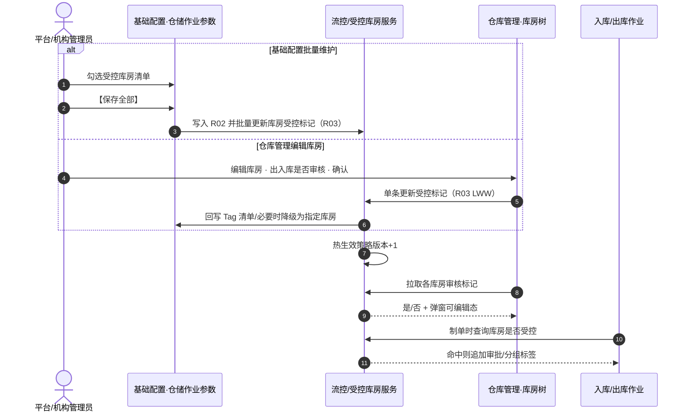
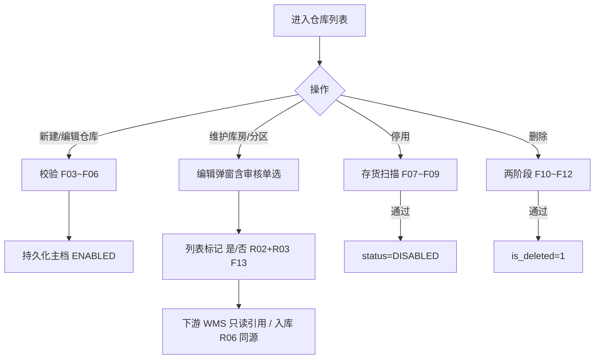

# 仓库管理 业务规则规格

> **文档定位**：**三件套核心**——状态机、动作约束、空间与中仓登规则、停用删除强校验、**F13 出入库审核双端联动**及下游快照的**唯一定义来源**。配套：[主PRD](./仓库管理主PRD.md)（业务与**页面功能说明**）、[字段清单](./仓库管理字段清单.md)（字段）。ASCII/Demo 为衍生，只引用本文件规则 ID，不重复定义规则本体。  
> **模块类型**：主数据 / 空间台账（列表 + 详情 + 模态维护，无独立审批流）  
> **统一引用规范**：
> - 本台账：【仓库管理】（菜单：配置管理 → 仓库管理 → 仓库管理）
> - 上游参数：【基础配置 · 仓储作业参数】[R02](../02-平台管理-基础配置/基础配置业务规则规格.md#出入库审核与受控库房范围联动规则r02)、[R03](../02-平台管理-基础配置/基础配置业务规则规格.md#库房出入库审核双端同步与以最后修改为准规则r03)
>
> **版本**：V2.7（F13×M01 权限分轨 · 监管员主用） | **更新时间**：2026-10-20 | 责任人：森云科技（Senyun Technology）

## 一、单据与能力定位

| 项目 | 内容 |
| :--- | :--- |
| **层级定位** | **【基础空间层 - 物理仓储与管理主体主档】**（货-仓-金空间架构底座） |
| **核心职责** | 维护“仓库（1） → 库房（N） → 分区（N）”三级物理空间架构，绑定仓储管理方主体资质，记录中仓登准入资质与现场附件，管理挂载的设备设施；向仓储作业、实时库存、数字仓单、动产质押与物联监控提供真实空间主档。 |
| **实体映射** | `wms_warehouse`（仓库主表）、`wms_storeroom`（库房表）、`wms_partition`（分区表）、`wms_equipment`（设备设施表）、`wms_zhongcangdeng`（中仓登资质扩展表） |
| **上下游关系** | **上游**：租户中心、组织架构人员中心（监管员/片区经理）；**基础配置仓储作业参数（R01/R02）** 提供移库/出入库审核策略； **下游**：入库单/出库单（空间校验、**读取 R02 判定是否追加审批**）、实时库存（货位绑定）、数字仓单与动产质押（中仓登准入资质）、设备管理（物联挂载）。 |
| **数据隔离约束** | 所有空间节点与设施必须带 `tenant_id` 强隔离；下辖库房与分区严格依赖上级仓库，禁止孤立节点存在。 |

---

## 二、状态定义与流转模型

### 2.1 状态定义

| 状态维度 | 字段与枚举 (`status`) | 是否允许人工切换 | 含义说明 | 下游影响与生效范围 |
| :--- | :--- | :---: | :--- | :--- |
| **自身状态 (`status`)** | `ENABLED` (启用) `DISABLED` (停用) | 是 | 空间节点当前是否允许接纳新业务单据 | 列表默认展示有效启用数据；停用后下游单据禁止选择该空间节点。 |
| **逻辑删除状态 (`is_deleted`)** | `0` (未删除) `1` (已删除) | 否 | 逻辑删除标记，前台界面全局不可见 | 仅当空间节点处于停用状态且满足无存货、无业务单据及无下级节点强校验时触发；不可物理恢复。 |
| **中仓登准入状态 (`is_zhongcangdeng`)** | `YES` (是) `NO` (否) | 是 | 仓库是否通过中国仓单登记有限责任公司（中仓登）线下资质准入 | 仅企业管理方允许选“是”；控制押品风控准入与中仓登 4 项扩展表单项呈现。 |

### 2.2 状态流转矩阵

| 起始状态 | 触发动作 | 前置校验条件 | 目标状态 | 二次确认与交互组件 | 后置级联影响 | 失败与阻断提示 |
| :--- | :--- | :--- | :--- | :--- | :--- | :--- |
| **未创建** | 新建仓库/库房/分区 | ① 必填项完整 ② 格式校验通过 ③ 同级名称唯一 | `ENABLED` | 新建模态弹窗（Modal） | 默认启用，生成持久化空间 ID 并写入审计日志 | 浮窗提示（Toast）阻断： 「空间名称已存在 / 格式错误」 |
| **启用** | 停用仓库 | 服务端强校验：该仓库下辖所有库房及分区均无“存货中”货物 | `DISABLED` | 确认模态弹窗 | 阻止下游新增业务单据选择该仓库；更新更新时间戳 | 浮窗提示（Toast）阻断： 「该仓库下还有货物存放，请处理后再进行停用操作！」 |
| **启用** | 停用库房 | 服务端强校验：该库房下辖所有分区均无“存货中”货物 | `DISABLED` | 确认模态弹窗 | 阻止下游新增业务单据选择该库房；更新更新时间戳 | 浮窗提示（Toast）阻断： 「该库房下还有货物存放，请处理后再进行停用操作！」 |
| **启用** | 停用分区 | 服务端强校验：该分区无“存货中”货物 | `DISABLED` | 确认模态弹窗 | 阻止下游新增业务单据选择该分区；更新更新时间戳 | 浮窗提示（Toast）阻断： 「该分区下还有货物存放，请处理后再进行停用操作！」 |
| **停用** | 启用仓库/库房/分区 | 具备配置维护或管理员权限 | `ENABLED` | 确认模态弹窗 | 恢复下游业务单据引用选择资格；更新更新时间戳 | 浮窗提示（Toast）： 「操作失败，数据已被修改」 |
| **停用** | 删除仓库 | ① 仓库已停用； ② 该仓库下无任何库房（库房需先全量删除） | `is_deleted = 1` | 风险警告模态弹窗 | 逻辑删除仓库记录；前台全局隐藏；下游历史单据保留快照 | 浮窗提示（Toast）阻断： ① 未停用：「该仓库处于启用状态，仅停用状态支持删除操作！」 ② 有库房：「请先删除所有库房再进行仓库删除！」 |
| **停用** | 删除库房 | ① 库房已停用； ② 无历史入库业务记录； ③ 该库房下无任何分区（分区需先全量删除） | `is_deleted = 1` | 风险警告模态弹窗 | 逻辑删除库房记录；前台全局隐藏 | 浮窗提示（Toast）阻断： ① 未停用：「该库房处于启用状态，仅停用状态支持删除操作！」 ② 有入库：「该库房已有业务数据产生，无法删除！」 ③ 有分区：「请先删除全部分区再删除库房！」 |
| **停用** | 删除分区 | ① 分区已停用； ② 无历史入库业务记录 | `is_deleted = 1` | 风险警告模态弹窗 | 逻辑删除分区记录；前台全局隐藏 | 浮窗提示（Toast）阻断： ① 未停用：「该分区处于启用状态，仅停用状态支持删除操作！」 ② 有入库：「该分区已有业务数据产生，无法删除！」 |

---

## 三、动作能力与流转控制矩阵

> 与 2.2 节 状态流转矩阵一致；下列为按 **动作入口** 归纳的快捷索引。

| 触发动作 | 操作入口 | 适用角色 | 前置业务校验 | 结果状态 | 失败阻断提示（摘要） |
| :--- | :--- | :--- | :--- | :--- | :--- |
| **新建仓库/库房/分区** | 列表/详情【+ 新增】 | M01 授权角色 | 名称唯一、必填完整、中仓登材料（若开启） | `ENABLED` | 名称重复 / 材料缺失 |
| **编辑仓库** | 列表【编辑】模态 | 同上 | F04~F06 | 保持原状态 | 个人+中仓登冲突 |
| **停用空间节点** | 行【停用】 | 同上 | F07~F09 无在库 | `DISABLED` | 有货存放标准 Toast |
| **启用空间节点** | 行【启用】 | 同上 | 权限 | `ENABLED` | 乐观锁冲突 |
| **删除空间节点** | 行【删除】 | 管理员等 | F10~F12 两阶段 | `is_deleted=1` | 启用/下级/入库阻断 |
| **维护设备设施** | 详情 Tab3 | 同上 | F14 字段完整 | 持久化 | 必填缺失 |
| **查看出入库审核标记** | 详情 Tab2 库房树 | 所有可查看角色 | 无 | 展示「是/否」 | — |
| **维护库房出入库审核** | 【添加/编辑库房】弹窗单选 | M01 且租户 R02 总开关=是 | R03 LWW；总开关=否时单选置灰 | 热更新受控标记 | 并发冲突刷新提示 |

---

## 四、状态流转图（空间节点）

---

## 五、核心业务规则

### 5.1 空间架构与命名规则

#### 【租户数据严格隔离规则】(F01)
- 仓库、库房、分区、设备设施及中仓登资质主档严格基于 `tenant_id` 物理数据隔离；
- 前端所有查询接口必须由网关层透传认证租户上下文，数据库查询强制注入租户条件，严禁跨租户越权。

#### 【三级物理空间架构约束规则】(F02)
- 仓储物理空间严格遵循“仓库（1） → 库房（N） → 分区（N）”三级树状拓扑关系；
- 分区必须从属于唯一的有效库房，库房必须从属于唯一的有效仓库，严禁创建或迁移产生无上级归属的孤立空间节点。

#### 【空间节点逐级名称唯一性规则】(F03)
- 同一租户下，**仓库名称**严格唯一（长度 1~50 字符，前后去空格），编辑时排除自身比对；
- 同一仓库下，**库房名称**严格唯一（长度 1~50 字符）；
- 同一库房下，**分区名称**严格唯一（长度 1~50 字符）；
- 数据库底层在对应租户或父节点外键范围建立组合唯一索引。

### 5.2 中仓登准入规则

#### 【管理方主体类型与中仓登互斥规则】(F04)
- 仓库管理方类型分为 `1企业` 与 `2个人`；
- 当管理方类型为 `2个人` 时，系统强制禁止启用中仓登准入（`is_zhongcangdeng` 强制置为“否”且置灰禁用切换）；
- 编辑仓库时，若将管理方由“企业”切换为“个人”，且当前中仓登准入为“是”，后端强行阻断保存并提示必须先关闭中仓登准入。

#### 【中仓登准入资质与材料完整性规则】(F05)
- 当“是否中仓登准入仓”选“是”时，以下 4 项资质材料联动变更为**条件必填**，缺一不可提交保存：
  1. `zcd_warehouse_id`（中仓登仓库ID号）：文本输入，由中仓登线下审核提供；
  2. `zcd_map_file`（仓库库区图或库位图）：支持 JPG/PNG/JPEG，大小 不超过 5MB，限 1 张；
  3. `zcd_reg_form_pdf`（仓库信息登记表）：仅限 PDF 格式，限 1 份，需完成仓储方与平台方双公章盖章；
  4. `zcd_site_images`（仓库现场图片）：支持 JPG/PNG/JPEG，大小 不超过 5MB，最多 8 张。

#### 【中仓登状态切换与字段自动清空规则】(F06)
- 当编辑仓库将“是否中仓登准入仓”由“是”切换为“否”并保存时，系统在同一数据库本地事务内自动清空已保存的 4 项中仓登字段数据及对象存储（OSS）关联引用，防止残留脏数据影响风控判断。

### 5.3 停用与删除控制

#### 【仓库停用存货强校验拦截规则】(F07)
- 点击仓库操作列【停用】时，服务端实时查询实时库存中心：
  - 查询条件：`SELECT COUNT(1) FROM wms_inventory WHERE warehouse_id = :warehouseId AND stock_qty > 0`；
  - 若库存数量大于 0，立即强阻断停用操作，并以浮窗提示（Toast）呈现标准阻断文案：「该仓库下还有货物存放，请处理后再进行停用操作！」。

#### 【库房停用存货强校验拦截规则】(F08)
- 点击库房操作列【停用】时，服务端实时扫描该库房下所有分区的实时在库库存：
  - 查询条件：`SELECT COUNT(1) FROM wms_inventory WHERE storeroom_id = :storeroomId AND stock_qty > 0`；
  - 若库存数量大于 0，立即强阻断停用，并以浮窗提示（Toast）呈现标准阻断文案：「该库房下还有货物存放，请处理后再进行停用操作！」。

#### 【分区停用存货强校验拦截规则】(F09)
- 点击分区操作列【停用】时，服务端实时扫描该分区的实时在库库存：
  - 查询条件：`SELECT COUNT(1) FROM wms_inventory WHERE partition_id = :partitionId AND stock_qty > 0`；
  - 若库存数量大于 0，立即强阻断停用，并以浮窗提示（Toast）呈现标准阻断文案：「该分区下还有货物存放，请处理后再进行停用操作！」。

#### 【仓库两阶段安全删除控制规则】(F10)
- **阶段一（自身状态校验）**：若仓库当前处于启用状态，直接阻断删除并提示：「该仓库处于启用状态，仅停用状态支持删除操作！」；
- **阶段二（下级节点校验）**：若仓库已停用，系统检查其下是否存在库房节点（包含启用和停用状态）：
  - 若存在库房记录（计数大于 0），强制阻断删除并提示：「请先删除所有库房再进行仓库删除！」；
  - 若库房数量 等于 0，唤起风险二次确认模态弹窗，确认后执行逻辑删除（`is_deleted = 1`）。

#### 【库房两阶段安全删除控制规则】(F11)
- **阶段一（自身状态校验）**：库房处于启用状态直接阻断并提示先停用；
- **阶段二（业务数据与下级校验）**：库房处于停用状态时执行双重校验：
  - 校验入库记录：若历史上产生过仓储入库单明细（`COUNT(wms_inbound_detail) > 0`），强制阻断删除并提示：「该库房已有业务数据产生，无法删除！」；
  - 校验下级分区：若存在下属分区节点（计数大于 0），强制阻断删除并提示：「请先删除全部分区再删除库房！」；
  - 双重校验均通过，经用户二次确认后执行逻辑删除（`is_deleted = 1`）。

#### 【分区两阶段安全删除控制规则】(F12)
- **阶段一（自身状态校验）**：分区处于启用状态直接阻断并提示先停用；
- **阶段二（业务记录扫描）**：分区处于停用状态时，服务端扫描历史入库单明细：
  - 若历史上产生过仓储入库单明细，强制阻断删除并提示：「该分区已有业务数据产生，无法删除！」；
  - 完全无入库单记录，经二次确认后执行逻辑删除（`is_deleted = 1`）。

### 5.4 下游联动与快照

#### 【库房出入库审核控制联动规则】(F13)

> **跨模块真源**：总开关与范围模式见【出入库审核与受控库房范围联动规则】(R02)；受控清单 **双端读写与以最后修改为准** 见【库房出入库审核双端同步与以最后修改为准规则】(R03)。本规则定义 **仓库管理侧入口、展示与禁止混写项**。

- **列表展示（线上一致）**：库房树展示 **「出入库审核标记：是 / 否」**（只读；由 R02+R03 计算，「是」= 受控需审批，「否」= 免审）。
- **编辑弹窗（线上一致）**：【添加/编辑库房】含必填 **「出入库是否审核」** 单选（是/否）、库房名称、备注；**确认** 保存时写入 R03 共享受控数据并回写基础配置 Tag。R02 总开关为「否」时单选置灰为「否」。
- **主使用角色**：**仓库监管员**（`R-WH-SUPER`）在授权仓库内通过 **编辑库房** 维护；无 C02 者不可改总开关/批量清单。**审计（本期）**：保存留痕，关闭/放宽 **不** 单独强制 P04 原因弹窗。
- **热更新**：基础配置【保存全部】或库房弹窗保存后，列表标记与 Tag **自动一致**（P0 至少重新进入详情页正确）。
- **导航辅助**：具备 **C02** 时展示【前往配置】批量圈定；监管员主用编辑弹窗（R03）。
- **下游引用**：
  - **出库/转让 / 入库 R06**：与列表审核标记 **同一运行时服务**（R02+R03），禁止入库模块再维护第二套库房审核标记。
- **新建库房**：默认值遵循 R03（指定模式默认免审，全部模式默认受控）。

#### 【设备设施独立维护与快速删除规则】(F14)
- 在仓库详情页【设备设施配置】标签页中维护设施记录（设施名称、数量、单位、有效期）；
- 设备设施仅作仓储现场物理设施档案台账，不与库存强挂钩，删除设施时弹出二次确认模态弹窗确认后直接物理或逻辑删除，不阻断存货。

#### 【持久化唯一主键与层级关联规则】(F15)
- 空间层级关联及下游单据引用必须保存持久化全局唯一 ID（`warehouse_id`, `storeroom_id`, `partition_id`），严禁仅凭名称文本做外键关联。

#### 【下游业务单据历史快照不可变规则】(F16)
- 仓储作业单据（入库单、出库单、盘点单、移库单）、加工单、数字仓单与质押单在生成时刻，必须冗余固化记录当时的仓库名称、地址、管理方及库房分区名称快照；
- 空间主档后续的任何名称修改、地址微调或停用操作，绝不改写历史单据的存证快照。

### 5.5 权限、并发与安全

#### 【并发控制乐观锁与幂等规则】(F17)
- 仓库、库房、分区及设备设施的增删改启停采用基于版本号（`version`）或更新时间戳的乐观锁机制；
- 停用与删除操作部署业务幂等防护，防止多用户并发点击引发脏读与重复操作。

---

## 六、权限与安全规范

### 【角色与数据权限隔离规则】(M01)

| 角色代码 | 角色名称 | 查看仓库列表/详情 | 新建/编辑仓库 | 仓库启用/停用 | 仓库逻辑删除 | 维护库房/分区 | 库房/分区停用与删除 | 编辑库房维护出入库审核 (F13) | 维护设备设施 | 数据范围 |
| :--- | :--- | :---: | :---: | :---: | :---: | :---: | :---: | :---: | :---: | :--- |
| `R-SYS-ADMIN` | 系统管理员 | ✅ | ✅ | ✅（无存货） | ✅（无库房） | ✅ | ✅（遵从校验） | ✅（R02 总开关=是） | ✅ | 当前租户全量 |
| `R-RISK-MGR` | 风控管理员 | ✅ | ✅ | ✅（无存货） | ✅（无库房） | ✅ | ✅（遵从校验） | ✅（R02 总开关=是） | ✅ | 所属机构及下辖仓库 |
| `R-AREA-MGR` | 片区经理 | ✅ | ✅ | ✅（无存货） | ❌ | ✅ | ✅（遵从校验） | ✅（R02 总开关=是） | ✅ | 个人授权片区仓库 |
| `R-WH-SUPER` | 仓库监管员 | ✅ | ✅ | ✅（无存货） | ❌ | ✅ | ✅（遵从校验） | ✅（**主角色**；R02 总开关=是；无 C02 批量权） | ✅ | 个人授权管辖仓库 |

> **与基础配置 C02 分轨**：R01/R02 批量保存仅 **机构系统管理员 / 平台管理员**（C02）；仓库监管员 **不** 持有该权限，仅通过 **编辑库房弹窗**（F13 列）维护授权范围内单库房受控标记（R03）。

- **敏感信息脱敏规范**：统一社会信用代码、身份证号及联系电话，对非管理员角色必须执行掩码脱敏展示（身份证保留前 6 后 4，手机号保留前 3 后 4）。

---

## 七、核心业务时序图

### 7.1 空间节点（仓库/库房/分区）停用校验时序

### 7.2 空间两阶段删除控制时序

### 7.3 出入库审核双端同步时序（F13 × R02 × R03）

---

## 八、业务流程与联动

> 与「二、」状态流转、「七、」时序图配合阅读；规则 ID 以上文 **F01~F17**、权限 **M01** 为准；跨模块配置 **R02** 见基础配置。

---

## 九、修订记录

| 日期 | 版本 | 变更摘要 | 变更人 |
| :--- | :---: | :--- | :--- |
| 2026-08-11 | V1.0 | 初版仓库管理业务规则口径。 | 产品团队 |
| **2026-09-16** | **V2.0 规范化升级** | 1. 核心三件套真源确立：独立编写本业务规则规格本体，确立 SSOT 地位； 2. 编号语义自解释：全量升级为 `【规则业务名称】(F01~F17/M01)` 格式； 3. 交互术语全面汉化：Toast/Modal/Alert 全面汉化为浮窗提示、模态弹窗、风险警告模态弹窗； 4. 强化两阶段删除与存货强拦截逻辑闭环。 | 森云科技规范化升级工作组 |
| **2026-10-10** | **V2.1** | F13 与 R02 职责拆分；废除库房分散配置；补充只读透出时序与入库 R06 同源。 | 6.3 基础配置协同 |
| **2026-10-10** | **V2.2** | 对齐标杆：「一、」能力定位、「三、」动作矩阵、「四、」状态图、「五、」规则分组（5.1~5.5）、章节重编号。 | 全文 |
| **2026-10-10** | **V2.3** | 对齐 6.2 IoT 三件套文头；新增业务流程与联动图。 | 文头、业务流程 |
| **2026-10-10** | **V2.4** | 规则编号简略化：全量对齐简写规则 ID（F01~F17、M01）。 | 全文 |
| **2026-10-10** | **V2.5** | 全量走查精炼：统一规则标题为四级标题；规范时序图子编号；业务流程图置于第八节、修订记录置于文末并彻底清除悬挂断裂表格行。 | 全文 |
| **2026-10-20** | **V2.6** | **F13 对齐 R03**：库房行可【开启/关闭出入库审核】；与基础配置共享受控清单、以最后修改为准；时序图改为双端同步。 | 三、5.4 F13、7.3、八 | 产品团队 |
| **2026-10-20** | **V2.7** | **M01 增 F13 列**；监管员主用行开关、C02 管理员批量；放宽不叠加 P04；【前往配置】随 C02 显隐。 | 5.4 F13、六 M01 | 产品团队 |
| **2026-10-20** | **V2.8** | **线上一致**：动作矩阵、7.3 时序、八流程图与编辑弹窗 + 列表标记对齐。 | 三、5.4、7.3、八 | 产品团队 |
