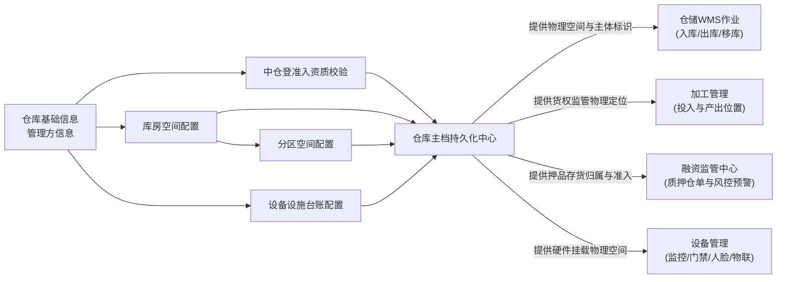
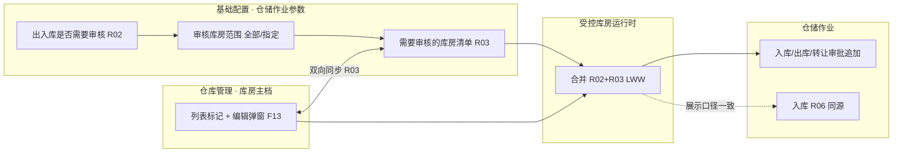

# 仓库管理 主PRD

> **文档体系（三件套为核心）**：
>
> | 层级 | 文档 | 职责 | 真源 |
> | :--- | :--- | :--- | :---: |
> | **核心** | 本文（主 PRD） | 业务背景、痛点、功能范围、模块架构、**页面功能说明**、场景、状态机摘要、规则摘要、验收 | ✅ |
> | **核心** | [仓库管理字段清单](./仓库管理字段清单.md) | 仓库/库房/分区/中仓登/设施字段、列表与表单展示顺序、必填与控件规格 | ✅ |
> | **核心** | [仓库管理业务规则规格](./仓库管理业务规则规格.md) | 状态机、F/M 规则、动作矩阵、时序图、权限矩阵 | ✅ |
> | *衍生* | [PC列表页](./仓库管理_ASCII_列表页.md) · [PC新增编辑页](./仓库管理_ASCII_新增编辑页.md) · [PC详情页](./仓库管理_ASCII_详情页.md) · [移动端](./仓库管理_ASCII_移动端.md) | 由三件套派生的可视化与原型输入，**非独立真源** | ❌ |
>
> **版本**：V2.8（线上一致 · 编辑库房维护审核） | **更新时间**：2026-10-20 | **责任人**：森云科技（Senyun Technology）  
> **读者**：研发工程师、测试工程师、产品复核  
> **字段基准**：[`仓库管理字段清单.md`](./仓库管理字段清单.md) 是空间主档与系统字段的唯一基准；规则本体见业务规则规格。  
> **跨模块协同**：总开关与范围见 [基础配置 R02](../02-平台管理-基础配置/基础配置业务规则规格.md#出入库审核与受控库房范围联动规则r02)；受控清单双端同步见 [R03](../02-平台管理-基础配置/基础配置业务规则规格.md#库房出入库审核双端同步与以最后修改为准规则r03)；本模块 **F13** 负责列表「审核标记：是/否」+ **编辑库房**弹窗单选。  
> **页面范围**：列表页（`P-CFG-WH-010`）、详情页（`P-CFG-WH-010-DETAIL`）、仓库模态、库房/分区/设备设施维护（第 6 节）。

---

## 1. 业务背景与业务痛点

### 1.1 业务背景
仓库管理是 SYZC 供应链金融存货监管系统的**物理空间与管理主体主档**入口，维护「仓库（1）→ 库房（N）→ 分区（N）」三级架构，绑定管理方主体资质、中仓登准入资料与现场设备设施台账。入库、出库、移库、转让、加工、盘点及物联设备挂载均依赖本模块提供的**持久化空间 ID** 与启用状态。

6.3 起，租户级 **出入库是否审核、受控库房范围** 在【基础配置 · 仓储作业参数】维护（R02）；**受控库房清单** 可在基础配置批量勾选，也可在仓库管理 **【添加/编辑库房】** 弹窗维护「出入库是否审核」（R03），两处 **自动同步、以最后修改为准**。列表展示 **出入库审核标记：是/否**（与线上一致），与入库记录【库房同审核属性强校验】(入库 R06) 同源。

### 1.2 核心业务痛点
1. **账实悬空**：空间节点被随意停用或删除，在库质押存货失去明确物理归属；
2. **合规冲突**：管理方类型或中仓登资质随意变更，线上数据与线下监管备案不一致；
3. **追溯断裂**：下游若仅按名称关联空间，改名后历史单据无法对齐；
4. **审批配置分散（6.3 前）**：库房级与平台级各配各的、易不一致；6.3 通过 R02+R03 **共享受控数据**，保留现场单库开关便利与平台批量圈定能力；
5. **物联盲区**：监控、门禁缺乏明确空间挂载点，无法动静结合预警。

---

## 2. 功能范围

| 包含功能范围 | 不包含功能范围 |
| :--- | :--- |
| - 仓库主档的新建、编辑、列表查询、启用/停用与逻辑删除； - 管理方主体类型（企业/个人）、证件号及权属关系规则校验； - 中仓登准入标记与 4 项附件资料联动（准入ID、库区图、登记表PDF、现场图片）； - 库房主档的新建、编辑（含 **出入库是否审核** 单选，R03 同步）、列表 **出入库审核标记：是/否** 展示、启用/停用与逻辑删除； - 分区主档的新建、编辑、所属库房关联、启用/停用与逻辑删除； - 仓库详情页设备设施列表的新增、编辑与删除维护； - 仓库/库房/分区停用时“无存货存放”的服务端强校验拦截； - 仓库/库房/分区删除时“两阶段强校验（无存货/无入库记录/无下级节点）”； - 租户数据隔离、数据权限过滤、操作审计日志、并发乐观锁与幂等校验。 | - **租户级审批总开关与范围模式**：移库是否审核、出入库总开关、全部/指定范围的 **批量保存**（R01/R02，见基础配置）；单库房受控 **在编辑库房弹窗维护**（R03/F13）； - 仓储作业（入库、出库、移库、盘点）的具体业务单据办理； - 仓储租金、保管费等财务结算与商务合同履约管理； - 中仓登官方应用程序编程接口（API）线上自动联网同步； - 监控、门禁、物联网设备的硬件底层通信协议配置； - 已逻辑删除仓库/库房/分区/设备设施主档的前台恢复功能。 |

---

## 3. 模块定位与系统链路

### 3.1 仓储作业与配置管理跨模块数据互通

| 协同板块 | 接收事件与触发时机 | 具体数据联动行为与业务效力 |
| :--- | :--- | :--- |
| **【02-基础配置 · 仓储作业参数】** | 管理员维护 R01/R02/R03 并保存 | 移库/出入库审核策略热生效；**批量圈定**受控库房；与编辑库房弹窗 **双向同步**（F13）。 |
| **【09~14 仓储作业单据】** | 制单选仓/库/分区 | 仅可选 `ENABLED` 节点；引用 `warehouse_id` / `storeroom_id` / `partition_id`；生成时固化空间快照 (F16)。 |
| **【09 入库记录 · R06】** | 入库多选库房 | 库房「需要审核/免审」标签与 R02+R03 运行时 **同源**，禁止在本模块维护第二套标记。 |
| **【设备管理 / 物联网】** | 设备绑定仓库 | 读取仓库地址与空间树，作为监控覆盖范围主档。 |

### 3.2 与基础配置 · 出入库审核的边界（6.3）

| 能力 | 维护入口 | 说明 |
| :--- | :--- | :--- |
| 出入库审核总开关、全部/指定范围 | **基础配置 R02** | 总开关为「否」时编辑弹窗审核单选置灰 |
| 受控库房清单（批量） | **基础配置 R03**（**C02 管理员**） | 机构/平台管理员批量穿梭保存 |
| 受控库房清单（单库） | **编辑/添加库房弹窗**（**仓库监管员** 主用） | 与上 **同步、LWW** |
| 列表「出入库审核标记：是/否」 | **运行时 R02+R03** | 只读展示；与入库 R06 同源 |
| 移库是否审核 | **基础配置 R01** | 不在库房/仓库表单维护 |

---

## 4. 业务场景与用户故事

| 场景编号与名称 | 触发角色 | 核心交互与风控约束 | 业务价值 |
| :--- | :--- | :--- | :--- |
| **场景 1【新建与编辑仓库主档】(WH-S01)** | 系统管理员 / 片区经理 | 录入仓库基础信息与管理方信息；校验租户内名称唯一、面积 大于 0（2 位小数）、证件号格式；保存后默认 **启用**。 | 建立可引用的监管物理空间根节点。 |
| **场景 2【中仓登准入与材料上传】(WH-S02)** | 风控管理员 | 仅 **企业管理方** 可选中仓登准入「是」；联动 4 项材料必传（ID、库区图、登记表 PDF、现场图）。 | 支撑仓单与动产质押合规准入。 |
| **场景 3【库房与分区空间树】(WH-S03)** | 仓库监管员 | 维护库房/分区；树表 **出入库审核标记：是/否**；【编辑库房】维护审核单选。 | 与线上一致，R03 同步基础配置。 |
| **场景 4【设备设施台账】(WH-S04)** | 仓库监管员 | 详情页【设备设施配置】增删改设施行；删除二次确认，不校验存货。 | 现场设施与仓库绑定可追溯。 |
| **场景 5【停用前存货强校验】(WH-S05)** | 仓储管理员 | 仓库/库房/分区【停用】前扫描在库库存；大于 0 则 Toast 阻断标准文案。 | 防止有货空间被误停用。 |
| **场景 6【两阶段安全删除】(WH-S06)** | 系统管理员 | 阶段一：启用态不可删；阶段二：有下级/有入库/有存货则阻断；通过则逻辑删除。 | 主档可治理且不影响历史单据快照。 |
| **场景 7【个人管理方与中仓登互斥】(WH-S07)** | 业务运营 | 管理方为个人时中仓登强制「否」且置灰；企业改个人且已准入则保存阻断。 | 避免个人主体误挂中仓登资质。 |
| **场景 8【中仓登关闭清空】(WH-S08)** | 风控管理员 | 准入「是→否」保存时事务内清空 4 项中仓登字段与附件引用。 | 防止残留脏数据误导风控。 |
| **场景 9【并发编辑保护】(WH-S09)** | 多用户 | 乐观锁 `version` 冲突时提示刷新后重试。 | 保障主档并发一致性。 |
| **场景 10【受控库房双端同步】(WH-S10)** | **仓库监管员**（A）/ **管理员**（B） | A：编辑库房将审核改为「否」并确认；B：基础配置移除 Tag。 | 列表标记与 Tag 一致；LWW；C02×M01 分轨。 |

---

## 5. 状态机与动作能力矩阵

> 空间节点 `status` / `is_deleted` 变迁由行操作驱动，**禁止**表单内下拉直接改状态。详见 [仓库管理业务规则规格.md 「二、」、「三、」](./仓库管理业务规则规格.md#二状态定义与流转模型)。

| 动作名称 | 仓库-启用 | 仓库-停用 | 库房-启用 | 库房-停用 | 分区-启用 | 分区-停用 | 任意-已删除 |
| :--- | :---: | :---: | :---: | :---: | :---: | :---: | :---: |
| **查看列表 / 详情** | ✅ | ✅ | ✅ | ✅ | ✅ | ✅ | ❌ |
| **编辑基本信息** | ✅ | ✅ | ✅ | ✅ | ✅ | ✅ | ❌ |
| **变更中仓登准入** | ✅（企业管理方） | ✅（企业管理方） | — | — | — | — | ❌ |
| **切换管理方为个人** | ✅（非中仓登仓） | ✅（非中仓登仓） | — | — | — | — | ❌ |
| **启用** | ❌ | ✅ | ❌ | ✅ | ❌ | ✅ | ❌ |
| **停用** | ✅（无存货） | ❌ | ✅（无存货） | ❌ | ✅（无存货） | ❌ | ❌ |
| **删除** | ❌ | ✅（无下级库房） | ❌ | ✅（无入库且无分区） | ❌ | ✅（无入库单） | ❌ |
| **下游新建单据引用** | ✅ | ❌ | ✅ | ❌ | ✅ | ❌ | ❌ |
| **维护设备设施** | ✅ | ✅ | — | — | — | — | ❌ |

---

## 6. 页面功能说明

> 字段控件与展示顺序引用 [仓库管理字段清单.md](./仓库管理字段清单.md)；交互阻断引用 [仓库管理业务规则规格.md](./仓库管理业务规则规格.md)。

### 6.1 仓库管理 — 列表页（`P-CFG-WH-010`）

- **路径**：`配置管理 / 仓库管理 / 仓库管理`
- **页头**：仓库配额提醒（当前可使用仓库数/最多可使用数）
- **筛选与操作区**：仓库名称（模糊）、中仓登准入仓标记（全部/是/否）；右侧操作栏并列排布【添加仓库】与【下载仓库信息登记表】，并提供【重置】【查询】（列表不提供「状态」筛选项，启停仅通过行操作）
- **表格列**（顺序固定）：序号、仓库名称（链接进详情）、管理方名称、是否中仓登准入仓、创建人、创建时间、最近更新时间、状态徽章、操作
- **行操作**：【编辑】、【启用】/【停用】、【删除】（遵从两阶段删除与存货校验）

### 6.2 仓库详情页（`P-CFG-WH-010-DETAIL`）

- **布局骨架**：**双栏并排工作台体系**（左栏主档三卡片 + 右栏空间与设施双工作区），避免标签页切换割裂主档信息与空间维护
- **左栏 · 仓库主档三卡片**：
  - **卡片 1【仓库基础信息】**：仓库物理名称、状态徽章（`启用中` / `已停用`）、物理地址；双列指标展示面积、仓库类型、监管员及片区经理
  - **卡片 2【管理方信息】**：右上角主体属性 Badge（如 `企业 · 自有` / `个人 · 其他`）；管理企业/个人名称、统一社会信用代码/身份证号、联系电话
  - **卡片 3【中仓登准入仓】**：右上角准入 Badge（`已准入` / `未准入`）；已准入展示中仓登仓库 ID、平面图缩略图、盖章登记表附件下载、现场实景图；未准入展示空态说明
- **右栏 · 空间与设施双工作区**：
  - **工作区 1【库房与分区配置】**：【+ 添加库房】；**C02** 可见【前往配置】。库房树第二行 **出入库审核标记：是/否**；行操作【新增分区】【编辑】【停用/启用】【删除】；**编辑/添加库房** 弹窗含审核单选（R03）。
  - **工作区 2【设备设施情况】**：右上角【+ 添加设备设施】；表格展示序号、设备设施名称、数量、有效期、行级【编辑】【删除】；底部带简易分页条

### 6.3 新增/编辑仓库全页表单（`添加仓库` / `仓库`）

- **路径**：新增 `/配置管理/仓库管理/添加仓库`；编辑 `/配置管理/仓库管理/仓库/:id`（与线上一致，**非**列表内小弹窗）
- **触发**：列表【添加仓库】或行【编辑】
- **分区**：页头提示；**仓库基础信息**（名称、地址级联+详细、面积、类型、监管员/片区经理及按人按角色）；**管理方信息**；**中仓登准入**及条件附件区（企业才可开启，F04）
- **动作**：【返回】【保存】；Dirty 离开确认；保存校验 F03~F06；**不含** 出入库审核配置项

### 6.4 库房 / 分区维护（详情内嵌）

- **库房表单字段**：库房名称、**出入库是否审核**（必填单选）、备注；保存后刷新列表审核标记并同步 R03
- **分区表单字段**：所属库房、分区名称、备注
- **共用弹窗**：停用确认、删除风险确认、存货阻断 Toast（F07~F09、F10~F12）

### 6.5 移动端（H5 · 工作台）

与 PC「列表管理」和「添加仓库全页」拆分一致，但移动端按权限清单为 **两个并列宫格入口**（非列表内按钮新增）：

| 入口 | 菜单 | 能力 | 路由 |
| :--- | :--- | :--- | :--- |
| **仓库管理** | 工作台 → 配置管理 → 仓库管理 | 列表、**查看详情**、编辑、停/启用、删除；筛选：仓库名称 + 中仓登准入仓 | `/m/workspace/config/warehouse-management`（详情 `…/:id`，编辑 `…/:id/edit`） |
| **新增仓库** | 工作台 → 配置管理 → 新增仓库 | 仅新建主档表单；保存后可进入仓库管理详情查看 | `/m/workspace/config/new-warehouse` |

- **兼容**：旧路径 `/m/config/warehouses/*` 重定向至上述新路由

---

## 7. 核心业务规则索引

| 规则编码与名称 | 规则核心逻辑摘要 | 规则规格唯一定义章节 |
| :--- | :--- | :--- |
| **【租户数据严格隔离】(F01)** | `tenant_id` 强隔离，禁止跨租户 | [5.1 节](./仓库管理业务规则规格.md#51-空间架构与命名规则) |
| **【三级空间架构约束】(F02)** | 仓库→库房→分区，禁止孤立节点 | [5.1 节](./仓库管理业务规则规格.md#51-空间架构与命名规则) |
| **【逐级名称唯一】(F03)** | 租户/同仓/同库内名称唯一 | [5.1 节](./仓库管理业务规则规格.md#51-空间架构与命名规则) |
| **【管理方与中仓登互斥】(F04)** | 个人管理方禁止中仓登 | [5.2 节](./仓库管理业务规则规格.md#52-中仓登准入规则) |
| **【中仓登材料完整】(F05)** | 准入=是时 4 项必传 | [5.2 节](./仓库管理业务规则规格.md#52-中仓登准入规则) |
| **【中仓登关闭清空】(F06)** | 是→否 事务清空扩展字段 | [5.2 节](./仓库管理业务规则规格.md#52-中仓登准入规则) |
| **【停用存货拦截】(F07~F09)** | 仓库/库房/分区停用在库强阻断 | [5.3 节](./仓库管理业务规则规格.md#53-停用与删除控制) |
| **【两阶段删除】(F10~F12)** | 启用不可删；下级/入库校验 | [5.3 节](./仓库管理业务规则规格.md#53-停用与删除控制) |
| **【出入库审核双端联动】(F13)** | R02+R03；编辑弹窗 + 列表标记；与 R06 同源 | [5.4 节](./仓库管理业务规则规格.md#库房出入库审核控制联动规则f13) · [R03](../02-平台管理-基础配置/基础配置业务规则规格.md) |
| **【设备设施维护】(F14)** | 详情页台账，删除不校库存 | [5.4 节](./仓库管理业务规则规格.md#54-下游联动与快照) |
| **【唯一主键引用】(F15)** | 下游引用 ID 非名称 | [5.4 节](./仓库管理业务规则规格.md#54-下游联动与快照) |
| **【历史快照不可变】(F16)** | 主档变更不回写单据 | [5.4 节](./仓库管理业务规则规格.md#54-下游联动与快照) |
| **【并发乐观锁】(F17)** | version 冲突拦截 | [5.5 节](./仓库管理业务规则规格.md#55-权限并发与安全) |
| **【角色数据权限】(M01)** | RBAC + 脱敏 | [「六、」权限与安全](./仓库管理业务规则规格.md#六权限与安全规范) |

---

## 8. 权限、非功能与异常边界

### 8.1 权限与数据隔离（摘要）
- 租户 `tenant_id` 强隔离；角色矩阵见业务规则 **M01**（系统/风控管理员可删仓，片区经理/监管员无删仓权限）。
- 证件号、信用代码、手机号按角色脱敏展示。

### 8.2 非功能性需求
- **列表查询**：租户内万级仓库列表，常规筛选响应 不超过 1.0 秒；
- **详情库房树**：展开下级分区前端渲染无明显卡顿（单仓不超过 200 个库房）；
- **审计**：启停、删除、中仓登变更全路径审计，保留不少于 5 年。

### 8.3 异常边界
- 并发编辑：提示「数据已被他人修改，请刷新后重试」（F17）；
- 幂等：客户端请求流水号防网络重试重复提交；
- 面积/格式：前端阻断 + 服务端二次校验。

---

## 9. 验收用例与测试标准

| 验收用例编码 | 验收项业务名称 | 前置条件与测试步骤 | 预期结果与阻断交互 |
| :--- | :--- | :--- | :--- |
| **WH-V01** | 【仓库同租户重名拦截测试】 | 在新建模态弹窗中录入当前租户已存在的仓库名称尝试保存 | 保存失败，浮窗提示（Toast）告知「仓库名称已存在，请重新输入」 |
| **WH-V02** | 【个人管理方中仓登互斥测试】 | 管理方类型选择“个人”，观察中仓登准入控件状态 | 中仓登选项强制为“否”且置灰禁用切换，鼠标悬浮显示互斥提示 |
| **WH-V03** | 【中仓登准入材料必传校验测试】 | 选择中仓登准入为“是”，未上传信息登记表 PDF 直接点击保存 | 保存失败，表单定位至未传附件并标红提示「请上传盖章登记表」 |
| **WH-V04** | 【仓库停用存货强阻断测试】 | 仓库下辖任一分区存在库存大于 0 的货物，在列表中点击【停用】 | 阻断操作，浮窗提示（Toast）告知「该仓库下还有货物存放，请处理后再进行停用操作！」 |
| **WH-V05** | 【库房停用存货强阻断测试】 | 库房下辖分区存在库存货物，点击库房操作列【停用】 | 阻断操作，浮窗提示（Toast）告知「该库房下还有货物存放，请处理后再进行停用操作！」 |
| **WH-V06** | 【仓库启用状态删除拦截测试】 | 对处于启用状态的仓库直接点击行操作【删除】 | 阶段一阻断，浮窗提示「该仓库处于启用状态，仅停用状态支持删除操作！」 |
| **WH-V07** | 【仓库存在库房删除拦截测试】 | 仓库已停用，但其下仍包含未删除的库房记录，点击【删除】 | 阶段二阻断，浮窗提示「请先删除所有库房再进行仓库删除！」 |
| **WH-V08** | 【库房存在入库单删除拦截测试】 | 库房已停用，但历史上产生过入库单明细记录，点击【删除】 | 阶段二阻断，浮窗提示「该库房已有业务数据产生，无法删除！」 |
| **WH-V09** | 【分区存在入库单删除拦截测试】 | 分区已停用，但历史上产生过入库单记录，点击【删除】 | 阶段二阻断，浮窗提示「该分区已有业务数据产生，无法删除！」 |
| **WH-V10** | 【无入库数据分区删除成功测试】 | 分区已停用且从未产生入库单记录，点击【删除】并二次确认 | 执行逻辑删除成功，浮窗提示「删除成功」，列表不再展示 |
| **WH-V11** | 【库房表单含出入库审核单选】 | 打开库房新增/编辑表单 | 必填 **「出入库是否审核」**（是/否）；R02 总开关=否 时置灰为「否」 |
| **WH-V12** | 【双端同步 · 基础配置 → 仓库管理】 | 基础配置将某库房纳入受控清单并【保存全部】后，打开仓库详情 | 对应库房列表展示 **出入库审核标记：是**；与基础配置 Tag 一致 |
| **WH-V13** | 【双端同步 · 仓库管理 → 基础配置】 | 编辑库房将审核改为「否」并保存后，打开基础配置仓储作业参数 | 该库房从 Tag 清单移除（或范围降为「指定库房」）；仍以 R03 展示为准 |
| **WH-V14** | 【以最后修改为准】 | 用户 A 在基础配置纳入库房 X；几乎同时用户 B 在仓库管理对库房 X【关闭出入库审核】 | 时间戳较新的操作生效；较旧一方收到刷新提示，两端展示一致 |
| **WH-V15** | 【权限分轨】 | 以 **仓库监管员** 登录仓库详情；再以 **机构管理员** 打开基础配置 | 监管员可 **编辑库房** 维护审核、**无**【前往配置】；管理员可批量改清单，两端仍同步 |

---

## 修订记录

| 日期 | 版本 | 变更摘要 | 变更人 |
| :--- | :---: | :--- | :--- |
| 2026-08-11 | V1.0 | 初版仓库管理主 PRD | 产品团队 |
| **2026-09-16** | **V2.0 规范化升级** | 1. 编号语义自解释：场景统一命名为 `场景 N【业务场景名称】(WH-S01~S09)`，用例命名为 `【用例业务名称】(WH-V01~V10)`； 2. 交互术语全面汉化：Toast/Modal/Tab 等裸英文全面汉化为浮窗提示、模态弹窗、标签页； 3. 强化三件套真源强对齐：业务规则全面映射《仓库管理业务规则规格.md》与《仓库管理字段清单.md》。 | 森云科技规范化升级工作组 |
| **2026-10-10** | **V2.1** | 出入库审核库房配置 **完全归口基础配置 R02**；库房表单移除可编辑审核属性；补充 WH-S10、WH-V11/V12 与 3.1 节 边界图。 | 6.3 基础配置协同 |
| **2026-10-10** | **V2.2** | 对齐入库记录等标杆三件套结构：第1节 痛点分层、第4节 用户故事表、第6节 分页面功能说明、第7节 规则索引、第8节 NFR；3.1 节 跨模块互通表。 | 全文 |
| **2026-10-10** | **V2.3** | 对齐 6.2 IoT 标杆三件套文头（真源表、字段基准、读者）；修复业务规则规格文件编码。 | 文头 | AI PM / 森云科技 |
| **2026-10-10** | **V2.4** | 规则编号简略化：全量对齐 F01~F17 与 M01 规则编号体系。 | 第 7 节 | AI PM / 森云科技 |
| **2026-10-10** | **V2.5** | 全量走查精炼：标明跨模块 R06 规则主语，三件套版本与规范强对齐。 | 文头、1.1 节、修订记录 | AI PM / 森云科技 |
| **2026-10-20** | **V2.6** | 评审定稿 **R03/F13**：库房出入库审核双端可维护、以最后修改为准；更新 3.2 边界图、WH-S10、WH-V11~V14。 | 1.1、3、4、6.2、7、9 节 | 产品团队 |
| **2026-10-20** | **V2.7** | 定稿：**放宽不加重 P04**；**C02 管理员 × 监管员 F13** 分轨；WH-V15、【前往配置】随 C02。 | 3.2、4、6.2、9 节 | 产品团队 |
| **2026-10-20** | **V2.8** | **线上一致**：列表「出入库审核标记：是/否」+ 编辑库房弹窗单选；WH-V11~V15 与 F13 对齐。 | 2、3.2、4、6、9 节 | 产品团队 |
