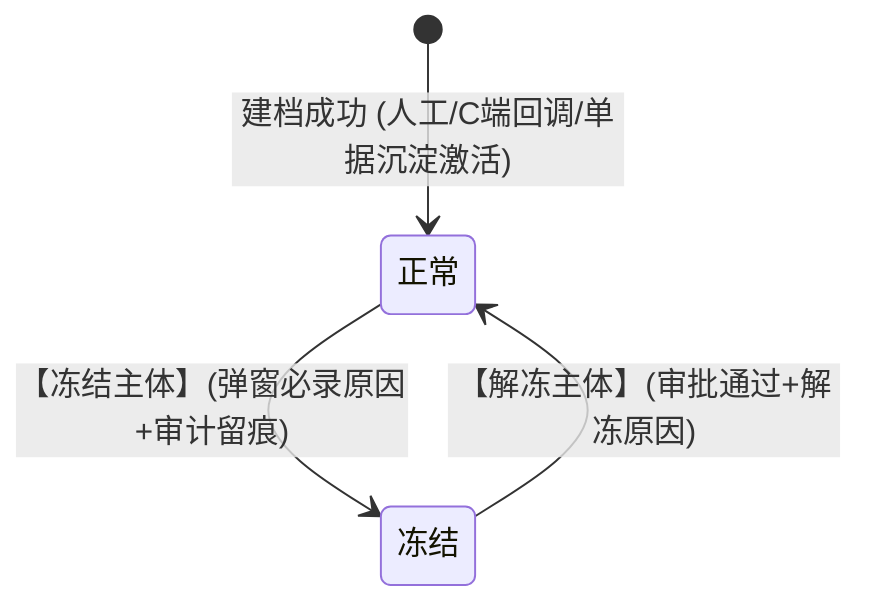
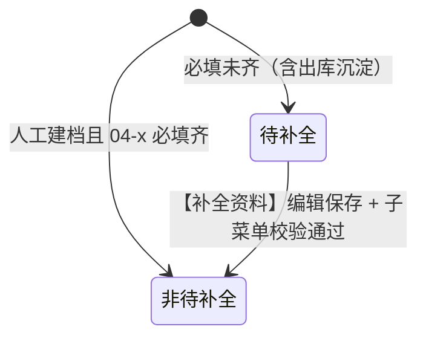
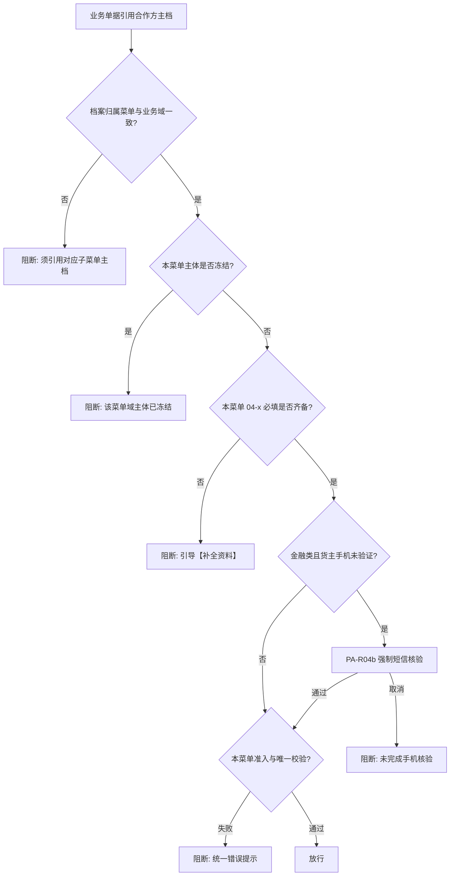

# 合作方主数据 · 公共业务规则规格

> **模块定位**：合作方主数据层 **跨四子菜单共用** 的状态机、短信核验、冻结、排序、导航（PA-R12）、OCR 框架（PA-R13）及 **库内匹配总则（PA-R03）** 的**唯一定义来源**。**各子菜单库内匹配细则** 见 **WH-R01 / PP-R01 / FN-R01 / SP-R01**（不重复定义规则本体）。  
> **范式类型**：范式 D · 基础档案类  
> **文档体系（方案 B）**：[合作方主数据-公共主PRD.md](./合作方主数据-公共主PRD.md) · [合作方主数据-公共字段清单.md](./合作方主数据-公共字段清单.md) · 本文；子菜单 [04-1 货主信息](./04-1-货主信息/) · [04-2 提货人信息](./04-2-提货人信息/) · [04-3 资金方信息](./04-3-资金方信息/) · [04-4 服务方信息](./04-4-服务方信息/) 各一套三件套。  
> **版本**：V3.3 | **更新时间**：2026-10-20 | **责任人**：森云科技（Senyun Technology）  
> **统一引用规范**：公共 **PA-R01~PA-R13**、**PA-P01~PA-P02**；货主 **WH-R01**；提货人 **PP-R01**；资金方 **FN-R01**；服务方 **SP-R01**；准入 **P01~P09** 真源 [基础配置业务规则规格](../02-平台管理-基础配置/基础配置业务规则规格.md)。  
> **ASCII 线框（PC）**：[合作方档案_ASCII_列表页](./合作方档案_ASCII_列表页.md) · [合作方档案_ASCII_新增编辑页](./合作方档案_ASCII_新增编辑页.md) · [合作方档案_ASCII_详情页](./合作方档案_ASCII_详情页.md)  
> **ASCII 线框（H5）**：[合作方档案_ASCII_H5](./合作方档案_ASCII_H5.md)

---

## 一、单据与能力定位

| 项目 | 内容规格 |
| :--- | :--- |
| **单据层级** | **【第 1 层 · 业务主体主数据层】**（全平台个人/企业合作方统一基础档案） |
| **核心职责** | 集中维护合作方身份资料、证件地址及来源；**四子菜单即四类合作身份域**（货主 / 提货经办人 / 资金方 / 服务方），**同一物理主档表、分菜单独立主档**；跨菜单通过 **追加合作方档案角色** 创建关联主档；**分菜单主体冻结互不影响**；**待补全** 由 **04-x 必填配置** **派生展示**（非独立状态字段）；为入库、出库、转让、仓单、抵质押与监管服务等提供引用源与凭据快照源。 |
| **单据来源** | **三重录入与沉淀渠道**： 1. **主动建档**：业务运营在后台管理端手工新增建档； 2. **C 端回调**：客户端用户完成实名认证后系统自动回调建档； 3. **单据沉淀**：出库等作业单据录入新经办人时系统静默沉淀创建简易档案。 |
| **上游依赖** | **工商与公安核验**：企业统一社会信用代码与个人身份证真实性； **准入策略配置**：【基础配置 · **货主准入策略**】维护的货主证件地址必填（P01）、一人一址（P02）及场景配置。 |
| **下游影响** | **仓储模块**：为入库、出库、提货、转让、仓单提供主体选择与数据校验； **交易模块**：与 C 端客户账号建立 1:1 绑定关系； **融资与风控**：为融资产品提供合格资金方候选池，承接风控隔离冻结指令。 |
| **数据隔离机制** | 主体主档按**租户**物理隔离；地址唯一校验范围为**同一租户内适用项目/业务范围**；跨租户不做主体合并与地址比较。 |
| **端侧维护入口** | **PC**：用户中心 Sidebar 分组 **合作方档案** 下 **四个并列菜单项**（货主信息 / 提货人信息 / 资金方信息 / 服务方信息），**无**合作方档案总列表；**H5**：用户中心 **四个入口按钮**；列表/详情/新增 **同一套组件**，**档案归属菜单** 由路由注入；**RBAC 四子菜单分别授权**。规则 PA-R01~PA-R13 双端共用；**分菜单独立主档**。 |

---

## 二、双层状态模型与流转定义

合作方档案 **按档案归属菜单分域** 维护状态，**严禁在表单内用下拉框直接改状态**：
1. **主体状态**（四菜单共用）：本条主档在本菜单域内的生命周期（本期 **正常 / 冻结**，不提供注销）；
2. **待补全（派生，非字段）**：运行时按 **当前菜单 04-x 必填表** 判定本菜单必填是否齐备；未齐时在 **主体状态** 旁展示「待补全」辅助徽章，列表/详情 **编辑位** 改文案 **【补全资料】**（**方案 A**）；与主体冻结正交；
3. **业务合作角色**（接口派生，前台不单独维护）：与 **档案归属菜单** 一一对应，供下游单据快照与拦截引用，**不再**在同一条主档上挂多条角色关系。

### 2.1 主体状态定义表

| 状态名称 | 业务含义 | 是否终态 | 列表可见性 | 进入条件 | 离开条件 |
| :--- | :--- | :---: | :---: | :--- | :--- |
| **正常** | 主体主档已激活，可按所属角色参与对应业务流转 | 否 | 可见（排序在前） | 建档成功 / 审批解冻 | 冻结 |
| **冻结** | 命中风控限制或人工管控，新发业务默认阻断拦截 | 否 | 可见（沉底排序在后） | 人工冻结 / 风控系统自动触发 | 解冻审批通过 |

> **版本约束说明**：本期系统**暂不提供注销货主/注销主体**功能。对于存在违约、风险或暂停合作的主体，统一采用**【冻结】**机制进行管控，保障在库库存、电子仓单及存证证据链的完整性。注销功能作为终态归档能力延期至二期规划。

#### 状态二问 · 正常
- **阶段**：本菜单域主档生效中，可被引用本域业务的单据使用（另须 **本菜单必填已齐**，见 2.2）；
- **允许**：编辑资料（按权限）、**追加合作方档案角色**、**冻结主体**（仅本菜单域）、查看关联合作档案与客户账号；
- **禁止**：物理删除、表单内直接改动主体状态、本期注销。

#### 状态二问 · 冻结
- **阶段**：**本菜单域** 风险受控；**不自动冻结** 同证号在其他子菜单的独立主档；列表沉底；
- **允许**：查看详情、提交解冻审批；
- **禁止**：以 **本菜单身份** 发起新业务、编辑核心资质与身份标识（按冻结矩阵）。

---

### 2.2 待补全派生判定（四菜单 · 必填配置 SSOT 在 04-x）

| 派生态 | 业务含义 | 典型场景 | 消失条件 |
| :--- | :--- | :--- | :--- |
| **待补全** | 本菜单 **04-x 必填** 未齐 | 出库快捷建档提货人缺手机/经办人证等；货主 **P01** 开启时缺证件地址；人工保存时跳过非阻断项等 | 编辑/【补全资料】保存且子菜单规则（如提货人 **【提货人信息库内匹配规则】(PP-R01)**）通过 |

**判定口径（摘要）**：

- **货主信息**：主体名称、身份标识、联系手机、企业经办人（企业）；**证件地址** 仅当基础配置 **【货主证件地址必填校验规则】(P01)** 开启时纳入待补全判定；
- **提货人信息**：**个人** — 姓名、身份证、手机号；**企业** — 企业名称、信用代码、经办人姓名、**经办人身份证**、联系电话；**不含**证件地址；
- **资金方信息 / 服务方信息**：锁定 **企业**；**主体名称 + 统一社会信用代码** 齐备即非待补全（手机/地址/经办人可空）。

> **禁止** 落库独立「资料完备状态」字段。仅 **货主信息** 因 **P01** 与地址相关；**提货人 / 资金方 / 服务方** 不因地址进入 **【补全资料】**。

---

## 三、状态流转图

### 3.1 主体状态机流转图

### 3.2 待补全派生流转（非持久状态机）

### 3.3 运行时拦截决策流（分菜单主体 + 必填派生）

---

## 四、状态流转动作表

### 4.1 主体状态流转动作表

| 当前状态 | 触发动作 | 适用角色 | 前置业务校验条件 | 目标状态 | 二次确认与弹窗 | 联动后置影响 | 失败阻断提示 |
| :--- | :--- | :--- | :--- | :--- | :--- | :--- | :--- |
| — | **创建主体** | 平台管理员 / 业务运营 | 按当前 **档案归属菜单** 执行 **【主体识别与库内匹配规则】(PA-R03)**；货主场景通过准入校验；出库沉淀若必填未齐则 **派生待补全** | 正常 | 库内匹配/跨菜单创建类二次确认弹窗 | 写入主体主档、关联合作档案（若有）及操作审批日志 | 见 PA-R03 分场景 Toast / 弹窗文案 |
| **正常** | **冻结主体** | 风控专员 / 管理员 | 处于正常状态；强制录入冻结原因（不超过 200 字） | 冻结 | 二次确认弹窗（录入原因） | 写审计日志；**仅拦截本菜单域** 新发业务；**不冻结** 同证号其他菜单主档；列表沉底 | 「冻结失败：请填写冻结原因」 |
| **冻结** | **解冻主体** | 部门主管 / 管理员 | 处于冻结状态；解冻审批终审通过；强制录入解冻原因 | 正常 | 审批确认弹窗 | 写审计日志；恢复主体正常业务发起资格与正常排序位次 | 「解冻失败：解冻须审批通过」 |
| **任意状态** | **表单改状态** | — | — | — | **系统绝对禁止** | — | 前端不渲染状态下拉框，服务端接口强校验拦截 |

### 4.2 跨菜单建档与资料补全动作表

| 当前状态 | 触发动作 | 适用角色 | 前置业务校验条件 | 目标结果 | 二次确认与弹窗 | 联动后置影响 | 失败阻断提示 |
| :--- | :--- | :--- | :--- | :--- | :--- | :--- | :--- |
| — | **追加合作方档案角色** | 授权业务运营 | 本菜单主体未冻结；勾选 **其他子菜单**（排除当前菜单）；目标菜单尚无同证号主档 | 在目标菜单 **新建独立主档** + 写入 **关联合作档案** | **「将在【××信息】创建独立主档，是否继续？」** 用户确认后创建；可预填身份资料 | 列表 **其他合作档案** 列展示目标菜单标签；详情 Tab 可跳转 | 目标域库内冲突见 WH-R01 / PP-R01 等 |
| — | **追加合作方档案角色（已存在）** | 同上 | 目标菜单 **已有** 同证号主档 | 仅建立/刷新 **关联** | 提醒「该身份在【××信息】已有档案，将建立关联」 | 不重复创建 | — |
| **派生待补全**（任一菜单） | **补全资料**（编辑位） | 业务运营 / 制单员 | **04-x 必填** 完整；子菜单规则（如 **PP-R01**） | 徽章消失 | 同编辑路由；身份区只读按 PA-R04c | 下游引用放行；写审计日志 | 子菜单 Toast |

> **6.3 方案 B 折中**：**不提供** 详情页「冻结/解冻/移除单条业务角色」；风控 **仅冻结本菜单主体**。

---

## 五、动作能力矩阵

### 5.1 主体级动作能力矩阵

| 业务动作 | 正常 | 冻结 | 注销 ⭐终态 |
| :--- | :---: | :---: | :---: |
| **查看列表与详情** | ✅ | ✅ |
| **新增合作方主体** | ✅ | ✅ |
| **编辑基础档案资料** | ✅（按权限） | ⚠️（仅限非关键信息） |
| **编辑证件地址** | ✅（个人须通过准入） | ⚠️（仅限纠偏且须通过准入） |
| **追加合作方档案角色** | ✅ | ❌ |
| **冻结主体** | ✅（风控权限；强制原因） | ❌ |
| **解冻主体** | ❌ | ✅（审批通过） |
| **注销主体** | ❌（本期不提供） | ❌（本期不提供） |
| **物理删除** | ❌（系统绝对禁止） | ❌（系统绝对禁止） |

### 5.2 分菜单业务引用能力矩阵（摘要）

| 业务动作 | 主档 · 正常且必填齐 | 主档 · 正常且派生待补全 | 主档 · 冻结 |
| :--- | :---: | :---: | :---: |
| **本域业务引用**（如出库引用提货人） | ✅ | ❌（引导【补全资料】） | ❌ |
| **追加合作方档案角色** | ✅ | ✅ | ❌ |
| **列表/详情【编辑】位** | ✅（「编辑」） | ✅（「补全资料」） | ⚠️ |

> 货主入库等 **不因 P01 缺址** 在作业侧阻断；资金方 / 服务方引用见 **FN-R01 / SP-R01**。

---

## 六、核心业务规则清单 (PA-R01 ~ PA-R11)

#### 【分菜单主体引用与拦截规则】(PA-R01)
* **【校验时机】**：业务单据须引用 **档案归属菜单与业务域一致** 的合作方主体标识（货主业务 → **货主信息** 主档；出库提货人 → **提货人信息** 主档；抵质押权人 → **资金方信息**；监管服务质权人 → **服务方信息**）；
* **【接口派生角色】**：快照与拦截中的「业务合作角色」由 **档案归属菜单** 唯读派生（货主 / 提货经办人 / 资金方 / 服务方），**不在** 同一条主档维护多条角色关系；
* **【本菜单冻结】**：某菜单域主体 **冻结** 时，仅阻断 **以该菜单身份** 发起的新业务；**不** 自动冻结同证号在其他菜单的独立主档；
* **【本菜单必填齐备】**：业务引用前须 **04-x 必填已齐**；派生待补全时阻断并引导 **【补全资料】**（出库提货人见 **【提货人信息库内匹配规则】(PP-R01)**）；
* **【转让挂接】**：货物转让在申请阶段于 **货主信息** 域创建/引用主档；**无**「待生效」角色态。

#### 【分菜单主体冻结与在途在库前置校验规则】(PA-R02)
* **【菜单域隔离】**：在 **货主信息** 冻结某主档，**不得** 自动冻结同证号在 **提货人信息 / 资金方信息 / 服务方信息** 的独立主档；反之亦然；
* **【冻结语义】**：「冻结主体」仅指 **当前档案归属菜单** 下该条主档的主体状态；冻结后禁止以该身份参与新的仓储作业或金融开单；
* **【冻结前置货物与单据强校验（阻断条件）】**：在管理端或移动端执行「冻结主体」前，系统必须前置检索该主体在租户内的在库资产与进行中单据，命中下列任意条件时**强阻断拦截，禁止进入原因录入与提交步骤**：
  1. **货主信息（有货禁止冻结）**：若该货主在系统中存在在库货物或在押存量（包含可用库存、质押锁定量、生效中/有效在押数字仓单、未出清入库单），系统强阻断并提示：**「该货主名下仍有在库或在押货物，无法执行冻结。请先办理货物出库转让或解除质押，确保名下库存清零后再行冻结。」**
  2. **提货人信息（有待提货单据禁止冻结）**：若该提货人名下存在处于待提货状态的出库单或提货单（状态为 `待提货`），系统强阻断并提示：**「该提货人名下存在待提货的出库单据，无法执行冻结。请等待现场提货完成或作废单据后再行冻结。」**
  3. **资金方信息（有进行中单据禁止冻结）**：若该资金方名下存在进行中、生效中或在押中的融资单据（如有效在押数字仓单、生效中抵质押单），系统强阻断并提示：**「该资金方名下存在进行中的抵质押单据，无法执行冻结。请先完成业务结清或解押后再行冻结。」**
  4. **服务方信息（有进行中单据禁止冻结）**：若该服务方名下存在进行中、生效中或审批中的监管服务单据（如生效中监管服务单），系统强阻断并提示：**「该服务方名下存在进行中的监管服务单据，无法执行冻结。请先完成监管服务单结案或终止协议后再行冻结。」**
* **【允许冻结与原因必填】**：仅当上述前置校验完全通过（货主无在库在押货物、提货人无待提货单据、资方/服务方无进行中单据）时，方可弹出【确认冻结主体】确认弹窗；操作人员强制录入不超过 200 字的冻结原因，提交后主体状态变更为 `FROZEN`，写入操作审计日志，并在列表中沉底（PA-R11）；
* **【入库审批联动】**：**货主信息** 域主档冻结后，除拦截新发入库外，**审批中入库单终审** 须二次复检并驳回，严禁写库存。

#### 【主体识别与库内匹配总则】(PA-R03)
* **【分菜单独立主档】**：四子菜单共用 **同一物理主档表**，按 **档案归属菜单**（`货主信息` / `提货人信息` / `资金方信息` / `服务方信息`）分域；**同一租户、同一菜单内** 身份标识唯一；**跨子菜单同证号允许各一条主档**（不同合作方主体标识）；
* **【库内已有主体】**：指本租户、**当前档案归属菜单** 下已有主档；跨菜单同证号 **不视为** 本菜单重复建档，须 **跨菜单提醒**（见下）；
* **【手机号属性】**：手机号为业务联系方式，非主体唯一键；格式与必填分菜单见各子菜单字段清单；
* **【跨菜单同证号】**：保存时若其他子菜单已有同证号主档，**允许** 在本菜单独立建档，须 Toast/弹窗：「该身份已在【××信息】存在档案，本菜单将生成独立主档」；
* **【追加合作方档案角色】**：勾选目标子菜单时，若该域 **尚无** 同证号主档，须弹窗 **「将在【××信息】创建独立主档，是否继续？」**，用户确认后创建并建立 **关联合作档案**；若 **已有** 同证号主档，则提醒并 **仅关联**，不合并（后期 **PA-R10**）；
* **【分菜单匹配细则（SSOT 在子菜单规格）】**：
  - **货主信息** → **【货主信息库内匹配与准入规则】(WH-R01)**：[货主信息业务规则规格.md](./04-1-货主信息/货主信息业务规则规格.md)
  - **提货人信息** → **【提货人信息库内匹配规则】(PP-R01)**：[提货人信息业务规则规格.md](./04-2-提货人信息/提货人信息业务规则规格.md)
  - **资金方信息** → **【资金方信息库内匹配规则】(FN-R01)**：[资金方信息业务规则规格.md](./04-3-资金方信息/资金方信息业务规则规格.md)
  - **服务方信息** → **【服务方信息库内匹配规则】(SP-R01)**：[服务方信息业务规则规格.md](./04-4-服务方信息/服务方信息业务规则规格.md)

#### 【货主准入与地址唯一联动规则】(PA-R04)
* **【P01 货主菜单必填】**：遵循【货主证件地址必填校验规则】(P01)，**仅**在 **货主信息** 子菜单的新增、编辑、补全资料、改址等**保存成功前**校验 **个人与企业货主** 证件登记地址非空；**提货人/资金方/服务方** 菜单 **不执行 P01**；**不因 P01** 在入库、出库、仓单、转让、预约等作业单据提交或货主引用时拦截。
* **【P02 证件地址防重复】**：新增/追加 **个人货主** 或 **企业货主**、对应主体改址、C 端认证落货主、作业 **入库快捷建档**（货主且录入地址时）、**货物转让**挂接/生效货主等场景，须调用【统一准入校验服务】（P08）执行 **P02**；**个人池与企业池分池比对**，互不混比（见【企业货主准入边界隔离规则】(P05)）；**提货经办人、资金方、服务方** 不触发 P02；
* **【资方/服务方字段必填边界】**：**资金方信息** 与 **服务方信息** 菜单保存时 **仅强制** 企业 **主体名称** 与 **统一社会信用代码**（两菜单 **同构**，分档案域）；证件地址、联系电话、经办人姓名等 **允许为空**，页面标注「非必填」；**不执行** P01 档案域地址必填（主动填写地址仍不参与货主 P02 池）。**抵质押单**引用 **资金方信息** 域；**监管服务单**引用 **服务方信息** 域（单据称谓合规，见各模块 PRD）。
* **【内部标准化比对】**：地址唯一比对采用系统内部生成的标准化比较值（去除空格、统一全半角与行政区划别名），页面不暴露内部比较串；
* **【冲突同步阻断】**：若命中同类型其他有效货主占用同地址，遵循【证件登记地址防重复唯一校验与同步阻断规则】(P02) **同步强阻断**；个人提示「已有相同证件地址，不能绑定为该个人货主」；企业提示「已有相同证件地址，不能绑定为该货主企业」；作业快捷建档可追加「请核实货主主体信息」；**严禁泄露他人姓名、证号或完整地址**。

#### 【合作方短信二元身份核验服务规则】(PA-R04a)
* **【统一核验服务】**：管理端合作方档案、仓储入库/预约、金融类业务单据在**需要触发**短信核验时，须调用**同一套**二元身份核验服务（6 位动态验证码、60 秒防刷、校验接口与审计口径一致）；
* **【管理端新增建档不强制短信】**：具备【新建/编辑主体】权限（**PA-P02**）的操作员在 **货主信息 / 提货人信息 / 资金方信息 / 服务方信息** 任一菜单新增页点击「保存并提交」时，**不强制**唤起短信弹窗；通过 **PA-R03** 与准入校验后可直接落库，初始 **联系手机核验状态** 为「未验证」（见 **PA-R04b**）；四子菜单 **共用同一套页面与短信组件**，便于双端复用；
* **【提货经办人核验展示】**：提货经办人菜单建档、改号 **默认不走** 金融场景强制补验（**PA-R04b** 仅约束 **货主** 角色引用）；列表/详情仍展示「未验证 / 已验证」徽章，运营可选「保存并验证」或详情【验证联系手机】，与货主菜单交互一致；
* **【新增可选保存并验证】**：同一新增页提供次要动作「保存并验证」（**PA-P02**）；表单校验通过后唤起【验证联系手机】弹窗（场景 3，要素取自当前表单、**不改号**）；短信通过后**原子建档**且联系手机核验状态为「已验证」，并立即触发 **PA-R04c**；用户在弹窗取消或关闭则**不落库**；
* **【入库快捷建档】**：仓储 **入库记录** 制单页通过 **【+ 快速添加货主】** 或搜索空态 **【添加货主】** 唤起与 **货主信息** 菜单**共用的新增表单**；保存时执行 **货主信息档案域** 下 PA-R03 及 **P02**（货主且录入地址时，个人/企业分池），**不**执行 **P01** 档案必填（允许证件地址为空落库）。默认「保存并提交」落库 **未验证**；可选「保存并验证」走本规则场景 3。创建来源 **「入库快捷建档」**；**档案归属菜单 = 货主信息**。**入库单提交**不因货主缺证件地址阻断；金融类未验证货主走 **PA-R04b**（见入库 R03）。
* **【出库快捷建档】**：仓储 **出库记录** 制单页 **【+ 快速添加提货经办人】** 唤起同一 `PartnerQuickCreateSheet`（场景 `OUTBOUND_PICKUP_AGENT`）；落库 **提货人信息** 域独立主档，若必填未齐则 **派生待补全**、主体状态 **正常**，创建来源 **「出库快捷建档」**；**不触发**货主 P02；**禁止**提货人输入框失焦静默建档。
* **【编辑修改联系手机二元核验】**：编辑合作方档案时，业务联系手机（个人手机号 / 企业经办人手机）相对原值发生变更，点击保存时前置唤起【修改联系手机身份确认】弹窗，向**新手机号**发送 6 位验证码，二元核验通过后方可落盘；**C 端已实名货主**在 B 端改号同样适用本流程，改号成功后联系手机核验状态保持「已验证」（绑定新号）；
* **【企业调整经办人信息】**：联系手机核验状态为「已验证」的企业主体，在编辑页展开【调整经办人信息】修改经办人姓名或经办人手机时，保存前须向**当前录入的经办人手机**（若改号则为新号）发起短信二元核验，通过后落盘；
* **【改址与改手机号组合流程】**：个人货主同时修改证件地址与手机号时，先确认【改址原因】（PA-R06a），再执行手机号短信二元核验，双重通过后合并提交；
* **【待补全模式基础信息只读规范】**：单据静默沉淀档案补全资料时，基础资料（主体类型、主体名称、手机号/联系电话、身份标识）只读卡片展示，仅开放证件地址录入。

#### 【联系手机核验状态与金融场景强制核验规则】(PA-R04b)
* **【状态定义】**：主体主档维护 **联系手机核验状态** 枚举：`未验证`、`已验证`；与 Tab「关联客户账号」中的 **C 端实名认证状态** 独立展示，互不替代；
* **【初始赋值】**：
  - **人工建档**、**单据沉淀**（未走短信）：`未验证`；
  - **C 端实名认证回调建档**：`已验证`（认证通过时同步业务联系手机）；
  - **入库快捷建档「保存并验证」成功**、**新增「保存并验证」成功**、**详情主动补验**、**金融场景补验成功**：`已验证`；
* **【普通入库零短信】**：入库类型为 **普通入库**（`NORMAL`）且引用**已建档货主**时，从制单至**审批通过**全流程**不要求**短信核验，**未验证**货主可正常完成普通入库；
* **【金融业务强制核验范围】**：下列场景在单据 **提交审核** 或业务 **生效** 前（以各模块规格定义的拦截点为准），若引用货主/存货人/融资主体的 **联系手机核验状态 = 未验证**，须**前置强阻断**，提示 **「货主未进行验证，需要验证后才可以进行业务」**，并唤起【货主/合作方身份信息确认】短信弹窗（**PA-R04a**）；验证码通过后回写主档为 `已验证`，方可继续提交流程：
  1. **质押 / 抵押 / 监管服务**：含独立质押单、抵押单、监管服务单制单/生效，及 **质押入库、抵押入库、监管服务入库**（含监管服务加工入库联动类）；
  2. **仓单全链路**：含仓单开立、锁定、转让、质押、解押、注销及 **仓单入库**（H5 入库发起等）；
  3. **独立融资制单**：融资/贷中业务模块在制单或提交节点引用合作方货主时，纳入本规则（具体菜单以该模块 PRD 挂载 **PA-R04b** 为准）；
* **【选择器提示】**：下游合作方选择器须回传联系手机核验状态，制单页展示徽章；【查看货主】新标签打开合作方详情，详情展示核验徽章。金融类制单页选中「未验证」货主时，须展示未验证状态并提示：**须先完成联系手机验证后方可提交**（与提交阻断文案一致）。

#### 【已验证主体核心字段锁定规则】(PA-R04c)
* **【适用条件】**：仅当 **联系手机核验状态 = 已验证** 时生效；`未验证` 主体仍遵循证号创建后只读等既有规则，**主体名称**在未验证时可编辑（身份标识创建后始终只读）；
* **【个人主体】**：**主体名称（真实姓名）**、**身份标识（身份证号）** 表单只读置灰；允许编辑 **手机号**、**证件地址**（改址 PA-R06a；改手机号 PA-R04a）；
* **【企业主体】**：**主体名称（企业全称）**、**身份标识（统一社会信用代码）**、**经办人姓名** 默认只读置灰（详情与表单折叠区展示）；**证件地址** 可编辑；调整 **经办人姓名** 或 **联系电话（经办人手机）** 须通过编辑页【调整经办人信息】展开区操作，保存前执行 **PA-R04a** 短信核验；
* **【主体冻结】**：**本菜单域** 主体冻结时，字段可编辑范围取冻结矩阵与 PA-R04c 的**更严**交集。

#### 【关联合作档案解除规则】(PA-R05)
* **【解除范围】**：仅解除 **关联合作档案** 展示关系，**不删除** 目标菜单主档、不回写历史单据快照；
* **【货主主档保护】**：**货主信息** 主档本期 **不可物理删除**；管控需求仅用 **冻结主体**；
* **【解除前检查】**：若目标主档存在在途业务依赖，阻断解除并提示先办结或冻结目标域主档。

#### 【货主地址唯一活跃池规则】(PA-R06)
* **【占用口径】**：租户内「货主 · 角色状态=正常或冻结」且证件地址非空的主体，其证件地址标准化比较值计入**分类型活跃池**（个人货主池、企业货主池）；同一比较值在同一池内同时仅允许一条有效货主占用；
* **【冻结不释放】**：主体或货主角色被**冻结**时，活跃池占用**保持不变**，防止冻结期间地址被他人抢注；
* **【无注销/无移除货主】**：本期不提供注销主体、移除货主角色；**不得**通过移除货主释放地址；
* **【凭据快照不回写】**：历史已发生的入库单、仓单凭据快照中的地址数据**永久保留，严禁物理回写或篡改**。

#### 【个人货主证件地址变更规则】(PA-R06a)
* **【适用对象】**：**货主信息** 域、个人主体且主体状态 **正常**；
* **【编辑入口】**：合作方档案【编辑】→ 证件地址区；主体**冻结**时仅允许风控授权下的**纠偏改址**（须同样过准入）；
* **【变更前校验】**：调用统一准入服务，对新地址执行必填 + 唯一比对（排除本主体当前占用项）；冲突则阻断，文案同 PA-R04；
* **【活跃池原子切换】**：保存成功后，**旧标准化地址立即出池**，**新地址入池**；审计日志记录改址前后摘要及改址原因（不超过 200 字，必填）；
* **【搬家业务路径】**：存量协同规格中「确属搬家」一律走本规则，**禁止**通过地址冲突审批或移除货主绕行；
* **【与快照关系】**：改址仅影响主档与后续新业务；已固化单据快照不变（C08）。

#### 【操作审批日志生成与防篡改规则】(PA-R07)
* **【核心准则】**：遵循**“事成才记、有变必录、无动不写”**原则。仅当业务数据真实变动且数据库事务提交成功（或审批流终审通过）后，系统才原子落库生成审计日志流水；校验失败、中途取消或未修改任何内容点击保存的，**绝不记录伪日志**；
* **【三大生成场景与触发条件】**：
  1. **资料变动场景（建档 / 编辑 / 追加合作方档案角色 / 补全资料）**：操作人点击提交，且提交内容相比原值**存在真实字段级变更（与原值不一致）**并保存成功时立即生成；记录操作人、修改字段原值与新值；
  2. **状态管控场景（冻结主体 / 解冻主体）**：风控专员录入必填原因（不超过 200 字）二次确认成功时立即生成；**解冻动作必须在审批终审通过后触发生成**；记录操作人/审批人、管控/解冻原因及状态流转；
  3. **系统联动场景（单据静默沉淀 / 快照固化）**：下游业务单据（入库单、出库单、转让单）**终审生效落库**时由系统服务自动触发生成；记录系统自动化标识、关联的下游单据号及固化快照摘要；
* **【底层不可变存证】**：日志流水仅支持追加写入，严禁修改与删除，永久归档供司法与风控追溯。

#### 【状态变更按钮驱动规则】(PA-R08)
* **【表单只读展示】**：新增页、编辑页及详情页中的 **主体状态** 须为只读徽章；**待补全** 仅派生徽章，**非**表单字段；
* **【独立按钮驱动】**：主体冻结/解冻由【冻结主体】【解冻主体】触发；**【补全资料】** 与 **【编辑】** 同路由，待补全时 **编辑位** 改文案并突出样式（**方案 A**）。

#### 【并发防重与幂等规则】(PA-R09)
* **【客户端令牌防重】**：创建主体、跨菜单建档（追加合作方档案角色）、编辑提交必须携带客户端唯一防重令牌，提交按钮点击后立即置灰并展示加载中状态；
* **【双重并发防护】**：应用层采用基于 **租户 + 档案归属菜单 + 身份标识**（及货主场景下标准化地址）的并发防重锁；数据库底层部署 **租户 + 档案归属菜单 + 身份标识** 唯一约束，货主域另保 **标准化地址活跃池** 唯一索引，杜绝高并发双建漏洞。

#### 【简易沉淀与合并治理规则】(PA-R10)
* **【治理合并入口】**：因单据录入错误产生的简易沉淀档案（待补全），或 **分菜单独立主档** 需后期聚合为一条的，由**平台运维/后端数据治理接口**发起事务合并（**6.3 P2：管理端无列表行操作入口**，见 [08-版本范围与里程碑](../08-版本范围与里程碑.md)）；
* **【原子事务迁移】**：合并时系统原子将原单据引用外键改写指向目标主体，原简易角色或冗余主档标记为「已失效」归档留痕；**历史单据快照不回写**。

#### 【列表多级加权排序规则】(PA-R11)
* **【第一优先级 · 主体状态权重（冻结沉底）】**：
  * 主体状态为 `正常` 的排在前面（权重 1）；
  * 主体状态为 `冻结` 的统一沉底排在后面（权重 2）；
  * 列表分页查询时，优先展示全量正常主体，全部正常主体展示完毕后才展示冻结主体；
* **【第二优先级 · 系统建档日期】**：
  * 同状态分组内，严格按主体在系统中**首次创建建档的日期**（`create_date`，按天维度 `YYYY-MM-DD`）**倒序排列**（最新建档日期居前）；
  * 后续 **关联其他菜单主档** 不改变本主档建档日期基准；
* **【第三优先级 · 创建时间戳绝对倒序】**：
  * 同一建档日期内，按系统底层首次建档的精确时间戳（`create_time`，精确到秒）绝对倒序排列；
* **【待补全排序】**：
  * **派生待补全** 主档 **主体状态仍为正常**，按首次沉淀建档日期参与排序；列表在 **主体状态** 旁展示「待补全」徽章，**编辑位** 为 **【补全资料】**。

#### 【合作方子菜单分视图与隐式角色规则】(PA-R12)
* **【菜单拆分】**：**合作方档案** 为 **主菜单（目录）**，下挂 **货主信息、提货人信息、资金方信息、服务方信息** 四个子菜单；**取消** 原「合作方管理 → 合作方档案」单页与表单内 **业务角色多选**；四子菜单页面规格一致；
* **【分菜单独立主档】**：每条主档必带 **档案归属菜单**（与入口菜单一致）；列表 **仅展示本菜单档案域** 的主档；**同一自然人/企业在不同菜单可各有一条主档**（同证号、不同合作方主体标识），因而在多个菜单列表 **分别出现**；
* **【菜单即身份域】**：业务合作角色与 **档案归属菜单** 一一对应（货主 / 提货经办人 / 资金方 / 服务方）；保存时 **不展示**「业务角色」多选；接口层唯读派生角色枚举供快照使用；
* **【资金方与服务方合规分域】**：**抵质押单** 抵质押权人业务选 **资金方信息** 域；**监管服务单** 质权人业务选 **服务方信息** 域；两域 **不得** 因合规称谓合并为单菜单；
* **【详情与关联】**：详情 **Tab【其他合作档案】** 展示经 **追加合作方档案角色** 或运营关联的 **其他菜单主档**（菜单名、对方主体标识、主体状态、跳转链接）；可选只读「同证号在【××信息】另有主档」提示；合并治理见 **PA-R10**；
* **【追加合作方档案角色（方案 B）】**：新增/编辑/详情可选 **目标子菜单**（排除当前菜单）；确认弹窗后 **在目标域创建独立主档** 或 **关联已有主档**（**PA-R03**）；
* **【列表其他合作档案列】**：默认 **7 列**（无业务角色列）；仅当存在关联的其他菜单主档时展示 **其他合作档案** 列（菜单名标签，可点击跳转）；
* **【历史接收方迁移】**：存量「接收方」迁移为 **货主信息** 域主档，来源单据号保留；转让等业务直接挂 **货主信息** 域主档。

#### 【企业营业执照 OCR 识别规则】(PA-R13)
* **【适用范围】**：主体类型为 **企业** 时，**货主信息 / 提货人信息 / 资金方信息 / 服务方信息** 四子菜单的 **PC 与 H5** 新增页、编辑页，以及列表/检索区 **查询** 场景（与 [入库记录](../10-仓储管理-入库记录/入库记录主PRD.md) 企业货主 **OCR** 交互一致：输入框旁 **识别营业执照** 入口）；
* **【识别字段】**：优先填充 **统一社会信用代码**、**企业全称**；识别失败或用户跳过 OCR 时 **允许手输**；
* **【与各菜单库内规则联动】**：OCR 回填后保存仍走对应菜单 **WH-R01 / PP-R01 / FN-R01 / SP-R01**；**不得** 绕过库内校验。

---

## 七、与下游业务的状态耦合与快照时点

| 下游业务模块 | 耦合交互点 | 合作方侧状态前置要求 | 快照固化时机与内容 |
| :--- | :--- | :--- | :--- |
| **入库记录** | 货主引用、提交审核、审批终审二次复检 | 货主角色=「正常」；主体未冻结；**不因 P01 缺证件地址阻断**；**金融类入库**须货主 **联系手机已验证**（PA-R04b） | **审批通过且写库存前**，固化货主主体标识、名称、证号、证件地址、经办人（企业）及来源 |
| **客户入库预约** | 货主引用、预约单提交 | 同入库；**不因 P01 缺址阻断** | **审批通过时**固化主体快照；制单提交时仅存主体标识引用 |
| **出库记录/提货单** | 货主/提货人引用、核销出库 | **提货人信息** 主档 **本菜单必填已齐** 且未冻结；货主引用 **货主信息** 域未冻结；**不因 P01 缺址阻断** | **出库单提交生成时**固化提货主体与经办人快照 |
| **货物转让** | **申请阶段**即在 **货主信息** 域 **创建/引用主档**；无「待生效」态 | 挂接/生效时执行 **P02**（个人/企业货主分池）；**不因 P01 缺址阻断**；**单据驳回或撤销仍保留货主主档** | **转让终审生效且货权变更前**，原子固化双方主体快照 |
| **交易客户管理** | 实名认证回调 | 认证成功于 **货主信息** 域自动建档 | **认证通过时**固化认证资料与合作方 1:1 绑定关系 |
| **监管办理**（抵押/质押单） | 权人选择、提审 | 权人主档 **资金方信息** 域 · **正常**；**FN-R01** | **终审通过生单时**固化权人名称、信用代码、合作方主体标识（**R-PLG-14**） |
| **监管办理**（监管服务单） | 质权人（服务方）选择 | **服务方信息** 域 · **正常**；**SP-R01**；界面不得称「资金方」 | 同上（**R-PLG-15**） |
| **监管管理** | 详情只读、Deep link | 快照域与开单一致（**DZY-R14**） | 生单快照；主档变更不回写 |

---

## 八、权限与数据范围规则 (PA-P01 ~ PA-P02)

#### 【租户与项目数据隔离规则】(PA-P01)
* 合作方主体主档严格按当前登录操作员所属的租户实施物理数据隔离；
* 增删改查及地址比对接口强制由服务端上下文自动注入租户标识，跨租户访问直接返回 403 权限拒绝；不同租户之间不做主体合并与地址比较。

#### 【合作方档案操作权限矩阵】(PA-P02)

| 系统角色 | 查看台账 | 新建/编辑主体 | 追加合作方档案角色 | 冻结/解冻主体（本菜单） | 导出审计日志 |
| :--- | :---: | :---: | :---: | :---: | :---: |
| **平台超级管理员** | ✅ | ✅ | ✅ | ✅ | ✅ |
| **业务运营人员** | ✅ | ✅ | ✅ | ❌ | ❌ |
| **风控审核专员** | ✅ | ❌ | ❌ | ✅ | ✅ |
| **仓库监管主管** | ✅（管辖仓） | ✅（管辖仓） | ✅ | ❌ | ❌ |

---

## 九、异常边界与失败提示

| 异常业务场景 | 触发前置条件 | 系统处理与防护机制 | 交互提示与日志表现 |
| :--- | :--- | :--- | :--- |
| **库内主体匹配冲突** | 个人/企业货主证号或手机与库内不一致 | 按 **PA-R03** 分支 Toast 或二次确认 | 个人：「货主手机号已被绑定…」/「货主身份信息已被绑定…」；企业 B 端：脱敏确认后更新；企业 C 端：不一致阻断 |
| **货主证件地址冲突** | 使用他人已占用的证件地址建货主 | 统一准入服务同步阻断，不进审批流 | 个人/企业分类型提示（见 PA-R04） |
| **待补全主体办理出库** | **提货人信息** 主档 **派生待补全** | **【分菜单主体引用与拦截规则】(PA-R01)** + **PP-R01** | 引导 **【补全资料】** |
| **货主注销诉求** | 用户尝试申请注销在押货主 | 系统本期不提供注销入口，引导冻结 | 引导提示：「本期不支持注销主体，如需管控业务请操作【冻结】」 |
| **并发同址双建竞争** | 两名运营毫秒级同时提交同地址 | 分布式锁排队，后提交者命中唯一索引阻断 | 浮动提示：「地址已被占用，请核实后重试」 |
| **主体冻结后审批入库** | 审批流转期间货主被风控冻结 | 终审通过时二次复检失败 | 审批流自动驳回并记录审计：「货主已被冻结，驳回单据」 |

---

## 十、验收用例索引

| 验收用例编号 | 验收核心场景 | 测试输入与操作步骤 | 预期判定结果 |
| :--- | :--- | :--- | :--- |
| **PA-V01** | 个人货主证号命中但信息不一致 | 货主菜单录入库内已有身份证号且姓名或手机号任一不同 | Toast「货主身份信息已被绑定，无法重复使用」，不产生新主档 |
| **PA-V01b** | 个人货主手机号占用 | 证号未命中但手机号已被其他货主占用 | Toast「货主手机号已被绑定，无法重复使用」 |
| **PA-V01c** | 个人货主证号命中且完全一致 | 姓名+手机号与库内一致 | 二次确认弹窗；确认后追加/确认货主角色，不新建主档 |
| **PA-V02** | 个人货主证件地址冲突阻断 | 新建个人货主时录入他人已绑定的证件地址 | 系统同步阻断，统一错误提示，且不展示被占用方任何隐私信息 |
| **PA-V03** | 分菜单冻结互不影响 | 同证号在货主信息与提货人信息各有一条主档；仅冻结 **货主信息** 主档 | 新发入库拦截；**提货人信息** 主档仍可出库引用（若必填已齐且未冻结） |
| **PA-V03a** | 货主有在库/在押货物禁止冻结 | 尝试冻结名下存在在库库存或有效在押仓单的货主主体 | 系统强阻断，弹出阻断提示告知存在在库在押货物，禁止进入冻结确认 |
| **PA-V03b** | 提货人有待提货单据禁止冻结 | 尝试冻结名下有关联出库单状态为「待提货」的提货人主体 | 系统强阻断，弹出阻断提示列出待提货单号，禁止进入冻结确认 |
| **PA-V03c** | 资方/服务方有进行中单据禁止冻结 | 尝试冻结名下存在生效中质押单、仓单或监管服务单的资方/服务方 | 系统强阻断，弹出阻断提示列出进行中业务单据，禁止进入冻结确认 |
| **PA-V04** | 冻结主体全局沉底排序 | 将某正常主体操作冻结后刷新列表 | 该主体排位沉底至所有正常主体之后，状态徽章呈橙色冻结 |
| **PA-V05** | 列表按创建日期倒序展示 | 查看含提货人待补全主档的列表 | 按首次建档日期倒序；提货人 **待补全** 仍按正常主体状态参与排序 |
| **PA-V06** | 页面状态字段无下拉篡改口 | 打开新增、编辑与详情页面检查状态字段 | 状态呈现为只读徽章，页面无任何状态修改下拉选择控件，且无注销按钮 |
| **PA-V07** | 转让申请创建货主且驳回仍保留 | 转让申请阶段创建 **货主信息** 域主档后，单据驳回或撤销 | **货主主档保留**（主体正常）；不回收 |
| **PA-V07b** | 企业货主 B 端信息更新确认 | B 端录入已有信用代码且名称或电话不同 | 弹窗展示脱敏原值；确认后更新主档并写 PA-R07 审计 |
| **PA-V07c** | 资金方名称变更确认 | 资金方菜单信用代码命中、名称不同 | 弹窗展示原名称与新名称；确认后更新主档 |
| **PA-V07f** | 追加合作方档案角色跨菜单创建 | 货主信息详情勾选「提货人信息」并确认弹窗 | **提货人信息** 域新建独立主档并出现在 **其他合作档案** Tab/列 |
| **PA-V07d** | 分菜单独立主档同证号 | 同一身份证号分别在货主信息与提货人信息子菜单各建档一次 | 生成 **两条主档**（不同主体标识、不同档案归属菜单）；两子菜单列表各展示一条；互不因同证号阻断 |
| **PA-V07e** | 企业 OCR 失败手输 | OCR 失败改手输信用代码与名称后保存 | 允许保存；仍执行 PA-R03 |
| **PA-V08** | 并发同地址双建幂等防重 | 双线程并发提交相同个人货主证件地址 | 仅一条请求成功建档，另一条被分布式锁与唯一索引拦截 |
| **PA-V09** | 个人货主改址活跃池切换 | 货主·正常主体编辑证件地址至新址并填写改址原因 | 新址过准入；旧标准化地址出池；历史入库快照地址不变 |
| **PA-V10** | 冻结货主地址仍占活跃池 | 冻结 **货主信息** 主档后，他人用旧地址新建货主 | 冲突阻断；解冻后原主体仍占用原地址 |
| **PA-V11** | 管理端免短信建档与列表未验证展示 | 业务运营人工新增个人货主并保存 | 不弹短信弹窗；主档为「联系手机未验证」；列表/详情可见徽章 |
| **PA-V12** | 金融入库未验证货主补验 | 未验证货主发起质押入库并提交审核 | 提交前弹 R03 同款短信窗；通过后主档变已验证且单据可提交；普通入库同货主无短信直至审批通过 |
| **PA-V13** | 新增「保存并验证」原子建档 | 新增页填完整表单后点击「保存并验证」，短信通过后确认 | 主档「已验证」且 PA-R04c 生效；取消弹窗不落库；列表/详情可见徽章与核验时间 |
| **PA-V14** | 详情主动补验联系手机 | 未验证正常主体详情页点击【验证联系手机】并完成短信 | 主档变已验证、写入核验时间与审计「联系手机核验」；冻结主体无入口 |
| **PA-V15** | H5 列表排序与 PC 一致 | 在 H5 合作方档案列表查看正常/冻结主体排位 | 正常主体在前、冻结沉底；同状态按首次建档日期与时间戳倒序，与【列表多级加权排序规则】(PA-R11) 一致 |
| **PA-V16** | H5 悬浮新增建档 | H5 列表点击【+】填写必填项保存 | 不强制短信，主档联系手机为未验证；重复证号阻断与 PA-V01 一致；详情可 **追加合作方档案角色** / **冻结主体** |

---

## 十一、修订记录

| 日期 | 版本 | 变更内容说明 | 影响范围 | 修订人 |
| :--- | :--- | :--- | :--- | :--- |
| 2026-09-20 | V1.0 | 确立范式 D 基础档案类双层状态机、动作表与 PA-R01~PA-R10 规则本体。 | 规则全章节 | AI PM / 森云科技 |
| 2026-09-20 | V1.5 | 全量实施规范化重构（对齐基准版样式与语言去水）。 | 规则规格全章节 | AI PM / 森云科技 |
| 2026-10-08 | **V1.6** | **业务规则优化与裁切落地**： 1. 本期下线注销货主与注销主体功能，主体状态聚焦正常与冻结两态，货主角色不支持注销与移除； 2. 新增 PA-R11 列表加权排序规则（状态加权：正常在上、冻结沉底；同状态按首次建档日期倒序；单据沉淀待补全主体按方案 A 正常参与建档日期排序）； 3. 精炼重构 PA-R07 操作审批日志生成条件（“事成才记、有变必录、无动不写”，明确三大业务场景生成条件与 Commit Only 约束）。 | 规则规格全章节 | AI PM / 森云科技 |
| 2026-10-08 | **V1.7** | 重构 PA-R06 活跃池口径；新增 **PA-R06a 改址**（旧址出池、新址入池）；PA-R10 明确 P2 无 UI 合并入口。 | 「六、」 PA-R06/06a/10 | AI PM / 森云科技 |
| 2026-10-08 | **V1.8** | **企业电话规格升级与短信二元核验全闭环**： 1. PA-R03 明确企业联系电话规范为经办人 11 位有效手机号； 2. 修正 PA-R04，新增 **PA-R04a 合作方短信二元身份核验规则**，支持管理端新增建档与编辑修改手机号双场景 6 位短信核验； 3. 明确改址与改手机号双重核验的流转顺序； 4. 明确单据沉淀待补全模式下基础资料全部以只读卡片展示。 | 「六、」 PA-R03, PA-R04, PA-R04a | AI PM / 森云科技 |
| 2026-10-08 | **V1.9** | PA-R04a 增补「与入库 R03 共用核验服务」定稿条款；与主 PRD S01 一致。 | 「六、」 PA-R04a | AI PM / 森云科技 |
| 2026-10-16 | **V2.3** | 第一章补充 PC/H5 端侧入口与规则共用说明；验收增补 **PA-V15/V16**（H5 排序与悬浮新增）；引用 H5 ASCII。 | 第一章、第十章 | AI PM / 森云科技 |
| 2026-10-16 | **V2.2** | 【查看货主】改为跳转详情，选择器提示不再要求独立弹窗。 | 「六、」 PA-R04b | AI PM / 森云科技 |
| 2026-10-16 | **V2.1** | 增补 **PA-V13/V14**（新增保存并验证、详情主动补验）；与主 PRD V2.2、原型对齐。 | 第十章 | AI PM / 森云科技 |
| 2026-10-19 | **V2.4** | **入库 R03 快捷建档**：PA-R04 节补充 **【入库快捷建档】**；废止入库提交建档交叉表述。 | 「六、」 PA-R04、入库耦合 | 产品团队 |
| 2026-10-19 | **V2.5** | **P01 档案域定稿**：证件地址必填仅合作方档案（个人+企业）；仓储/仓单/转让作业不因缺址阻断；PA-R04 与下游耦合表同步。 | 「六、」 PA-R04、第七章 | 产品团队 |
| 2026-10-19 | **V2.6** | **P02 扩围**：个人货主与企业货主均租户内证件地址唯一（分池比对）；PA-R04、PA-R06 与异常文案同步。 | 「六、」 PA-R04、PA-R06 | 产品团队 |
| 2026-10-20 | **V2.7** | **三菜单拆分与接收方废止**：新增 **PA-R12**（货主信息/提货经办人/资金方分视图、隐式角色、接收方→货主迁移）；重写 **PA-R03** 库内匹配（个人/企业货主、经办人、资金方、create_channel）；新增 **PA-R13** 企业 OCR；废止角色 **待生效**；更新转让耦合、验收 PA-V01/V07 系列。 | 第一~三章、六~十章 | 产品团队 |
| 2026-10-20 | **V2.7.1** | **分菜单独立主档定稿**：PA-R03/PA-R09/PA-R12 改为租户+档案归属菜单+证号唯一；跨菜单同证号可并存；**PA-V07** 明确转让驳回后货主主档保留；**PA-V07d** 验收双主档。 | 「六、」 PA-R03/09/12，第七、十章 | 产品团队 |
| 2026-10-20 | **V3.1** | **服务方信息子菜单**：PA-R12 四子菜单；**服务方** 隐式角色；**SP-R01** 同构 FN-R01；抵质押/监管服务分域引用。 | PA-R03/04/12/13 | 产品团队 |
| 2026-10-20 | **V3.0** | **方案 B 文档拆分**：本文升格为公共规则；PA-R03 总则化；货主/提货人/资金方库内细则迁至 **WH-R01 / PP-R01 / FN-R01**。 | 文头、PA-R03、PA-R13 | 产品团队 |
| 2026-10-20 | **V3.2** | **方案 B 折中定稿**：菜单即身份域；**追加合作方档案角色** 跨菜单创建主档；**PA-R01/R02** 分菜单冻结互不影响；提货人 **资料完备状态** + **【补全资料】**；废止同主档多角色 UI。 | 第二~五章、PA-R01/02/05/12、第七~十章 | 产品团队 |
| 2026-10-20 | **V3.3** | **方案 A + 待补全派生**：废止独立资料完备状态；四菜单 **04-x 必填** 统一派生待补全；行操作 **编辑位** 互斥文案 **【补全资料】**。 | 第二~五章、PA-R01/08/11、第七~九章 | 产品团队 |
| 2026-10-16 | **V2.0** | **联系手机核验分场景定稿（评审闭环）**： 1. 重构 **PA-R04a** 为统一短信服务 + 管理端新增免强制短信 + 企业经办人调整核验； 2. 新增 **PA-R04b** 联系手机核验状态、普通入库零短信、金融全链路强制补验； 3. 新增 **PA-R04c** 已验证主体字段锁定（个人姓名/证号；企业名称/证号/经办人）； 4. 更新 3.3 决策流与下游耦合表；增补 PA-V11/V12。 | 「六、」 PA-R04a/b/c、第七章、第十章 | AI PM / 森云科技 |
