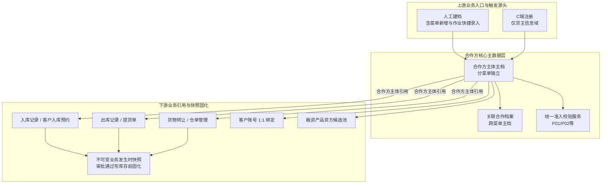

# 合作方主数据 · 公共主 PRD

> **文档体系（方案 B）**：
>
> | 层级 | 文档 | 职责 | 真源 |
> | :--- | :--- | :--- | :---: |
> | **公共** | 本文 | 背景、导航、共用页面、链路、公共规则索引 | ✅ |
> | **公共** | [合作方主数据-公共字段清单.md](./合作方主数据-公共字段清单.md) | 主档共用字段、审计、嵌入选择器公共项 | ✅ |
> | **公共** | [合作方主数据-公共业务规则规格.md](./合作方主数据-公共业务规则规格.md) | PA-R01~PA-R13（PA-R03 总则） | ✅ |
> | **子菜单** | [04-1 货主信息](./04-1-货主信息/) · [04-2 提货人信息](./04-2-提货人信息/) · [04-3 资金方信息](./04-3-资金方信息/) · [04-4 服务方信息](./04-4-服务方信息/) | 各菜单必填、库内校验、场景与验收 | ✅ |
> | *衍生* | [ASCII 线框](./合作方档案_ASCII_列表页.md) 等 | 四子菜单共用，`archiveMenu` 区分 | ❌ |
>
> **版本**：V3.6 | **更新时间**：2026-10-23 | **责任人**：森云科技（Senyun Technology）  
> **统一引用规范**：公共 **PA-R12**、**PA-R03** 总则、**PA-R03a**、**PA-R13**、**PA-R04a~c**；子菜单 **WH-R01 / PP-R01 / FN-R01 / SP-R01**。  
> **页面范围**：见 **6.0**；子菜单差异见 04-1~04-4 主 PRD。  
> **ASCII 线框（PC）**：[合作方档案_ASCII_列表页](./合作方档案_ASCII_列表页.md) · [合作方档案_ASCII_新增编辑页](./合作方档案_ASCII_新增编辑页.md) · [合作方档案_ASCII_详情页](./合作方档案_ASCII_详情页.md)  
> **ASCII 线框（H5）**：[合作方档案_ASCII_H5](./合作方档案_ASCII_H5.md)

---

## 1. 业务背景与业务痛点

### 1.1 业务背景
在 SYZC 供应链金融存货监管系统中，货主、提货人、资金方等业务主体长期分散在入库、出库、转让、仓单、融资等各模块重复手工维护。此前个人货主曾以手机号作为标识，导致主体识别标准不统一、证件地址缺失、个人货主地址重复绑定等风控漏洞。

6.3 在 **用户中心 → 合作方档案** 下拆 **货主信息、提货人信息、资金方信息、服务方信息** 四个子菜单（页面规格一致、**分菜单独立主档**）：**资金方信息** 与 **服务方信息** 字段同构、分域（抵质押单抵质押权人 vs 监管服务单质权人合规称谓）；同一证号可在不同子菜单各有一条主档。身份资料、地址规则、库内匹配见 **【主体识别与库内匹配总则】(PA-R03)** 与字段清单 **档案归属菜单**。

### 1.2 核心业务痛点
1. **主体识别分裂**：各作业单据各自维护货主，手机号与姓名检索口径不一，历史重复建档泛滥；
2. **个人货主地址风险**：缺乏证件登记地址硬核验，同一地址被多个身份证号冒用绑定为个人货主，导致开票主体与货权归属混淆；
3. **菜单与多角色 UI 叠床架屋**：四子菜单已表达合作身份，列表/详情仍重复展示「业务角色」与角色子表，运营不知去哪个菜单建档；
4. **提货人沉淀资料不全**：出库快捷建档的提货人须 **主档待补全 + 【补全资料】**，与货主域隔离；
5. **违约管控与司法存证需求**：主数据严禁物理删除，为保障在库库存与电子仓单证据链绝对完整，本期针对高危违约合作方聚焦实施精准冻结管控，延后注销功能以防法律纠纷。

---

## 2. 功能范围

| 包含功能范围 | 不包含功能范围 |
| :--- | :--- |
| - **四子菜单 = 身份域（PA-R12）**：货主 / 提货人 / 资金方 / 服务方；**分菜单独立主档**；**追加合作方档案角色** 跨菜单创建或关联主档； - **方案 B 折中 UI**：列表默认 **无业务角色列**；有关联时展示 **其他合作档案**；详情 Tab **其他合作档案**； - **四页同一壳层（方案 A）**：列表 / 详情 / 新增编辑 **四菜单布局与行操作位次完全一致**；差异仅 **04-x 必填** 与下游拦截； - **分菜单冻结（PA-R02）**：各菜单 **冻结主体** 互不影响； - **待补全派生**：任一菜单 **本菜单必填未齐** 时在 **主体状态** 旁派生「待补全」；行操作/详情 **编辑位** 改文案 **【补全资料】**（同编辑路由）；**无**独立资料完备字段； - **库内匹配（PA-R03）** + **WH-R01 / PP-R01 / FN-R01 / SP-R01**；**OCR（PA-R13）**；**PA-R04a~c**； - **P01/P02 仅货主域**；**H5 四入口**。 | - **同主档多业务角色子表 UI**； - **按角色冻结/移除**； - **注销**；**RBAC 登录角色**；**接收方**；**跨菜单合并 UI（P2）**。 |

---

## 3. 模块定位与系统链路

### 3.1 实体属性与引用关系规范

| 属性项目 | 规范要求 |
| :--- | :--- |
| **数据层级** | **【第 1 层 · 业务主体主数据层】**（全平台业务主体唯一台账） |
| **唯一识别键** | **档案归属菜单 + 身份标识** 在租户内唯一（个人身份证 / 企业信用代码）；跨子菜单同证号允许独立主档 |
| **状态控制** | **主体状态**（正常 / 冻结，分菜单互不影响）；待补全仅在必填未齐时 **派生展示**（**PP-R01**） |
| **单据引用模式** | 业务单据保存合作方主体标识引用；**凭据快照**于单据终审通过且写库存/货权变更前固化 |
| **物理删除管控** | **严禁物理删除**；管控采用 **冻结主体**；关键动作全路径审计留痕 |
| **数据隔离机制** | 租户级数据物理隔离；地址唯一校验范围为同一租户内适用项目/业务范围 |

### 3.2 档案引用与系统链路拓扑图

### 3.3 跨模块数据互通与业务快照固化

依据全系统数据互通规范，下游单据引用合作方主档时遵循以下交互约定：

| 协同模块 | 交互阶段与触发时机 | 具体数据更新行为与业务效力 |
| :--- | :--- | :--- |
| **【10-入库记录】** | 制单引用 / 提交审核 / 审批通过 | 1. **制单**：搜索或 **【+ 快速添加货主】** 绑定 `owner_partner_id`，反显只读字段与核验状态（**【合作方货主引用与快捷建档规则】(R03)**）； 2. **短信**：普通入库未验证 **零短信**；金融类提交前 **PA-R04b** + **PA-R04a**；**不在提交时建档**； 3. **快照固化**：审批通过且写库存前固化货主名称、证号、地址、企业经办人及来源。 |
| **【01-客户入库预约】** | 发起预约 / 审批通过 | 1. **作业不因 P01 缺址阻断**；新建货主时 **P02** 同址冲突在保存时同步阻断； 2. **审批联动**：审批通过时固化主体快照，转正式入库时直接继承。 |
| **【04-货物转让】** | 申请挂接 / 转让生效 | 1. **申请阶段**：在 **货主信息** 域创建/挂接 **货主 · 正常**（**不**使用待生效/接收方）；**驳回或撤销仍保留货主主档**（PA-V07）； 2. **生效**：执行 **P02**；**不因 P01 缺址阻断**。 |
| **【02-出库记录/提货单】** | 出库制单 / 提货办理 | 1. **货主**：须 **货主信息** 域嵌入式选择器引用已有主档（**制单页不提供货主快捷建档**，见出库 **【货主类型与字段隔离】(O05)**）；引用在库货主 **不因 P01 缺址阻断**； 2. **提货经办人**：**提货人信息** 域选择或 **【+ 快速添加提货经办人】**（**【提货经办人引用与快捷建档】(O06a)**）；**禁止**输入框失焦静默建档；不触发货主 **P02**；记录来源单号。 |
| **【04-客户管理】** | 实名认证通过 | 1. **账号绑定**：客户账号与 **货主信息** 域主档 1:1 绑定； 2. **建档**：个人认证通过于 **货主信息** 域创建主档并同步身份证地址。 |

---

## 4. 业务场景与用户故事

| 场景编号与名称 | 触发角色 | 核心交互与风控约束 | 业务价值 |
| :--- | :--- | :--- | :--- |
| **场景 1【货主信息菜单建档】(S01)** | 业务运营人员 | **货主信息**【+ 新增】；**PA-R03** 域内匹配；P01/P02；保存不强制短信；金融入库 **PA-R04b**。 | 菜单即货主域。 |
| **场景 1b【金融入库触发手机补验】(S01b)** | 仓储制单人员 | 货主须先 R03 引用/快捷建档；普通入库未验证可零短信提交；**质押/抵押/监管服务/仓单** 提交前 **PA-R04b** 阻断并 **PA-R04a** 补验，通过后货主变已验证且单据可提交。 | 普通作业与金融风控分层。 |
| **场景 1c【已验证货主改号】(S01c)** | 业务运营人员 | C 端已实名或金融补验后的货主，B 端修改手机号或企业【调整经办人信息】；保存前短信发往新号，通过后更新联系手机并保持已验证。 | 与现网改号验证一致。 |
| **场景 2【同菜单库内匹配】(S02)** | 业务运营人员 | **同一子菜单内** 证号/手机冲突按 **PA-R03** Toast 或 B 端企业确认更新；**跨子菜单同证号** 允许新建独立主档并提醒。 | 分菜单独立主档 + 域内唯一。 |
| **场景 2b【跨菜单同证号双主档】(S02b)** | 业务运营人员 | 货主信息已建张三，再在 **提货人信息** 用同一身份证号新建；生成第二条主档，列表各显一条。 | 对齐 PA-V07d。 |
| **场景 3【个人货主证件地址冲突拦截】(S03)** | 业务运营 / C端用户 | 试图使用已被其他有效个人货主绑定的证件地址新增或修改个人货主；系统同步阻断并统一提示「已有相同证件地址，不能绑定为该个人货主」，且**严禁泄露冲突方敏感信息**。 | 防范多主体冒用同一地址虚假质押，保障开票主体唯一性。 |
| **场景 4【出库快捷建档提货人】(S04)** | 仓储制单人员 | 出库快捷建档 → **提货人信息** 主档 **派生待补全**（缺证件地址等）；**【补全资料】**（编辑位）补录后徽章消失；不触发货主 P02。 | 现场出库 + 主档沉淀。 |
| **场景 4b【资金方信息建档】(S04b)** | 融资运营 | **资金方信息** 子菜单仅校验名称+信用代码；供 **抵质押单** 抵质押权人引用。 | 抵质押资方池。 |
| **场景 4d【服务方信息建档】(S04d)** | 监管运营 | **服务方信息** 与资金方 **同构**；供 **监管服务单** 质权人引用；同信用代码可在两域各一条主档。 | 监管合规称谓。 |
| **场景 4c【转让申请创建货主】(S04c)** | 仓储/交易运营 | 转让申请即挂 **货主信息** 域货主；单据驳回 **货主主档仍保留**。 | PA-V07。 |
| **场景 5【本菜单补全资料】(S05)** | 业务运营 / 制单员 | 任一菜单主档 **派生待补全** → 列表/详情 **【补全资料】**（同编辑页）→ 必填齐后徽章消失（提货人见 **PP-R01**）。 | 出库沉淀与人工建档收口。 |
| **场景 5b【追加合作方档案角色】(S05b)** | 业务运营 | 货主详情勾选「资金方信息」→ 弹窗确认 → 在 **资金方信息** 创建独立主档并关联。 | 跨菜单多身份。 |
| **场景 6【分菜单冻结互不影响】(S06)** | 风控审核专员 | 冻结 **货主信息** 主档；同证号 **提货人信息** 主档仍正常。 | **PA-R02**。 |
| **场景 7【审批中货主冻结联动驳回】(S07)** | 仓储审批人员 | 审批中 **货主信息** 主档被冻结；终审二次复检驳回入库。 | 风控穿透防护。 |
| **场景 8【冻结主体沉底】(S08)** | 风控审核专员 | **本菜单**【冻结主体】；仅拦截本菜单域业务；列表沉底。 | 分菜单风控。 |
| **场景 9【个人货主搬家改址】(S09)** | 业务运营人员 | 张明货主·正常，编辑证件地址至新门牌并保存；新址过准入唯一校验；**旧标准化地址出活跃池**，新址入池；历史入库快照地址不变。 | 在不开放注销前提下支持合规搬家。 |
| **场景 10【活跃池占用与冻结不释放】(S10)** | 风控审核专员 | 有效个人货主被冻结后，其证件地址**仍占活跃池**；他人无法用同址新建货主；解冻后占用关系不变。 | 防止冻结窗口期地址被抢注。 |
| **场景 11【简易重复档案合并治理】(S11)** | 平台运维（后端） | 出库误建简易主体经线下核验后，通过**数据治理接口**合并至真实主体（**6.3 无管理端合并按钮**）；单据引用迁移，快照不回写。 | 消除录入笔误；UI 入口规划 P2。 |
| **场景 12【客户端认证回调自动建档】(S12)** | 系统自动化 | C 端实名认证 → **货主信息** 域主档、联系手机已验证、账号 1:1 绑定。 | C/B 主数据打通。 |

---

## 5. 状态机与动作能力矩阵

### 5.1 主体状态机与能力矩阵

| 动作名称 | 正常 | 冻结 |
| :--- | :---: | :---: |
| **查看列表与详情** | ✅（优先展示） | ✅（沉底展示） |
| **编辑基础档案资料** | ✅（按权限） | ⚠️（仅限非关键字段） |
| **编辑证件地址** | ✅（个人须通过准入） | ⚠️（仅限纠偏且须通过准入） |
| **追加合作方档案角色** | ✅ | ❌ |
| **冻结主体** | ⚠️（风控权限；前置强校验：货主有货阻断、提货人有待提货单据阻断、资金方/服务方有进行中单据阻断；通过后弹窗必录原因 不超过 200 字，见 PA-R02） | ❌ |
| **解冻主体** | ❌ | ✅（审批通过；弹窗必录原因） |
| **注销主体** | ❌（本期不提供） | ❌（本期不提供） |
| **物理删除** | ❌（系统绝对禁止） | ❌（系统绝对禁止） |

### 5.2 待补全派生能力矩阵（摘要 · 四菜单共用壳层）

| 动作名称 | 派生待补全（主体正常） | 必填已齐 | 主体冻结 |
| :--- | :---: | :---: | :---: |
| **列表/详情【编辑】位（待补全时为【补全资料】）** | ✅ | ✅（文案为「编辑」） | ❌（仅详情 + 解冻） |
| **出库引用提货人** | ❌（**PP-R01**） | ✅ | ❌ |
| **追加合作方档案角色** | ✅ | ✅ | ❌ |

> 完整矩阵见 [公共业务规则规格](./合作方主数据-公共业务规则规格.md) 5.2 节；**不设**独立资料完备状态字段。

---

## 6. 页面交互规格索引

### 6.0 菜单与导航结构（PC / H5）

| 层级 | 菜单名称 | 说明 |
| :--- | :--- | :--- |
| **上级** | 用户中心 | 6.3 规划不变 |
| **分组（PC 侧栏）** | **合作方档案** | **仅分组标题**，**不提供**可进入的「合作方档案总列表」；**废止**「合作方管理 → 合作方档案」单页 |
| **子菜单 1** | **货主信息** | `archiveMenu=货主信息`；个人/企业 |
| **子菜单 2** | **提货人信息** | `archiveMenu=提货人信息`；个人为主；待补全 **派生**（见 04-2 必填） |
| **子菜单 3** | **资金方信息** | `archiveMenu=资金方信息`；隐式 **资金方**；仅企业；**抵质押单** 抵质押权人 |
| **子菜单 4** | **服务方信息** | `archiveMenu=服务方信息`；隐式 **服务方**；仅企业、字段同资金方；**监管服务单** 质权人 |

**PC 端（侧边栏）**

- 在 **用户中心** 模块 Sidebar 展示分组 **「合作方档案」**，其下 **四个并列可点击菜单项**：货主信息、提货人信息、资金方信息、服务方信息。
- 点击任一项进入 **同一套列表页组件**，由路由/上下文注入 **档案归属菜单**，列表 API 只查该域主档。
- **不存在** 聚合路由「合作方档案总列表」。

**H5 端（四个入口按钮）**

- 路径：`工作台 → 用户中心`。
- 在用户中心页提供 **四个入口按钮（或四卡片）**：「货主信息」「提货人信息」「资金方信息」「服务方信息」，分别跳转对应列表路由（与 PC 共用 `archiveMenu` 语义）。

**路由与 RBAC**

- **页面复用**：列表 / 新增 / 详情 **一套组件**，路由参数 `archiveMenu`（研发枚举可 `OWNER | PICKUP_PERSON | FUNDER | SERVICE_PROVIDER`）区分数据域。
- **RBAC（强制）**：四个子菜单 **分别授权、分别挂菜单路径**；**不**使用「只授合作方档案目录即通吃四页」的单权限替代。与 [00-菜单迭代记录](../00-菜单迭代记录.md)、`功能与数据权限-6.3增量.json` 对齐。

### 6.0.1 需求文档组织（方案 B · 已定稿）

> **说明**：文头「**方案 B**」指 6.3 **产品 + 文档架构**（四子菜单、分菜单主档、公共与子菜单分层三件套）。本节 **不再** 采用早期评审表里「方式 A / 方式 B」的旧称，避免与文头方案 B 混淆。索引真源：[README.md](./README.md)。

| 层级 | 路径 / 文件 | 职责 | 真源 |
| :--- | :--- | :--- | :---: |
| **公共三件套** | `04-合作方档案/合作方主数据-公共{主PRD,字段清单,业务规则规格}.md` | 背景、**6.0 导航**、共用页面规格（6.1~6.6）、**PA-R01~R13 公共部分**、规则索引 | ✅ |
| **子菜单三件套 ×4** | [04-1 货主信息](./04-1-货主信息/) · [04-2 提货人信息](./04-2-提货人信息/) · [04-3 资金方信息](./04-3-资金方信息/) · [04-4 服务方信息](./04-4-服务方信息/) | 各菜单 **必填差异**、库内匹配细则（**WH-R01 / PP-R01 / FN-R01 / SP-R01**）、子菜单验收 | ✅ |
| **衍生** | `合作方档案_ASCII_*`、`合作方档案-*推演.md` | 线框与沙盘；须 **先改三件套再同步** | ❌ |
| **跳转 stub** | `合作方档案主PRD.md` 等（历史文件名） | 指向公共层 + 子目录，**非 SSOT** | ❌ |

**不采用的组织方式（对照）**

| 旧设想 | 为何不采用 |
| :--- | :--- |
| **单文件三件套包打天下** | 四子菜单必填/细则差异大，全塞进一份字段清单易漂移；与已交付的 **04-1~04-4** 子目录冲突 |
| **顶层拆成 `04-货主/`、`05-提货人/`… 各重复 90% 正文** | 页面与规则高度共用；物理拆模块会导致 PA/WH/PP 双轨维护 |
| **只写菜单迭代、不写子 PRD** | RBAC 四行菜单 **必须** 有文档挂载点；子菜单三件套承担「差异真源」 |

**菜单 / 权限与文档的关系**

- [00-菜单迭代记录](../00-菜单迭代记录.md) 与 `功能与数据权限-6.3增量.json`：**四条菜单路径**、**四条 RBAC**（货主 / 提货人 / 资金方 / 服务方），与公共 + 子三件套 **并存**，不等于把共用正文复制四份。
- 原型 `PrototypeDocument`：**公共三件套路径 + 当前子菜单三件套**（见 [README](./README.md) 变更顺序）。

**变更顺序（强制）**

ASCII 线框放在 `04-合作方档案/` 根下，四子菜单 **共用**，`archiveMenu` 与 **档案归属菜单** 字段区分差异（见 [公共字段清单](./合作方主数据-公共字段清单.md)）。

### 6.1 列表页（PC · 四子菜单共用）
- **页面路径**：`用户中心 → 合作方档案 → 货主信息`（或提货人信息 / 资金方信息 / **服务方信息**）
- **线框基准**：[合作方档案_ASCII_列表页](./合作方档案_ASCII_列表页.md)
- **核心规格**：
  - 筛选区：主体名称/身份标识、主体类型、主体状态（**全部 / 正常 / 冻结**）、**资料完备**（**全部 / 待补全 / 完整**，按当前菜单 04-x 必填派生，与列表「待补全」徽章同判定）；展开含联系手机核验、联系手机、创建时间（**不提供创建来源筛选**；**列表筛选不提供 OCR**，OCR 见新增/编辑 **PA-R13**）；
  - 数据表格（默认 **7 列**）：序号、主体名称/身份标识、主体类型、主体状态（必填未齐时并列 **待补全** 徽章）、联系手机、创建人、操作；**有其他合作档案关联时** 增加 **其他合作档案** 条件列；
  - 行操作（**方案 A**）：【详情】→【验证联系手机】（未验证且可补验时，无则不占格）→【编辑/补全资料】→【追加合作方档案】→【冻结/解冻】；操作列每行最多 3 钮；**不含**删档/解除/注销；
  - 详情 Tab【其他合作档案】子表行操作：**仅【查看详情】**；**6.3 不提供解除关联**（见 **【跨菜单关联只读与不解除规则】(PA-R05)**）；
  - 默认多级排序规则：第一优先级主体状态加权（正常排前面、冻结沉底排后面）；第二优先级在系统中首次建档的创建日期倒序（按天维度）；第三优先级建档时间戳绝对倒序；出库快捷建档等产生的简易待补全主体作为正常主体按其建档日期正常排位（方案 A）；
  - 页面右上角【+ 新增】（文案可带当前子菜单名，如「新增货主」）。

### 6.2 新增/编辑页（PC · 四子菜单共用）
- **页面路径**：列表页点击【+ 新增{子菜单简称}】（如新增货主）或行操作【编辑】；路由携带 `archiveMenu`
- **线框基准**：[合作方档案_ASCII_新增编辑页](./合作方档案_ASCII_新增编辑页.md)
- **核心规格**：
  - **字段排布与类型切换**（详见字段清单 8.3 节）：
    - 个人：类型 → 姓名（已验证只读）→ 手机号 → 身份证号（创建后只读）→ 证件地址；
    - 企业：类型 → 企业全称（已验证只读）→ **经办人姓名**（**货主信息选填**、**提货人信息必填**；已验证默认只读，可【调整经办人信息】）→ 经办人手机 → 信用代码（创建后只读）→ 证件地址；
    - 编辑页页头展示 **联系手机核验状态** 徽章；
  - **【补全资料】编辑态**：任一菜单 **派生待补全** 时，进入 **同一路由编辑页**；身份标识等按 **PA-R04c** 只读，开放 **本菜单 04-x 必填** 录入；保存校验通过后待补全徽章消失（提货人 **PP-R01**）；
  - **联系手机核验（PA-R04a~PA-R04c）**：
    - **身份域**：由 **档案归属菜单** 确定（**PA-R12**）；**追加合作方档案角色** 选填，确认后在目标菜单 **创建独立主档** 或 **关联已有主档**；
    - 新增：**「保存并提交」不强制**短信，默认「未验证」；可选 **「保存并验证」**（【合作方档案操作权限矩阵】(PA-P02)）经场景 3 短信后建档为「已验证」并触发 **【已验证主体核心字段锁定规则】(PA-R04c)**；弹窗取消则不落库；
    - 编辑改联系手机 / 企业展开调整经办人：变更保存前短信二元核验；
    - 已验证主体：个人锁定姓名与身份证；企业锁定名称、信用代码与经办人姓名（经办人信息经展开区修改并短信确认）；
  - **改址与改手机号组合流程**：编辑页修改个人货主证件地址且与上次保存不一致时，保存前走统一准入校验（【个人货主证件地址变更规则】(PA-R06a)），**无**单独改址确认弹窗；若同时修改了手机号，须再弹出新手机号短信二元核验弹窗，双重通过后合并保存；
  - **追加合作方档案角色**（选填 · 仅新增页）：
    - 勾选 **0 项**：按本菜单 **PA-R03** 直接保存；
    - 勾选 **≥1 项**：走 **【追加多身份一次保存原子规则】(PA-R03a)**——预检 → **一次**「确认一并保存」→ 单事务落库；成功/失败 **分项清单** 提示（失败时 **未写入任何档案**）；**【保存并验证】** 短信通过后再预检与确认；
    - 列表/详情 **【追加合作方档案】** 多选目标同样走 **PA-R03a**（预检 → 一次确认 → 分项反馈）；
  - 资金方/服务方企业锁定等同各子菜单字段清单；
  - 企业 **信用代码 / 企业名称** 输入旁 **识别营业执照**（PC/H5，失败可手输）；
  - 未保存离开 Dirty 拦截。

### 6.3 详情页（PC · 四子菜单共用）
- **页面路径**：列表页行操作点击【详情】或名称下钻
- **线框基准**：[合作方档案_ASCII_详情页](./合作方档案_ASCII_详情页.md)
- **核心规格**：
  - 页头：主体名称、类型、脱敏证号、合作方主体标识、**档案归属菜单**、主体状态（必填未齐并列 **待补全** 徽章）；可选同证号提示；操作【返回】【编辑/补全资料】（互斥文案、同路由）、【验证联系手机】、【追加合作方档案】【冻结主体】；
  - 底部标签页：
    - **标签页 1【基础档案】**：在页头主体标识信息之外，采用三行结构化分区并排展示：
      - **第 1 行（主体业务资料）**：联系手机核验状态、**核验时间**（未验证为 ——）、联系电话（脱敏）、企业经办人姓名、证件地址；
      - **第 2 行（创建建档信息）**：**创建来源**（货主：**C端注册 / 人工建档**；提货人/资金方/服务方：**仅人工建档**）、创建人与创建时间并排展示（建档审计属性归组；**列表不提供创建来源筛选**）；
      - **第 3 行（最后维护信息）**：更新人（展示格式为「姓名（所在机构）」，必须附带所在机构单位）与更新时间并排展示（维护审计属性归组）；
    - **标签页 3【关联客户账号】**：只读 C 端绑定与认证状态；
    - **标签页 4【操作审计日志】**：仅本主档 **创建、修改、冻结、解冻** 四类时间轴（【操作审批日志生成与防篡改规则】(PA-R07) · Tab 展示范围）；不含下游单据快照固化；文案见 [合作方档案-操作审计日志文案速查.md](./合作方档案-操作审计日志文案速查.md)；
    - **6.3 不提供【关联业务单据】Tab**（货/单在仓储、交易模块查询；若后续聚合菜单再评估恢复）。

### 6.4 嵌入场景：「查看货主」跳转规格
- **唤起入口**：仓储入库记录、客户入库预约等页面，选中已建档货主后提供【查看货主】链接；
- **交互动作**：新标签打开 **货主信息** 域对应详情；
- **展示要素**：详情页头与基础档案（含 **档案归属菜单**、主体状态）；**无** 业务角色 Tab；
- **待补全**：按 **04-x 必填** 派生；详情 **【补全资料】**（编辑位）进入同编辑页。

### 6.5 下游合作方选择器规范
- **返回数据结构**：合作方主体标识、**档案归属菜单**、主体名称、脱敏身份标识、主体类型、**业务合作角色（派生）**、主体状态、联系手机核验状态、**是否派生待补全**（布尔，非持久字段）；
- **过滤**：本菜单主体 **正常** 且未冻结、**本菜单必填已齐**（出库提货人见 **PP-R01**）；制单域与菜单一致（入库→货主信息；出库→提货人信息；等）。

### 6.6 移动端（H5）
- **菜单入口**：工作台 → 用户中心 → **四个入口按钮（或四卡片）**：货主信息 / 提货人信息 / 资金方信息 / **服务方信息**（**无**聚合总列表；与 PC 四子菜单、`archiveMenu` 一致）；
- **原型路由（示例）**：`/m/workspace/user-center/partner-archives/owner` 等，与 PC 共用 `archiveMenu` 参数；
- **列表页**（交互对齐入库记录、入库暂存登记、设备预警信息）：
  - 筛选：关键词、Pill（主体类型、主体状态、资料完备）；更多筛选同 PC（含联系手机核验；无业务角色 Pill；**无 OCR**）；
  - 卡片摘要：名称、主体标识、类型、状态、其他合作档案（若有）、联系手机+核验、创建人；卡片 Footer **方案 A 单行文字链**（右对齐，对齐仓储单据 H5 卡片；详情/验证/编辑/追加/冻结，无胶囊栅格）；
  - 列表右下角固定悬浮【+】进入新增（对齐入库暂存登记 FAB），需具备【合作方档案操作权限矩阵】(PA-P02) 新建权限；
- **详情页**（排版对齐入库详情）：
  - 顶部白色**基础信息区**（对齐 PC 页头）：主体名称、主体类型/主体状态/待补全徽章、身份标识与 **合作方主体标识**；联系手机、证件地址、联系手机核验等见 **基础档案** Tab；
  - Tab：基础档案、**其他合作档案**、关联客户账号、操作审计日志；
  - **详情无底部操作条**（只读）；管控与验证在 **列表卡片**，与 PC 列表操作列 + PC 详情页头一致；基础档案 Tab 证件地址缺址 inline：正常态引导列表卡片【补全资料】，冻结态引导先解冻（与 PC 详情 inline 一致）；
- **新增/编辑页**：
  - 卡片：基础档案（含 OCR）、证件地址、**追加合作方档案角色**（选填 · 勾选其他子菜单，隐式身份由 `archiveMenu` 派生）；
  - 新增页多选追加与 PC 一致走 **【追加多身份一次保存原子规则】(PA-R03a)**：预检 → 底部 Sheet「确认一并保存」→ 成功/失败分项反馈；
  - 新增页 **【保存并提交】+【保存并验证】** 双按钮（与 PC 6.2 一致）：默认「未验证」；「保存并验证」走场景 3 短信，通过后原子建档「已验证」，取消不落库（【合作方短信二元身份核验服务规则】(PA-R04a) / 【合作方档案操作权限矩阵】(PA-P02)）；
  - 编辑/补全：待补全只读身份区 + 地址补全；已验证锁定核心字段；改手机走短信核验 Sheet，改址走表单保存前准入校验；未保存离开须 Dirty 二次确认；
- **PC 与 H5 关系**：同一租户主数据、同一状态机与 PA 规则；列表行操作矩阵双端一致；企业「调整经办人信息」展开区以 PC 为准（H5 P2）。

---

## 7. 核心业务规则索引

| 规则编码与名称 | 规则核心逻辑摘要 | 规则规格唯一定义章节 |
| :--- | :--- | :--- |
| **【分菜单主体引用与拦截规则】(PA-R01)** | 引用须匹配档案归属菜单；提货人待补全阻断；本菜单冻结阻断 | [公共业务规则规格 「六、」](./合作方主数据-公共业务规则规格.md) |
| **【分菜单主体冻结与在途在库前置校验规则】(PA-R02)** | 冻结前置强校验（货主在库在押/提货人待提货/资方服务方进行中单据）；分菜单独立冻结；入库终审联动 | [业务规则规格 「六、」](./合作方主数据-公共业务规则规格.md#分菜单主体冻结与在途在库前置校验规则pa-r02) |
| **【主体识别与库内匹配总则】(PA-R03)** | 分菜单独立主档；跨菜单提醒；细则在子菜单 | [公共业务规则规格](./合作方主数据-公共业务规则规格.md) |
| **【追加多身份一次保存原子规则】(PA-R03a)** | 新增页多选追加：预检、一次确认、同事务、分项成功/失败反馈 | [公共业务规则规格 「六、」](./合作方主数据-公共业务规则规格.md#追加多身份一次保存原子规则pa-r03a) |
| **【货主信息库内匹配与准入规则】(WH-R01)** | 货主域匹配、P01/P02、B/C | [04-1 货主信息](./04-1-货主信息/货主信息业务规则规格.md) |
| **【提货人信息库内匹配规则】(PP-R01)** | 三角校验、出库快捷建档 | [04-2 提货人信息](./04-2-提货人信息/提货人信息业务规则规格.md) |
| **【资金方信息库内匹配规则】(FN-R01)** | 名称+信用代码、名称确认；抵质押单域 | [04-3 资金方信息](./04-3-资金方信息/资金方信息业务规则规格.md) |
| **【服务方信息库内匹配规则】(SP-R01)** | 同构 FN-R01；监管服务单质权人域 | [04-4 服务方信息](./04-4-服务方信息/服务方信息业务规则规格.md) |
| **【合作方子菜单分视图与隐式角色规则】(PA-R12)** | 四子菜单、隐式角色、资金方/服务方合规分域；废止接收方 | [业务规则规格 「六、」](./合作方主数据-公共业务规则规格.md#合作方子菜单分视图与隐式角色规则pa-r12) |
| **【企业营业执照 OCR 识别规则】(PA-R13)** | 企业新增/编辑表单 OCR，失败可手输；**不含**列表筛选 | [业务规则规格 「六、」](./合作方主数据-公共业务规则规格.md#企业营业执照-ocr-识别规则pa-r13) |
| **【货主准入与地址唯一联动规则】(PA-R04)** | **P01** 仅档案保存（个人+企业）；**P02** 个人/企业货主分池唯一；仓储/仓单/转让作业 **不因 P01 缺址阻断** | [业务规则规格 「六、」](./合作方主数据-公共业务规则规格.md#货主准入与地址唯一联动规则pa-r04) |
| **【合作方短信二元身份核验服务规则】(PA-R04a)** | 统一短信服务；管理端新增免强制短信；改号与企业经办人调整须核验 | [业务规则规格 「六、」](./合作方主数据-公共业务规则规格.md#合作方短信二元身份核验服务规则pa-r04a) |
| **【联系手机核验状态与金融场景强制核验规则】(PA-R04b)** | 未验证/已验证；普通入库零短信；金融全链路提交前强制补验 | [业务规则规格 「六、」](./合作方主数据-公共业务规则规格.md#联系手机核验状态与金融场景强制核验规则pa-r04b) |
| **【已验证主体核心字段锁定规则】(PA-R04c)** | 已验证后锁定个人姓名/证号、企业名称/证号/经办人 | [业务规则规格 「六、」](./合作方主数据-公共业务规则规格.md#已验证主体核心字段锁定规则pa-r04c) |
| **【跨菜单关联只读与不解除规则】(PA-R05)** | 6.3 不提供解除关联；关联仅追加建立、子表只读跳转 | [业务规则规格 「六、」](./合作方主数据-公共业务规则规格.md#跨菜单关联只读与不解除规则pa-r05) |
| **【货主地址唯一活跃池规则】(PA-R06)** | 正常个人货主占用活跃池；冻结不释放；无注销/移除货主 | [业务规则规格 「六、」](./合作方主数据-公共业务规则规格.md#货主地址唯一活跃池规则pa-r06) |
| **【个人货主证件地址变更规则】(PA-R06a)** | 改址过准入；旧址出池、新址入池；历史快照不回写 | [业务规则规格 「六、」](./合作方主数据-公共业务规则规格.md#个人货主证件地址变更规则pa-r06a) |
| **【操作审批日志生成与防篡改规则】(PA-R07)** | 遵循“事成才记、有变必录、无动不写”；详情 Tab4 仅展示主档增改冻解；单据快照不在 Tab4；Commit Only | [业务规则规格 「六、」](./合作方主数据-公共业务规则规格.md#操作审批日志生成与防篡改规则pa-r07) |
| **【状态变更按钮驱动规则】(PA-R08)** | 主体与角色状态在所有表单中设为只读徽章；严禁下拉直接改动，必须经专属按钮（冻结/解冻）驱动 | [业务规则规格 「六、」](./合作方主数据-公共业务规则规格.md#状态变更按钮驱动规则pa-r08) |
| **【列表多级加权排序规则】(PA-R11)** | 第一优先级正常在前/冻结沉底；同状态按首次在系统中建档的创建日期倒序；静默沉淀待补全主体正常排位 | [业务规则规格 「六、」](./合作方主数据-公共业务规则规格.md#列表多级加权排序规则pa-r11) |
| **【并发防重与幂等规则】(PA-R09)** | 采用防重令牌、分布式锁与数据库租户级联合唯一索引三重防护，防范并发重复提交 | [业务规则规格 「六、」](./合作方主数据-公共业务规则规格.md#并发防重与幂等规则pa-r09) |
| **【简易沉淀与合并治理规则】(PA-R10)** | 录入错误产生的简易档案后续走原子事务合并至真实主体，原记录置失效留痕，不重复建档 | [业务规则规格 「六、」](./合作方主数据-公共业务规则规格.md#简易沉淀与合并治理规则pa-r10) |
| **【租户与项目数据隔离规则】(PA-P01)** | 主体增删改查与状态变更强校验当前租户标识；跨租户物理隔离且互不比较地址 | [业务规则规格 「八、」](./合作方主数据-公共业务规则规格.md#租户与项目数据隔离规则pa-p01) |
| **【合作方档案操作权限矩阵】(PA-P02)** | 平台管理、业务运营与风控人员严格按权限矩阵隔离新建、编辑、冻结与解冻操作（本期无注销） | [业务规则规格 「八、」](./合作方主数据-公共业务规则规格.md#合作方档案操作权限矩阵pa-p02) |

---

## 8. 非功能性需求

### 8.1 性能要求
- **列表检索响应时间**：在租户 5 万级合作方数据量下，组合多条件模糊检索响应时间 不超过 0.8 秒；
- **统一准入接口响应时间**：地址标准化与唯一性比对服务单次调用耗时 不超过 100 毫秒；
- **详情页标签切换**：各标签页采用异步按需加载，首屏渲染耗时 不超过 0.5 秒。

### 8.2 安全性与合规性
- **敏感数据脱敏**：个人身份证号展示脱敏中间 8 位，手机号脱敏中间 4 位；地址冲突提示绝对禁止回显冲突主体的姓名与证号；
- **数据防篡改**：已发生业务单据中的主体历史快照一旦生成即刻固化，合作方主档后续资料变更严禁回写历史单据；
- **审计留痕追溯**：主体资料修改、状态变更、角色增删操作日志保留 5 年以上不可更改。

---

## 9. 修订记录

| 日期 | 版本 | 变更内容说明 | 影响范围 | 修订人 |
| :--- | :--- | :--- | :--- | :--- |
| 2026-10-22 | **V3.6** | **列表/H5 行操作对齐**：方案 A 增加条件【验证】、无占位、每行最多 3 钮；H5 详情只读无底栏；PA-V14 与 6.1/6.6 同步。 | 6.1、6.6、7 | 产品团队 |
| 2026-10-22 | **V3.5** | **改址交互收敛**：废止改址弹窗原因录入；6.2/6.6、PA-R06a 与审计 M04 对齐；ASCII/原型同步。 | 6.2、6.6、7 | 产品团队 |
| 2026-10-22 | **V3.3** | **创建来源收敛**：全板块 C端注册 / 人工建档；货主两值、其余三菜单仅人工建档；列表不提供创建来源筛选，仅详情展示；拓扑图与 6.1/6.3 同步。 | 3.2、6.1、6.3 | 产品团队 |
| 2026-09-20 | V1.0 | **初始化 6.3 统一合作方档案主 PRD**：确立以身份证/信用代码为唯一主键的主档定位与双层状态机。 | 全模块 | AI PM / 森云科技 |
| 2026-09-20 | **V1.5** | **规范化重构（对齐基准版样式与语言去水）**： 1. 规范文头为 4 行精干引用块，移除大段说教表格； 2. 建立【包含】vs【不包含】双栏功能范围表与跨模块数据互通表； 3. 全量汉化专业术语（Tab/Tag/Badge/Dirty 等）； 4. 重构 11 场景故事表为标准 4 列自解释格式，条目化核心业务规则索引。 | 主 PRD 全文 | AI PM / 森云科技 |
| 2026-10-08 | **V1.6** | **需求裁切与规则优化落地**： 1. 本期下线注销货主与注销主体功能，聚焦冻结与解冻管控； 2. 确立列表多级加权排序规范（正常在上、冻结沉底；同状态按首次建档日期倒序；静默沉淀待补全主体按方案 A 正常参与建档日期排序）； 3. 明确操作审批日志“事成才记、有变必录、无动不写”三大生成场景（资料变动、状态管控、系统联动）。 | 全文各章节 | AI PM / 森云科技 |
| 2026-10-08 | **V1.7** | 新增改址场景 S09、活跃池冻结 S10；PA-R06/06a 索引；合并治理改 S11（P2 无 UI）。 | 场景与规则索引 | AI PM / 森云科技 |
| 2026-10-08 | **V1.8** | **企业联系电话升级与短信二元核验全闭环**： 1. 功能范围补充编辑改手机号二元短信核验说明； 2. 规范 6.2 节新增/编辑字段排布顺序（个人：名称-手机-身份证号；企业：名称-联系电话-信用代码）； 3. 企业联系电话严格要求为 11 位有效手机格式； 4. 补充单据沉淀待补全模式下基础资料全部只读卡片展示； 5. 串联个人货主改址准入与改手机号二元短信核验复合保存流程（**2026-10-22 起无单独改址弹窗**，见 **V3.5**）。 | 第2节 功能范围、6.2 节 页面规格 | AI PM / 森云科技 |
| 2026-10-08 | **V1.9** | **定稿 PA-R04a 与入库 R03 共用短信核验**：修订 S01，明确管理端人工新增合作方与入库/预约「创建新货主」在准入通过后共用同一套短信二元身份核验能力，取消「内网人工建档免核验」差异表述。 | 第4节 场景 S01 | AI PM / 森云科技 |
| 2026-10-19 | **V2.5** | **入库 R03 快捷建档**：3.3 协同表改 10-入库记录；S01b 对齐 PA-R04b；功能范围补充入库快捷建档与 PA-R04a 表述。 | 第2、3、4节 | 产品团队 |
| 2026-10-16 | **V2.4** | **移动端合作方档案纳入范围**：工作台新增「用户中心 → 合作方档案」；主 PRD 新增 6.6 节 H5 列表/详情/表单说明；删除「H5 不设独立维护入口」旧表述，明确 H5 精简能力与 PC 分工。 | 第2节、6.6、文头页面范围 | AI PM / 森云科技 |
| 2026-10-16 | **V2.3** | 【查看货主】改为新标签跳转合作方详情，取消弹窗与右侧抽屉；待补全走详情页头【去补全资料】。 | 6.4 | AI PM / 森云科技 |
| 2026-10-16 | **V2.2** | 列表 8 列与联系手机列徽章、展开筛选核验状态；详情页头【验证联系手机】与 Tab1 核验时间；新增「保存并验证」双按钮。 | 6.1~6.3 | AI PM / 森云科技 |
| 2026-10-16 | **V2.1** | 列表增加联系手机列与筛选；「初始业务角色」口径合并为「业务角色（首次挂接）」新增页文案。 | 6.1、6.2 | AI PM / 森云科技 |
| 2026-10-16 | **V2.0** | **评审定稿：联系手机核验分场景**：管理端免短信建档 + 未验证展示；普通入库零短信；金融 PA-R04b 强制补验；PA-R04c 已验证锁定；企业经办人姓名与展开调整；S01/S01b/S01c；同步 R03。 | 第2、4、6、7节 | AI PM / 森云科技 |
| 2026-10-20 | **V3.2** | **6.0.1 定稿**：公共 + 04-1~04-4 分层三件套；废止旧「方式 A/B」表述；6.1~6.6 统一四子菜单、H5 四入口、选择器四域。 | 6.0.1、6.1~6.6 | 产品团队 |
| 2026-10-23 | **V3.8** | **列表筛选不提供 OCR**：6.1/6.6 与 **PA-R13** 索引同步；OCR 仅新增/编辑。 | 6.1、6.6、规则索引 | 产品团队 |
| 2026-10-23 | **V3.7** | **PC/H5 交互与文档对齐**：H5 详情缺址 inline 与 PC 冻结/补全引导一致；6.6 补充说明。 | 6.6 | 产品团队 |
| 2026-10-23 | **V3.6** | **PA-R03a**：新增页多选追加一次保存原子、分项反馈；6.2 与 ASCII 6.5 同步。 | 6.2、规则索引 | 产品团队 |
| 2026-10-20 | **V3.3** | **方案 B 折中定稿**：其他合作档案；追加合作方档案角色跨菜单创建；分菜单冻结；提货人资料完备 + **【补全资料】**。 | 2~7 章 | 产品团队 |
| 2026-10-20 | **V3.5** | **冻结前置强校验定稿**：货主在库在押货物强阻断、提货人待提货单据强阻断、资金方/服务方进行中单据强阻断（PA-R02）。 | 第 4、7 章 | 产品团队 |
| 2026-10-20 | **V3.4** | **方案 A + 待补全派生**：四菜单列表/详情/表单 **同一壳层**；行操作固定位次；待补全按 **04-x 必填** 统一派生；废止独立资料完备字段表述。 | 2、5、6 章 | 产品团队 |
| 2026-10-20 | **V3.2.1** | **文档债扫尾**：3.3 出库货主仅选已有档案 + 提货 **O06a**；6.1 列表排序文案去噪。 | 3.3、6.1 | 产品团队 |
| 2026-10-20 | **V3.1** | **服务方信息** 第四子菜单；SP-R01；抵质押/监管服务分域引用。 | 1、2、6.0、7 | 产品团队 |
| 2026-10-20 | **V3.0** | **方案 B 文档拆分**：公共三件套 + 04-1~04-4 子菜单三件套；规则索引 WH/PP/FN/SP。 | 全文 | 产品团队 |
| 2026-10-20 | **V2.6** | **合作方档案主菜单 + 三子菜单**：6.0 导航（货主信息/提货人信息/资金方信息）；分菜单独立主档；PA-R03/12/13；转让货主保留；场景与页面规格同步字段清单 V2.5。 | 全文 | 产品团队 |
