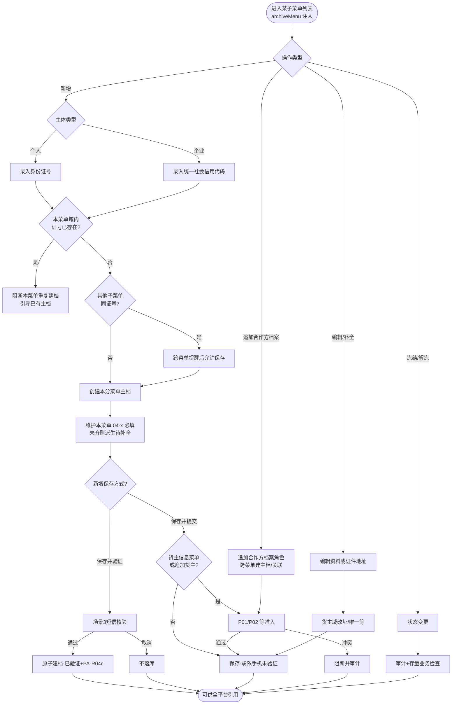
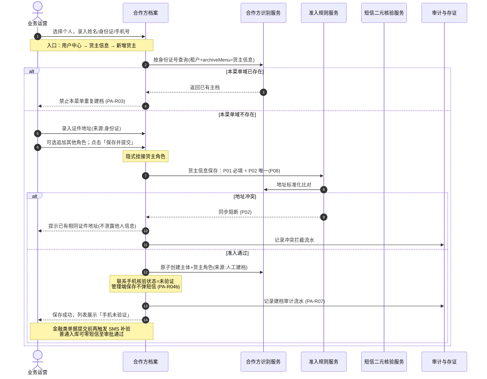
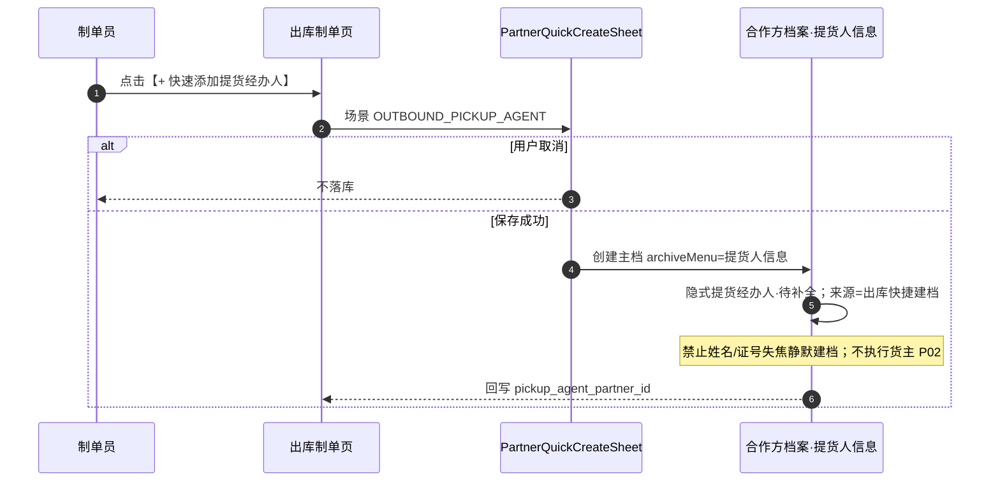
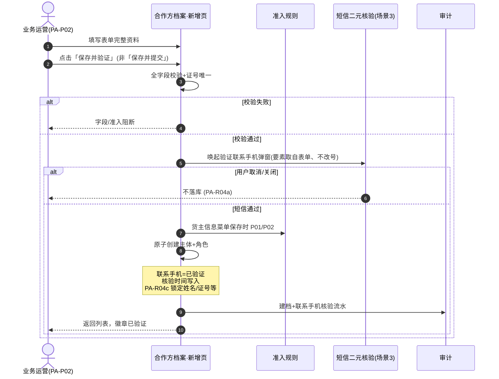
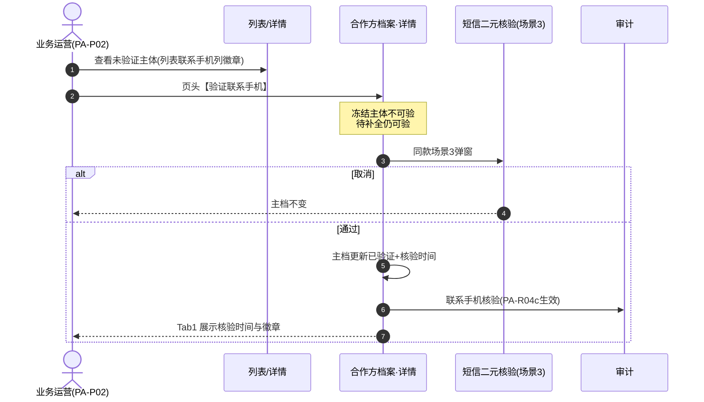
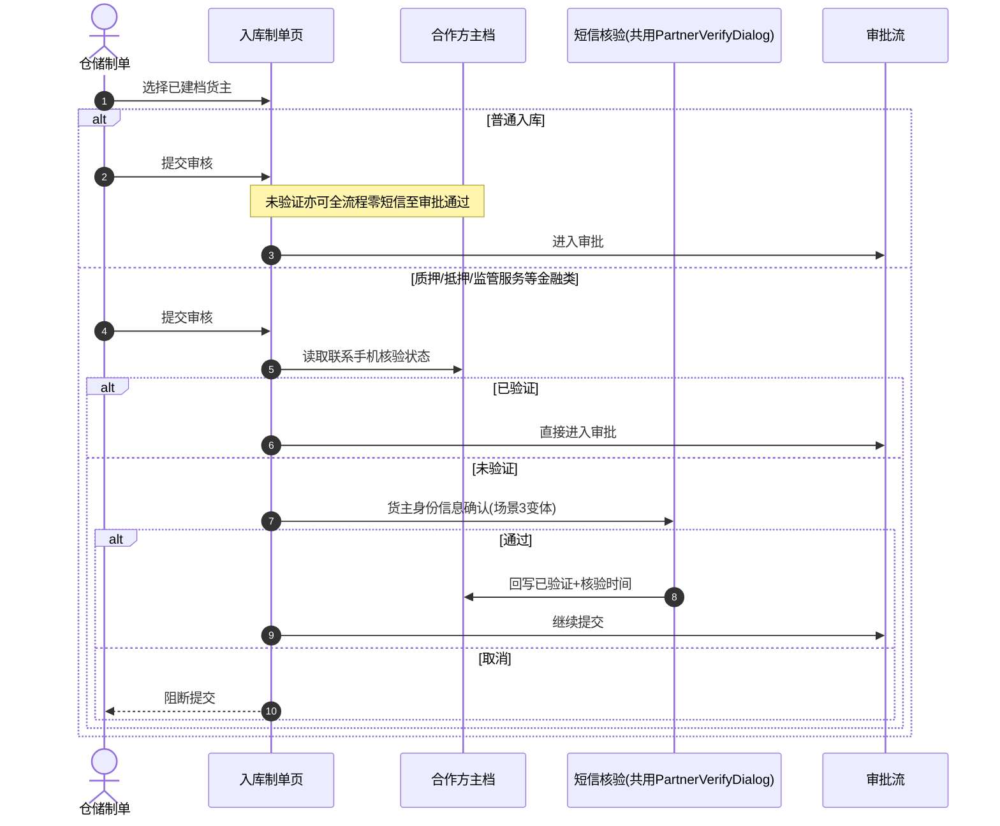
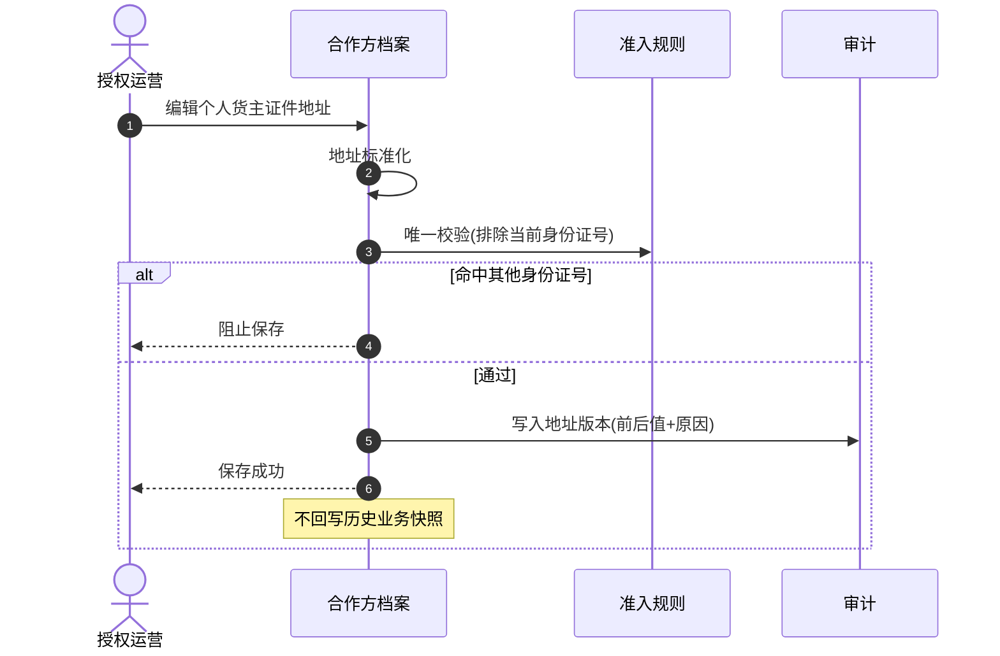

# 合作方档案-业务流程推演

> **覆盖场景**：人工建档（保存并提交 / 保存并验证）/ 详情主动补验 / 金融入库手机补验 / **C端注册**沉淀 / **出库提货人快捷建档（O06a）** / **追加合作方档案角色** / 证件地址维护 / **分菜单冻结主体**（本期不提供注销）  
> **不展开范围**：融资产品资方候选池内部算法、银行核心账务、具体 DB 表结构  
> **参考文档**：[合作方主数据-公共主PRD](./合作方主数据-公共主PRD.md) · [合作方主数据-公共业务规则规格](./合作方主数据-公共业务规则规格.md) · [货主准入规则-业务流程推演](../01-合作方准入规则/合作方准入规则-业务流程推演.md)（归档） · [合作方改造-存量业务单据协同规格](../05-存量改造与关联业务协同/合作方改造-存量业务单据协同规格.md)  
> **版本**：V2.2 | 2026-10-20  
> **H5 线框**：[合作方档案_ASCII_H5](./合作方档案_ASCII_H5.md)

---

## 一、业务流程概述

### 1.1 核心业务特征说明

- ✅ **分菜单主体识别（PA-R03）**：个人/企业以身份标识 + **档案归属菜单** 在租户内唯一；**跨菜单同证号可各建一条主档**（须跨菜单提醒，不自动合并）。
- ✅ **菜单即身份域 + 追加合作方档案角色（PA-R12）**：进入某子菜单即该域主档；可选 **追加合作方档案角色** 跨菜单建主档/关联；**无**业务角色子表 UI；**待补全** 由 04-x 必填 **派生**（方案 A）。
- ✅ **证件地址主档维护**：个人来源身份证、企业来源营业执照/企业认证资料；列表默认展示状态或脱敏，不全量暴露。
- ⚠️ **货主准入联动**：**【货主证件地址必填校验规则】(P01)** 与 **P02** 仅 **货主信息** 菜单保存及货主域追加/改址等；配置入口为 **货主准入策略**（基础配置）。
- ⚠️ **分菜单主体冻结（PA-R02）**：冻结 **货主信息** 主档不自动冻结同证号在 **提货人信息** 等的独立主档。
- ✅ **联系手机核验分场景（方案 C · PA-R04a/b/c）**：管理端「保存并提交」免短信、初始未验证；可选「保存并验证」、列表【验证】或详情【验证联系手机】经场景 3 短信后已验证；普通入库存量货主零短信；金融类提交前对未验证货主强制补验（与 R03 共用弹窗服务）。

### 1.2 端侧入口（PC / H5）

| 端 | 菜单路径 | 维护能力边界 |
| :--- | :--- | :--- |
| **PC** | 用户中心 → 合作方档案 → **货主信息 / 提货人信息 / 资金方信息 / 服务方信息**（四子菜单，`archiveMenu` 分域） | 同一套列表/新增/详情；列表 **无业务角色筛**；新增文案随子菜单；详情 **无关联业务单据 Tab** |
| **H5** | 工作台 → 用户中心 → **四入口按钮** 进四列表 | 卡片列表 + 筛选抽屉、FAB 新增（带 `archiveMenu`）；**方案 A 行操作在列表卡片**（含条件【验证】，每行最多 3 钮）；详情 Tab **只读无底栏**；重度改址/企业经办人展开以 PC 为准（公共字段清单 8.8） |

两端共用同一主数据与 **PA-R01~PA-R11**；列表排序均遵循【列表多级加权排序规则】(PA-R11)。

### 1.3 本业务在全局数据链路中的位置

### 1.4 完整端到端流程图

---

## 二、涉及角色与参与主体

| 参与主体 | 核心职责 | 参与节点与权限说明 |
| :--- | :--- | :--- |
| 平台管理员 | 建档、地址修改、准入规则、冻结/解冻 | 全权限；敏感字段按最小必要（本期无注销） |
| 业务运营 | 人工建档、补全资料、追加合作方档案 | 新增/编辑；地址修改需授权 |
| 风控人员 | 冻结/解冻本菜单主体、冲突治理 | **PA-R02** 分菜单冻结；查看冲突摘要 |
| 项目管理员 | 本项目范围内合作方维护 | 按项目数据权限隔离 |
| C 端客户 | 认证时创建/绑定主体 | 经客户管理间接沉淀，非本菜单直接操作 |
| 业务单据 | 作业快捷建档 / 引用 | 入库货主 **R03**；出库提货人 **O06a**（**禁止**失焦静默）；出库货主 **仅选已有** 档案 |

---

## 三、涉及单据、记录与职责

| 单据 / 记录名称 | 业务层级 | 核心职责 | 上游来源 | 下游联动 | 实物与资产状态影响 |
| :--- | :--- | :--- | :--- | :--- | :--- |
| 合作方主体（分菜单主档） | 主档 | 身份资料 + **档案归属菜单** | 人工/C端/单据/转让挂接 | 全业务引用（按域选择器） | 货主信息域决定入库货主资格 |
| 关联合作档案 | 跨菜单关联 | 追加合作方档案角色 | 运营确认 | 只读跳转 | 不替代各菜单主档 |
| 证件地址及来源 | 主档字段 | 开票主体识别、个人唯一校验 | 身份证/营业执照 | 结算开票引用 | 历史单据保存快照不回写 |
| 地址变更记录 | 审计层 | 前后版本、操作人、原因 | 编辑保存 | 合规追溯 | 不影响历史快照 |
| 客户账号绑定 | 关联层 | C端账号↔合作方 | 客户管理 | C端业务 | 无直接库存影响 |
| 业务主体快照 | 凭证层 | 发生时身份+地址 | 各作业单据生效 | 货权/结算/存证 | 固化不可变 |

---

## 四、主流程时序推演

### 4.1 新增个人主体并赋予货主角色

### 4.2 出库提货人快捷建档（O06a · 提货人信息域）

> **货主**：出库制单须 **货主信息** 域选择已有主档，**不提供**制单页货主快捷建档（见 11-出库 **O05**）。本节仅描述 **提货经办人**。

### 4.3 新增「保存并验证」（场景 3 · 原子建档）

### 4.4 详情主动补验（路径 A）

### 4.5 金融入库补验（路径 B · 普通入库零短信）

### 4.6 个人货主修改证件地址

---

## 五、单据与事件级联联动规则表

| 触发动作 | 触发条件 | 级联影响对象 | 传递与继承数据 | 状态与后置变更 | 异常回滚策略 |
| :--- | :--- | :--- | :--- | :--- | :--- |
| 创建个人货主 | 地址唯一通过 | 合作方主体+货主角色 | 身份证、地址、来源 | 主体正常/待补全 | 事务回滚，不残留半成品 |
| 追加货主角色 | 已有个人主体 | 角色关系表 | 来源单据号 | 执行货主准入 | 冲突则不加角色 |
| 冻结货主角色 | 风控/人工 | 新入库/融资发单 | 冻结原因 | 仅拦截货主相关新业务 | 审批通过时再校验，冻结则拦截通过 |
| 冻结主体 | 命中风控或管控 | 全部角色 | 冻结原因 | 暂停发起新业务 | 列表沉底排序（本期不提供注销） |
| 地址主档修改 | 保存成功 | 历史单据 | 无回写 | 新单据用新地址 | 保留地址版本链 |
| C端注册建档 | 实名认证通过 | 客户账号关联 | 认证资料同步地址 | 创建来源=C端注册；联系手机已验证 | 认证失败不建主体 |
| 保存并验证 | 场景3短信通过 | 新建主体 | 全量表单 | 已验证+PA-R04c | 取消弹窗不落库 |
| 列表/详情补验 | 未验证+可补验 | 主档 | — | 已验证+核验时间 | 取消不变更 |
| 金融入库提交 | 货主未验证 | 主档+入库单 | 短信通过后继续 | 货主变已验证 | 取消阻断提交 |

---

## 六、关键异常与分支处置推演

- **分支 1【本菜单域证号重复建档】**：同一 **档案归属菜单** 内证号已存在则阻断；**不**禁止在其他子菜单另建主档（须跨菜单提醒，见 **PA-V07d**）。
- **分支 2【个人货主地址冲突】**：阻止保存/加角色；不展示已有主体姓名、身份证号、完整地址；见决策清单「地址冲突提示文案在不同场景是否统一」。
- **分支 3【简易档案直接当货主】**：待补全且缺必填地址时，追加货主或入库选为货主必须在提交前补全；见「简易沉淀档案何时能作为货主」。
- **分支 4【提货人后续加货主】**：原仅提货人角色、地址与他人货主冲突 → 追加货主时执行唯一校验并阻断。
- **分支 5【改址与活跃池】**：正常货主占用活跃池；**改址 (PA-R06a)** 旧址出池、新址入池；冻结不释放；无注销/移除货主。
- **分支 6【企业地址维护】**：不参与个人一对一校验；需与营业执照/企业认证资料核对。
- **分支 7【保存并验证取消】**：场景 3 弹窗关闭或取消时**不得**写入半成品主体；仅「保存并提交」或验证通过后落库。
- **分支 8【双路径补验】**：路径 A 列表【验证】或详情页头【验证联系手机】；路径 B 金融入库提交前；列表联系手机列仍展示核验徽章。

---

## 七、关键架构决策与证据留痕

1. **为什么业务角色不进 RBAC 角色管理？**  
   货主/提货人是业务关系，不是 B 端登录权限；混用会导致权限模型不可维护。

2. **为什么证件地址只在主档维护？**  
   避免入库、出库、转让等多处重复录入导致不一致；业务单据仅保存快照。

3. **为什么按角色隔离冻结？**  
   同一企业可能既是货主又是监管仓；全局冻结会误伤第三方存货出库（见合作方管理需求 Q4）。

4. **为什么禁止物理删除？**  
   遵循 SYZC 主数据规范（2.3 节）；冻结管控+历史快照保留司法追溯效力。

5. **为什么冲突不走审批？**  
   地址冲突属于准入校验，应同步阻断，不应进入审批中心增加无效待办。

---

## 八、本菜单相关问题与决策

| 主题 | 问题 | 决策方案 |
| :--- | :--- | :--- |
| 多入口校验一致性 | 合作方档案人工建档与入库「创建新货主」校验是否一致？ | **统一准入 + 共用 PA-R04a / R03 弹窗组件**；管理端「保存并提交」免短信未验证；「保存并验证」/列表或详情补验/金融补验/入库新货主走短信；普通入库存量货主零短信 |
| C端注册默认货主 | C端注册是否默认增加货主角色？ | **默认增加货主**；认证完成时同步执行证件地址准入；创建来源记 **C端注册** |
| 地址冲突提示 | 地址冲突提示文案如何表述？ | 「已有相同证件地址，不能绑定为该个人货主」；不泄露他人信息 |
| 简易档案当货主 | 「待补全」简易档案何时能当货主？ | 缺必填地址时**禁止**作为货主提交；须先补全 |
| 地址占用 | 货主地址能否被他人复用？ | **正常货主占活跃池**；**改址 (PA-R06a)** 旧址出池；**冻结不释放**；历史快照**永久保留** |
| 作用域 | 主体与地址唯一的作用域？ | **租户隔离**；地址唯一在租户内适用项目/业务范围 |
| 地址标准化 | 地址如何做标准化比较？ | 标准化比较值做唯一校验；保留原文；见决策清单 |
| H5 四入口 | 移动端是否维护合作方主档？ | **6.3 纳入**：用户中心 **四按钮** 进四列表（`archiveMenu`）；与 PC 同库；作业页选择器须带域（入库→货主信息） |
| 转让货主 | 是否还用接收方/待生效？ | **废止**；申请即在 **货主信息** 域挂 **货主·正常**；驳回 **保留主档**（**PA-V07**）；生效执行 **P02**，不因 P01 缺址阻断作业 |
| 出库货主 | 制单页能否快捷新建货主？ | **否**；须引用已有 **货主信息** 主档（须在库有货）；新货主走 **入库 R03** 等入口后再出库引用 |

完整用例沙盘与校验数据见 [合作方档案-用例数据推演.md](./合作方档案-用例数据推演.md)。

---

## 修订记录

| 日期 | 版本 | 变更说明 |
| :--- | :---: | :--- |
| 2026-09-20 | V1.0 | 初始化合作方档案业务流程推演 |
| 2026-09-20 | V1.1 | 同步已定稿决策 |
| 2026-09-20 | V1.2 | 规则引用对齐基准版格式；去除裸编号 |
| 2026-10-16 | **V1.5** | 新增 **1.2 端侧入口（PC/H5）**；流程图起点标注双端；决策表补充 H5 菜单口径；引用 H5 ASCII。 |
| 2026-10-16 | **V1.4** | **方案 C 双路径补验**：新增 4.3~4.5（保存并验证、详情补验、金融入库补验）；1.4 流程图双保存分支；级联表与异常分支 7/8。 |
| 2026-10-16 | **V1.3** | 4.1 对齐 PA-R04b：「保存并提交」免短信落库未验证；金融场景再补验。 |
| 2026-10-20 | **V2.0** | **方案 B**：四子菜单与 `archiveMenu`；PA-R03 分域 + 跨菜单；隐式角色/追加其他角色；转让废止接收方；P01 货主信息；端侧入口与流程图/时序同步。 | 全文 | 产品团队 |
| 2026-10-20 | **V2.1** | **4.2** 改为出库 **O06a** 时序；补充出库货主仅选已有决策；角色表口径更新。 |
| 2026-10-20 | **V2.2** | **方案 A + 方案 B UI**：待补全派生；追加合作方档案角色；废止角色子表/按角色冻结表述。 |
