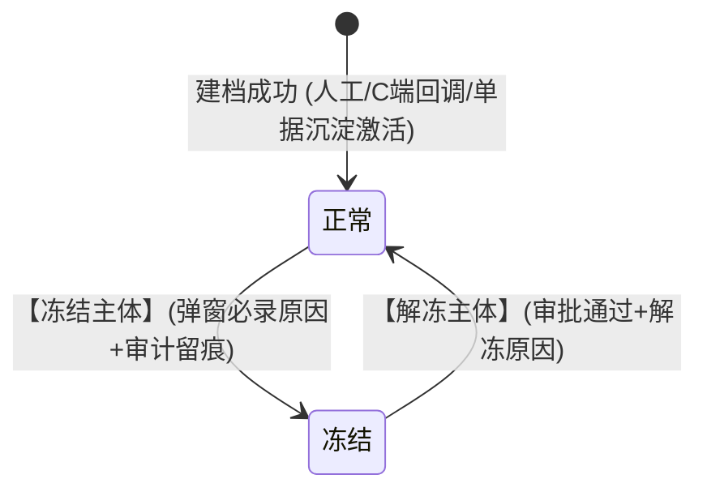
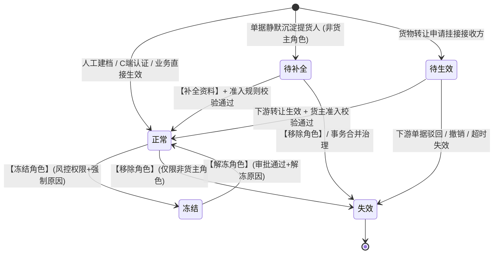
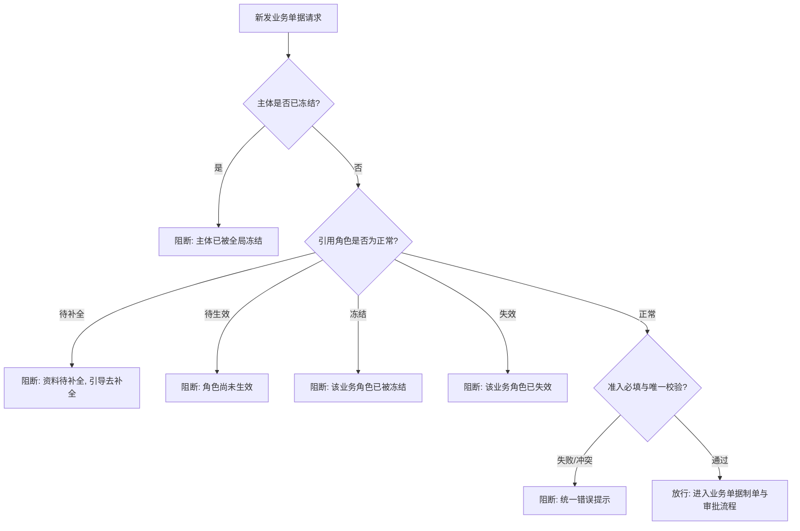

# 合作方档案业务规则规格

> **模块定位**：合作方管理 / 合作方档案模块主体状态机、角色关系状态机、动作约束、准入联动、注销强校验与并发幂等的**唯一定义来源（SSOT）**。主 PRD、字段清单及端侧原型仅引用本文件规则名称与编号，不重复定义规则本体。  
> **范式类型**：范式 D · 基础档案类（启用/冻结/注销；严禁物理删除；引用保护与快照隔离）  
> **参考文档**：[合作方档案主PRD.md](./合作方档案主PRD.md) · [合作方档案字段清单.md](./合作方档案字段清单.md) · [合作方准入规则业务规则规格.md](../01-合作方准入规则/合作方准入规则业务规则规格.md) · [合作方改造-存量业务单据协同规格.md](../05-存量改造与关联业务协同/合作方改造-存量业务单据协同规格.md)  
> **版本**：V1.9 | **更新时间**：2026-10-08 | **责任人**：森云科技（Senyun Technology）  
> **ASCII 线框**：[合作方档案_ASCII_列表页](./合作方档案_ASCII_列表页.md) · [合作方档案_ASCII_新增编辑页](./合作方档案_ASCII_新增编辑页.md) · [合作方档案_ASCII_详情页](./合作方档案_ASCII_详情页.md)

---

## 一、单据与能力定位

| 项目 | 内容规格 |
| :--- | :--- |
| **单据层级** | **【第 1 层 · 业务主体主数据层】**（全平台个人/企业合作方统一基础档案） |
| **核心职责** | 集中维护合作方身份资料、证件地址及来源、业务角色关系（货主/提货经办人/接收方/资金方等）、主体与角色双层生命周期状态；为入库、出库、转让、仓单、融资等业务提供统一引用源与凭据快照源。 |
| **单据来源** | **三重录入与沉淀渠道**： 1. **主动建档**：业务运营在后台管理端手工新增建档； 2. **C 端回调**：客户端用户完成实名认证后系统自动回调建档； 3. **单据沉淀**：出库等作业单据录入新经办人时系统静默沉淀创建简易档案。 |
| **上游依赖** | **工商与公安核验**：企业统一社会信用代码与个人身份证真实性； **准入策略配置**：【合作方准入规则】维护的地址必填、唯一校验及场景配置。 |
| **下游影响** | **仓储模块**：为入库、出库、提货、转让、仓单提供主体选择与数据校验； **交易模块**：与 C 端客户账号建立 1:1 绑定关系； **融资与风控**：为融资产品提供合格资金方候选池，承接风控隔离冻结指令。 |
| **数据隔离机制** | 主体主档按**租户**物理隔离；地址唯一校验范围为**同一租户内适用项目/业务范围**；跨租户不做主体合并与地址比较。 |

---

## 二、双层状态模型与流转定义

合作方档案页面独立维护两个状态维度，**严禁使用单一状态下拉框混写状态含义**：
1. **主体状态**：主体全局生命周期管控（本期支持正常与冻结，暂不提供注销，注销规划在二期）；
2. **角色状态**：挂接在主体下的具体业务合作关系状态（货主角色本期仅支持正常与冻结，不提供注销/移除）。

### 2.1 主体状态定义表

| 状态名称 | 业务含义 | 是否终态 | 列表可见性 | 进入条件 | 离开条件 |
| :--- | :--- | :---: | :---: | :--- | :--- |
| **正常** | 主体主档已激活，可按所属角色参与对应业务流转 | 否 | 可见（排序在前） | 建档成功 / 审批解冻 | 冻结 |
| **冻结** | 命中风控限制或人工管控，新发业务默认阻断拦截 | 否 | 可见（沉底排序在后） | 人工冻结 / 风控系统自动触发 | 解冻审批通过 |

> **版本约束说明**：本期系统**暂不提供注销货主/注销主体**功能。对于存在违约、风险或暂停合作的主体，统一采用**【冻结】**机制进行管控，保障在库库存、电子仓单及存证证据链的完整性。注销功能作为终态归档能力延期至二期规划。

#### 状态二问 · 正常
- **阶段**：主体主档生效中，可被全平台业务引用；
- **允许**：编辑资料（按权限）、追加角色、按角色冻结/解冻、主体冻结、查看穿透单据；
- **禁止**：物理删除、表单内直接改动状态、本期注销。

#### 状态二问 · 冻结
- **阶段**：主体级风险受控期，限制发起新业务；列表展示沉底在后；
- **允许**：查看详情、提交解冻审批；
- **禁止**：发起任何新业务单据、编辑核心资质与身份标识。

---

### 2.2 角色状态定义表（单条角色关系）

| 状态名称 | 业务含义 | 是否终态 | 典型业务场景 | 离开条件 |
| :--- | :--- | :---: | :--- | :--- |
| **待补全** | 业务单据静默沉淀的简易角色，资料不完整 | 否 | 出库单录入新提货经办人 | 补全必填资料并通过准入 → 正常 |
| **待生效** | 角色关系已建立，等待下游业务生效核准 | 否 | 货物转让申请挂接接收方 | 业务生效 → 正常；业务撤销/驳回 → 失效 |
| **正常** | 具备合法资质，可参与对应业务流转 | 否 | 主动建档、C 端认证、业务生效 | 角色冻结；非货主角色移除失效 |
| **冻结** | 仅限制该角色对应业务，不波及同主体其他角色 | 否 | 货主违约、现场提货违规 | 审批解冻 → 正常 |
| **失效** | 该角色合作关系终止，保留历史记录与审计 | **是** | 主动移除经办人角色、转让撤销（**货主角色本期不可失效**） | —（终态不可逆） |

---

## 三、状态流转图

### 3.1 主体状态机流转图

### 3.2 角色状态机流转图（单条业务角色关系）

### 3.3 运行时主体与角色双层拦截决策流

---

## 四、状态流转动作表

### 4.1 主体状态流转动作表

| 当前状态 | 触发动作 | 适用角色 | 前置业务校验条件 | 目标状态 | 二次确认与弹窗 | 联动后置影响 | 失败阻断提示 |
| :--- | :--- | :--- | :--- | :--- | :--- | :--- | :--- |
| — | **创建主体** | 平台管理员 / 业务运营 | 身份证号/统一社会信用代码租户内唯一；勾选货主时通过准入校验 | 正常 | 无 / 准入冲突浮动提示 | 写入主体主档、角色子表及操作审计日志 | 「该主体已存在，请前往详情追加角色配置」 |
| **正常** | **冻结主体** | 风控专员 / 管理员 | 处于正常状态；强制录入冻结原因（不超过 200 字） | 冻结 | 二次确认弹窗（录入原因） | 写审计日志；拦截主体名下所有角色新发业务；列表排序沉底；**不自动修改角色状态** | 「冻结失败：请填写冻结原因」 |
| **冻结** | **解冻主体** | 部门主管 / 管理员 | 处于冻结状态；解冻审批终审通过；强制录入解冻原因 | 正常 | 审批确认弹窗 | 写审计日志；恢复主体正常业务发起资格与正常排序位次 | 「解冻失败：解冻须审批通过」 |
| **任意状态** | **表单改状态** | — | — | — | **系统绝对禁止** | — | 前端不渲染状态下拉框，服务端接口强校验拦截 |

### 4.2 角色状态流转动作表

| 当前状态 | 触发动作 | 适用角色 | 前置业务校验条件 | 目标状态 | 二次确认与弹窗 | 联动后置影响 | 失败阻断提示 |
| :--- | :--- | :--- | :--- | :--- | :--- | :--- | :--- |
| — | **追加角色** | 授权业务运营 | 主体未冻结；追加货主角色时调用统一准入服务（含地址唯一） | 正常 / 待补全 | 无 | 写入角色关系子表与来源单据号，记录审计日志 | 「已有相同证件地址，不能绑定为该个人货主」 |
| **待补全** | **补全资料** | 业务运营 / 制单员 | 必填字段录入完整；货主角色须通过地址唯一准入校验 | 正常 | 无 | 角色转为正常；具备发单资格；写审计日志 | 同上地址冲突提示 |
| **待生效** | **业务生效** | 下游系统模块 | 下游转让等单据终审通过；转为货主时通过地址准入校验 | 正常 | 由下游业务确认 | 角色正式激活；更新生效时间戳 | 「转让生效失败：个人货主证件地址冲突」 |
| **待生效** | **业务撤销** | 下游系统模块 | 下游单据被驳回、主动撤回或超时失效 | 失效 | 由下游业务确认 | 角色置为失效；更新失效时间戳 | — |
| **正常** | **冻结角色** | 风控专员 / 管理员 | 强制录入冻结原因（不超过 200 字） | 冻结 | 二次确认弹窗 | 仅拦截该特定角色新业务，同主体其他角色不受影响 | 「请填写冻结原因」 |
| **冻结** | **解冻角色** | 部门主管 / 管理员 | 具备权限；审批终审通过并录入解冻原因 | 正常 | 审批确认弹窗 | 写审计日志；恢复该特定角色业务发起资格 | — |
| **正常 / 冻结 / 待补全** | **移除角色** | 平台超级管理员 | 仅限非货主角色（货主角色本期不可移除）；名下无进行中的该角色关联业务 | 失效 | 二次确认弹窗（录入原因） | 角色置为失效，记录审计日志 | 「存在进行中的关联业务，无法移除该角色」 |

---

## 五、动作能力矩阵

### 5.1 主体级动作能力矩阵

| 业务动作 | 正常 | 冻结 | 注销 ⭐终态 |
| :--- | :---: | :---: | :---: |
| **查看列表与详情** | ✅ | ✅ |
| **新增合作方主体** | ✅ | ✅ |
| **编辑基础档案资料** | ✅（按权限） | ⚠️（仅限非关键信息） |
| **编辑证件地址** | ✅（个人须通过准入） | ⚠️（仅限纠偏且须通过准入） |
| **追加业务角色** | ✅ | ❌ |
| **冻结主体** | ✅（风控权限；强制原因） | ❌ |
| **解冻主体** | ❌ | ✅（审批通过） |
| **注销主体** | ❌（本期不提供） | ❌（本期不提供） |
| **物理删除** | ❌（系统绝对禁止） | ❌（系统绝对禁止） |

### 5.2 角色级动作能力矩阵（单条业务角色关系）

| 业务动作 | 待补全 | 待生效 | 正常 | 冻结 | 失效 ⭐终态 |
| :--- | :---: | :---: | :---: | :---: | :---: |
| **查看角色记录** | ✅ | ✅ | ✅ | ✅ | ✅ |
| **补全角色资料** | ✅（补全地址过准入） | ❌ | ❌ | ❌ | ❌ |
| **作为货主发起入库/预约** | ❌（前置门禁阻断） | ❌ | ✅ | ❌（前置拦截） | ❌ |
| **作为提货人办理出库** | ⚠️（按出库模块规则） | ❌ | ✅ | ❌（拦截新发） | ❌ |
| **冻结业务角色** | ❌ | ❌ | ✅（风控权限；强制原因） | ❌ | ❌ |
| **解冻业务角色** | ❌ | ❌ | ❌ | ✅（审批通过） | ❌ |
| **移除业务角色** | ✅（无存量业务） | ✅ | ⚠️（仅限非货主角色；货主本期不可移除） | ⚠️（仅限非货主角色） | ❌ |

---

## 六、核心业务规则清单 (PA-R01 ~ PA-R11)

#### 【主体与角色双层拦截规则】(PA-R01)
* **【校验时机】**：全系统各业务单据接口在引用合作方主体时，必须同时指定合作方主体标识与对应的业务合作角色；
* **【主体冻结兜底】**：主体状态为「已冻结」时，默认阻断名下所有角色新发业务；若某业务有存量履约例外，须由下游规格显式定义白名单；
* **【角色隔离拦截】**：角色状态为「已冻结」、「已失效」或「待生效」时，系统严格禁止将其作为对应角色的有效业务主体。

#### 【按角色隔离冻结规则】(PA-R02)
* **【隔离独立性】**：冻结某主体名下的某一业务角色（如货主角色）时，**严禁波及或自动冻结同主体名下的其他角色**（如提货经办人、监管仓角色）；
* **【并集最严原则】**：当主体级冻结与角色级冻结并存时，业务拦截判定取二者并集最严规则；
* **【入库审批联动】**：货主角色被冻结后，除拦截新发入库申请外，**在审批中的入库单终审通过时强制触发二次复检并执行驳回拦截**，严禁写入物理库存。

#### 【主体识别与禁止重复建档规则】(PA-R03)
* **【唯一主键标准】**：个人合作方以 **18 位公民身份证号** 为租户内唯一主键；企业合作方以 **18 位统一社会信用代码** 为租户内唯一主键；
* **【禁止重复建档】**：输入身份证号或信用代码若命中租户内已存在的主体，系统前置强阻断保存，并弹窗引导前往详情页【追加角色配置】；
* **【手机号属性定位】**：手机号统一定位为**业务联系方式**，不再作为合作方主体唯一识别键；
* **【手机号与联系电话格式规范】**：个人主体展示为「手机号」，企业主体展示为「联系电话（经办人手机）」，均必须为 **11 位大陆标准有效手机号格式**（严禁录入无法接收短信的座机固话），用于接收建档与换绑时的短信二元核验验证码。

#### 【货主准入与地址唯一联动规则】(PA-R04)
* **【调用统一服务】**：新增货主、追加货主、修改个人货主地址及货物转让生效时，系统必须强制调用【统一准入校验服务】（遵循【统一准入服务调用规则】P08）；
* **【校验作用域与组合行为】**：严格遵循【个人货主地址双开关作用域】(P05) 与【地址双开关组合行为】(P01/P02)，仅对个人货主执行证件地址必填与租户内一对一唯一性核验；
* **【内部标准化比对】**：地址唯一比对采用系统内部生成的标准化比较值（去除空格、统一全半角与行政区划别名），页面不暴露内部比较串；
* **【冲突同步阻断】**：若命中其他有效个人货主占用同地址，遵循【冲突同步阻断不进审批规则】(P02) 执行**同步强阻断拦截**，统一提示：「已有相同证件地址，不能绑定为该个人货主」；入库/预约场景追加提示「请核实个人货主主体信息」；**严禁泄露他人姓名、身份证号或完整地址**。

#### 【合作方短信二元身份核验规则】(PA-R04a)
* **【对齐入库记录标准 (R03)】**：全面对齐仓储入库记录及风控二元身份认证标准，合作方建档与修改联系手机时引入短信 6 位动态验证码校验机制；
* **【与入库新货主核验共用】**：管理端【合作方档案 · 新增合作方】与仓储【入库记录 / 客户入库预约 · 创建新货主】在**统一准入校验通过之后**，须调用**同一套**短信二元身份核验服务（验证码下发、60 秒防刷、校验接口与审计口径一致），禁止双标准或免核验旁路；
* **【新增合作方二元核验】**：管理端人工新增合作方，录入资料点击「保存并提交」时，系统前置强阻断并唤起【合作方身份信息确认】弹窗，脱敏展示核心四要素，向业务联系手机（个人手机/企业经办人手机）下发 6 位动态验证码（支持 60 秒防刷倒计时）；输入验证码校验通过后，原子提交落库；
* **【编辑修改手机号二元核验】**：编辑合作方档案时，系统识别联系电话是否相对原值变更；若有变更，点击保存时前置唤起【修改联系手机身份确认】弹窗，向**新手机号**发送 6 位验证码，二元核验通过后方可落盘并记录审计日志；
* **【改址与改手机号组合流程】**：若个人货主同时修改证件地址与手机号，先弹出【确认变更证件地址】弹窗录入必填改址原因（PA-R06a 阻断），确认后再弹出新手机号短信二元核验弹窗，双重核验通过后合并提交；
* **【待补全模式基础信息只读规范】**：单据静默沉淀生成的档案，在进入补全资料流程时，基础档案资料（主体类型、主体名称、手机号/联系电话、身份标识）全部以只读信息卡片展示，禁止编辑框，仅开放证件登记地址录入，补全保存后关联角色自动激活生效为正常。

#### 【角色移除存量强校验规则】(PA-R05)
* **【货主角色保护】**：本期系统**暂不提供注销货主与移除货主角色**功能，存量货主若有管控需求仅支持【冻结/解冻】；
* **【非货主角色移除检查】**：管理员执行非货主角色（如提货经办人、接收方）移除时，系统必须原子扫描存量业务依赖；若存在该角色关联的在途待处理单据或未结流程，系统绝对禁止操作并弹出阻断提示。

#### 【货主地址唯一活跃池规则】(PA-R06)
* **【占用口径】**：租户内「个人货主 · 角色状态=正常」且证件地址非空（或必填开关要求已填）的主体，其证件地址标准化比较值计入**唯一活跃池**；同一比较值同时仅允许一条有效个人货主占用；
* **【冻结不释放】**：主体或货主角色被**冻结**时，活跃池占用**保持不变**，防止冻结期间地址被他人抢注；
* **【无注销/无移除货主】**：本期不提供注销主体、移除货主角色；**不得**通过移除货主释放地址；
* **【凭据快照不回写】**：历史已发生的入库单、仓单凭据快照中的地址数据**永久保留，严禁物理回写或篡改**。

#### 【个人货主证件地址变更规则】(PA-R06a)
* **【适用对象】**：个人主体且名下存在**正常**货主角色（含仅有一个正常货主、无在途「待生效」货主冲突的情形）；
* **【编辑入口】**：合作方档案【编辑】→ 证件地址区；主体**冻结**时仅允许风控授权下的**纠偏改址**（须同样过准入）；
* **【变更前校验】**：调用统一准入服务，对新地址执行必填 + 唯一比对（排除本主体当前占用项）；冲突则阻断，文案同 PA-R04；
* **【活跃池原子切换】**：保存成功后，**旧标准化地址立即出池**，**新地址入池**；审计日志记录改址前后摘要及改址原因（不超过 200 字，必填）；
* **【搬家业务路径】**：存量协同规格中「确属搬家」一律走本规则，**禁止**通过地址冲突审批或移除货主绕行；
* **【与快照关系】**：改址仅影响主档与后续新业务；已固化单据快照不变（C08）。

#### 【操作审批日志生成与防篡改规则】(PA-R07)
* **【核心准则】**：遵循**“事成才记、有变必录、无动不写”**原则。仅当业务数据真实变动且数据库事务提交成功（或审批流终审通过）后，系统才原子落库生成审计日志流水；校验失败、中途取消或未修改任何内容点击保存的，**绝不记录伪日志**；
* **【三大生成场景与触发条件】**：
  1. **资料变动场景（建档 / 编辑 / 追加角色 / 补全资料）**：操作人点击提交，且提交内容相比原值**存在真实字段级变更（与原值不一致）**并保存成功时立即生成；记录操作人、修改字段原值与新值；
  2. **状态管控场景（冻结主体 / 冻结角色 / 解冻）**：风控专员录入必填原因（不超过 200 字）二次确认成功时立即生成；**解冻动作必须在审批终审通过后触发生成**；记录操作人/审批人、管控/解冻原因及状态流转；
  3. **系统联动场景（单据静默沉淀 / 快照固化）**：下游业务单据（入库单、出库单、转让单）**终审生效落库**时由系统服务自动触发生成；记录系统自动化标识、关联的下游单据号及固化快照摘要；
* **【底层不可变存证】**：日志流水仅支持追加写入，严禁修改与删除，永久归档供司法与风控追溯。

#### 【状态变更按钮驱动规则】(PA-R08)
* **【表单只读展示】**：新增页、编辑页及详情页中的主体状态与角色状态字段，必须渲染为只读状态徽章；
* **【独立按钮驱动】**：状态流转必须由专属操作按钮（【冻结】、【解冻】、【移除非货主角色】）呼出独立二次确认弹窗触发，弹窗强制录入 不超过 200 字原因事由。

#### 【并发防重与幂等规则】(PA-R09)
* **【客户端令牌防重】**：创建主体、追加角色、编辑提交必须携带客户端唯一防重令牌，提交按钮点击后立即置灰并展示加载中状态；
* **【双重并发防护】**：应用层采用基于租户与标准化地址的并发防重锁，数据库底层部署租户、标准化地址与有效货主标识的唯一约束索引，彻底杜绝高并发同地址双建漏洞。

#### 【简易沉淀与合并治理规则】(PA-R10)
* **【治理合并入口】**：因单据录入错误产生的简易沉淀档案（待补全），经线下核验确属已有真实主体的，由**平台运维/后端数据治理接口**发起事务合并（**6.3 P2：管理端无列表行操作入口**，见 [08-版本范围与里程碑](../08-版本范围与里程碑.md)）；
* **【原子事务迁移】**：合并时系统原子将原单据引用外键改写指向真实主体，原简易角色标记为「已失效」归档留痕，严禁重复建档；**历史单据快照不回写**。

#### 【列表多级加权排序规则】(PA-R11)
* **【第一优先级 · 主体状态权重（冻结沉底）】**：
  * 主体状态为 `正常` 的排在前面（权重 1）；
  * 主体状态为 `冻结` 的统一沉底排在后面（权重 2）；
  * 列表分页查询时，优先展示全量正常主体，全部正常主体展示完毕后才展示冻结主体；
* **【第二优先级 · 系统建档日期】**：
  * 同状态分组内，严格按主体在系统中**首次创建建档的日期**（`create_date`，按天维度 `YYYY-MM-DD`）**倒序排列**（最新建档日期居前）；
  * 主体名下只要存在**任一角色生效（状态为正常）**，即按该主体首次在系统中的建档日期参与排序；后续追加新角色不改变其建档日期基准；
* **【第三优先级 · 创建时间戳绝对倒序】**：
  * 同一建档日期内，按系统底层首次建档的精确时间戳（`create_time`，精确到秒）绝对倒序排列；
* **【静默沉淀主体排序规范（方案 A）】**：
  * 单据静默沉淀生成的简易主体（如仅有 `[提货经办人·待补全]`），其主体状态同样属于正常，按其首次沉淀建档日期参与排序，角色列清晰展示 `[待补全]` 彩色标签，便于运营快速识别与补全。

---

## 七、与下游业务的状态耦合与快照时点

| 下游业务模块 | 耦合交互点 | 合作方侧状态前置要求 | 快照固化时机与内容 |
| :--- | :--- | :--- | :--- |
| **入库记录** | 货主引用、审批终审二次复检 | 货主角色=「正常」；资料完整；主体未冻结 | **审批通过且写库存前**，固化货主主体标识、名称、证号、证件地址及来源 |
| **客户入库预约** | 新建货主、预约单提交 | 同入库；C 端预约新建货主同样触发准入 | **审批通过时**固化主体快照；制单提交时仅存主体标识引用 |
| **出库记录/提货单** | 提货人引用、核销出库 | 角色=「正常」或「待补全」；未被冻结 | **出库单提交生成时**固化提货主体与经办人快照 |
| **货物转让** | 接收方角色待生效 → 生效 | 接收方转为货主时通过地址准入校验 | **转让终审生效且货权变更前**，原子固化双方主体快照 |
| **交易客户管理** | 实名认证回调 | 认证成功自动建档并挂接正常货主角色 | **认证通过时**固化认证资料与合作方 1:1 绑定关系 |

---

## 八、权限与数据范围规则 (PA-P01 ~ PA-P02)

#### 【租户与项目数据隔离规则】(PA-P01)
* 合作方主体主档严格按当前登录操作员所属的租户实施物理数据隔离；
* 增删改查及地址比对接口强制由服务端上下文自动注入租户标识，跨租户访问直接返回 403 权限拒绝；不同租户之间不做主体合并与地址比较。

#### 【合作方档案操作权限矩阵】(PA-P02)

| 系统角色 | 查看台账 | 新建/编辑主体 | 追加业务角色 | 冻结/解冻角色 | 冻结/解冻主体 | 导出审计日志 |
| :--- | :---: | :---: | :---: | :---: | :---: | :---: |
| **平台超级管理员** | ✅ | ✅ | ✅ | ✅ | ✅ | ✅ |
| **业务运营人员** | ✅ | ✅ | ✅ | ❌ | ❌ | ❌ |
| **风控审核专员** | ✅ | ❌ | ❌ | ✅ | ✅ | ✅ |
| **仓库监管主管** | ✅（管辖仓） | ✅（管辖仓） | ✅ | ⚠️（限授权角色） | ❌ | ❌ |

---

## 九、异常边界与失败提示

| 异常业务场景 | 触发前置条件 | 系统处理与防护机制 | 交互提示与日志表现 |
| :--- | :--- | :--- | :--- |
| **身份标识重复建档** | 录入已有身份证号或统一代码 | 前置强阻断保存，不产生新单据 | 浮动提示：「该主体已存在，请前往详情追加角色配置」 |
| **个人货主地址冲突** | 使用他人已占用的证件地址建货主 | 统一准入服务同步阻断，不进审批流 | 统一提示：「已有相同证件地址，不能绑定为该个人货主」 |
| **待补全主体直接发单** | 待补全主体被选为入库货主提交 | 提交前资料完整度检查强阻断 | 弹窗阻断并展示黄色按钮：「请先补全证件地址」 |
| **货主注销诉求** | 用户尝试申请注销在押货主 | 系统本期不提供注销入口，引导冻结 | 引导提示：「本期不支持注销主体，如需管控业务请操作【冻结】」 |
| **并发同址双建竞争** | 两名运营毫秒级同时提交同地址 | 分布式锁排队，后提交者命中唯一索引阻断 | 浮动提示：「地址已被占用，请核实后重试」 |
| **主体冻结后审批入库** | 审批流转期间货主被风控冻结 | 终审通过时二次复检失败 | 审批流自动驳回并记录审计：「货主已被冻结，驳回单据」 |

---

## 十、验收用例索引

| 验收用例编号 | 验收核心场景 | 测试输入与操作步骤 | 预期判定结果 |
| :--- | :--- | :--- | :--- |
| **PA-V01** | 个人身份证号重复建档拦截 | 录入已存在于租户内的身份证号点击保存 | 系统拦截提交，提示「该主体已存在，请前往详情追加角色配置」 |
| **PA-V02** | 个人货主证件地址冲突阻断 | 新建个人货主时录入他人已绑定的证件地址 | 系统同步阻断，统一错误提示，且不展示被占用方任何隐私信息 |
| **PA-V03** | 按角色维度隔离冻结生效 | 在详情页仅冻结某主体的货主角色 | 新发入库被前置拦截；该主体作为提货经办人办理出库不受影响 |
| **PA-V04** | 冻结主体全局沉底排序 | 将某正常主体操作冻结后刷新列表 | 该主体排位沉底至所有正常主体之后，状态徽章呈橙色冻结 |
| **PA-V05** | 列表按创建日期倒序展示 | 查看列表前几页的多角色主体 | 主体按首次建档日期倒序排列，静默沉淀的待补全主体按其建档日期正常排位 |
| **PA-V06** | 页面状态字段无下拉篡改口 | 打开新增、编辑与详情页面检查状态字段 | 状态呈现为只读徽章，页面无任何状态修改下拉选择控件，且无注销按钮 |
| **PA-V07** | 待生效接收方转让撤销流转 | 转让单申请后被驳回或申请人主动撤销 | 接收方角色状态自动流转为【失效】，不残留有效货主记录 |
| **PA-V08** | 并发同地址双建幂等防重 | 双线程并发提交相同个人货主证件地址 | 仅一条请求成功建档，另一条被分布式锁与唯一索引拦截 |
| **PA-V09** | 个人货主改址活跃池切换 | 货主·正常主体编辑证件地址至新址并填写改址原因 | 新址过准入；旧标准化地址出池；历史入库快照地址不变 |
| **PA-V10** | 冻结货主地址仍占活跃池 | 冻结货主角色后，他人用旧地址新建货主 | 冲突阻断；解冻后原主体仍占用原地址 |

---

## 十一、修订记录

| 日期 | 版本 | 变更内容说明 | 影响范围 | 修订人 |
| :--- | :--- | :--- | :--- | :--- |
| 2026-09-20 | V1.0 | 确立范式 D 基础档案类双层状态机、动作表与 PA-R01~PA-R10 规则本体。 | 规则全章节 | AI PM / 森云科技 |
| 2026-09-20 | V1.5 | 全量实施规范化重构（对齐基准版样式与语言去水）。 | 规则规格全章节 | AI PM / 森云科技 |
| 2026-10-08 | **V1.6** | **业务规则优化与裁切落地**： 1. 本期下线注销货主与注销主体功能，主体状态聚焦正常与冻结两态，货主角色不支持注销与移除； 2. 新增 PA-R11 列表加权排序规则（状态加权：正常在上、冻结沉底；同状态按首次建档日期倒序；单据沉淀待补全主体按方案 A 正常参与建档日期排序）； 3. 精炼重构 PA-R07 操作审批日志生成条件（“事成才记、有变必录、无动不写”，明确三大业务场景生成条件与 Commit Only 约束）。 | 规则规格全章节 | AI PM / 森云科技 |
| 2026-10-08 | **V1.7** | 重构 PA-R06 活跃池口径；新增 **PA-R06a 改址**（旧址出池、新址入池）；PA-R10 明确 P2 无 UI 合并入口。 | 「六、」 PA-R06/06a/10 | AI PM / 森云科技 |
| 2026-10-08 | **V1.8** | **企业电话规格升级与短信二元核验全闭环**： 1. PA-R03 明确企业联系电话规范为经办人 11 位有效手机号； 2. 修正 PA-R04，新增 **PA-R04a 合作方短信二元身份核验规则**，支持管理端新增建档与编辑修改手机号双场景 6 位短信核验； 3. 明确改址与改手机号双重核验的流转顺序； 4. 明确单据沉淀待补全模式下基础资料全部以只读卡片展示。 | 「六、」 PA-R03, PA-R04, PA-R04a | AI PM / 森云科技 |
| 2026-10-08 | **V1.9** | PA-R04a 增补「与入库 R03 共用核验服务」定稿条款；与主 PRD S01 一致。 | 「六、」 PA-R04a | AI PM / 森云科技 |
