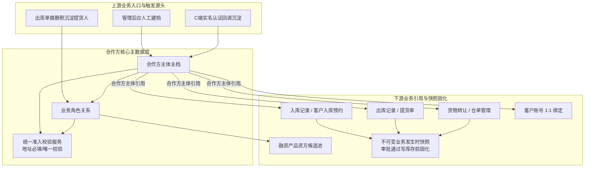

# 合作方档案主PRD

> **模块定位**：业务主体主数据层核心台账，集中维护全平台个人与企业合作方主体身份资料、证件地址、业务角色关系（货主、提货经办人、接收方、资金方等）及主体与角色双层生命周期状态。作为全平台入库、出库、转让、仓单、融资等业务的统一主数据源与防篡改凭据快照源，彻底消除多头建档与主体识别冲突。  
> **版本**：V2.4 | **更新时间**：2026-10-16 | **责任人**：森云科技（Senyun Technology）  
> **统一引用规范**：联系手机核验 **PA-R04a~PA-R04c**；准入 **P01~P09**；入库货主 **【合作方货主引用与快捷建档规则】(R03)** + 金融提交前 **PA-R04b**。  
> **编写依据**：[合作方档案字段清单.md](./合作方档案字段清单.md) 是本模块所有字段定义、枚举与页面展示的唯一基准；[合作方档案业务规则规格.md](./合作方档案业务规则规格.md) 是本模块双层状态机、角色隔离冻结、准入联动、存量强校验及并发控制的唯一定义来源；[基础配置业务规则规格.md](../02-平台管理-基础配置/基础配置业务规则规格.md)（**P01~P05**）是准入策略配置依据；[合作方档案-用例数据推演.md](./合作方档案-用例数据推演.md) 提供业务沙盘验证。  
> **页面范围**：覆盖 PC 端合作方档案列表页、新增/编辑页、详情页；移动端（H5）「工作台 → 用户中心 → 合作方档案」列表/详情/新增编辑；嵌入场景「查看货主」跳转详情及下游合作方选择器。  
> **ASCII 线框（PC）**：[合作方档案_ASCII_列表页](./合作方档案_ASCII_列表页.md) · [合作方档案_ASCII_新增编辑页](./合作方档案_ASCII_新增编辑页.md) · [合作方档案_ASCII_详情页](./合作方档案_ASCII_详情页.md)  
> **ASCII 线框（H5）**：[合作方档案_ASCII_H5](./合作方档案_ASCII_H5.md)

---

## 1. 业务背景与业务痛点

### 1.1 业务背景
在 SYZC 供应链金融存货监管系统中，货主、提货经办人、接收方、资金方等业务主体长期分散在入库、出库、转让、仓单、融资等各模块重复手工维护。此前个人货主曾以手机号作为标识，导致主体识别标准不统一、证件地址缺失、个人货主地址重复绑定等风控漏洞。

【合作方档案】作为 6.3 版本的统一合作方主数据层，以**身份证号（个人）/ 统一社会信用代码（企业）**为租户内唯一识别键，集中收口主体身份资料、证件地址、业务角色关系及主体/角色双层生命周期状态，为全平台业务单据提供**统一引用源**与**不可变快照**来源。

### 1.2 核心业务痛点
1. **主体识别分裂**：各作业单据各自维护货主，手机号与姓名检索口径不一，历史重复建档泛滥；
2. **个人货主地址风险**：缺乏证件登记地址硬核验，同一地址被多个身份证号冒用绑定为个人货主，导致开票主体与货权归属混淆；
3. **业务角色与权限角色混淆**：货主、提货人等业务合作关系被误当作系统登录权限角色（RBAC），缺乏按角色隔离冻结机制；
4. **简易沉淀冒用货主风险**：出库等单据静默沉淀的简易经办人档案若未补全证件地址即作为货主入库，容易形成监管真空；
5. **违约管控与司法存证需求**：主数据严禁物理删除，为保障在库库存与电子仓单证据链绝对完整，本期针对高危违约合作方聚焦实施精准冻结管控，延后注销功能以防法律纠纷。

---

## 2. 功能范围

| 包含功能范围 | 不包含功能范围 |
| :--- | :--- |
| - **合作方主体主档管理**：支持个人与企业主体的新增、编辑、列表检索、穿透式详情展示与多维组合筛选；列表/详情/选择器展示 **联系手机核验状态**（未验证 / 已验证），与 C 端实名认证状态分开展示； - **联系手机核验分场景闭环（PA-R04a~PA-R04c）**：管理端具备【新建/编辑主体】权限（PA-P02）者可 **免短信** 保存建档，初始为「未验证」；**普通入库**引用已建档货主时 **零短信** 直至审批通过；**质押/抵押/监管服务/仓单全链路/独立融资制单** 在提交或生效前对「未验证」货主 **强制** 短信二元核验（**【合作方短信二元身份核验服务规则】(PA-R04a)**），通过后置「已验证」；入库 **【+ 快速添加货主】** 为 **【入库快捷建档】**（见业务规则规格）；编辑改联系手机、C 端实名货主在 B 端改号、已验证企业【调整经办人信息】仍走短信确认；**已验证** 后锁定个人姓名与身份证、企业名称与信用代码与经办人姓名（企业经办人可展开调整并短信确认）； - **业务角色关系子表维护**：第一期上线支持货主、提货经办人、接收方、资金方 4 类业务角色，支持追加角色、补全资料、角色冻结/解冻与非货主角色移除； - **双层生命周期状态机**：主体状态（正常/冻结）与角色状态（待补全/正常/冻结/失效）双层驱动；状态字段仅限按钮触发，严禁表单内下拉改动； - **多级加权列表排序**：默认排序按状态加权（正常主体在前、冻结主体沉底在后），同状态内按主体在系统中首次建档的创建日期倒序排列（单据沉淀待补全主体按建档日期正常排位）； - **证件地址主档维护**：统一维护个人（身份证）与企业（营业执照）证件地址，新增/生效货主角色时联动调用统一准入校验服务；正常货主占用唯一活跃池，**改址（遵循【个人货主证件地址变更规则】(PA-R06a)）** 旧址出池、新址入池； - **五大标签页详情穿透**：提供基础档案、业务角色、关联客户账号、关联业务单据（只读穿透跳转）及全路径操作审批日志； - **精简规范操作审批日志**：遵循“事成才记、有变必录、无动不写”原则，覆盖资料变动、状态管控、系统联动三大场景； - **嵌入式组件数据供给**：为下游入库记录、客户入库预约等页面提供「查看货主」跳转详情及合作方全局下拉选择器； - **多源建档与沉淀支持**：支持人工主动建档、客户端（C 端）实名认证回调沉淀，以及业务单据静默沉淀简易档案； - **移动端（H5）合作方档案维护**：入口为 **工作台 → 用户中心 → 合作方档案**；支持列表检索、卡片详情、悬浮【+】新增与编辑保存；业务规则、字段口径与 PC 共用同一主数据服务，排序遵循【列表多级加权排序规则】(PA-R11)。 | - **合作方主体与货主注销功能**：本期系统**暂不提供注销货主与注销主体**功能，统一采用【冻结/解冻】进行业务管控，注销功能延期至二期规划； - **系统登录权限与菜单分配**：后台端（B 端）账户登录与菜单按钮权限统一由系统角色管理（RBAC）负责，合作方不承担登录角色职能； - **客户端（C 端）注册与认证流程**：C 端用户账号生命周期、密码策略由交易客户管理负责； - **准入策略与开关配置**：个人货主证件地址必填与唯一校验由 **配置管理 → 基础配置 → 合作方准入策略**（P01~P09）维护； - **具体作业单据状态流转**：入库、出库、转让、仓单各单据自身的状态流转与审核流程由各仓储模块规格唯一定义； - **提货主体与仓单角色扩展**：企业提货主体双层关系、仓单存货人与持有人角色划入后续批次纳管； - **H5 与 PC 完全等价的全量表单能力**：移动端本期为现场维护精简交互（见 6.6 节），不含 PC 全部改址复合弹窗、「保存并验证」双按钮等重度配置，复杂已验证锁定与改址仍以 PC 为准。 |

---

## 3. 模块定位与系统链路

### 3.1 实体属性与引用关系规范

| 属性项目 | 规范要求 |
| :--- | :--- |
| **数据层级** | **【第 1 层 · 业务主体主数据层】**（全平台业务主体唯一台账） |
| **唯一识别键** | 个人：18 位身份证号（租户内唯一）；企业：18 位统一社会信用代码（租户内唯一） |
| **双层状态控制** | **主体状态**（正常 / 冻结） + **角色状态**（待补全 / 正常 / 冻结 / 失效；货主角色本期不可失效） |
| **单据引用模式** | 业务单据保存合作方主体标识引用；**凭据快照**于单据终审通过且写库存/货权变更前固化 |
| **物理删除管控** | **严禁物理删除**；历史归档仅支持冻结或非货主角色失效，关键动作全路径审计留痕 |
| **数据隔离机制** | 租户级数据物理隔离；地址唯一校验范围为同一租户内适用项目/业务范围 |

### 3.2 档案引用与系统链路拓扑图

### 3.3 跨模块数据互通与业务快照固化

依据全系统数据互通规范，下游单据引用合作方主档时遵循以下交互约定：

| 协同模块 | 交互阶段与触发时机 | 具体数据更新行为与业务效力 |
| :--- | :--- | :--- |
| **【10-入库记录】** | 制单引用 / 提交审核 / 审批通过 | 1. **制单**：搜索或 **【+ 快速添加货主】** 绑定 `owner_partner_id`，反显只读字段与核验状态（**【合作方货主引用与快捷建档规则】(R03)**）； 2. **短信**：普通入库未验证 **零短信**；金融类提交前 **PA-R04b** + **PA-R04a**；**不在提交时建档**； 3. **快照固化**：审批通过且写库存前固化货主名称、证号、地址、企业经办人及来源。 |
| **【01-客户入库预约】** | 发起预约 / 审批通过 | 1. **前置阻断**：个人货主证件地址冲突在生成预约申请前阻断，不进审批流； 2. **审批联动**：审批通过时固化主体快照，转正式入库时直接继承。 |
| **【04-货物转让】** | 发起转让 / 转让生效 | 1. **申请阶段**：挂接接收方角色为【待生效】，不执行货主地址唯一校验； 2. **转让生效**：接收方角色转为【正常】货主，触发地址准入校验，冲突则阻止生效。 |
| **【02-出库记录/提货单】** | 出库制单 / 提货办理 | 1. **提货主体/经办人分层**：企业出库支持双层主体引用，提货经办人不触发货主地址校验； 2. **静默沉淀**：录入新经办人自动创建待补全角色，记录来源单号。 |
| **【04-客户管理】** | 实名认证通过 | 1. **账号绑定**：客户账号与合作方主体建立 1:1 绑定； 2. **默认角色**：个人认证通过默认增加货主角色并同步身份证地址。 |

---

## 4. 业务场景与用户故事

| 场景编号与名称 | 触发角色 | 核心交互与风控约束 | 业务价值 |
| :--- | :--- | :--- | :--- |
| **场景 1【人工主动建档个人货主】(S01)** | 业务运营人员 | 录入姓名、身份证号、手机号与证件地址，勾选货主；准入与证号唯一通过后 **保存即建档**，**不弹短信**，主档为 **联系手机未验证**；后续质押/仓单等金融场景提交前再补验。 | 提升主数据录入效率，金融节点收口核验。 |
| **场景 1b【金融入库触发手机补验】(S01b)** | 仓储制单人员 | 货主须先 R03 引用/快捷建档；普通入库未验证可零短信提交；**质押/抵押/监管服务/仓单** 提交前 **PA-R04b** 阻断并 **PA-R04a** 补验，通过后货主变已验证且单据可提交。 | 普通作业与金融风控分层。 |
| **场景 1c【已验证货主改号】(S01c)** | 业务运营人员 | C 端已实名或金融补验后的货主，B 端修改手机号或企业【调整经办人信息】；保存前短信发往新号，通过后更新联系手机并保持已验证。 | 与现网改号验证一致。 |
| **场景 2【身份标识重复建档阻断】(S02)** | 业务运营人员 | 录入已在租户内建档的身份证号或统一社会信用代码；系统前置强阻断保存，并弹窗提示「该主体已存在，请前往详情追加角色配置」。 | 彻底杜绝一企多档、一人多档的主数据分裂。 |
| **场景 3【个人货主证件地址冲突拦截】(S03)** | 业务运营 / C端用户 | 试图使用已被其他有效个人货主绑定的证件地址新增或修改个人货主；系统同步阻断并统一提示「已有相同证件地址，不能绑定为该个人货主」，且**严禁泄露冲突方敏感信息**。 | 防范多主体冒用同一地址虚假质押，保障开票主体唯一性。 |
| **场景 4【出库单据静默沉淀提货人】(S04)** | 仓储制单人员 | 出库单录入新提货司机身份证号与手机号；系统自动静默创建合作方档案，角色关系标记为【提货经办人 · 待补全】；**非货主角色不触发地址唯一校验**。 | 保障现场出库作业流畅度，同时沉淀人员履约主数据。 |
| **场景 5【待补全档案补全并晋升货主】(S05)** | 业务运营人员 | 在合作方详情中对待补全主体点击【补全资料】，补充必填证件地址并追加货主角色；系统调用准入规则，校验通过后角色状态转为【正常】，方可在入库中被选取为货主。 | 设立简易档案转货主前置门禁，防范缺资料主体违规发单。 |
| **场景 6【按角色维度隔离冻结】(S06)** | 风控审核专员 | 某主体因货主违约触发风控，在详情页对其【货主】角色执行冻结并强制录入原因；系统仅拦截其作为货主的新发入库与融资，**该主体名下的提货经办人角色不受影响**。 | 精准隔离单点违约风险，保障无辜第三方货权正常流转。 |
| **场景 7【审批中货主冻结联动驳回】(S07)** | 仓储审批人员 | 入库单在审批中，货主主体或货主角色被风控冻结；审批人在终审通过时触发系统二次复检（re-validate），强校验失败直接自动驳回入库单，严禁写入物理库存。 | 杜绝审批时差导致的风控穿透漏洞。 |
| **场景 8【冻结主体沉底与风险隔离】(S08)** | 风控审核专员 | 针对存在严重违约风险的合作方操作【冻结主体】；系统全量拦截该主体名下新业务，且该主体在合作方列表中自动沉底排在所有正常主体之后。 | 直观隔离高危主体，保障台账视觉焦点清晰。 |
| **场景 9【个人货主搬家改址】(S09)** | 业务运营人员 | 张明货主·正常，编辑证件地址至新门牌；录入改址原因，新址过准入唯一校验；**旧标准化地址出活跃池**，新址入池；历史入库快照地址不变。 | 在不开放注销前提下支持合规搬家。 |
| **场景 10【活跃池占用与冻结不释放】(S10)** | 风控审核专员 | 有效个人货主被冻结后，其证件地址**仍占活跃池**；他人无法用同址新建货主；解冻后占用关系不变。 | 防止冻结窗口期地址被抢注。 |
| **场景 11【简易重复档案合并治理】(S11)** | 平台运维（后端） | 出库误建简易主体经线下核验后，通过**数据治理接口**合并至真实主体（**6.3 无管理端合并按钮**）；单据引用迁移，快照不回写。 | 消除录入笔误；UI 入口规划 P2。 |
| **场景 12【客户端认证回调自动建档】(S12)** | 系统自动化 | C 端用户完成个人实名认证，系统自动同步身份证地址并创建合作方主档，默认挂接正常货主角色、**联系手机已验证**并写入 1:1 账号绑定关系。 | 实现 C 端与 B 端主体主数据秒级打通。 |

---

## 5. 状态机与动作能力矩阵

### 5.1 主体状态机与能力矩阵

| 动作名称 | 正常 | 冻结 |
| :--- | :---: | :---: |
| **查看列表与详情** | ✅（优先展示） | ✅（沉底展示） |
| **编辑基础档案资料** | ✅（按权限） | ⚠️（仅限非关键字段） |
| **编辑证件地址** | ✅（个人须通过准入） | ⚠️（仅限纠偏且须通过准入） |
| **追加业务角色** | ✅ | ❌ |
| **冻结主体** | ✅（风控权限；弹窗必录原因 不超过 200 字） | ❌ |
| **解冻主体** | ❌ | ✅（审批通过；弹窗必录原因） |
| **注销主体** | ❌（本期不提供） | ❌（本期不提供） |
| **物理删除** | ❌（系统绝对禁止） | ❌（系统绝对禁止） |

### 5.2 角色状态机与能力矩阵（单条业务角色关系）

| 动作名称 | 待补全 | 待生效 | 正常 | 冻结 | 失效 ⭐终态 |
| :--- | :---: | :---: | :---: | :---: | :---: |
| **查看角色详情** | ✅ | ✅ | ✅ | ✅ | ✅ |
| **补全角色资料** | ✅（补全地址过准入） | ❌ | ❌ | ❌ | ❌ |
| **作为货主提交入库/预约** | ❌（前置强阻断） | ❌ | ✅ | ❌（前置拦截） | ❌ |
| **作为提货人办理出库** | ⚠️（按出库规则放宽） | ❌ | ✅ | ❌（拦截新发） | ❌ |
| **冻结业务角色** | ❌ | ❌ | ✅（风控权限；强制原因） | ❌ | ❌ |
| **解冻业务角色** | ❌ | ❌ | ❌ | ✅（审批通过） | ❌ |
| **移除业务角色** | ✅（通过存量校验） | ✅ | ⚠️（仅限非货主角色；货主本期不可移除） | ⚠️（仅限非货主角色） | ❌ |

---

## 6. 页面交互规格索引

### 6.1 合作方档案 — 列表页（PC）
- **页面路径**：`用户中心 → 合作方管理 → 合作方档案`
- **线框基准**：[合作方档案_ASCII_列表页](./合作方档案_ASCII_列表页.md)
- **核心规格**：
  - 筛选区（默认四列一行 + 展开多列）：默认行含主体名称/身份标识（合并模糊搜索）、主体类型、业务角色、主体状态；展开行含角色状态、创建来源、**联系手机核验状态**、联系手机（11 位精确匹配）、创建时间范围；右上角黄色【查询】与【重置】；
  - 数据表格（8 列）：`序号`、`主体名称/身份标识`（双行：名称链接 + 脱敏证号）、`主体类型`、`主体状态`、`联系手机`（第一行脱敏号码、第二行 **已验证/未验证** 徽章；**无**行内验证按钮）、`业务角色`（彩色标签）、`创建人`（双行含创建时间，对齐入库制单人列）、`操作`；
  - 固定行操作：【详情】、【编辑】、【追加角色】、【冻结/解冻】（本期不提供注销）；
  - 默认多级排序规则：第一优先级主体状态加权（正常排前面、冻结沉底排后面）；第二优先级在系统中首次建档的创建日期倒序（，按天维度）；第三优先级建档时间戳（）绝对倒序；静默沉淀的简易待补全主体作为正常主体按其建档日期正常排位（方案 A）；
  - 页面右上角提供【+ 新增合作方】入口。

### 6.2 新增/编辑合作方页（PC）
- **页面路径**：列表页点击【+ 新增合作方】或行操作【编辑】
- **线框基准**：[合作方档案_ASCII_新增编辑页](./合作方档案_ASCII_新增编辑页.md)
- **核心规格**：
  - **字段排布与类型切换**（详见字段清单 8.3 节）：
    - 个人：类型 → 姓名（已验证只读）→ 手机号 → 身份证号（创建后只读）→ 证件地址；
    - 企业：类型 → 企业全称（已验证只读）→ **经办人姓名**（已验证默认只读，可【调整经办人信息】）→ 经办人手机 → 信用代码（创建后只读）→ 证件地址；
    - 编辑页页头展示 **联系手机核验状态** 徽章；
  - **单据沉淀待补全模式**：单据静默沉淀生成的档案，在补全资料时，基础资料（主体类型、主体名称、手机号/联系电话、身份标识）全部以只读卡片展示，禁止编辑框，仅开放证件登记地址录入，补全保存后关联角色自动激活生效为正常；
  - **联系手机核验（PA-R04a~PA-R04c）**：
    - 新增合作方：**「保存并提交」不强制**短信，默认「未验证」；可选 **「保存并验证」**（PA-P02）经场景 3 短信后建档为「已验证」并触发 PA-R04c；弹窗取消则不落库；
    - 编辑改联系手机 / 企业展开调整经办人：变更保存前短信二元核验；
    - 已验证主体：个人锁定姓名与身份证；企业锁定名称、信用代码与经办人姓名（经办人信息经展开区修改并短信确认）；
  - **改址与改手机号组合流程**：编辑页修改个人货主证件地址且与上次保存不一致时，弹出【改址原因】（不超过 200 字必填，遵循【个人货主证件地址变更规则】(PA-R06a) 阻断）；若同时修改了手机号，在确认改址原因后继续弹出新手机号短信二元核验弹窗，双重核验通过后合并保存；
  - **业务角色（首次挂接）**：仅新增页展示多选区块，标题「业务角色（首次挂接）」；与列表/详情【业务角色】为同一字段在不同页面的呈现；勾选货主即刻调用统一准入；编辑页不展示多选，改详情【追加角色】；表单内严禁状态下拉，编辑态展示主体状态与联系手机核验徽章；未保存离开 Dirty 拦截。

### 6.3 合作方详情页（PC）
- **页面路径**：列表页行操作点击【详情】或名称下钻
- **线框基准**：[合作方档案_ASCII_详情页](./合作方档案_ASCII_详情页.md)
- **核心规格**：
  - 顶部单据卡片：主体名称、类型、脱敏身份标识、合作方主体标识（可复制）、主体状态徽章，右上角提供【返回】、【编辑】、**【验证联系手机】**（联系手机 **未验证** 且主体非冻结或待补全可验时展示，PA-P02）、【追加角色】、【冻结主体】动作栏（本期不提供注销）；**上述识别项不在 Tab1 重复展示**；
  - 底部五标签页联动：
    - **标签页 1【基础档案】**：在页头主体标识信息之外，采用三行结构化分区并排展示：
      - **第 1 行（主体业务资料）**：联系手机核验状态、**核验时间**（未验证为 ——）、联系电话（脱敏）、企业经办人姓名、证件地址；
      - **第 2 行（创建建档信息）**：创建来源、创建人与创建时间并排展示（建档审计属性归组）；
      - **第 3 行（最后维护信息）**：更新人（展示格式为「姓名（所在机构）」，必须附带所在机构单位）与更新时间并排展示（维护审计属性归组）；
    - **标签页 3【关联客户账号】**：只读展示绑定的 C 端账号、认证状态与绑定时间；
    - **标签页 4【关联业务单据】**：只读穿透展示关联的入库、出库、转让等单据列表，支持跳转各模块详情；
    - **标签页 5【操作审计日志】**：时间轴形式呈现全路径操作审批日志。遵循“事成才记、有变必录、无动不写”原则，完整记录资料变动（建档/修改/追加/补全）、状态管控（冻结/解冻审批通过）及系统联动（单据沉淀/快照固化）三大场景。

### 6.4 嵌入场景：「查看货主」跳转规格
- **唤起入口**：仓储入库记录、客户入库预约等页面，选中已建档货主后提供【查看货主】链接；
- **交互动作**：在新标签页打开该合作方档案详情。不使用弹窗，也不使用右侧抽屉；
- **展示要素**：沿用详情页页头与基础档案，含主体类型、名称、脱敏证号、联系手机核验状态、脱敏联系电话、企业经办人姓名、证件地址、业务角色及主体状态；
- **待补全**：不在入库页再做一层补全按钮。进入详情后，页头黄色【去补全资料】直达编辑页。

### 6.5 下游合作方选择器规范
- **返回数据结构**：合作方主体唯一标识、主体名称、脱敏身份标识、主体类型、业务角色、角色状态、主体状态、**联系手机核验状态**；
- **基础过滤规则**：默认严格过滤主体状态为「正常」且引用角色状态为「正常」的有效主体。

### 6.6 移动端（H5）合作方档案
- **菜单入口**：工作台 → **用户中心**（6.3 新增分组）→ 合作方档案；
- **原型路由**：列表 `/m/workspace/user-center/partner-archives`；详情 `/m/workspace/user-center/partner-archives/:id`；新增/编辑 `/m/partner-archives/form`（编辑时 URL 带 `?edit=档案 id`）；
- **列表页**（交互对齐入库记录、入库暂存登记、设备预警信息）：
  - 顶部筛选：关键词占位「请输入主体名称或证件号码」、横滑 Pill（主体类型、主体状态、业务角色）；「更多筛选」抽屉（角色状态、创建来源、联系手机核验状态、联系手机、创建时间起止）；
  - 主体以卡片展示摘要（名称、合作方主体标识、类型、身份标识脱敏、业务角色、联系手机+核验徽章、创建人），行内【查看详情】【编辑】；
  - 列表右下角固定悬浮【+】进入新增（对齐入库暂存登记 FAB），需具备【合作方档案操作权限矩阵】(PA-P02) 新建权限；
- **详情页**（排版对齐入库详情）：
  - 顶部白色**基础信息区**（对齐 PC 页头）：主体名称、主体类型/主体状态/待补全徽章、身份标识与 **合作方主体标识**（可复制）；联系手机、证件地址、联系手机核验等见 **基础档案** Tab；
  - 下方**标签区**（横向 Tab，计数角标）：基础档案、业务角色、关联客户账号、关联业务单据、操作审计日志；Tab 内字段与 PC 详情五标签口径一致，业务单据只读穿透；
  - **底部固定操作条**：【编辑】/ 待补全时【去补全资料】、【追加角色】、【冻结主体】/【解冻主体】、联系手机未验证时【验证联系手机】（规则同 PC 页头）；
- **新增/编辑页**：
  - 卡片分组：**基础档案资料**（字段顺序同 6.2/字段清单 8.3）、证件登记地址、新增时「**业务角色（首次挂接）**」多选及说明文案；
  - 新增页 **【保存并提交】+【保存并验证】** 双按钮（与 PC 6.2 一致）：默认「未验证」；「保存并验证」走场景 3 短信，通过后原子建档「已验证」，取消不落库（【合作方短信二元身份核验服务规则】(PA-R04a) / 【合作方档案操作权限矩阵】(PA-P02)）；
  - 编辑/补全：待补全只读身份区 + 地址补全；已验证锁定核心字段；改手机/改址触发短信或改址原因 Sheet；未保存离开须 Dirty 二次确认；
- **PC 与 H5 关系**：同一租户主数据、同一状态机与 PA 规则；H5 列表行内仍不提供冻结/追加（详情底栏操作）；企业「调整经办人信息」展开区以 PC 为准（H5 P2）。

---

## 7. 核心业务规则索引

| 规则编码与名称 | 规则核心逻辑摘要 | 规则规格唯一定义章节 |
| :--- | :--- | :--- |
| **【主体与角色双层拦截规则】(PA-R01)** | 业务接口必须同时校验主体状态与引用角色状态；角色冻结优先拦截，主体冻结兜底拦截 | [业务规则规格 「六、」](./合作方档案业务规则规格.md#主体与角色双层拦截规则pa-r01) |
| **【按角色隔离冻结规则】(PA-R02)** | 冻结某一业务角色（如货主）不得波及同主体其他无关角色（如提货经办人）；拦截入库终审通过 | [业务规则规格 「六、」](./合作方档案业务规则规格.md#按角色隔离冻结规则pa-r02) |
| **【主体识别与禁止重复建档规则】(PA-R03)** | 个人按身份证号、企业按统一社会信用代码实现租户内唯一识别；已存在严禁双建，引导追加角色 | [业务规则规格 「六、」](./合作方档案业务规则规格.md#主体识别与禁止重复建档规则pa-r03) |
| **【货主准入与地址唯一联动规则】(PA-R04)** | 新增/生效货主或修改地址调用统一准入服务；个人货主同址冲突同步阻断，统一提示文案且不泄露他人隐私 | [业务规则规格 「六、」](./合作方档案业务规则规格.md#货主准入与地址唯一联动规则pa-r04) |
| **【合作方短信二元身份核验服务规则】(PA-R04a)** | 统一短信服务；管理端新增免强制短信；改号与企业经办人调整须核验 | [业务规则规格 「六、」](./合作方档案业务规则规格.md#合作方短信二元身份核验服务规则pa-r04a) |
| **【联系手机核验状态与金融场景强制核验规则】(PA-R04b)** | 未验证/已验证；普通入库零短信；金融全链路提交前强制补验 | [业务规则规格 「六、」](./合作方档案业务规则规格.md#联系手机核验状态与金融场景强制核验规则pa-r04b) |
| **【已验证主体核心字段锁定规则】(PA-R04c)** | 已验证后锁定个人姓名/证号、企业名称/证号/经办人 | [业务规则规格 「六、」](./合作方档案业务规则规格.md#已验证主体核心字段锁定规则pa-r04c) |
| **【角色移除存量强校验规则】(PA-R05)** | 货主角色本期不支持注销与移除；移除非货主角色前，强制扫描在途待处理单据，存在关联业务绝对阻断 | [业务规则规格 「六、」](./合作方档案业务规则规格.md#角色移除存量强校验规则pa-r05) |
| **【货主地址唯一活跃池规则】(PA-R06)** | 正常个人货主占用活跃池；冻结不释放；无注销/移除货主 | [业务规则规格 「六、」](./合作方档案业务规则规格.md#货主地址唯一活跃池规则pa-r06) |
| **【个人货主证件地址变更规则】(PA-R06a)** | 改址过准入；旧址出池、新址入池；历史快照不回写 | [业务规则规格 「六、」](./合作方档案业务规则规格.md#个人货主证件地址变更规则pa-r06a) |
| **【操作审批日志生成与防篡改规则】(PA-R07)** | 遵循“事成才记、有变必录、无动不写”原则；涵盖资料变动、状态管控、系统联动三大场景，Commit Only | [业务规则规格 「六、」](./合作方档案业务规则规格.md#操作审批日志生成与防篡改规则pa-r07) |
| **【状态变更按钮驱动规则】(PA-R08)** | 主体与角色状态在所有表单中设为只读徽章；严禁下拉直接改动，必须经专属按钮（冻结/解冻）驱动 | [业务规则规格 「六、」](./合作方档案业务规则规格.md#状态变更按钮驱动规则pa-r08) |
| **【列表多级加权排序规则】(PA-R11)** | 第一优先级正常在前/冻结沉底；同状态按首次在系统中建档的创建日期倒序；静默沉淀待补全主体正常排位 | [业务规则规格 「六、」](./合作方档案业务规则规格.md#列表多级加权排序规则pa-r11) |
| **【并发防重与幂等规则】(PA-R09)** | 采用防重令牌、分布式锁与数据库租户级联合唯一索引三重防护，防范并发重复提交 | [业务规则规格 「六、」](./合作方档案业务规则规格.md#并发防重与幂等规则pa-r09) |
| **【简易沉淀与合并治理规则】(PA-R10)** | 录入错误产生的简易档案后续走原子事务合并至真实主体，原记录置失效留痕，不重复建档 | [业务规则规格 「六、」](./合作方档案业务规则规格.md#简易沉淀与合并治理规则pa-r10) |
| **【租户与项目数据隔离规则】(PA-P01)** | 主体增删改查与状态变更强校验当前租户标识；跨租户物理隔离且互不比较地址 | [业务规则规格 「八、」](./合作方档案业务规则规格.md#租户与项目数据隔离规则pa-p01) |
| **【合作方档案操作权限矩阵】(PA-P02)** | 平台管理、业务运营与风控人员严格按权限矩阵隔离新建、编辑、冻结与解冻操作（本期无注销） | [业务规则规格 「八、」](./合作方档案业务规则规格.md#合作方档案操作权限矩阵pa-p02) |

---

## 8. 非功能性需求

### 8.1 性能要求
- **列表检索响应时间**：在租户 5 万级合作方数据量下，组合多条件模糊检索响应时间 不超过 0.8 秒；
- **统一准入接口响应时间**：地址标准化与唯一性比对服务单次调用耗时 不超过 100 毫秒；
- **详情页标签切换**：各标签页采用异步按需加载，首屏渲染耗时 不超过 0.5 秒。

### 8.2 安全性与合规性
- **敏感数据脱敏**：个人身份证号展示脱敏中间 8 位，手机号脱敏中间 4 位；地址冲突提示绝对禁止回显冲突主体的姓名与证号；
- **数据防篡改**：已发生业务单据中的主体历史快照一旦生成即刻固化，合作方主档后续资料变更严禁回写历史单据；
- **审计留痕追溯**：主体资料修改、状态变更、角色增删操作日志保留 5 年以上不可更改。

---

## 9. 修订记录

| 日期 | 版本 | 变更内容说明 | 影响范围 | 修订人 |
| :--- | :--- | :--- | :--- | :--- |
| 2026-09-20 | V1.0 | **初始化 6.3 统一合作方档案主 PRD**：确立以身份证/信用代码为唯一主键的主档定位与双层状态机。 | 全模块 | AI PM / 森云科技 |
| 2026-09-20 | **V1.5** | **规范化重构（对齐基准版样式与语言去水）**： 1. 规范文头为 4 行精干引用块，移除大段说教表格； 2. 建立【包含】vs【不包含】双栏功能范围表与跨模块数据互通表； 3. 全量汉化专业术语（Tab/Tag/Badge/Dirty 等）； 4. 重构 11 场景故事表为标准 4 列自解释格式，条目化核心业务规则索引。 | 主 PRD 全文 | AI PM / 森云科技 |
| 2026-10-08 | **V1.6** | **需求裁切与规则优化落地**： 1. 本期下线注销货主与注销主体功能，聚焦冻结与解冻管控； 2. 确立列表多级加权排序规范（正常在上、冻结沉底；同状态按首次建档日期倒序；静默沉淀待补全主体按方案 A 正常参与建档日期排序）； 3. 明确操作审批日志“事成才记、有变必录、无动不写”三大生成场景（资料变动、状态管控、系统联动）。 | 全文各章节 | AI PM / 森云科技 |
| 2026-10-08 | **V1.7** | 新增改址场景 S09、活跃池冻结 S10；PA-R06/06a 索引；合并治理改 S11（P2 无 UI）。 | 场景与规则索引 | AI PM / 森云科技 |
| 2026-10-08 | **V1.8** | **企业联系电话升级与短信二元核验全闭环**： 1. 功能范围补充编辑改手机号二元短信核验说明； 2. 规范 6.2 节新增/编辑字段排布顺序（个人：名称-手机-身份证号；企业：名称-联系电话-信用代码）； 3. 企业联系电话严格要求为 11 位有效手机格式； 4. 补充单据沉淀待补全模式下基础资料全部只读卡片展示； 5. 串联改址原因确认与新手机号二元短信核验复合交互流程。 | 第2节 功能范围、6.2 节 页面规格 | AI PM / 森云科技 |
| 2026-10-08 | **V1.9** | **定稿 PA-R04a 与入库 R03 共用短信核验**：修订 S01，明确管理端人工新增合作方与入库/预约「创建新货主」在准入通过后共用同一套短信二元身份核验能力，取消「内网人工建档免核验」差异表述。 | 第4节 场景 S01 | AI PM / 森云科技 |
| 2026-10-19 | **V2.5** | **入库 R03 快捷建档**：3.3 协同表改 10-入库记录；S01b 对齐 PA-R04b；功能范围补充入库快捷建档与 PA-R04a 表述。 | 第2、3、4节 | 产品团队 |
| 2026-10-16 | **V2.4** | **移动端合作方档案纳入范围**：工作台新增「用户中心 → 合作方档案」；主 PRD 新增 6.6 节 H5 列表/详情/表单说明；删除「H5 不设独立维护入口」旧表述，明确 H5 精简能力与 PC 分工。 | 第2节、6.6、文头页面范围 | AI PM / 森云科技 |
| 2026-10-16 | **V2.3** | 【查看货主】改为新标签跳转合作方详情，取消弹窗与右侧抽屉；待补全走详情页头【去补全资料】。 | 6.4 | AI PM / 森云科技 |
| 2026-10-16 | **V2.2** | 列表 8 列与联系手机列徽章、展开筛选核验状态；详情页头【验证联系手机】与 Tab1 核验时间；新增「保存并验证」双按钮。 | 6.1~6.3 | AI PM / 森云科技 |
| 2026-10-16 | **V2.1** | 列表增加联系手机列与筛选；「初始业务角色」口径合并为「业务角色（首次挂接）」新增页文案。 | 6.1、6.2 | AI PM / 森云科技 |
| 2026-10-16 | **V2.0** | **评审定稿：联系手机核验分场景**：管理端免短信建档 + 未验证展示；普通入库零短信；金融 PA-R04b 强制补验；PA-R04c 已验证锁定；企业经办人姓名与展开调整；S01/S01b/S01c；同步 R03。 | 第2、4、6、7节 | AI PM / 森云科技 |
