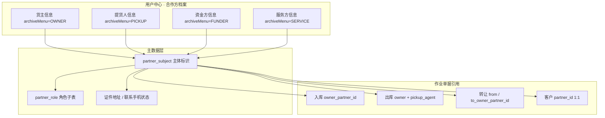

# 6.3 合作方主数据 · 数据迁移与切流

> **版本**：V1.0 | **更新日期**：2026-10-20 | **责任人**：森云科技（Senyun Technology）  
> **文档定位**：6.2/6.1 存量主体与作业单据外键，迁移至 **6.3 方案 B**（用户中心 → 合作方档案 **四子菜单** + `archiveMenu` 分域主档）的 **实施与验收唯一真源**。  
> **协同摘要入口**：[合作方改造-存量业务单据协同规格.md](./合作方改造-存量业务单据协同规格.md) **七、附录 C**  
> **范围真源**：[08-版本范围与里程碑.md](../08-版本范围与里程碑.md) 序号 **13（P0）**  
> **主数据真源**：[合作方主数据-公共业务规则规格.md](../04-合作方档案/合作方主数据-公共业务规则规格.md)（**PA-R12**、**PA-R03**、**PA-V07** 等）

---

## 一、迁移目标

1. **个人货主主键统一为 18 位身份证号**（协同规格 **Q01**）：废止「手机号即主键」；手机号降为联系方式与检索辅助项。  
2. **建立合作方主档 + 分域主档模型（方案 B）**：每条主档绑定 **档案归属菜单**（货主信息 / 提货人信息 / 资金方信息 / 服务方信息）；租户内 **域内证号唯一**（**PA-R03**），跨菜单同证号可并存（**PA-V07d**）。  
3. **业务单据外键统一为 `partner_id`（及角色语义字段）**：按 [附录 A](./合作方改造-存量业务单据协同规格.md#五附录-a--按菜单字段与引用改造检查表) 回填 `owner_partner_id`、`pickup_agent_partner_id`、`from_owner_partner_id`、`to_owner_partner_id` 等；历史展示字段保留只读冗余直至切流完成。  
4. **废止「接收方 / 待生效接收方」角色态**：存量接收方主体迁移为 **货主信息** 域 **货主** 主档（**PA-R12 · 历史接收方迁移**）；在途转让单按 **PA-V07** 挂接货主域 **货主 · 正常**。  
5. **快照与 C08 边界**：迁移只补写 **缺失** 的快照字段；已固化快照 **绝不回写**；迁移批次标记 `event_source=HISTORY_MIGRATION` / `migration_batch_id`。  
6. **与货主准入策略联动**：开 **【证件登记地址防重复唯一校验与同步阻断规则】(P02)** 前，须完成同址多货主治理（基础配置 **P03 历史冲突门禁**）；缺址货主引导 **货主信息** 台账补录（**Q02**），**不因缺址 alone 阻断**仓储发单。

---

## 二、源与目标模型对照

### 2.1 6.2 及以前（As-Is 示意）

| 来源 | 典型存储 | 问题 |
| :--- | :--- | :--- |
| 各模块独立货主表 / 行内文本 | 入库货主、出库货主、转让「接收方」 | 无统一主体标识；个人以手机为主键 |
| 提货人 / 司机 | 出库、提货单分散录入 | 与货主混池；无 **提货人信息** 域 |
| 资金方 / 监管方 | 融资单据平铺 | 未分 **资金方信息 / 服务方信息** 域 |
| 转让 | `RECEIVER` +「待生效」 | 6.3 **废止**；与方案 B 冲突 |

### 2.2 6.3 目标（To-Be）

**命名约定（实施层，与三件套业务名对齐）**

| 业务概念 | 迁移后外键字段（示例） | 档案归属菜单 |
| :--- | :--- | :--- |
| 货主 | `owner_partner_id` / `storer_partner_id` | 货主信息 |
| 提货经办人 | `pickup_agent_partner_id` | 提货人信息 |
| 转让受让人 | `to_owner_partner_id`（**货主信息域**，非接收方） | 货主信息 |
| 转让转让人 | `from_owner_partner_id` | 货主信息 |
| C 端认证主体 | `partner_id` | 货主信息（默认挂货主） |
| 抵押权人 / 质押权人 | 办理单权人引用 | 资金方信息 |
| 监管服务质权人 | 办理单权人引用 | 服务方信息 |

---

## 三、清洗与合并规则

| 编号 | 情况 | 处理策略 | 异常队列 |
| :---: | :--- | :--- | :--- |
| **M-R01** | 同手机绑定多个不同身份证（个人货主） | **人工队列**；以身份证建 `partner_subject`；单据外键映射至选定主体；审计保留原手机 | `DUPLICATE_PHONE_MULTI_ID` |
| **M-R02** | 同身份证多个手机 | 合并为联系方式列表；**已验证手机**优先保留为默认联系手机 | — |
| **M-R03** | 同身份证同域重复主档 | 域内 **PA-R03** 合并为一条；角色子表归并 | `DUPLICATE_ID_IN_MENU` |
| **M-R04** | 同身份证跨域（货主 + 提货人） | **允许双主档**（**PA-V07d**）；不自动合并 | 仅记录 `CROSS_MENU_DUAL_PROFILE` 供抽检 |
| **M-R05** | 缺证件地址 + 有在库库存 | 货主角色可 **正常**；**P02 开唯一前**须补址或暂关唯一开关；作业引用不阻断 | `MISSING_ADDR_WITH_STOCK` |
| **M-R06** | 缺证件地址 + 无在库 | 标记 `cert_address_status=MISSING`；引导货主信息补录 | — |
| **M-R07** | 简易沉淀提货人（出库误建） | 运维 **PA-R10** 合并接口指向真实 **提货人信息** 主档；快照不回写 | `SIMPLE_PICKUP_MERGE` |
| **M-R08** | 存量「接收方」角色 | 迁移为 **货主信息** + **货主** 角色 **正常**；`legacy_role=RECEIVER` 仅审计 | — |
| **M-R09** | 企业货主仅信用代码、名称冲突 | 以信用代码为准；名称冲突走 **PA-V07b** 人工确认队列 | `ENTERPRISE_NAME_CONFLICT` |
| **M-R10** | 无法解析证号 / 脏数据 | 写入 `migration_exception`；单据外键暂保留 legacy 文本 + 待补 `partner_id` | `UNRESOLVED_SUBJECT` |

**幂等与批次**

- 所有写操作带 `migration_batch_id`（建议模块前缀 `MIG-PARTNER-YYYYMMDD-NNN`）。  
- 支持按批次 **重跑** 与 **整批回滚**（见第八节）。  
- 禁止无批次号的生产 UPDATE。

---

## 四、业务单据 `partner_id` 回填顺序

与 [协同规格 C.3](./合作方改造-存量业务单据协同规格.md#c3-切流顺序) 一致，建议 **三波**：

| 波次 | 模块 | 回填字段 | 前置条件 |
| :---: | :--- | :--- | :--- |
| **W1** | 合作方主档清洗 | — | 主体表可用；四子菜单路由就绪 |
| **W2** | 入库记录、客户管理 | `owner_partner_id` / `partner_id` | W1 货主域映射表稳定 |
| **W3** | 出库、提货单、转让 | `owner_*`、`pickup_agent_*`、`from/to_owner_*` | 提货人域 W1 完成；转让 **to** 一律货主域 |
| **W3b** | 监管办理（抵押/质押/监管服务单） | 货主 + `funder_partner_id` / 服务方质权人引用 | **资金方信息 / 服务方信息** 域 W1 完成；对齐 **MIG-V12** |
| **W4（P1）** | 仓单管理 | `storer_partner_id`、`holder_*` 流水 | 货主引用已稳定 |

**回填原则**

1. 优先 **证号 + 档案归属菜单** 匹配；匹配不到进异常队列，**不静默丢弃**单据。  
2. 历史单据 **快照 JSON** 缺失时，按单据 **固化时点** 从当时可用的主体镜像补写；补写后视为不可变。  
3. 切流后新单 **禁止** 仅写 legacy 文本字段；须写 `partner_id` 外键。

---

## 五、切流与灰度

| 阶段 | 开关 | 说明 |
| :--- | :--- | :--- |
| 影子期 | `partner_ref_shadow_validate=true` | 新单双写外键 + 旧字段，比对不一致告警 |
| 正式期 | `partner_ref_required=true` | 未解析 `partner_id` 阻断提交 |
| 回滚 | 关闭 `partner_ref_required` | 主档与已迁移外键 **只读保留**；不回滚快照 |

**租户级建议**：先 **单租户试点** → 三租户并行 → 全量；每波次完成后跑 **MIG-V** 验收（第六节）。

---

## 六、迁移验收用例（MIG-V）

| 编号 | 场景 | 步骤摘要 | 预期 |
| :--- | :--- | :--- | :--- |
| **MIG-V01** | 手机主键合并 | 清洗同手机两身份证 | 进人工队列；无自动错误合并 |
| **MIG-V02** | 身份证货主入库 | 清洗后制单选货主 | 可按证号检索（**SYN-V15**） |
| **MIG-V03** | 缺址有库存 | 未补址开 P02 | 阻断或唯一暂关；发单仍可选该货主 |
| **MIG-V04** | 接收方迁移 | 查 legacy 接收方 | 货主信息域 **货主·正常**；无待生效 |
| **MIG-V05** | 转让在途单 | 迁移后打开在途转让 | `to_owner_partner_id` 指向货主域；驳回保留主档（**PA-V07**） |
| **MIG-V06** | 跨域双主档 | 同证号货主+提货人 | 两条主档；列表各一条（**PA-V07d**） |
| **MIG-V07** | 出库经办人 | 清洗提货人外键 | 仅 **提货人信息** 域；不校 P02 |
| **MIG-V08** | 客户 1:1 | C 端账号 | `partner_id` 唯一绑定 |
| **MIG-V09** | 快照不回写 | 迁移补快照后主档改址 | 历史单据快照不变 |
| **MIG-V10** | 批次回滚 | 回滚 `MIG-PARTNER-*` | 仅本批次写入撤销；不影响其他批次 |
| **MIG-V11** | 简易提货人合并 | 运维合并 API | 外键指向目标；历史快照保留 |
| **MIG-V12** | 监管办理权人 | 抵质押/监管单 | 资金方/服务方域引用正确 |
| **MIG-V13** | 异常闭环 | 打开 `migration_exception` | 每条有 `resolution_status` 与责任人 |
| **MIG-V14** | 影子比对 | 影子期双写 | 不一致率低于约定阈值 |
| **MIG-V15** | 正式切流 | 关闭 legacy 文本录入 | 新单无外键无法提交 |

---

## 七、回滚约束

1. 仅允许 `DELETE` / 反向脚本作用于 **本批次** `migration_batch_id` 写入的行。  
2. **禁止** `TRUNCATE` 主体表、**禁止**按时间范围无批次删除。  
3. 回滚后：已产生的 **业务快照** 与审计日志 **保留**；仅撤销错误的外键映射时可重跑新批次修正。  
4. 回滚前停止：准入唯一开关增量、单据 `partner_ref_required`、合并治理任务。

---

## 八、关联文档

| 文档 | 用途 |
| :--- | :--- |
| [合作方改造-存量业务单据协同规格](./合作方改造-存量业务单据协同规格.md) | 单据协同、SYN-V、附录 A/B |
| [合作方档案-用例数据推演](../04-合作方档案/合作方档案-用例数据推演.md) | 场景八转让、场景十三跨域 |
| [基础配置业务规则规格](../02-平台管理-基础配置/基础配置业务规则规格.md) | P01~P09、P03 历史冲突 |
| [08-版本范围与里程碑](../08-版本范围与里程碑.md) | P0 序号 13 |

---

## 九、修订记录

| 日期 | 版本 | 变更说明 |
| :--- | :---: | :--- |
| 2026-10-20 | **V1.0** | 初版：方案 B 四子菜单、接收方→货主、partner_id 回填波次、MIG-V01~15、切流与回滚 |
| 2026-10-20 | **V1.0.1** | 回填波次增 **W3b** 监管办理权人/货主（对齐 MIG-V12）。 |

---

*版本说明：V1.0 | 6.3 合作方主数据迁移实施真源*
