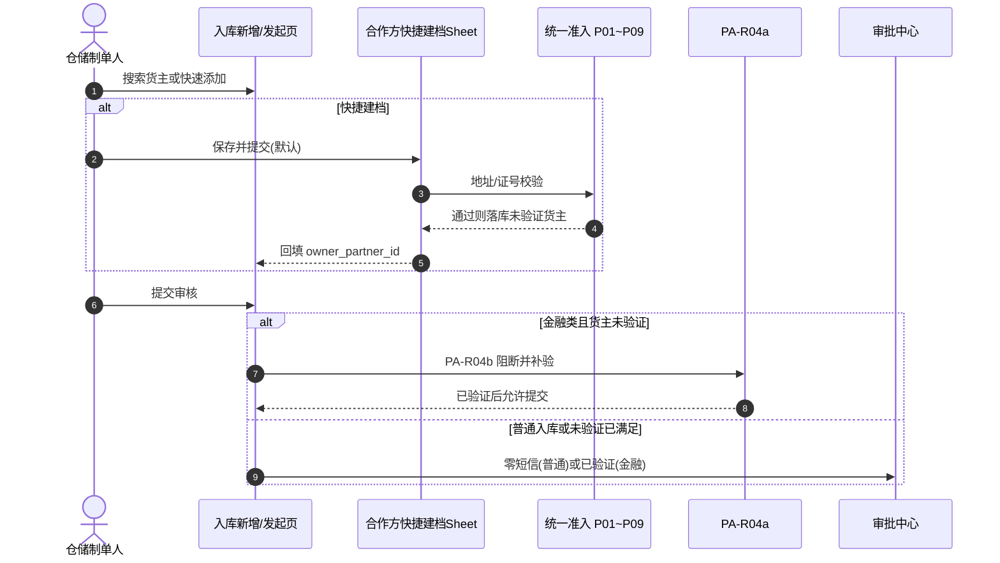
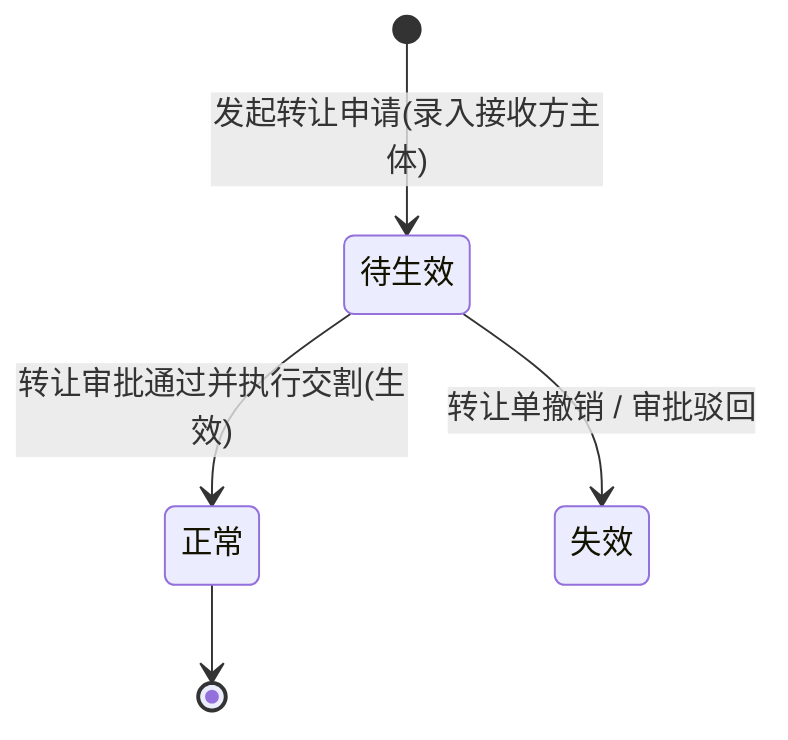

# 合作方改造 · 存量业务单据协同规格

> **版本**：V1.8 | **更新时间**：2026-10-19 | **责任人**：森云科技（Senyun Technology）  
> **文档定位**：6.3 版本存量业务单据（入库、预约、出库、提货、转让、仓单、客户管理）引用统一合作方主数据的协同改造唯一真源。  
> **范围真源**：[08-版本范围与里程碑.md](../08-版本范围与里程碑.md)（P0/P1 切分）。  
> **编写依据**：[合作方档案主PRD.md](../04-合作方档案/合作方档案主PRD.md) · [合作方档案业务规则规格.md](../04-合作方档案/合作方档案业务规则规格.md) · [基础配置主PRD.md](../02-平台管理-基础配置/基础配置主PRD.md) · [基础配置业务规则规格.md](../02-平台管理-基础配置/基础配置业务规则规格.md)（合作方准入 P01~P09 见基础配置 6.2 节）。  
> **覆盖范围**：仓储入库记录、工作中心客户入库预约、仓储出库记录、仓储提货单、货物转让记录、仓单管理、交易客户管理 7 大存量业务单据。

---

## 一、改造背景与四大基本原则

### 1.1 改造背景
在 6.3 版本之前，货主、提货人、接收方等业务主体长期分散在入库记录、出库记录、提货单、客户管理等各作业单据中各自独立手工录入与维护，导致主体识别标准混乱（原以手机号标识个人货主）、证件地址缺失、同一地址被冒用绑定等风控漏洞。  
6.3 版本正式引入【合作方档案】与【基础配置 · 合作方准入策略】（P01~P09）后，存量各业务单据全面改造为**引用统一合作方主数据**，不再各行其是维护第二套主数据。

### 1.2 四大协同基本原则

| 原则编号 | 原则名称 | 规范与技术约束 |
| :--- | :--- | :--- |
| **P-01** | **单一真源原则** | 所有作业单据中的货主、提货人、接收方、仓单存货人等，统一引用合作方主体标识，废除各模块独立的货主台账；主表单默认展示主体名称与脱敏证件号，详细证件地址通过【查看货主】新标签跳转合作方详情查看，主表单**绝不平铺地址编辑控件**。 |
| **P-02** | **准入与核验分场景原则** | **准入**（含个人货主地址唯一）优先于任何短信消耗；地址冲突须在发码前同步阻断。**核验分层**：① 管理端【合作方档案】新建/编辑（PA-P02）可 **免短信** 落库，联系手机状态为 **未验证**；② **入库创建新货主** 仍 **R03** 提交前短信；③ **普通入库存量货主** 零短信至审批通过；④ **质押/抵押/监管服务/仓单/独立融资** 在提交或生效前对 **未验证** 货主强制 **PA-R04b** 补验（共用 PA-R04a/R03 服务），通过后主档置 **已验证**。 |
| **P-03** | **快照不可变原则 (C08)** | 业务单据在写库存/货权生效的关键节点（如入库审批通过、转让生效、仓单开立），必须完整固化合作方身份标识、证件地址、主体类型的**不可变业务快照**；合作方主档后续编辑变更**绝不回写**历史事实流水。 |
| **P-04** | **按角色隔离冻结原则** | 业务单据仅校验当前业务所需的角色状态（如制单入库校验「货主角色」，提货核销校验「提货经办人角色」）；合作方单一角色冻结不影响其在其他合法角色下的独立履约。 |

---

## 二、存量业务单据改造总览表

| 序号 | 业务单据 / 菜单 | 优先级 | 所属系统板块 | 引用合作方角色 | 证件地址规则触发时机 | 核心改造与阻断机制 |
| :---: | :--- | :---: | :--- | :--- | :--- | :--- |
| **01** | **入库记录** | **P0** | 仓储 / 入库管理 | 货主 (OWNER) | 快捷建档时 **P02**（个人）；**不**因 **P01** 缺址阻断提交 | 个人货主唯一键由手机号变更为**身份证号**；快捷建档 **P02** 前置于短信；引用已建档货主 **不因缺证件地址阻断**。 |
| **02** | **客户入库预约** | **P0** | 工作中心 / 需求审批 | 货主 (OWNER) | 客户/运营创建新货主时校验 | 提交预约时前置校验；地址冲突在生成申请前同步阻断，不产生待办审批流。 |
| **03** | **出库记录** | **P0** | 仓储 / 出库管理 | 货主 + 提货主体 + 提货经办人 | 仅当兼任货主写入时校验 | 分层引用；静默沉淀简易提货人；经办人默认不校货主地址唯一。 |
| **04** | **提货单** | **P0** | 仓储 / 货物管理 | 提货经办人 (PICKUP_AGENT) | 不触发个人货主地址唯一校验 | 身份证/手机号检索；角色冻结拦截核销。 |
| **05** | **货物转让记录** | **P0** | 仓储 / 货物管理 | 原货主 + 接收方 (RECEIVER) | **转让生效**接收方转货主时校验 | 申请阶段待生效不校地址；生效时准入，冲突阻止生效。 |
| **06** | **仓单管理** | **P1** | 仓储 / 仓单管理 | 存货人 (STORER) + 持有人 (HOLDER) | 实质转货主时校验 | P0：存货人复用货主；P1：持有人时点流水与质押联动快照。 |
| **07** | **客户管理** | **P0** | 交易 / 客户管理 | 认证主体关联 (C 端客户) | 实名认证默认开通货主时校验 | 账号 1:1 绑定合作方；认证同步地址+准入。 |

---

## 三、各业务单据详细协同规格

### 3.1 仓储 · 入库记录（重点改造）【P0】

#### 1. 核心交互与主键口径变更
- **身份证号成为唯一标识**：彻底废除原基准版中以「手机号」作为个人货主主键的做法，个人货主统一以 18 位身份证号为租户内唯一主键；手机号降级为联系方式与辅助检索项。
- **主表单展示与跳转详情**：入库新增页仅保留货主名称、主体类型、脱敏身份证号/信用代码展示；提供【查看货主】行内链接，点击在新标签打开合作方档案详情，**不使用右侧抽屉**，主表单不平铺地址输入框。
- **新建货主入口（6.3.3 · 作业嵌入快捷建档）**：入库/H5 入库发起页提供：
  1. **【+ 快速添加货主】** 与搜索 **无结果空态【添加货主】**（需 **PA-P02**；无权限隐藏）；
  2. **共用合作方新增表单**（PC 抽屉 / H5 底 Sheet），挂接货主角色；创建来源 **「入库快捷建档」**，**创建人 = 当前操作用户**；
  3. 默认 **保存并提交 → 联系手机未验证**；可选 **保存并验证 → 【合作方短信二元身份核验服务规则】(PA-R04a)**；
  4. 保存成功后 **自动回填** `owner_partner_id`；**不在入库提交时建档**（废止 6.2「提交时 R03 原子建档」）。
- **线框真源**：[合作方快捷建档-QCP_ASCII_作业嵌入.md](./合作方快捷建档-QCP_ASCII_作业嵌入.md) · [入库记录业务规则规格 R03](../10-仓储管理-入库记录/入库记录业务规则规格.md)。

#### 2. 校验时序闭环（先建档与准入，提交仅金融补验）

#### 3. 拦截与异常机制
- **地址冲突**：在 **快捷建档保存** 时由准入同步阻断（不发短信、不落库）。
- **审批终审二次复检**：货主/货主角色冻结则驳回通过（PA-R02）。
- **金融未验证**：提交前阻断，文案「货主未进行验证，需要验证后才可以进行业务」（PA-R04b）。
- **6.3 入库三件套真源**：[10-仓储管理-入库记录](../10-仓储管理-入库记录/)；6.2 基准只读对照。

---

### 3.2 工作中心 · 客户入库预约【P0】

#### 1. 业务协同定位
- 供 C 端认证客户或业务代办人在 PC/移动端发起入库预约意向；
- 预约单中的货主信息同样来源于统一合作方服务，预约单审批通过后可一键「转入库记录」。

#### 2. 规则协同要点
- **作业侧拦截边界**：预约**提交**不因 **P01** 缺证件地址阻断；若快捷建档个人货主触发 **P02** 同址冲突，在**建档保存**时同步拦截（不进审批中心）。角色冻结等仍按 **PA-R01** 在提交时拦截。
- **不增设地址冲突审批**：冲突即硬阻断；确属搬家或地址变更的，须在【合作方档案】执行**证件地址编辑改址 (PA-R06a)**（填改址原因、新址准入、旧址出池），**不得**通过移除货主或注销绕行。

---

### 3.3 仓储 · 出库记录与提货单【P0】

#### 1. 业务主体三层分离
在出库业务中，严格区分三个层级的主体概念：

- **出库货主**：必须为在库货品的合法权属主体，仅需校验其拥有有效的「货主」角色；
- **提货主体**：提货合同的签约相对方，可为企业或个人；
- **提货经办人**：实际到场提货的自然人，仅关联「提货经办人」角色。

#### 2. 协同改造规格
- **提货人不触发地址唯一校验**：提货经办人（如货车司机）即便录入了身份证与住址，由于其业务角色为提货经办人而非货主，**绝不调用**个人货主证件地址唯一校验规则，避免误伤物流人员。
- **【快速添加提货经办人】（6.3.3）**：制单页仅通过 **【+ 快速添加提货经办人】** 唤起与合作方档案共用表单（`PartnerQuickCreateSheet` · 场景 `OUTBOUND_PICKUP_AGENT`）；**失焦/手输不再静默沉淀**；落库来源 **「出库快捷建档」**，角色 **提货经办人**（默认待补全），**不触发**个人货主地址唯一校验。
- **提货单高频检索**：提货单现场核销页面支持输入身份证号或手机号快速带出已登记的提货经办人；若该经办人处于「冻结」状态，拦截提货出库。

---

### 3.4 仓储 · 货物转让记录【P0】

#### 1. 接收方角色状态变迁机制
转让业务涉及货权自原货主向接收方的转移，改造重点在于接收方角色的状态机协同：

- **申请阶段（待生效）**：转让制单时，若接收方尚未在平台建立合作方，允许录入并生成合作方主体，但其角色赋予为 `待生效接收方`，**此阶段不执行个人货主证件地址唯一校验**。
- **生效阶段（转为正式货主）**：转让单终审通过、正式执行库存货权转移瞬间，系统自动将接收方的角色转为正式 `货主`，**此时必须强制触发合作方准入规则**。若触发地址冲突，系统阻断转让生效，单据停留在待处理状态并告警通知转让双方。

#### 2. 双向主体快照固化
转让单生效归档时，必须同时固化两份快照：
- **转让人主体快照**：主体名称、证件号码、证件地址；
- **受让人主体快照**：主体名称、证件号码、证件地址。

---

### 3.5 仓储 · 仓单管理【P1】

#### 1. 存货人与持有人解耦
- **存货人 (STORER)**：仓单开立时的原始货物权属人，必须直接复用入库记录中的合作方货主，**不得**在仓单开立模块重新新建主体。
- **持有人 (HOLDER)**：仓单当前合法权利人，采用时点关系维护流水：
  - 仓单开立时：初始持有人 = 存货人；
  - 仓单质押时：持有人保持为存货人，同时记录资金方合作方质押权；
  - 仓单转让/平仓处置时：持有人变更为新的合作方主体，并记录流转时间轴。

#### 2. 快照追溯
仓单每一次状态流转（开立、锁定、转让、质押、解押、注销），均按时点固化当时的存货人与持有人合作方信息，确保仓单在金融机构与司法存证场景下的证据链闭环。

---

### 3.6 交易 · 客户管理（C 端账号绑定）【P0】

#### 1. 账号与主体关系解耦
- **概念隔离**：
  - **客户账号 (Account)**：维护 C 端登录名、登录手机号、注册时间、密码凭证；
  - **合作方主体 (Partner)**：维护法人或自然人层面的社会统一实体（身份证号/统一社会信用代码）。
- **绑定机制**：
  - 一个个人客户账号实名认证后，1:1 绑定一个个人合作方主体；
  - 认证通过后，系统**默认**在合作方档案为其开通「货主」角色；
  - 自动将实名认证填报的证件地址写入合作方主档的证件地址，并前置调用准入规则校验唯一性。

---

## 四、附录：存量改造核心决策映射（Q01~Q14 闭环查对）

| 决策编号 | 原始问题摘要 | 最终落地实施规格 | 协同单据覆盖 |
| :--- | :--- | :--- | :--- |
| **Q01** | 个人货主唯一键由手机号改为身份证号 | 个人合作方主体以 18 位身份证号为租户内唯一主键；存量数据通过清洗脚本合并；入库表单手机号仅作联系用 | 入库记录、客户管理 |
| **Q02** | 个人货主未填地址存量单据处理 | **【合作方档案证件地址必填校验规则】(P01)** 仅在档案保存时强制补址（个人与企业）；**入库/出库/仓单/转让等作业不因缺证件地址阻断**。缺址主体可在档案台账补录；作业侧仍校角色状态、冻结与 **PA-R04b** 等 | 全仓储单据 + 档案 |
| **Q03/04** | 业务角色与系统权限混淆 | 合作方角色（货主、提货人等）为业务身份，非 RBAC 权限；支持按角色独立冻结 | 全单据通用 |
| **Q06** | 个人货主地址唯一校验作用域 | 四象限矩阵：仅对个人有效、仅对货主有效；提货人、待生效接收方均不触发 | 准入规则、转让、提货 |
| **Q11** | 准入校验与二元短信认证时序 | 严格先准入阻断、再核验资料、后发短信验证码；杜绝地址冲突仍发短信 | 入库记录、预约单 |
| **Q12** | 历史流水单据快照不回写 | 仓储库存写入与货权变动时点固化快照，合作方后续更名/改址绝不回写历史流水 | 仓储全单据 |
| **Q14** | 简易沉淀提货人合并治理 | 出库沉淀的简易主体经**运维/backend 合并接口**归并（6.3 无 UI）；历史单据快照保留 | 出库、提货单 |

---

## 五、附录 A · 按菜单字段与引用改造检查表

| 菜单 | 6.2 基准文档（路径示意） | 6.3 增量字段/改造要点 | 快照固化时点 |
| :--- | :--- | :--- | :--- |
| 入库记录 | 6.2 入库管理三件套 | `owner_partner_id`；货主展示名/脱敏证号；`owner_snapshot_json`；移除主表平铺地址；+创建货主抽屉 | 审批通过写库存前 |
| 客户入库预约 | 6.2 工作中心预约 PRD | 同上货主引用；提交前准入 | 审批通过 |
| 出库记录 | 6.2 出库三件套 | `owner_partner_id`；`pickup_subject_partner_id`；`pickup_agent_partner_id`；经办人沉淀 | 出库单提交/核销时点（各模块定义） |
| 提货单 | 6.2 提货单 | `pickup_agent_partner_id`；检索身份证/手机 | 核销通过 |
| 转让记录 | 6.2 转让 | `from_owner_partner_id`；`receiver_partner_id`；`from_snapshot`/`to_snapshot` | 转让生效货权变更前 |
| 仓单管理 | 6.2 仓单 | P0：`storer_partner_id` 复用货主；P1：`holder_partner_id` 流水 | 开立/流转节点 |
| 客户管理 | 6.2 客户管理 | `partner_id` 1:1；认证回调写地址+准入 | 认证通过 |

### 快照 JSON 最小字段集（全单据统一）

`partner_id`, `subject_type`, `subject_name`, `id_no_masked`, `cert_address`, `cert_address_source`, `role_at_snapshot`, `admission_rule_version`, `snapshot_time`

---

## 六、附录 B · 存量协同验收用例

| 编号 | 场景 | 步骤摘要 | 预期 |
| :--- | :--- | :--- | :--- |
| **SYN-V01** | 入库新货主地址冲突 | 制单创建新个人货主同址提交 | 阻断；无短信；无审批单 |
| **SYN-V02** | 入库准入通过后 R03 | 新货主合法地址提交 | 发短信；进审批 |
| **SYN-V03** | 入库审批 re-validate | 审批中冻结货主 | 通过按钮驳回 |
| **SYN-V04** | 预约冲突不进审批 | 预约提交冲突地址 | 无预约待办 |
| **SYN-V05** | 出库沉淀提货人 | 新司机身份证 | 生成待补全；不校货主地址唯一 |
| **SYN-V06** | 提货单冻结拦截 | 冻结经办人核销 | 阻断出库 |
| **SYN-V07** | 转让待生效不校址 | 转让申请录入接收方 | 不校地址 |
| **SYN-V08** | 转让生效校址 | 生效瞬间同址冲突 | 阻止生效 |
| **SYN-V09** | 客户认证同步 | C 端实名 | 1:1 绑定；默认货主；准入 |
| **SYN-V10** | 快照不回写 | 主档改址后查历史入库单 | 快照地址不变 |
| **SYN-V11** | 查看货主跳转 | 入库页点击链接 | 新标签打开合作方详情，页内可看地址与核验状态 |
| **SYN-V12** | 仓单 P0 存货人 | 开立仓单 | 存货人=入库货主引用 |
| **SYN-V13** | 继承货主跳过准入 | 退货 inherit 原货主 | 不新建；不 R03（见用例场景九） |
| **SYN-V14** | 选择器过滤 | 选货主 | 仅正常主体+正常货主角色 |
| **SYN-V15** | 迁移后入库 | 清洗后身份证货主 | 可按新主键制单 |
| **SYN-V16** | 快捷建档后普通入库提交 | 入库页快捷【保存并提交】未验证 → 自动选中货主 → 普通入库提交 | 提交零短信；金融类仍 PA-R04b 补验 |

---

## 七、附录 C · 数据迁移与切流

### C.1 目标

- 个人货主主键由手机号迁移为 **18 位身份证号**（Q01）；
- 缺地址存量引导 **档案补录**（Q02）；**不**因缺址 alone 限制仓储发单；
- 与 **P03 历史冲突门禁** 配合：开唯一前须治理同址多货主。

### C.2 清洗规则（摘要）

| 情况 | 处理 |
| :--- | :--- |
| 同手机多身份证 | 人工队列；以身份证建 `partner_subject`；单据外键映射 |
| 同身份证多手机 | 合并手机为联系方式；保留最新验证手机 |
| 缺地址且有在库 | 禁止开唯一至补录完成；或暂关唯一开关过渡 |
| 缺地址无在库 | 档案引导补址；货主角色正常则作业可引用 |

### C.3 切流顺序

1. 部署合作方主档 + 准入服务（只读影子校验可选）  
2. 执行清洗脚本 + 人工冲突清单  
3. PAR 历史冲突检查通过 → 启用唯一  
4. 各单据发版引用 `partner_id`（按附录 A 分批：入库/预约/客户 → 出库/提货/转让 → 仓单 P1）  
5. 回滚：关闭新单据入口引用，主档只读保留（不回滚快照）

---

## 八、修订记录

| 日期 | 版本 | 说明 |
| :--- | :---: | :--- |
| 2026-09-20 | V1.5 | 初版协同规格 |
| 2026-10-08 | V1.6 | P0/P1 标签；改址路径；附录 A/B/C；R03 引用 |
| 2026-10-10 | V1.7 | 入库 P0 轻量：【+ 新增合作方】权限跳转档案页；4a 增量；SYN-V16；准入 SSOT 指向基础配置 P01~P09 |
| 2026-10-19 | **V1.8** | 入库 3.1 改为作业嵌入快捷建档（R03 重写）；时序图与 SYN-V16 更新；废止提交时建档。 | 3.1、附录 B |

---
*版本说明：V1.7 | 森云科技（Senyun Technology）存量改造协同基准规范*
