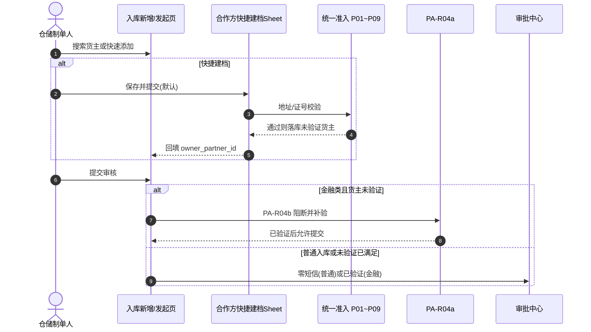
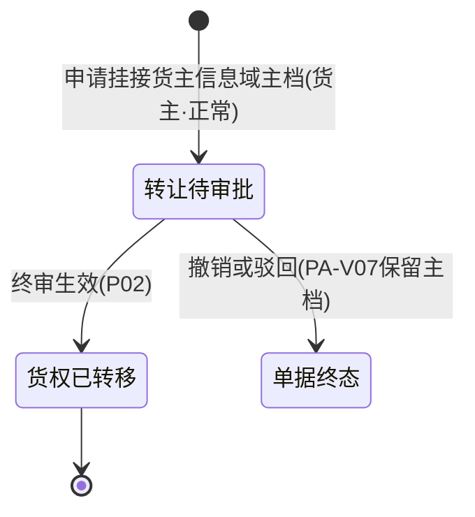

# 合作方改造 · 存量业务单据协同规格

> **版本**：V2.1 | **更新时间**：2026-10-20 | **责任人**：森云科技（Senyun Technology）  
> **研发改造地图（原型）**：PC Demo `/用户中心/业务协同/合作方档案存量改造地图`（索引页；规格全文见同目录独立菜单）。
> **目录索引**：[05/README.md](./README.md) · **迁移实施真源**：[6.3合作方主数据-数据迁移与切流.md](./6.3合作方主数据-数据迁移与切流.md)（附录 C 摘要 + **MIG-V** 验收）  
> **6.3 档案分域（方案 B）**：[04 合作方主数据索引](../04-合作方档案/README.md) · 货主 [04-1](../04-合作方档案/04-1-货主信息/) · 提货人 [04-2](../04-合作方档案/04-2-提货人信息/) · 抵质押权人 [04-3](../04-合作方档案/04-3-资金方信息/) · 监管服务质权人 [04-4](../04-合作方档案/04-4-服务方信息/) · [12-融资监管引用域](../12-融资监管-菜单更名与监管管理口径.md)  
> **文档定位**：6.3 版本存量业务单据（入库、预约、出库、提货、转让、仓单、客户管理）引用统一合作方主数据的协同改造唯一真源。  
> **范围真源**：[08-版本范围与里程碑.md](../08-版本范围与里程碑.md)（P0/P1 切分）。  
> **编写依据**：[04 合作方主数据索引](../04-合作方档案/README.md) · [合作方主数据-公共主PRD.md](../04-合作方档案/合作方主数据-公共主PRD.md) · [合作方主数据-公共业务规则规格.md](../04-合作方档案/合作方主数据-公共业务规则规格.md) · 货主 [04-1](../04-合作方档案/04-1-货主信息/货主信息业务规则规格.md) · 提货人 [04-2](../04-合作方档案/04-2-提货人信息/提货人信息业务规则规格.md) · [基础配置主PRD.md](../02-平台管理-基础配置/基础配置主PRD.md) · [基础配置业务规则规格.md](../02-平台管理-基础配置/基础配置业务规则规格.md)（合作方准入 **P01~P09** 见基础配置 6.2 节）。  
> **覆盖范围**：仓储入库记录、仓储出库记录、仓储提货单、货物转让记录、仓单管理、交易客户管理 **6 大** B 端存量业务单据（**不含**工作中心「客户入库预约」——属 C 端客户入库信息/预约域，**6.3 不涉及**）。

---

## 一、改造背景与四大基本原则

### 1.1 改造背景
在 6.3 版本之前，货主、提货人、接收方等业务主体长期分散在入库记录、出库记录、提货单、客户管理等各作业单据中各自独立手工录入与维护，导致主体识别标准混乱（原以手机号标识个人货主）、证件地址缺失、同一地址被冒用绑定等风控漏洞。  
6.3 版本正式引入 **用户中心 → 合作方档案 → 四子菜单**（`archiveMenu` 分域独立主档，**【合作方子菜单分视图与隐式角色规则】(PA-R12)**）与【基础配置 · **货主准入策略**】（P01~P09，**仅货主域**）后，存量各业务单据全面改造为**引用统一合作方主数据**，不再各行其是维护第二套主数据。

### 1.2 四大协同基本原则

| 原则编号 | 原则名称 | 规范与技术约束 |
| :--- | :--- | :--- |
| **P-01** | **单一真源原则** | 所有作业单据中的货主、提货经办人、**受让人（货主信息域）**、仓单存货人等，统一引用合作方主体标识，废除各模块独立的货主台账；嵌入式选择器须带 **档案归属菜单**（货主 → **货主信息**、提货经办人 → **提货人信息** 等），列表 **不得跨域混选**（**【合作方子菜单分视图与隐式角色规则】(PA-R12)**）；主表单默认展示主体名称与脱敏证件号，【查看档案】新标签打开 `/用户中心/合作方档案/{域}/详情/:id`，主表单**绝不平铺地址编辑控件**。 |
| **P-02** | **准入与核验分场景原则** | **准入**（含个人货主地址唯一）优先于任何短信消耗；地址冲突须在发码前同步阻断。**核验分层**：① 管理端【合作方档案】新建/编辑（PA-P02）可 **免短信** 落库，联系手机状态为 **未验证**；② **入库创建新货主** 仍 **R03** 提交前短信；③ **普通入库存量货主** 零短信至审批通过；④ **质押/抵押/监管服务/仓单/独立融资** 在提交或生效前对 **未验证** 货主强制 **PA-R04b** 补验（共用 PA-R04a/R03 服务），通过后主档置 **已验证**。 |
| **P-03** | **快照不可变原则 (C08)** | 业务单据在写库存/货权生效的关键节点（如入库审批通过、转让生效、仓单开立），必须完整固化合作方身份标识、证件地址、主体类型的**不可变业务快照**；合作方主档后续编辑变更**绝不回写**历史事实流水。 |
| **P-04** | **按角色隔离冻结原则** | 业务单据仅校验当前业务所需的角色状态（如制单入库校验「货主角色」，提货核销校验「提货经办人角色」）；合作方单一角色冻结不影响其在其他合法角色下的独立履约。 |

---

## 二、存量业务单据改造总览表

| 序号 | 业务单据 / 菜单 | 优先级 | 所属系统板块 | 引用合作方角色 | 证件地址规则触发时机 | 核心改造与阻断机制 |
| :---: | :--- | :---: | :--- | :--- | :--- | :--- |
| **01** | **入库记录** | **P0** | 仓储 / 入库管理 | 货主 (OWNER) | 快捷建档时 **P02**（个人）；**不**因 **P01** 缺址阻断提交 | 个人货主唯一键由手机号变更为**身份证号**；快捷建档 **P02** 前置于短信；引用已建档货主 **不因缺证件地址阻断**。 |
| **02** | **客户入库预约** | **—** | 工作中心 / 需求审批 | — | **6.3 不涉及** | C 端客户入库信息/预约域；沿用基准版，不做合作方引用与准入协同改造。 |
| **03** | **出库记录** | **P0** | 仓储 / 出库管理 | 货主 + 提货主体 + 提货经办人 | 仅当兼任货主写入时校验 | 货主 **仅选已有**；提货经办人 **O06a** 快捷建档；**不**失焦静默沉淀；经办人不校货主 **P02**。 |
| **04** | **提货单** | **P0** | 仓储 / 货物管理 | 提货经办人 (PICKUP_AGENT) | 不触发个人货主地址唯一校验 | 身份证/手机号检索；角色冻结拦截核销。 |
| **05** | **货物转让记录** | **P0** | 仓储 / 货物管理 | 原货主 + **受让人（货主信息域）** | **转让生效**执行 **P02** | 申请即在 **货主信息** 挂 **货主·正常**（**PA-V07**）；申请不校 P02；生效校 P02，冲突阻止生效；**废止**接收方/待生效。 |
| **06** | **仓单管理** | **P1** | 仓储 / 仓单管理 | 存货人 (STORER) + 持有人 (HOLDER) | 实质转货主时校验 | P0：存货人复用货主；P1：持有人时点流水与质押联动快照。 |
| **07** | **客户管理** | **P0** | 交易 / 客户管理 | 认证主体关联 (C 端客户) | 实名认证默认开通货主时校验 | 账号 1:1 绑定合作方；认证同步地址+准入。 |
| **08** | **监管办理** | **P0** | 融资 / 监管业务 | 货主 + 抵押权人/质押权人/质权人 | 权人保存不执行货主 **P02**（主动填址仍不入池） | 权人选择器分 **资金方信息 / 服务方信息** 域；货主 **货主信息**；生单快照（见 **八、**、[12](../12-融资监管-菜单更名与监管管理口径.md)） |
| **09** | **监管管理** | **P0** | 融资 / 监管业务 | 同上（列表/详情只读） | — | 展示开单快照；Deep link 须带 **archiveMenu**；**不在本菜单改权人** |
| **10** | **入库暂存登记** | **暂定开发** | 仓储 / 入库 | 转正前可临时文本；转正绑货主 | 暂存保存 **不** 校 **P02** | 暂存可手填货主说明；**转正/正式页**须 `owner_partner_id` + **R03**（见 [09-入库暂存](../09-仓储管理-入库暂存登记/) · [暂存联动说明](./入库暂存登记-存量入库板块业务改造规格.md)） |

### 2.1 本期不改造 · 只读继承（说明用）

| 类型 | 模块示例 | 6.3 口径 |
| :--- | :--- | :--- |
| **划出 6.3** | 工作中心 · 客户入库预约；07/06 入库收集与 SKU 保质期配置 | 沿用基准版，不做合作方引用增量 |
| **仅挂载规则、不改菜单** | 贷中风控 / 独立融资制单等 | 若引用货主且未验证，按 **【合作方短信二元身份核验服务规则】(PA-R04b)**；具体菜单待各模块 PRD 挂载 |
| **只读下游** | 货权档案、库存明细/流水、移库出库联动、加工、盘点、异动 | **不新增**合作方选择器；消费入库/出库/转让等上游 **快照或库存货主**，主档变更不回写 |

---

## 三、各业务单据详细协同规格

### 3.1 仓储 · 入库记录（重点改造）【P0】

#### 1. 核心交互与主键口径变更
- **身份证号成为唯一标识**：彻底废除原基准版中以「手机号」作为个人货主主键的做法，个人货主统一以 18 位身份证号为租户内唯一主键；手机号降级为联系方式与辅助检索项。
- **主表单展示与跳转详情**：入库新增页仅保留货主名称、主体类型、脱敏身份证号/信用代码展示；提供【查看货主】行内链接，点击在新标签打开合作方档案详情，**不使用右侧抽屉**，主表单不平铺地址输入框。
- **新建货主入口（6.3.3 · 作业嵌入快捷建档）**：入库/H5 入库发起页提供：
  1. **【+ 快速添加货主】** 与搜索 **无结果空态【添加货主】**（需对应子菜单新建权限 · **【合作方档案操作权限矩阵】(PA-P02)**；无权限隐藏）；
  2. **共用合作方新增表单**（PC 抽屉 / H5 底 Sheet），挂接货主角色；创建来源 **「入库快捷建档」**，**创建人 = 当前操作用户**；
  3. 默认 **保存并提交 → 联系手机未验证**；可选 **保存并验证 → 【合作方短信二元身份核验服务规则】(PA-R04a)**；
  4. 保存成功后 **自动回填** `owner_partner_id`；**不在入库提交时建档**（废止 6.2「提交时 R03 原子建档」）。
- **线框真源**：[合作方快捷建档-QCP_ASCII_作业嵌入.md](./合作方快捷建档-QCP_ASCII_作业嵌入.md) · [入库记录业务规则规格 R03](../10-仓储管理-入库记录/入库记录业务规则规格.md)。

#### 2. 校验时序闭环（先建档与准入，提交仅金融补验）

#### 3. 拦截与异常机制
- **地址冲突**：在 **快捷建档保存** 时由准入同步阻断（不发短信、不落库）。
- **审批终审二次复检**：货主/货主角色冻结则驳回通过（PA-R02）。
- **金融未验证**：提交前阻断，文案「货主未进行验证，需要验证后才可以进行业务」（PA-R04b）。
- **6.3 入库三件套真源**：[10-仓储管理-入库记录](../10-仓储管理-入库记录/)；6.2 基准只读对照。

---

### 3.2 工作中心 · 客户入库预约【6.3 不涉及 · 归档说明】

> **范围裁切（2026-10-19）**：客户入库预约承载 **C 端客户入库信息** 与预约审批，不在 6.3「B 端作业引用合作方主数据」改造范围。下文保留历史推演，**研发与联调不以本节为验收依据**。

#### 1. 业务协同定位
- 供 C 端已注册（实名认证）货主或业务代办人在 PC/移动端发起入库预约意向；
- 预约单中的货主信息同样来源于统一合作方服务，预约单审批通过后可一键「转入库记录」。

#### 2. 规则协同要点
- **作业侧拦截边界**：预约**提交**不因 **P01** 缺证件地址阻断；若快捷建档个人货主触发 **P02** 同址冲突，在**建档保存**时同步拦截（不进审批中心）。角色冻结等仍按 **PA-R01** 在提交时拦截。
- **不增设地址冲突审批**：冲突即硬阻断；确属搬家或地址变更的，须在【合作方档案】执行**证件地址编辑改址 (PA-R06a)**（新址准入、旧址出池），**不得**通过移除货主或注销绕行。

---

### 3.3 仓储 · 出库记录与提货单【P0】

#### 1. 业务主体三层分离
在出库业务中，严格区分三个层级的主体概念：

- **出库货主**：必须为在库货品的合法权属主体，仅需校验其拥有有效的「货主」角色；
- **提货主体**：提货合同的签约相对方，可为企业或个人；
- **提货经办人**：实际到场提货的自然人，仅关联「提货经办人」角色。

#### 2. 协同改造规格
- **提货人不触发地址唯一校验**：提货经办人（如货车司机）即便录入了身份证与住址，由于其业务角色为提货经办人而非货主，**绝不调用**个人货主证件地址唯一校验规则，避免误伤物流人员。
- **提货经办人引用域**：嵌入式选择器 **`archiveMenu=提货人信息`**，库内匹配 **【提货人信息库内匹配规则】(PP-R01)**；**【+ 快捷建档】** 唤起 `PartnerQuickCreateSheet` · 场景 `OUTBOUND_PICKUP_AGENT`，落库 **提货人信息** 域主档；**失焦/手输不再静默沉淀**；来源 **「出库快捷建档」**，角色 **提货经办人**（默认待补全），**不触发**个人货主 **【证件登记地址防重复唯一校验与同步阻断规则】(P02)**。
- **出库货主引用域**：货主须 **`archiveMenu=货主信息`** **仅检索**已有主档（**WH-R01**）；**不提供**出库制单页快捷新增（新建货主无在库货物，无法选货出库）；新货主在 **入库** 等入口建档后再出库引用；与提货经办人 **分字段、分域**；详情深链带 **货主信息** 菜单路径。
- **提货单高频检索**：提货单现场核销页面支持输入身份证号或手机号快速带出已登记的提货经办人；若该经办人处于「冻结」状态，拦截提货出库。
- **提货主体（合同层）**：6.3 **P0** 不落地 `pickup_subject_partner_id` 外键；个人场景以 **提货经办人** 引用为准；企业提货主体双层结构见 [08 序号 14](../08-版本范围与里程碑.md) **P2**，制单层字段沿用基准手输/反显。

---

### 3.4 仓储 · 货物转让记录【P0】

#### 1. 受让人挂接货主信息域（废止接收方 / 待生效）
转让业务涉及货权自原货主向受让人的转移；6.3 **方案 B** 与公共主数据一致：**不再**使用「接收方」角色或「待生效→货主」两段式。

- **申请阶段**：在 **货主信息** 档案域 **创建/挂接** 受让人主档，隐式 **货主 · 正常**（**【合作方子菜单分视图与隐式角色规则】(PA-R12)**）；**不执行** **【证件登记地址防重复唯一校验与同步阻断规则】(P02)**；**不因** **【货主证件地址必填校验规则】(P01)** 缺址阻断申请。
- **驳回 / 撤销（PA-V07）**：转让单未完结时，**已创建的货主主档与货主角色均保留**（正常态），系统不因单据失败回收主档。
- **生效阶段**：终审通过、执行库存货权转移前，**必须**执行 **P02**（个人/企业货主分池）；地址冲突 **阻断生效** 并通知双方；通过后固化双方快照（**P-03**）。

#### 2. 双向主体快照固化
转让单生效归档时，必须同时固化两份快照：
- **转让人主体快照**：主体名称、证件号码、证件地址；
- **受让人主体快照**：主体名称、证件号码、证件地址。

#### 3. 存量迁移
历史「接收方」主体清洗为 **货主信息** 域 **货主** 主档，来源单据号保留；详见 [6.3合作方主数据-数据迁移与切流.md](./6.3合作方主数据-数据迁移与切流.md) **M-R08**、**MIG-V04~05**。

---

### 3.5 仓储 · 仓单管理【P1】

#### 1. 存货人与持有人解耦
- **存货人 (STORER)**：仓单开立时的原始货物权属人，必须直接复用入库记录中的合作方货主，**不得**在仓单开立模块重新新建主体。
- **持有人 (HOLDER)**：仓单当前合法权利人，采用时点关系维护流水：
  - 仓单开立时：初始持有人 = 存货人；
  - 仓单质押时：持有人保持为存货人，同时记录资金方合作方质押权；
  - 仓单转让/平仓处置时：持有人变更为新的合作方主体，并记录流转时间轴。

#### 2. 快照追溯
仓单每一次状态流转（开立、锁定、转让、质押、解押、注销），均按时点固化当时的存货人与持有人合作方信息，确保仓单在金融机构与司法存证场景下的证据链闭环。

---

### 3.6 交易 · 客户管理（C 端账号绑定）【P0】

#### 1. 账号与主体关系解耦
- **概念隔离**：
  - **客户账号 (Account)**：维护 C 端登录名、登录手机号、注册时间、密码凭证；
  - **合作方主体 (Partner)**：维护法人或自然人层面的社会统一实体（身份证号/统一社会信用代码）。
- **绑定机制**：
  - 一个个人客户账号实名认证后，1:1 绑定一个个人合作方主体；
  - 认证通过后，系统**默认**在合作方档案为其开通「货主」角色；
  - 自动将实名认证填报的证件地址写入合作方主档的证件地址，并前置调用准入规则校验唯一性。

---

## 四、附录：存量改造核心决策映射（Q01~Q14 闭环查对）

| 决策编号 | 原始问题摘要 | 最终落地实施规格 | 协同单据覆盖 |
| :--- | :--- | :--- | :--- |
| **Q01** | 个人货主唯一键由手机号改为身份证号 | 个人合作方主体以 18 位身份证号为租户内唯一主键；存量数据通过清洗脚本合并；入库表单手机号仅作联系用 | 入库记录、客户管理 |
| **Q02** | 个人货主未填地址存量单据处理 | **【货主证件地址必填校验规则】(P01)** 仅在 **货主信息** 子菜单保存时强制补址（个人与企业货主）；**入库/出库/仓单/转让等作业不因缺证件地址阻断**。缺址货主可在 **货主信息** 台账补录；作业侧仍校角色状态、冻结与 **PA-R04b** 等 | 全仓储单据 + 货主信息 |
| **Q03/04** | 业务角色与系统权限混淆 | 合作方角色（货主、提货人等）为业务身份，非 RBAC 权限；支持按角色独立冻结 | 全单据通用 |
| **Q06** | 个人货主地址唯一校验作用域 | 四象限矩阵：仅对个人有效、仅对货主有效；**提货人信息** 域、转让 **申请阶段** 均不触发 P02；转让 **生效** 执行 P02 | 准入规则、转让、提货 |
| **Q11** | 准入校验与二元短信认证时序 | 严格先准入阻断、再核验资料、后发短信验证码；杜绝地址冲突仍发短信 | 入库记录、预约单 |
| **Q12** | 历史流水单据快照不回写 | 仓储库存写入与货权变动时点固化快照，合作方后续更名/改址绝不回写历史流水 | 仓储全单据 |
| **Q14** | 简易沉淀提货人合并治理 | 出库沉淀的简易主体经**运维/backend 合并接口**归并（6.3 无 UI）；历史单据快照保留 | 出库、提货单 |

---

## 五、附录 A · 按菜单字段与引用改造检查表

| 菜单 | 6.2 基准文档（路径示意） | 6.3 增量字段/改造要点 | 快照固化时点 |
| :--- | :--- | :--- | :--- |
| 入库记录 | 6.2 入库管理三件套 | `owner_partner_id`；货主展示名/脱敏证号；`owner_snapshot_json`；移除主表平铺地址；+创建货主抽屉 | 审批通过写库存前 |
| 客户入库预约 | 6.2 工作中心预约 PRD | **6.3 不涉及**（C 端预约域） | — |
| 出库记录 | 6.2 出库三件套 | `owner_partner_id`；`pickup_subject_partner_id`；`pickup_agent_partner_id`；经办人沉淀 | 出库单提交/核销时点（各模块定义） |
| 提货单 | 6.2 提货单 | `pickup_agent_partner_id`；检索身份证/手机 | 核销通过 |
| 转让记录 | 6.2 转让 | `from_owner_partner_id`；`receiver_partner_id`；`from_snapshot`/`to_snapshot` | 转让生效货权变更前 |
| 仓单管理 | 6.2 仓单 | P0：`storer_partner_id` 复用货主；P1：`holder_partner_id` 流水 | 开立/流转节点 |
| 客户管理 | 6.2 客户管理 | `partner_id` 1:1；认证回调写地址+准入 | 认证通过 |
| 监管办理 | 基准抵质押办理三件套 + [12](../12-融资监管-菜单更名与监管管理口径.md) | 货主 `owner_partner_id`；抵押/质押 `funder_partner_id`（**资金方信息**）；监管服务质权人 **服务方信息**；权人/货主快照 | 终审生单 |
| 监管管理 | 基准抵质押管理三件套 | 列表/详情只读快照字段；跳转合作方详情带域 | 开单时已固化 |
| 入库暂存登记 | [09-入库暂存](../09-仓储管理-入库暂存登记/) | 暂存：档案货主可选或临时文本；转正后同入库 `owner_partner_id` | 正式单审批通过写库存前（同入库） |

### 快照 JSON 最小字段集（全单据统一）

`partner_id`, `subject_type`, `subject_name`, `id_no_masked`, `cert_address`, `cert_address_source`, `role_at_snapshot`, `admission_rule_version`, `snapshot_time`

---

## 六、附录 B · 存量协同验收用例

| 编号 | 场景 | 步骤摘要 | 预期 |
| :--- | :--- | :--- | :--- |
| **SYN-V01** | 入库新货主地址冲突 | 制单创建新个人货主同址提交 | 阻断；无短信；无审批单 |
| **SYN-V02** | 入库快捷建档后验证/金融补验 | 新货主合法地址【保存并验证】或金融类 **PA-R04b** | 短信通过；普通入库【保存并提交】未验证则 **SYN-V16** 零短信 |
| **SYN-V03** | 入库审批 re-validate | 审批中冻结货主 | 通过按钮驳回 |
| **SYN-V04** | ~~预约冲突不进审批~~ | **归档 · 6.3 不验收**（客户入库预约划出范围） | — |
| **SYN-V05** | 出库快捷建档提货人 | 出库 **O06a** 新经办人 | 落 **提货人信息** 域；不校货主 **P02** |
| **SYN-V06** | 提货单冻结拦截 | 冻结经办人核销 | 阻断出库 |
| **SYN-V07** | 转让申请不校 P02 | 转让申请在货主信息域挂接受让人 | 不校 P02；货主·正常 |
| **SYN-V08** | 转让生效校 P02 | 生效瞬间同址冲突 | 阻止生效 |
| **SYN-V18** | 转让驳回保留主档 | 申请创建货主后驳回 | 货主主档保留（**PA-V07**） |
| **SYN-V09** | 客户认证同步 | C 端实名 | 1:1 绑定；默认货主；准入 |
| **SYN-V10** | 快照不回写 | 主档改址后查历史入库单 | 快照地址不变 |
| **SYN-V11** | 查看货主跳转 | 入库/出库页点击【查看档案】 | 新标签打开 `/用户中心/合作方档案/货主信息/详情/:id`（或提货人/资金方/服务方对应域） |
| **SYN-V12** | 仓单 P0 存货人 | 开立仓单 | 存货人=入库货主引用 |
| **SYN-V13** | 继承货主跳过准入 | 退货 inherit 原货主 | 不新建；不 R03（见用例场景九） |
| **SYN-V14** | 选择器过滤 | 选货主/提货经办人 | 仅当前 **archiveMenu** 域内、主体正常且对应隐式角色正常的档案（PA-R12） |
| **SYN-V17** | 出库提货人域 | 出库制单选经办人 | 下拉仅 **提货人信息** 域；快捷建档写入同域；不校货主 P02 |
| **SYN-V15** | 迁移后入库 | 清洗后身份证货主 | 可按新主键制单 |
| **SYN-V16** | 快捷建档后普通入库提交 | 入库页快捷【保存并提交】未验证 → 自动选中货主 → 普通入库提交 | 提交零短信；金融类仍 PA-R04b 补验 |

---

## 七、附录 C · 数据迁移与切流

> **全文真源**：[6.3合作方主数据-数据迁移与切流.md](./6.3合作方主数据-数据迁移与切流.md)（清洗 **M-R01~10**、波次 **W1~W4**、验收 **MIG-V01~15**）。本节为产品/协同侧摘要。

### C.1 目标

- 个人货主主键由手机号迁移为 **18 位身份证号**（Q01）；
- **方案 B 四子菜单**主档落地（`archiveMenu` 分域；域内 **PA-R03**）；
- 业务单据 **partner_id 外键**回填（附录 A）；**接收方 → 货主信息域货主**（**M-R08**）；
- 缺地址存量引导 **货主信息** 补录（Q02）；**不**因缺址 alone 限制仓储发单；
- 与 **P03 历史冲突门禁** 配合：开 **P02** 唯一前须治理同址多货主。

### C.2 清洗规则（摘要）

| 情况 | 处理 |
| :--- | :--- |
| 同手机多身份证 | 人工队列；以身份证建主体；单据外键映射（**M-R01**） |
| 同身份证多手机 | 合并为联系方式；保留最新验证手机（**M-R02**） |
| 同证号跨货主/提货人菜单 | 允许 **双主档**（**PA-V07d** / **M-R04**） |
| 缺地址且有在库 | 开 P02 前须补址或暂关唯一；作业引用不阻断（**M-R05**） |
| 缺地址无在库 | 档案引导补址；货主角色正常则作业可引用（**M-R06**） |
| 存量接收方 | 迁移为货主信息 · 货主 · 正常（**M-R08**） |
| 脏数据 / 无法匹配 | `migration_exception` 队列，禁止静默丢弃（**M-R10**） |

### C.3 切流顺序

1. 部署合作方主档 + 准入服务（**影子校验**可选，见迁移真源第五节）  
2. 执行清洗脚本 + 人工冲突清单（带 `migration_batch_id`）  
3. **P03** 历史冲突检查通过 → 启用 **P02** 唯一  
4. 各单据发版引用 `partner_id`：**W2** 入库/客户 → **W3** 出库/提货/转让 → **W3b** 监管办理权人/货主 → **W4** 仓单（P1）  
5. 关闭 legacy 行内主体录入；回滚时关闭 `partner_ref_required`，主档与快照 **只读保留**

### C.4 迁移验收（MIG-V，与 SYN-V 互补）

| 编号 | 要点 |
| :--- | :--- |
| **MIG-V02** | 清洗后可按身份证货主制单（对齐 **SYN-V15**） |
| **MIG-V04~05** | 接收方迁移 + 在途转让 **PA-V07** |
| **MIG-V06** | 跨菜单双主档 **PA-V07d** |
| **MIG-V10** | 批次回滚边界 |

完整 **MIG-V01~15** 见 [迁移真源 第六节](./6.3合作方主数据-数据迁移与切流.md#六迁移验收用例mig-v)。

---

## 八、融资监管 · 监管办理（6.3 交叉引用）

> 全文真源：[12-融资监管-菜单更名与监管管理口径.md](../12-融资监管-菜单更名与监管管理口径.md) · 基准 [抵质押业务办理业务规则规格](../../🌟🌟🌟-最新基准版/B端PC/03-融资监管/06-抵质押业务-抵质押业务办理/抵质押业务办理业务规则规格.md) **R-PLG-14~16**

| 单据 | 权人界面称谓 | 合作方档案域 |
| :--- | :--- | :--- |
| 抵押单 / 质押单 | 抵押权人 / 质押权人 | **资金方信息**（FN-R01） |
| 监管服务单 | 质权人（服务方） | **服务方信息**（SP-R01） |
| 共用货主 | 货主 | **货主信息**（WH-R01） |

监管办理 **不** 与仓储出库共用提货经办人域；原型见 `融资/监管/监管业务/监管办理`。

---

## 九、修订记录

| 日期 | 版本 | 说明 |
| :--- | :---: | :--- |
| 2026-09-20 | V1.5 | 初版协同规格 |
| 2026-10-08 | V1.6 | P0/P1 标签；改址路径；附录 A/B/C；R03 引用 |
| 2026-10-10 | V1.7 | 入库 P0 轻量：【+ 新增合作方】权限跳转档案页；4a 增量；SYN-V16；准入 SSOT 指向基础配置 P01~P09 |
| 2026-10-19 | **V1.8** | 入库 3.1 改为作业嵌入快捷建档（R03 重写）；时序图与 SYN-V16 更新；废止提交时建档。 | 3.1、附录 B |
| 2026-10-20 | **V1.9** | **方案 B**：P-01/SYN-V11/V14 写清 archiveMenu 与四子菜单深链；出库 3.3 货主/提货人分域；新增 **八、监管办理** 交叉引用与 SYN-V17。 | 一、3.3、附录 B、八 |
| 2026-10-20 | **V1.9.1** | 出库货主 **不提供** 制单页快捷建档（须在库有货）。 | 3.3 |
| 2026-10-20 | **V2.0** | **附录 C 扩写** + 迁移真源；**3.4 转让**对齐 **PA-V07**（废止接收方/待生效）；**SYN-V07/08/18**、**Q06** 同步。 | 3.4、附录 B/C |
| 2026-10-20 | **V2.0.1** | **P-01** 受让人表述；附录 A 客户入库预约标 **6.3 不涉及**；索引见 [05/README](./README.md)。 | 一、附录 A |
| 2026-10-20 | **V2.1** | **2.1 范围边界**；总览 **08~10** 监管/暂存；附录 A 补监管/暂存；**3.3** 提货主体 P2 说明；**SYN-V02/04/05** 与 **C.3 W3b**；研发改造地图入口。 | 二、附录 A/B/C |

---
*版本说明：V2.0.1 | 森云科技（Senyun Technology）存量改造协同基准规范*
