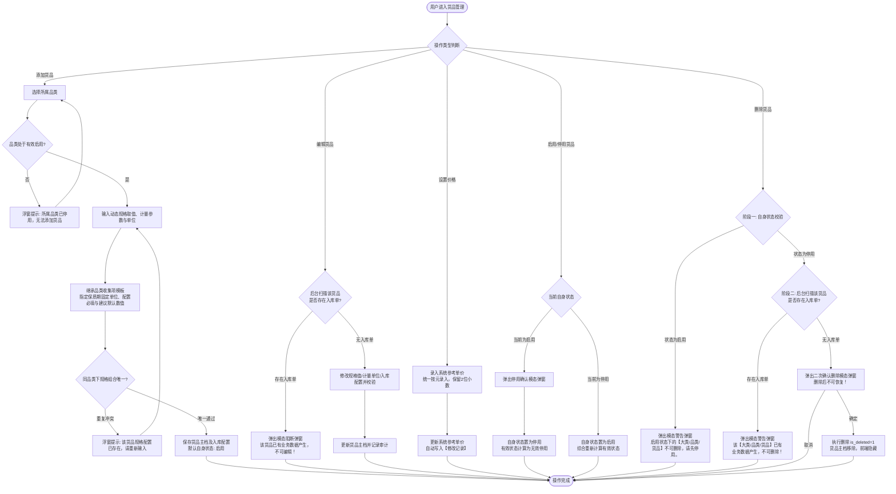
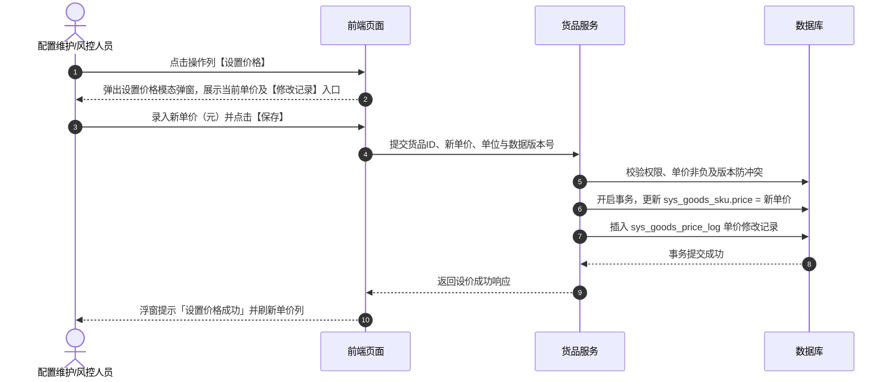
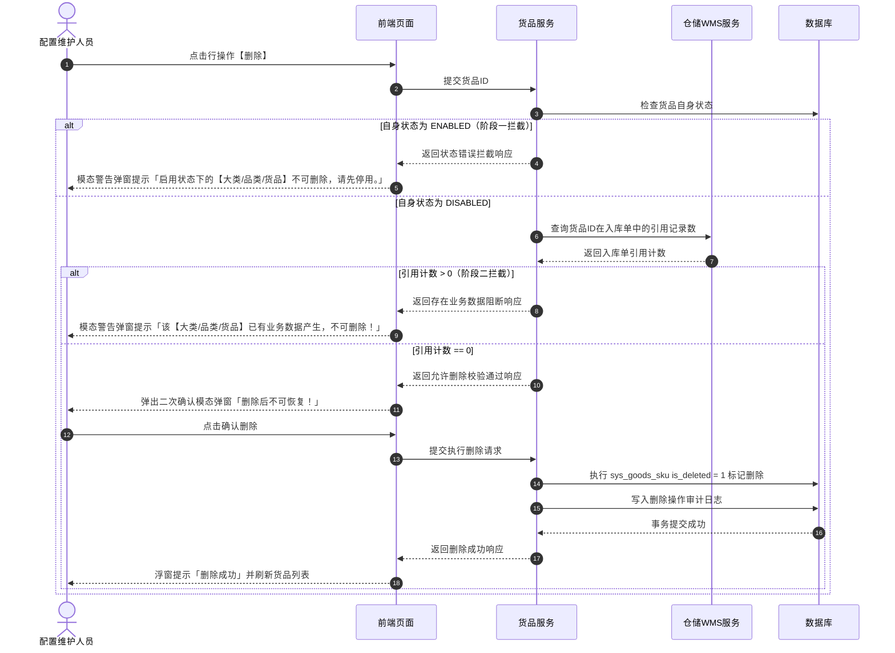

# 货品管理业务规则规格

> **文档定位**：货品管理（14-货品规格管理-货品管理 / SKU 主档）状态机模型、有效启用多级综合计算公式、动态规格组合唯一性校验、入库收集信息继承配置与保质期固定单位锁定、价格管理与展示精度、下游缺价统一提示以及两阶段安全删除的唯一定义真源（SSOT）。  
> **参考文档**：[货品管理主PRD.md](./货品管理主PRD.md)、[货品管理字段清单.md](./货品管理字段清单.md)、[入库收集项配置业务规则规格.md](../07-货品规格管理-入库收集项配置/入库收集项配置业务规则规格.md)、[品类管理业务规则规格.md](../../../🌟🌟🌟-最新基准版/B端PC/09-配置管理/04-货品规格管理-品类管理/品类管理业务规则规格.md)（6.3 无品类增量，沿用基准版）  
> **版本**：V2.2（6.3版本保质期固定单位升级） | 更新时间：2026-10-08 | 责任人：森云科技（Senyun Technology）

---

## 一、模块与单据定位

| 项目 | 内容 |
| :--- | :--- |
| **层级定位** | **【第 3 层 - 货品 / SKU 主档】**（货品主数据与存货监管体系最小业务交易与核算单元） |
| **核心职责** | 维护从属于品类的具体货品/SKU，包含动态规格参数取值、计量参数与单位、入库收集信息配置（继承品类模板并配置必填与建议默认保质期数值）、系统参考单价与单价修改记录；向入库、库存、数字仓单、动产质押、融资与加工管理提供核心主档数据支持。 |
| **实体映射** | `sys_goods_sku`（货品 SKU 主表）、`sys_goods_price_log`（单价修改记录表）、`sys_goods_sku_field_rel`（货品收集项关联配置表） |
| **上下游关系** | **上游**：底座配置层（[07 入库收集项配置](../07-货品规格管理-入库收集项配置/入库收集项配置业务规则规格.md) 提供入库采集字段池与可用单位白名单）；分类归属（所属大类与品类提供分类层级与动态规格参数维度）； **下游**：入库单（动态生成收集字段并锁定固定保质期单位）、加工管理（投产与产出货品估值）、仓单与抵质押（质押标的与风控价值核算）、融资管理（押品准入强校验）。 |
| **数据约束** | 同一租户同品类下，`动态规格参数取值组合 + 计量参数 + 单位` 严格唯一。 |

---

## 二、状态定义与有效启用计算模型

### 2.1 状态定义

| 状态维度 | 字段与枚举 (`status`) | 是否允许人工切换 | 含义说明（通俗人话） | 下游影响与生效范围 |
| :--- | :--- | :---: | :--- | :--- |
| **自身状态 (`status`)** | `ENABLED` (启用) `DISABLED` (停用) | 是 | 货品自身的开关状态，代表货品档案本身是否可用。 | 在列表操作列人工点击【启用】或【停用】切换；新建货品保存后默认自身状态为【启用】。 |
| **有效状态 (`effective_status`)** | `VALID` (有效启用) `INVALID` (无效停用) | 否 | 由系统自动判定的综合可用状态。**货品能不能在业务里真正使用，由“大类、品类、货品自身”三级联动共同决定**。 | **只有当大类、品类、货品自身三者都处于启用状态时，货品才算“有效启用”**。只有有效启用的货品，仓储入库单、仓单、加工、抵质押与融资单据录单时才能选到；只要上级任何一级停用，该货品自动变为无效，录单时选不到，防止错用已停用的类目。 |
| **删除状态 (`is_deleted`)** | `0` (正常) `1` (已标记删除) | 否 | 后台软删除标记，保护历史业务数据不丢失。 | 仅当货品处于停用状态且完全没有产生过入库单时，管理员二次确认后系统才将其标记为删除；一旦删除，前端界面完全隐藏，且不可物理恢复。 |

### 2.2 有效启用状态计算规则（三级联动大白话）

- **有效启用 (VALID)**：必须同时满足以下三个条件，缺一不可：
  1. 货品自身状态为【启用】；
  2. 货品所属品类状态为【启用】；
  3. 货品所属大类状态为【启用】。
- **无效停用 (INVALID)**：只要上述三个条件中有任何一个不满足（例如：货品自身被停用，或者管理员停用了它所属的大类/品类），系统即判定该货品为无效停用。此时下游业务录单下拉框中自动隐藏该货品。

---

## 三、核心业务规则

### 【货品SKU唯一性校验规则】(SKU-F01)
- **业务通俗定义**：同一品类下，货品是否重复的判断依据是：**各项规格参数取值（如产地、品牌、口味等） + 计量参数 + 计量单位**；三者完全相同的货品绝对不允许重复录入。
- **保存拦截与提示**：用户点击保存时，系统自动检查当前品类下是否已经建有相同规格、计量参数和单位的货品：
  - 如果已存在完全相同的组合，系统直接阻止保存，并在页面上方弹出轻提示（Toast）明确告知：**「该货品规格配置已存在，请重新输入」**；
  - 系统后台建立唯一性强校验，防止多名管理员同一时间并发提交导致重复建档。

### 【计量参数与单位分离维护规则】(SKU-F02)
- 计量参数（如 `重量`、`数量`、`体积`）与计量单位（如 `吨`、`包`、`件`）在表单中分开独立选择和填写；
- 货品列表中统一按 `计量参数(单位)` 组合展示（例如：`重量(吨)`、`数量(包)`），一目了然；
- 该单位作为后续仓库入库、出库、移库盘点以及动产质押核算的标准业务数量单位。

### 【入库收集信息配置与保质期固定单位指定规则】(SKU-F03)
- **为什么需要固定保质期单位？**
  - 过去保质期单位由仓库现场录单人员随意下拉（一会儿选年，一会儿选月或天），不仅录单容易选错，还容易出现同一货品“有人录 2 年、有人录 24 个月、有人录 730 天”的多单位混乱，导致后续仓库存货货龄分析和临期预警规则根本无法统一对齐；
  - 因此，系统支持在货品建档阶段，由业务维护人员为不同货品指定其专属的【固定保质期单位】（例如：花椒固定为“年”，八角固定为“月”），从源头统一行业度量标准。
- **添加收集项与继承品类模板**：
  - 货品新建/编辑时，支持从【入库收集项配置】(05模块)字段池中弹窗勾选添加，也可以直接继承所属品类已配好的收集项模板；
- **专属保质期单位指定（建档阶段）**：
  - 货品添加【保质期】收集项后，页面提供度量单位下拉选择框（选项来自 05 模块开启的白名单：`天 (DAY)`、`月 (MONTH)`、`年 (YEAR)`）；
  - 建档人员根据具体货品的物理属性自由指定（如花椒选“年”、八角选“月”）；
  - **用过的数据自动锁定**：如果该货品尚未产生过入库单，允许在编辑表单中重新选择单位；如果该货品已经在仓库产生了入库单（已有实际业务数据），则单位下拉框自动置灰锁定为只读，绝对不允许再改，防止历史业务账目发生错乱。
- **逐项配置是否必填**：
  - 每一项已添加的收集项都可以单独勾选是否【必填】。如果勾选了必填，仓管员在仓库做入库录单时该字段必须填写，否则不给提交；如果不勾选，则现场选填。
- **建议默认保质期数值**：
  - 货品建档时支持选填【建议默认保质期数值】（正整数，例如花椒填 `2`、八角填 `24`）；
  - 配置后，仓管员在仓库做入库录单选中该货品时，保质期数值框会自动填入这个默认值，仓管员核对实物包装后可微调，大幅提升现场录单效率；如果不填建议值，入库单数值框默认为空。

### 【入库单动态联动与单位只读锁定规则】(SKU-F04)
- **动态表单渲染与单位只读锁定**：
  - 仓库做入库单时，一旦选中具体货品，系统立即根据该货品配置的收集项动态渲染录入表单：
    - 标记为必填的字段，显示醒目的红星【*】，提交时强校验不能为空；
    - **保质期单位只读锁定**：保质期字段严格展示为【正整数数值输入框 + 固定单位只读文本标签】（例如：花椒展示为 `[ 2 ] 年`，八角展示为 `[ 24 ] 个月`），**现场完全禁止下拉切换或修改单位**，现场人员只需录入数值，彻底杜绝录错单位；
- **生产日期、保质期、过期时间三字段独立填报（不搞公式强绑）**：
  - 生产日期、保质期、过期时间三个字段全部由仓管员按照货物实物外包装上的喷码如实录入，系统不强制用公式自动推算出到期日；
  - **物理常识基础校验**：如果现场同时录入了生产日期和过期时间，系统只做最基本的常识检查：**过期时间必须晚于生产日期**。如果录入的过期时间早于或等于生产日期，系统直接阻止提交并弹窗提示：「过期时间必须晚于生产日期，请核对实物包装」；
- **其他属性常规校验**：
  - 温度、湿度等数值区间必须是“最小值不超过最大值”；水分含量、杂质率等百分比必须在 0 到 100 之间。

### 【系统参考单价维护与双精度展示规则】(SKU-F05)
- **单价定位**：货品在系统中设置的单价定位为**【系统参考单价】**，为存货监管、库存估值、质押授信核算及加工产出核算提供基准价格参考；
- **录入与存储规范**：
  - 点击列表操作列【设置价格】按钮弹出设价窗口；
  - 统一按**“元”**录入和存储，保留 2 位小数，必须为大于或等于 0 的非负数字；
- **双单位自由展示**：
  - **以“元”展示**：保留 6 位小数并支持千分位（例如：`1,234.560000 元/吨`）；
  - **以“万元”展示**：保留 10 位小数（例如：`0.1234560000 万元/吨`），方便大宗商品和大额监管资产查阅；
- **单价修改记录留痕**：
  - 每次修改单价并保存成功后，系统自动在【修改记录】中新增一条历史记录（包含序号、调整后的单价、计量单位、修改人姓名、修改时间）；
  - 在【设置价格】弹窗右上角点击【修改记录】链接，或在货品详情页点击【修改记录】，即可打开二级弹窗查阅完整的调价历史。

### 【未设置单价下游统一提示规则】(SKU-F06)
- 如果某个货品尚未设置系统参考单价（即列表中单价为空或显示 `--`）：
- 当在下游业务单据（例如【加工管理】、【动产质押单据】、【融资申请】等）中引用该货品时，系统在对应单价显示位置和表格单元格中统一友好提示：**`系统未设置的单价`**，明确告知业务人员当前货品缺价，引导前往货品管理补齐单价。

### 【价格变更与存量业务计算规则】(SKU-F07)
- 货品单价定位为【系统参考单价】；
- 当管理员调整了货品的系统参考单价后，历史存量业务单据依据各业务模块的具体口径重新读取最新单价核算估值；
- 历次单价调整记录在【修改记录】中永久保留，供风控与审计人员随时调阅核对。

### 【编辑操作入库单强拦截规则】(SKU-F08)
- 当用户在列表点击【编辑】修改货品属性（动态规格值、计量单位、入库收集配置）时，系统在保存前会实时检查仓储入库记录：
- 如果该货品已经在仓库产生了入库单（已有真实业务数据），系统坚决阻止修改核心信息，并弹出阻断弹窗明确提示：**「该货品已有业务数据产生，不可编辑！」**，防止因主数据变更造成历史业务账实不符。

### 【两阶段安全删除控制规则】(SKU-F09)
- **为什么删除需要分两步检查？**
  - 货品是底层核心主数据，直接关联仓库实物库存、出入库台账和银行质押物。如果误删了正在使用的货品，会导致账实脱节和重大风控事故。因此系统设立了两道安全关卡：
- **第一步：检查自身状态（启用中的坚决不让删）**：
  - 如果货品自身处于【启用】状态，点击删除时系统立即阻止，并弹出警告弹窗明确提示：**「启用状态下的【大类/品类/货品】不可删除，请先停用。」** 必须由管理员确认不再使用并手动停用后，才能进入下一步；
- **第二步：检查有无入库业务数据（产生过业务数据的坚决不让删）**：
  - 当货品处于【停用】状态时，系统会自动扫描该货品在仓库中是否产生过入库单：
    - **已有入库记录**：说明该货品已用于实际业务，系统弹出警告弹窗坚决阻止删除：**「该【大类/品类/货品】已有业务数据产生，不可删除！」**，确保历史数据永远可追溯；
    - **完全无入库记录**：说明是建错的或者从未使用过的草稿货品，系统弹出二次确认弹窗：**「删除后不可恢复！」**，管理员点击确认后，系统在后台打上删除标记（软删除），前端列表中彻底移除。

### 【多人同时编辑防冲突与防重复提交规则】(SKU-F10)
- **多人同时编辑防冲突机制（告别覆盖他人修改）**：
  - 实际业务中，可能两名管理员同时打开同一个货品进行编辑修改：
    - 假设管理员 A 和管理员 B 在同一时间打开了“大红袍花椒”的编辑页面；
    - 管理员 A 先修改完并点击了保存，系统将该货品更新为第 2 版；
    - 此时管理员 B 的屏幕上依然停留着旧数据，当管理员 B 也点击保存提交时，系统会精准识别出数据已被别人更新过，立即阻止保存并弹出友好提示：**「数据已被他人修改，请刷新后重试」**；
    - 这样就有效保护了管理员 A 刚刚保存好的内容，绝不会被管理员 B 悄悄覆盖丢失。
- **防止连击与重复提交**：
  - 用户点击【保存】、【设置价格】或【删除】按钮后，按钮立即置灰并显示加载状态，防止因网络慢或手滑连续快速点击导致提交重复请求，保障系统只处理一次。

### 【有效启用状态多级综合计算规则】(SKU-F11)
- 货品的“有效启用”状态不需要人工手动去配，完全由系统根据层级自动计算：
  - **大类启用 + 品类启用 + 货品自身启用**，三级全部为启用时，货品才处于【有效启用】状态；
  - 只要上级的大类被停用了，或者品类被停用了，即使货品自身是启用状态，系统计算出的有效状态也是【无效停用】；
  - 只有处于【有效启用】的货品，仓管员做入库单、业务员做仓单质押时才能选得到；停用的货品自动隐藏，彻底杜绝把停用类目选入业务单据。

---

## 四、权限与安全规范

### 【角色与数据权限隔离规则】(SKU-P01)

| 角色代码 | 角色名称 | 查看货品列表/预览 | 新建/编辑货品 | 启用/停用货品 | 设置价格（系统参考单价） | 查看修改记录 | 删除货品 | 数据范围 |
| :--- | :--- | :---: | :---: | :---: | :---: | :---: | :---: | :--- |
| `R-SYS-ADMIN` | 系统管理员 | ✅ | ✅ | ✅ | ✅ | ✅ | ✅ | 当前所属租户全量数据 |
| `R-CFG-MGR` | 配置维护人员 | ✅ | ✅ | ✅ | ✅ | ✅ | ✅ | 当前所属租户全量数据 |
| `R-RISK-MGR` | 风控管理人员 | ✅ | ❌ | ❌ | ✅ | ✅ | ❌ | 当前所属租户全量数据 |
| `R-BUSI-OPER` | 业务人员 / 只读用户 | ✅ | ❌ | ❌ | ❌ | ❌ | ❌ | 当前所属租户全量（只读） |

- **数据安全与隔离**：严格按租户隔离，各企业/租户之间的数据完全物理隔离，禁止跨租户查看或修改。

---

## 五、核心业务流程图

---

## 六、核心操作时序图

### 1. 货品设置系统参考单价与修改记录时序

### 2. 货品两阶段安全删除时序

---

## 七、修订记录

| 日期 | 版本 | 变更摘要 | 变更人 |
| :--- | :---: | :--- | :--- |
| 2026-08-14 | V1.0 | 初版货品管理业务规则规格。 | 产品团队 |
| 2026-09-02 | V2.0 | 规范状态机、有效启用公式、16项预置收集项校验、设价精度与两阶段删除。 | AI PM / 森云科技 |
| 2026-09-16 | V2.0 规范化升级 | 1. 编号语义自解释：规则全面升级为 `【规则业务名称】(SKU-F01~11/P01)` 格式； 2. 交互术语全面汉化：Toast/Modal/Alert 全面汉化为浮窗提示、模态弹窗、模态警告弹窗； 3. 强化与主PRD、字段清单三件套真源强对齐。 | 森云科技规范化升级工作组 |
| 2026-09-21 | V2.1 (6.3版本) | 1. **对齐入库收集项底座 (05模块)**：重构 SKU-F03，由继承品类收集项模板替代原 16 项硬编码； 2. **锁定保质期固定单位**：货品端单位只读锁定，支持专人配置必填与建议默认保质期数值； 3. **对齐决策 D02**：重构 SKU-F04 为三字段独立填报 + 基础常识强校验（过期时间晚于生产日期）。 | 森云科技产品团队 |
| 2026-10-08 | V2.2 (6.3版本) | 1. **支持货品端指定固定保质期单位**：重构 SKU-F03，建档态支持下拉单选指定专属单位（花椒配年、八角配月），消除每笔入库重复选择与 2年 vs 24个月 口径撕裂； 2. **下游 WMS 入库单单位只读锁定**：强化 SKU-F04，入库单渲染为正整数框 + 只读文本标签，彻底禁止现场修改单位； 3. **存量业务锁定**：产生入库单后货品编辑态单位自动置灰锁定。 | 森云科技产品团队 |
| **2026-10-26** | **V2.3 (人话口径重构)** | 1. **统一业务字段口径**：全面将“基准参考单价”对齐为“系统参考单价”；将“设价流水/日志”对齐为“修改记录”； 2. **通篇人话大白话重构**：去除“乐观锁受控”、“单位死锁”等生硬黑话，将 SKU-F10 重构为【多人同时编辑防冲突与防重复提交规则】，以“后保存者提示刷新重试，避免覆盖先修改内容”通俗大白话讲解透彻； 3. **规则与界面一致性**：同步更新有效启用、两阶段删除、流程图与时序图文案，确保业务人员、产品与研发完全同频。 | 森云科技产品团队 |
