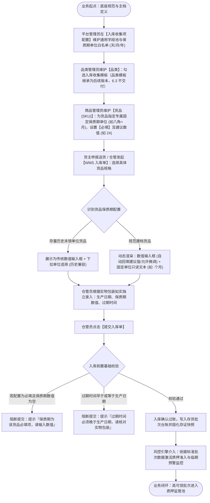

# 入库收集项配置 — 业务流程推演

> **覆盖业务场景**：
> 1. 平台/租户底座维护收集项字段池与保质期度量白名单（天/月/年）；
> 2. 品类勾选入库收集模板并提供行业默认建议；
> 3. 货品主档（SKU）建档：为具体货品指定专属【固定保质期单位】、设置【必填/选填】及【建议默认数值】；
> 4. 仓储 WMS 入库单现场录单：动态渲染表单，保质期单位锁定只读，现场仓管员如实独立填报生产日期、保质期数值与过期时间；
> 5. 入库过账后的批次台账快照固化、历史数据保护与质押临期风控。
> 
> **参考真源**：[入库收集项配置主PRD.md](./入库收集项配置主PRD.md) · [入库收集项配置字段清单.md](./入库收集项配置字段清单.md) · [入库收集项配置业务规则规格.md](./入库收集项配置业务规则规格.md) · [06-货品管理业务规则规格.md](../06-货品规格管理-货品管理/货品管理业务规则规格.md)  
> **版本**：V2.0（人话口径重构版） | 更新时间：2026-10-28

---

## 一、业务流程概述

### 1.1 核心业务特征说明（说人话）

- ✅ **度量标准源头固化，告别现场混选**：在 **货品建档 (SKU)** 时由专业建档人员指定专属固定保质期单位（如八角配月、花椒配年）。仓库现场录单时单位只读锁定，仓管员仅录数值，彻底消除同一货品“有人录 2 年、有人录 24 个月”的多单位混选撕裂。
- ✅ **自定义必填与建议数值自动带出**：由建档人员针对具体货品设置保质期是否必填；配置为必填时入库单严格拦截空值；主档配置建议默认数值（如 24），入库单自动回填，仓管员核对实物标签后可按需微调，录单效率大幅提升。
- ✅ **三字段独立如实填报，不搞公式强绑**：生产日期、保质期数值、过期时间三项均由现场仓管员依照实物包装标注如实录入，系统不强制推算，现场作业灵活顺畅。
- ⚠️ **基础物理常识校验**：若现场同时录入了生产日期与过期时间，系统仅做最基础的物理常识检查：**过期时间必须晚于生产日期**，防止手滑录入倒挂。
- ⚠️ **历史业务单据不受影响**：入库单完成过账后，现场收集的批次属性、生产日期、过期时间与保质期数值/单位立即固化为不可变存证快照；主档后续若有任何调整，绝不改动历史已过账的单据和台账。

### 1.2 端到端业务流程图

---

## 二、涉及角色与参与主体

| 参与主体 | 核心职责 | 参与节点与权限说明 |
| :--- | :--- | :--- |
| **平台运营 / 租户管理员** | 维护底层元数据字段池，定义字段类型与保质期可用度量白名单（天/月/年） | 字段池配置与版本维护，拥有底座管理权限 |
| **行业商品主管 / 运营人员** | 维护商品类目规范，指定品类专属收集项模板与基准单位建议 | 品类管理维护、模板绑定 |
| **货品档案员 / 商品管理员** | 维护货品规格（SKU），为货品指定专属固定保质期单位，设置必填属性与建议默认数值 | 货品管理新增/编辑、入库收集信息配置 |
| **现场仓管员 / 录单人员** | 现场验货收货，根据实物包装独立录入生产日期、保质期数值与过期时间并过账 | 仓储 WMS 入库单录入、质检核实与过账执行 |
| **风控审核人员 / 系统引擎** | 依据入库固化的保质期属性执行质押准入核验，实时监控货品临期与跌价风险 | 质押准入审查、临期风控规则配置、补仓平仓处置 |
| **资金方 / 商业银行** | 查验质押存货的数字仓单与不可变批次明细，确保质押标的真实合规 | 动产质押融资审批、放款终审 |

---

## 三、涉及核心业务单据与记录

| 单据 / 记录名称 | 业务层级 | 核心职责 | 业务关系与影响 |
| :--- | :--- | :--- | :--- |
| **入库收集字段池** | 底座配置层 | 集中规范通用字段名称、控件类型与度量白名单 | 供下游品类与货品主档引用，不直接影响实物状态 |
| **品类收集模板** | 类目标准层 | 归集某大宗品类常用的入库指标集合 | 供货品建档时快速继承模板 |
| **货品规格主档 (SKU)** | 货品主档层 | 明确具体商品的专属固定保质期单位、必填属性与建议默认数值 | 驱动 WMS 入库单表单渲染；一旦产生入库单，单位只读锁定 |
| **WMS 仓储入库单** | 作业执行层 | 现场如实录入批次、生产日期、保质期数值与过期时间 | 实物验收入库，单据过账后生成库存批次与数字仓单 |
| **存货批次台账** | 资产台账层 | 固化批次号、标准单位、实录各日期的不可变存证快照 | 触发风控引擎质押准入，正式形成可监管质押资产 |
| **押品临期预警记录** | 风控预警层 | 依据台账实时计算剩余货龄，达到阈值触发告警 | 推送风控处置、限制出库质押，保障资产安全 |

---

## 四、异常与边界情况处理

1. **试图删除已被使用的收集项**：
   - 收集项若已被任何品类或货品在用，点击删除时系统强行阻断并提示：**「该收集项已被使用，不可删除！请先前往解绑。」**，坚决杜绝因底层删除导致下游单据崩溃。
2. **试图删除启用中的收集项**：
   - 点击删除时系统直接拦截提示：**「启用状态下的收集项不可删除，请先停用。」**，必须由管理员确认停用后方可安全核验。
3. **试图关闭全部保质期度量单位**：
   - 保质期单位配置中，天、月、年三项开关至少保留 1 项开启。若试图关闭最后一个单位，系统直接拦截提示：**「至少保留一个可用保质期单位」**。
4. **仓库录单过期时间倒挂**：
   - 若仓管员录入的过期时间早于或等于生产日期，提交时系统弹出明确提示：**「过期时间必须晚于生产日期，请核对实物包装」**，阻止错误数据写入。
