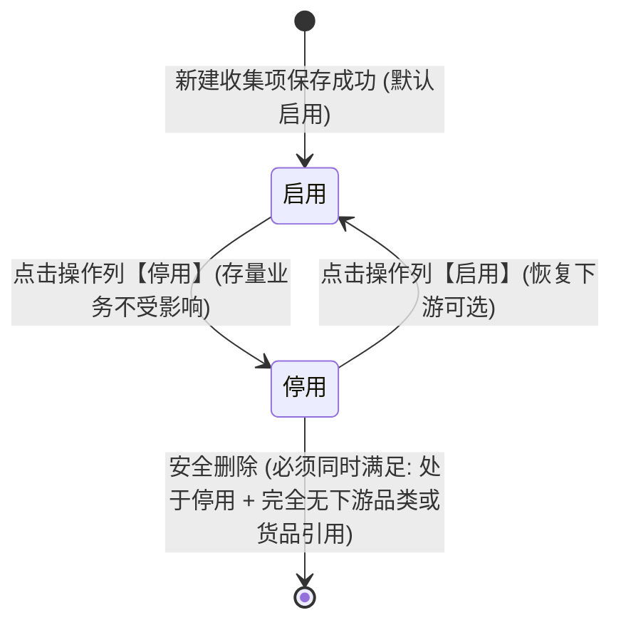

# 入库收集项配置 业务规则规格

> **文档定位**：本文件是 SYZC 存货监管系统【配置管理 → 货品规格管理 → 入库收集项配置】独立菜单**状态机、动作约束、校验规则（Rxx）、计算与版本规则（Cxx）、权限与风控约束（Pxx）的唯一定义真源（SSOT）**。
>
> **适用范式**：基础档案类 + 规则配置类。  
> **统一引用规范**：本菜单规则统一采用简略 ID（**R01~R07**、**C01~C02**、**P01~P02**）。跨模块关联 [06-货品规格管理-货品管理](../06-货品规格管理-货品管理/货品管理业务规则规格.md) 中的【入库收集信息配置与保质期固定单位指定规则】(SKU-F03) 与【入库单动态联动与单位只读锁定规则】(SKU-F04)。  
> **版本**：V2.3（新增省市区三级联动控件，字段池对齐 06 存量名称） | 更新时间：2026-10-28 | 责任人：森云科技（Senyun Technology）  
> **配套文档**：[主PRD](./入库收集项配置主PRD.md) · [字段清单](./入库收集项配置字段清单.md) · [列表页 ASCII](./入库收集项配置_ASCII_列表页.md) · [新增/编辑页 ASCII](./入库收集项配置_ASCII_新增编辑页.md) · [详情页 ASCII](./入库收集项配置_ASCII_详情页.md) · [业务流程推演](./入库收集项配置-业务流程推演.md)

---

## 一、模块与单据定位

| 项目 | 内容说明 |
| :--- | :--- |
| **模块定位** | **【配置底座层 - 入库采集字段池】**（货品入库元数据标准配置中心） |
| **核心职责** | 集中定义全平台与各租户通用的货品入库数据采集标准，规范控件类型与保质期度量单位白名单（天/月/年）；守护系统核心字段不被误删破坏；为下游【品类管理】与【货品管理 (SKU)】提供统一规范的字段字典池。 |
| **上下游关系** | **上游**：系统管理员 / 档案管理员初始化与日常维护； **下游**： 1. **品类管理**：从本字段池勾选入库收集模板，提供品类层面的默认度量建议； 2. **货品管理 (SKU)**：**业务执行真源**——建档人员为具体货品从白名单中指定专属的【固定保质期单位】（如花椒配年、八角配月），并设定是否必填与建议默认数值； 3. **仓储 WMS 入库单**：依据货品配置动态生成录入表单，保质期单位锁定只读，现场人员如实独立填报生产日期、保质期数值与过期时间。 |
| **核心价值** | 从源头消除仓库现场“单位随意换、多单位混选（例如同一货品有人录 2 年、有人录 24 个月）”导致的货龄混乱问题，确保存货资产台账标准化、可追溯。 |

---

## 二、状态定义与生命周期模型

系统采用极简的【启用 / 停用】双态生命周期，杜绝冗余中间状态。

### 2.1 状态定义表

| 状态名称 | 业务含义（说人话） | 是否终态 | 允许进行的操作 | 严禁进行的操作 |
| :--- | :--- | :---: | :--- | :--- |
| **启用** | 收集项正常生效中。下游在新建品类或添加货品规格时，可在收集项列表中正常看到并勾选引用。 | 否 | 查看详情、编辑属性、供下游勾选引用、手动切换为停用。 | 直接物理删除、在数据库中强行抹除记录。 |
| **停用** | 收集项已暂停使用。下游在新建品类或添加货品时自动隐藏该项；历史已经引用了该项的存量货品和入库单据不受任何影响。 | 否 | 查看详情、重新恢复启用、在满足完全无引用的前提下执行安全删除。 | 下游新建货品时勾选该项。 |

### 2.2 状态流转图

---

## 三、状态流转动作表

| 当前状态 | 触发动作 | 触发主体 | 前置条件与拦截校验 | 目标状态 | 页面交互与确认机制 | 业务影响 | 拦截与提示语（说人话） |
| :--- | :--- | :--- | :--- | :--- | :--- | :--- | :--- |
| — | **新增收集项** | 档案管理员 | 收集项名称在当前租户内全局唯一 | **启用** | 进入独立新增页录入，点击【保存并启用】 | 写入系统字典池，默认启用，下游立即可以勾选使用 | 重复时提示：**「收集项名称已存在，请重新输入」** |
| **启用** | **编辑收集项** | 档案管理员 | 非系统内置核心项；若已有下游引用，控件类型锁定 | **启用** | 进入独立编辑页修改，点击【保存】 | 更新字段属性，历史单据保留原样，仅对新业务生效 | 控件类型锁定展示提示：**「该项已被使用，控件类型已锁定」** |
| **启用** | **切换停用** | 档案管理员 | 任意处于启用中的收集项均可停用 | **停用** | 弹出二次确认弹窗，点击确认 | 状态变为停用，下游新建货品勾选池中自动隐藏该项 | 确认提示：**「确定停用收集项「××」吗？停用后新建货品将无法选择此项，已有货品和历史入库单不受影响。」** |
| **停用** | **切换启用** | 档案管理员 | 任意处于停用中的收集项均可重新启用 | **启用** | 弹出二次确认弹窗，点击确认 | 状态恢复为启用，下游新建货品可重新勾选 | 确认提示：**「确定恢复启用收集项「××」吗？启用后下游新建货品可以重新勾选此项。」** |
| **停用** | **删除收集项** | 档案管理员 | **安全检查双门禁**： 1. 必须处于停用状态； 2. 必须非核心项； 3. 探测下游完全无任何引用记录 | **记录移除** | 弹出删除确认警示弹窗，点击确认删除 | 后台打上删除标记，前端列表中彻底移除 | • 启用中点击删除提示：**「启用状态下的收集项不可删除，请先停用。」** • 有引用点击删除提示：**「该收集项已被使用，不可删除！请先前往解绑。」** • 核心项删除禁用提示：**「系统核心字段，禁止删除」** |

---

## 四、动作能力矩阵

| 收集项分类 | 当前状态 | 查看详情 | 编辑基础属性 | 配置保质期单位 | 切换停用/启用 | 删除操作 |
| :--- | :---: | :---: | :---: | :---: | :---: | :---: |
| **系统核心项** (如保质期、生产日期、过期时间) | 启用 | ✅ | 仅限修改输入提示与备注 | ✅ (保质期专属) | ✅ (停用) | ❌ (永久置灰禁用，提示核心字段禁止删除) |
| **系统核心项** (如保质期、生产日期、过期时间) | 停用 | ✅ | 仅限修改输入提示与备注 | ✅ (保质期专属) | ✅ (启用) | ❌ (永久置灰禁用，提示核心字段禁止删除) |
| **自定义扩展项** (如质检项、仓储要求) | 启用 | ✅ | ✅ (有引用时控件类型锁定) | ❌ | ✅ (停用) | ❌ (拦截提示先停用) |
| **自定义扩展项** (如质检项、仓储要求) | 停用 | ✅ | ✅ | ❌ | ✅ (启用) | ✅ (仅限探测下游无引用时允许) |

---

## 五、核心业务规则清单（R / C / P）

### 1. 基础字段与校验规则（Rxx）

#### 【收集项名称唯一性校验规则】(R01)
- **为什么需要名称唯一？**
  - 如果一个租户下出现两个同名的收集项（例如配了两个“含水量”），仓库仓管员在录单时根本分不清应该填哪一个，会导致质检数据统计和质押风控口径割裂。
- **校验逻辑**：
  - 收集项名称支持 2 至 30 个汉字或字符；
  - 录入时系统自动去除首尾空格；
  - 保存时系统严格校验租户内全局唯一性；
- **拦截与提示**：
  - 若名称已存在，系统直接阻止保存，并在名称输入框下方标红明确提示：**「收集项名称已存在，请重新输入」**。

#### 【系统核心收集项保护机制】(R02)
- **为什么需要保护核心字段？**
  - 【保质期】、【生产日期】、【过期时间】三项是仓库存货监管与银行质押准入的核心时间基准。如果被业务人员不小心删掉或改坏了控件类型，下游入库单据与临期预警引擎会整体失效。（批次号、产地等其它预置项按自定义扩展项管理，可停用，不在本规则「系统核心项」范围内。）
- **保护策略**：
  - **永久禁止删除**：核心内置字段在列表操作列的【删除】按钮永久置灰禁用，鼠标悬停时轻量提示：**「系统核心字段，禁止删除」**。后端接口同样实施硬校验拦截，杜绝误操作；
  - **控件类型锁定**：核心字段的控件类型在建档时已锁定（保质期固定为周期组合项、生产日期/过期时间固定为日期选择器），在编辑页中直接置灰锁定，不允许修改底层类型；
  - **已引用字段保护**：自定义扩展字段一旦被下游品类或货品引用，其【控件类型】也自动锁定只读，防止改坏下游既有表单。

#### 【收集项启用与停用规则】(R03)
- **为什么需要停用而不是直接删？**
  - 当某个指标（例如某个旧版检测项）不再要求采集时，如果粗暴删除，会导致系统里已经入库的历史货物档案报错。
- **业务行为**：
  - 收集项支持在列表操作列随时点击切换【停用】或【启用】；
  - 某个收集项停用后，在下游【品类管理】与【货品管理】的新增/编辑弹窗中自动隐藏，新建业务不再能选到它；
  - **老业务不受影响**：历史上已经使用了该字段的存量货品规格和已过账的入库单据，完全保留原样展示，正常开展出入库与质押监管。

#### 【两阶段安全删除控制规则】(R04)
- **为什么删除需要分两步检查？**
  - 收集项作为底座元数据，一旦被实际业务使用，直接删除会造成下游货品和单据产生“孤儿数据”。因此系统设立了两道严格的安全门禁：
- **第一步：检查自身状态（启用中的坚决不让删）**：
  - 如果收集项自身处于【启用】状态，点击删除时系统立即拦截，弹出警告弹窗明确提示：**「启用状态下的收集项不可删除，请先停用。」** 必须确认不再使用并手动停用后，才能进入下一步；
- **第二步：后台快速探测下游引用（正在使用的坚决不让删）**：
  - 当收集项处于【停用】状态时，点击删除，系统后台快速探测下游是否存在有效引用（避免耗时的全表关联统计，保障系统秒级响应）。**引用从哪来：以【货品管理】里未删除的货品实际勾选了本收集项为准**，一个货品算一次引用；品类模板引用待后续版本接入后一并统计：
    - **存在下游引用**：系统立即阻断删除，弹出提示弹窗：**「该收集项已被使用，不可删除！请先前往解绑。」** 仅提供【我知道了】按钮，坚决不让删；弹窗内同时注明**「当前被 N 个货品使用」**，让管理员知道去哪儿解绑；
    - **完全没有被任何业务使用**：说明是建错的或者从未使用过的草稿项，系统弹出常规二次确认弹窗：**「确定彻底删除该收集项吗？删除后不可恢复。」** 管理员确认后，系统在后台打上删除标记，前端列表中彻底移除。

#### 【保质期度量单位白名单与基准推荐规则】(R05)
- **为什么需要由平台定义度量白名单？**
  - 过去仓管员在现场录入保质期时，随意下拉年、月、天，导致有的商品录了 2 年，有的商品录了 24 个月，系统无法统一计算临期风险。
- **白名单配置规范**：
  - 在本菜单操作列点击【配置单位】，可集中维护全平台/租户允许使用的保质期单位范围：
    - 提供【按天计量】、【按月计量】、【按年计量】三个独立开关；
    - 提供【推荐基准单位】下拉单选（默认推荐“月”）；
  - **保底强校验**：天、月、年三项开关不可同时关闭，系统至少强制保留 1 项开启。如果管理员试图关闭最后一个开启的单位，系统直接拦截并提示：**「至少保留一个可用保质期单位」**；
- **下游联动作用**：
  - 此处开启的单位范围，作为下游 [06-货品管理](../06-货品规格管理-货品管理/货品管理业务规则规格.md) 建档时选择固定保质期单位的**可选下拉白名单**。

#### 【下游货品执行与入库单只读规则】(R06)
- **货品主档层配置专属参数 (SKU-F03)**：
  - 在【货品管理】建档时，由建档人员从本菜单字段池勾选收集项，只配置三件事：**是否必填、保质期固定单位、建议默认数值**；字段的名称、控件类型、单位标签、下拉选项一律只读引用本菜单，不在货品端另存一份；
  - 保质期固定单位从本菜单白名单中指定（如花椒固定为“年”，八角固定为“月”）；
  - 建议默认数值只对【保质期】开放（如花椒填 2、八角填 24），其它收集项不设建议值；
  - **产生业务数据后锁定**：一旦该货品在仓库产生了第一笔入库单，该货品的固定保质期单位自动锁定只读，不再允许修改。
- **仓库现场入库录单执行规范 (SKU-F04)**：
  - 仓管员在仓库开入库单、选中具体货品时，表单自动渲染对应的收集项：
    - 标记为必填的显示红星【*】，为空时阻止提交；
    - **单位只读锁死**：保质期严格展示为【正整数数值输入框 + 固定单位只读文本标签】（如 `[ 24 ] 个月`），现场完全禁止修改单位，仓管员仅录入数值，免去现场选择单位，杜绝选错；
    - **三字段独立录入与常识校验**：生产日期、保质期数值、过期时间三项全部由现场仓管员依照实物包装喷码如实录入，系统不搞强制推算联动；若同时录入了生产日期和过期时间，系统仅做物理常识检查：**过期时间必须晚于生产日期**，不符合时阻止提交。

#### 【负数温度与减号录入防呆规则】(R07)
- **为什么需要内置减号与智能纠偏？**
  - 在冷链、生鲜、恒温冷库（如冷冻肉类 -18℃ ~ -15℃）业务中，温度负数非常常见。用户在键盘上录入负数时，极易手滑误敲成下划线 `_` 或中文全角减号 `－`，导致系统判定非法或录入错误。
- **配置端防呆设计（内置减号按钮）**：
  - 在新增/编辑独立页的【输入提示】下方直接内置 `[ - 减号 ]` 快捷按钮，管理员点击后系统直接在当前光标位置插入标准半角减号 `-`，无需在键盘上反复切换寻找；同时提供 `[ 例如：-18 至 -15 ]` 快捷示例按钮，一键填入完整规范模板。
- **智能静默纠偏机制**：
  - 前端输入监听：若用户键盘手动误输入了下划线 `_` 或全角减号 `－`，系统在失焦或输入瞬间**自动智能静默转换为标准半角减号 `-`**，不弹红字阻断，顺畅体验。
- **仓库现场录单双数字框规范**：
  - 仓库现场 WMS 入库单遇到【数字区间框】时，表单严格渲染为 `[ 最小值 ] 至 [ 最大值 ] [ 单位 ]` 两个独立的数值输入框，自动校验最小值不能大于最大值（如 `-18 至 -15` 合法；若录入 `-15 至 -18`，系统友好提示：`最小值不能大于最大值，请核对`）。

---

### 2. 计算、版本与历史单据规则（Cxx）

#### 【历史业务单据不受影响规则】(C01)
- **为什么配置变更绝不能改动历史单据？**
  - 存货入库后即作为商业银行动产质押放款的凭据。如果底座字段配置修改后直接回写历史入库单，会导致历史入库凭单与现场实物账实不符，破坏司法存证效力。
- **业务处理原则**：
  - 收集项配置每次保存成功后，系统自动递增内部数据版本号；
  - 字段属性变更（如修改了名称、调整了单位标签、关闭了某个保质期单位）**只对保存后新建立的货品或新业务生效**；
  - 历史已入库的仓储单据、在库批次台账与存量货品档案保持原样，绝不回写改动，确保历史数据永远可信。

#### 【多人同时编辑防冲突与防重复提交规则】(C02)
- **多人同时编辑防冲突机制**：
  - 实际业务中，可能两名管理员同时打开同一个收集项进行编辑：
    - 管理员 A 先修改完并点击了保存，系统更新为新版本；
    - 此时管理员 B 屏幕上仍停留在旧数据，当管理员 B 也点击保存提交时，系统能精准识别出数据已被他人更新，立即阻止提交并提示：**「数据已被他人修改，请刷新后重试」**；
    - 这样就有效保护了管理员 A 刚刚保存好的内容，绝不会被静默覆盖丢失。
- **防重复提交**：
  - 用户点击【保存】或【删除】后，按钮立即置灰并展示加载状态，防止因网络卡顿或手滑连续快速点击导致提交重复请求。

---

### 3. 权限与数据安全约束（Pxx）

#### 【入库收集项配置管理权限】(P01)
- 仅具备系统管理员角色或商品主档管理员角色的用户拥有本菜单的查询、新增、编辑、启用/停用与删除权限；
- 仓库现场一线作业人员仅在仓储入库单中按照规范填报数据，无权访问本底座配置菜单。

#### 【多租户数据隔离机制】(P02)
- 收集项字典池在多租户体系下严格隔离，不同租户的企业只能查看和维护属于自己租户的收集项，数据互不可见。

---

## 六、附录：核心控件类型枚举字典

| 控件类型名称 | 适用业务场景说明 | 仓库现场 WMS 入库单表单呈现行为 |
| :--- | :--- | :--- |
| **单行文本输入框** | 批次号、生产厂家、检验机构等常规文本信息 | 标准单行文本输入框 |
| **下拉单选框** | 包装方式、外观等级、存储方式等固定选项 | 下拉单选面板 |
| **日期选择器** | 生产日期、过期时间、送检日期等关键日期 | 日历日期选择器（格式：`YYYY-MM-DD`） |
| **数字区间框** | 温度要求（℃）、湿度要求（%RH）等指标范围 | 两个数字框（最小值 至 最大值），带固定单位后缀 |
| **百分比数值框** | 水分含量（%）、杂质率（%）等质量比率参数 | 单数字输入框，固定带 `%` 后缀，校验 0 至 100 |
| **周期组合项** | **保质期专属**（数值 + 固定只读单位） | **正整数输入框 + 锁定单位文本标签**（现场仓管员仅录数值，单位只读锁死免选） |
| **省市区三级联动** | 产地、发货地等行政区划溯源字段 | 三个联动下拉框（省 → 市 → 区），逐级带出，最终落库为「省/市/区」完整文本 |

---

## 七、修订记录

| 版本号 | 修订日期 | 修订人 | 修订内容摘要 | 影响章节 |
| :--- | :---: | :--- | :--- | :--- |
| V1.0 | 2026-09-21 | 森云科技产品团队 | 初版入库收集项配置业务规则规格。 | 全文 |
| V1.1 | 2026-10-08 | 森云科技产品团队 | 对齐货品主档指定固定单位逻辑。 | 第五章 |
| **V2.0** | **2026-10-28** | **森云科技产品团队** | 1. **全篇人话大白话重写**：剥离 SQL 表名与生硬技术词汇，增加“为什么需要”业务场景解释； 2. **对齐 06 货品管理标杆口径**：理顺底座白名单、货品主档锁定与入库单独立录入常识校验链路； 3. **提示语极简瘦身**：两阶段删除与拦截提示语直截了当，说人话三要素到位。 | 全文 |
| **V2.1** | **2026-10-28** | **森云科技产品团队** | 1. 启停确认由「气泡」改为「二次确认弹窗」，提示语带收集项名称并补充存量不受影响说明； 2. 与原型统一，避免同一动作两套文案。 | 第三章 |
| **V2.2** | **2026-10-28** | **森云科技产品团队** | 1. 状态流转动作表与 R07 由「模态弹窗」改为「独立新增/编辑页」； 2. 【系统核心收集项保护机制】(R02) 核心项口径收窄为保质期、生产日期、过期时间，批次号归入可扩展项说明。 | 三、五 |
| **V2.3** | **2026-10-28** | **森云科技产品团队** | 1. 控件字典新增第 7 种「省市区三级联动」，承接存量产地采集口径； 2. 字段池名称对齐 06 存量叫法（存储温度要求→温度要求、质检含水量→水分含量、生产厂家批号并入批次号）； 3. 【两阶段安全删除控制规则】(R04) 明确下游引用来源为 06 货品实际勾选，并展示被引用数量； 4. 【下游货品执行与入库单只读规则】(R06) 收窄货品端只配必填、固定单位、建议值三件事。 | 五、六 |
