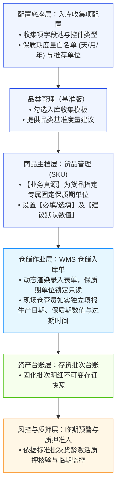
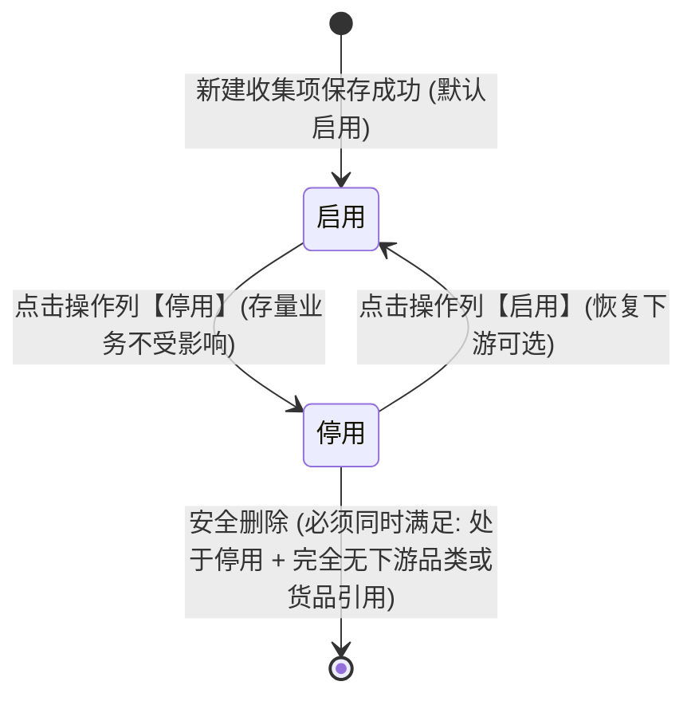

# 入库收集项配置主PRD

> **模块定位**：货品规格管理基础配置节点（入库采集字段池），负责集中维护全平台及各租户通用的入库采集字段规范、控件类型及保质期度量单位白名单（天/月/年），实现核心项保护、保质期专项配置与两阶段安全删除拦截，为下游【品类管理】与【货品管理 (SKU)】提供统一的字段元数据底座。  
> **6.3 交付范围说明**：本模块作为供应链存货监管主数据采集底座，定义与 06 货品主档协同闭环。  
> **版本**：V2.8（去自主观业务分类左树、移除下置预览区与主表格下游引用列，回归 7 列清爽高质效列表） | 更新时间：2026-10-29 | 责任人：森云科技（Senyun Technology）  
> **核心依据**：[入库收集项配置字段清单.md](./入库收集项配置字段清单.md) 是本模块所有字段、页面呈现、控件类型与展示顺序的唯一定义真源；[入库收集项配置业务规则规格.md](./入库收集项配置业务规则规格.md) 是本模块状态机、动作流转、校验规则（Rxx）、计算与版本规则（Cxx）及权限（Pxx）的唯一定义真源。  
> **衍生文档**：[列表页 ASCII](./入库收集项配置_ASCII_列表页.md) · [新增/编辑页 ASCII](./入库收集项配置_ASCII_新增编辑页.md) · [详情页 ASCII](./入库收集项配置_ASCII_详情页.md) · [业务流程推演](./入库收集项配置-业务流程推演.md)

---

## 1. 业务背景与风控目的

### 1.1 业务定位
入库收集项配置是 SYZC 存货监管系统“货-仓-金”全链路数据采集的标准基石。通过在配置底座统一规范货品入库时需采集的物理特性（如保质期、生产日期、包装规格、质检指标等），解决传统仓储作业中各仓库字段口径不一、单位混选、数据失真等问题，确保存货从验收入库起即形成高可信、标准化的批次资产数据。

### 1.2 核心痛点与管控目标（说人话）
1. **彻底解决保质期单位多选混乱痛点**：过去保质期单位由仓库现场录单人员随意下拉（一会儿选年，一会儿选月或天），不仅录单容易选错，还容易出现同一货品“有人录 2 年、有人录 24 个月、有人录 730 天”的多单位混乱，导致后续仓库存货货龄分析和临期预警规则根本无法统一对齐。本模块通过在底座统一定义保质期可用度量单位白名单（天/月/年），供下游货品管理建档时**指定专属固定单位**，入库录单时单位只读锁定免选，彻底消除口径撕裂。
2. **防范核心业务字段误删断链风险**：保质期、生产日期等核心字段若被误删，会导致下游入库单与风控预警引擎瘫痪。本模块确立核心内置项保护机制，永久禁止删除、禁止篡改底层控件类型。
3. **保障历史业务单据真实可信**：存货入库后即作为银行动产质押放款凭证。本模块严格执行历史数据不回写原则，配置变更仅对后续新建业务生效，绝不修改历史入库单明细与批次台账。
4. **两阶段安全删除防误操作**：对于自定义扩展指标，杜绝直接物理删除，执行“自身停用状态检查 + 下游引用实时扫描”双门禁，杜绝孤儿配置。

---

## 2. 功能范围

| 包含功能 (In Scope) | 不包含功能 (Out of Scope) |
| :--- | :--- |
| - 入库收集项字段池列表展示（标准结构化矩阵：序号、收集项名称、控件类型、度量单位/选项摘要、状态徽章、创建时间、操作列）； - 行操作录入效果弹窗预览（支持 7 种控件录入形态真实展示，兼顾按需查看）； - 新增与编辑收集项（名称唯一性、控件类型选定、单位标签/下拉选项配置、输入提示与备注）； - 核心内置强语义字段保护（保质期、生产日期、过期时间等禁止删除、锁定控件类型）； - 【保质期】专项度量单位白名单配置（天/月/年开关、默认推荐单位设置、至少保留一单位强校验）； - 启用与停用生命周期管理（停用后下游新建货品不可选，存量业务不受影响）； - 两阶段安全删除拦截（阶段一停用状态拦截 + 阶段二下游品类/货品引用扫描阻断）； - 租户数据隔离与操作审计留痕。 | - 具体货品（SKU）的必填性设置、专属固定单位绑定与建议默认数值配置（由【货品管理】完成）； - 仓储 WMS 入库单现场录单与质检验收作业（由仓储 WMS 模块完成）； - 存货批次的临期预警规则与平仓风控处置（由【风控管理/预警配置】完成）。 |

---

## 3. 架构与引用模型

### 3.1 实体定位与全链路数据拓扑

### 3.2 历史数据保护与防冲突机制
* **新业务生效，不改历史**：收集项配置保存成功后，系统递增内部版本号；新配置仅对后续新建的货品或业务单据生效，绝不回写历史已过账的入库单明细与批次快照；
* **多人同时编辑防冲突**：两名管理员同时编辑同一收集项时，后保存者系统提示刷新重试，避免静默覆盖他人修改。

---

## 4. 业务场景

| 场景序号 | 场景名称 | 场景类型 | 核心业务流程与约束说明 | 关联规则索引 |
| :---: | :--- | :--- | :--- | :--- |
| **场景 1** | 【新增自定义收集项】 | 正常主流程 | 管理员录入收集项名称、选择控件类型（如数字区间框、百分比数值框、下拉单选框），配置度量单位或选项集合，系统校验租户内名称唯一性后保存，默认进入【启用】状态。 | 【收集项名称唯一性校验规则】(R01) 【多人同时编辑防冲突与防重复提交规则】(C02) |
| **场景 2** | 【保质期度量单位白名单配置】 | 特色主流程 | 在【保质期】行点击【配置单位】，开启/关闭天、月、年单位开关并设定推荐基准单位；强校验至少保留 1 项开启；供下游货品建档时下拉选择专属固定单位。 | 【保质期度量单位白名单与基准推荐规则】(R05) 【历史业务单据不受影响规则】(C01) |
| **场景 3** | 【收集项停用与启用控制】 | 管控流程 | 对非核心收集项执行停用；停用后下游新建货品弹窗中自动隐藏，存量已引用货品和历史批次继续正常使用；支持重新启用恢复可选。 | 【收集项启用与停用规则】(R03) |
| **场景 4** | 【两阶段安全删除拦截】 | 安全拦截 | 对自定义项执行删除：第一步检查是否已停用（启用态直接阻断）；第二步扫描下游品类与货品引用，若正在使用弹窗阻断；完全无引用经二次确认后彻底删除。 | 【两阶段安全删除控制规则】(R04) 【系统核心收集项保护机制】(R02) |
| **场景 5** | 【系统核心项保护拦截】 | 安全防护 | 针对【保质期】、【生产日期】、【过期时间】等内置核心项，列表操作列永久置灰禁用【删除】按钮；编辑弹窗中锁定底层控件类型，禁止篡改核心业务语义。 | 【系统核心收集项保护机制】(R02) |

---

## 5. 状态机与动作能力矩阵

### 5.1 状态定义与流转摘要
系统采用极简的【启用 / 停用】双态生命周期模型：
* **启用**：收集项正常生效，下游新建品类或货品时可见且可勾选引用；
* **停用**：收集项失效停用，下游新建货品时自动过滤隐藏；已引用的存量货品与历史入库批次不受影响。

### 5.2 动作能力矩阵

| 收集项类别 | 当前状态 | 查看详情 | 编辑基础属性 | 配置保质期单位 | 切换停用/启用 | 删除操作 |
| :--- | :---: | :---: | :---: | :---: | :---: | :---: |
| **系统核心项** (如保质期) | 启用 | ✅ | 仅限修改输入提示与备注 | ✅ (保质期专属) | ✅ (置为停用) | ❌ (永久置灰禁用) |
| **系统核心项** (如保质期) | 停用 | ✅ | 仅限修改输入提示与备注 | ✅ (保质期专属) | ✅ (恢复启用) | ❌ (永久置灰禁用) |
| **自定义扩展项** (如质检项) | 启用 | ✅ | ✅ (有引用控件类型锁定) | ❌ | ✅ (置为停用) | ❌ (提示先停用) |
| **自定义扩展项** (如质检项) | 停用 | ✅ | ✅ | ❌ | ✅ (恢复启用) | ✅ (仅限引用计数=0) |

---

## 6. 页面功能与交互说明

### 6.1 列表页功能与交互（标准4列筛选 + 主表格 + 弹窗预览）
1. **筛选区域 Card（WarningFilterHeader 规范）**：
   - 严格遵循 4 列栅格排布（`lg:grid-cols-4`）：【收集项名称】模糊搜索框、【控件类型】下拉单选框、【状态】下拉单选框、【创建时间范围】日期范围选择器；
   - 右侧操作按钮：`[ 重置 ]` · `[ 查询 ]` · `[ + 新增收集项 ]`。
2. **主表格 Card**：
   - 表头实色无穿透，采用苹方（PingFang SC）字体，包含 7 维清晰业务列：序号（第 1 列）、收集项名称（加粗可点跳转详情）、控件类型、度量单位/选项摘要、状态徽章（绿色启用 / 灰色停用）、创建时间、操作列（末列）。
3. **行操作交互与提示语**：
   - **【详情】**：点击进入收集项详情页，只读查看，不改变任何数据；
   - **【预览】**：点击打开弹窗预览，以模态窗口按需呈现该收集项在仓储现场 WMS 入库单中的填报控件与提示占位，免去在列表常驻占用页面垂直空间；
   - **【编辑】**：跳转编辑页，回填数据并沿用录入保护规则；
   - **【配置单位】**：仅在【保质期】行展示，点击打开保质期度量单位配置弹窗；
   - **【停用 / 启用】**：点击弹出二次确认弹窗，确认后即时切换状态；
   - **【删除】**：
     - 系统核心内置项：按钮置灰禁用，鼠标悬停 Tooltip 提示：**「系统核心字段，禁止删除」**；
     - 停用中自定义项：系统后台快速探测，若被使用则弹出阻断提示：**「该收集项已被使用，不可删除！请先前往解绑。」**；若无引用则弹出二次确认：**「确定彻底删除该收集项吗？删除后不可恢复。」**。

### 6.2 新增/编辑页交互
> 新增与编辑都进入独立页面（路由 `/入库收集项配置/新增`、`/入库收集项配置/编辑/:id`），不再使用弹窗；列表【新增收集项】、行操作【编辑】、详情页【编辑】三处都跳这一套页面。

1. **页面结构**：顶部操作卡片（面包屑「入库收集项配置 / 新增收集项 | 编辑收集项」+ 标题 + 右侧【取消】【保存并启用 / 保存】），下方「字段配置」卡片按两列排布（收集项名称｜控件类型、度量单位标签｜输入提示、下拉选项集合、说明 / 备注），页尾为规格对照框。
2. **录入引导**：字段下方用浅灰说明文字引导填写；【输入提示】旁提供 `[ - 减号 ]` 与快捷示例按钮，点击直接在光标处插入半角减号，彻底杜绝负数误输入下划线。遵循【负数温度与减号录入防呆规则】(R07)。
3. **表单控件联动**：
   - 选择【数字区间框】：自动展示【度量单位标签】输入框（必填，如 `℃`、`%RH`）；
   - 选择【下拉单选框】：自动展示【下拉选项集合】配置区，支持动态增删行（至少配 1 项）；
   - 选择【单行文本输入框】、【日期选择器】或【省市区三级联动】：隐藏度量单位与选项配置区；
4. **编辑态引用保护**：系统核心项的【收集项名称】与【控件类型】锁定只读；已被下游引用的自定义项，【控件类型】与【度量单位标签】锁定，输入框下方轻量提示：`该项已被使用，控件类型已锁定`。
5. **离开与提交**：有未保存修改时点【取消】或面包屑返回，二次确认「当前有未保存的修改，确认离开吗？」；保存成功后，新增回列表、编辑回该收集项详情页。

### 6.3 保质期专项【配置单位】弹窗交互
1. **弹窗布局**：
   - 提供【按天计量】、【按月计量】、【按年计量】三个独立开关；
   - 提供【推荐基准单位】下拉单选框，选项联动自开启的单位开关；
2. **保底校验拦截**：
   - 若管理员试图关闭最后一个开启的单位开关，系统直接阻止关闭并提示：**「至少保留一个可用保质期单位」**。

### 6.4 详情页与录入效果预览
1. **详情页骨架**：页头摘要（名称、核心/自定义徽章、状态徽章、一行属性说明，右侧为编辑 / 配置单位 / 停用入口；返回列表通过顶部面包屑，不重复放按钮），下方为三个分区：「字段基础规格」（左侧字段信息，右侧并排「入库单录入样式」）、「保质期度量单位白名单」（仅保质期出现）、「系统与审计信息」。
2. **录入效果预览**：嵌在「字段基础规格」右侧，按收集项当前控件类型静态渲染该字段在仓储入库单里的样子：单行文本、下拉单选（附前若干选项）、日期选择器、数字区间框（最小值 至 最大值 + 单位）、百分比数值框（数值 + %）、周期组合项（数值 + 只读单位）、省市区三级联动（省 / 市 / 区三级下拉）。
   - **【输入提示】直接作为输入框内的浅灰占位文字**展示，不再额外占用一行；数字区间框拆成两个数字框放不下，提示语单独放在框下一行；
   - 必填星号仅作示意，**实际是否必填由下游【货品管理】在货品主档设置**；
   - 收集项处于停用状态时，预览整体置灰并提示：**「当前收集项已停用，下游新建货品不再显示此项」**；
   - 预览区标题固定标注「入库单录入样式 / 仓储入库单示意」，只用于确认配置效果，**不得作为最终上线 UI 规范**。
3. **两个入口同一内容**：列表行操作【预览】弹出预览窗口，详情页展示右侧「入库单录入样式」，两处渲染规则一致、均只读。

---

## 7. 修订记录

| 版本号 | 修订日期 | 修订人 | 修订内容摘要 | 影响章节 |
| :--- | :---: | :--- | :--- | :--- |
| V1.0 | 2026-09-21 | 森云科技产品团队 | 初版入库收集项配置主 PRD。 | 全文 |
| **V2.0** | **2026-10-28** | **森云科技产品团队** | 1. **全篇人话大白话重写**：剔除技术黑话，通俗化阐述全链路业务背景与管控目标； 2. **对齐 06 货品管理标杆口径**：明确底座白名单、货品主档指定固定单位与入库单只读锁死； 3. **提示语全面瘦身**：所有提示语做到极简清晰，说人话三要素齐备。 | 全文 |
| **V2.1** | **2026-10-28** | **森云科技产品团队** | 1. 列表行操作补充【详情】与【预览】； 2. 详情页精简冗余字段，新增「效果预览」分区与六种控件形态说明。 | 6.1、6.4 |
| **V2.2** | **2026-10-28** | **森云科技产品团队** | 1. 新增/编辑由模态弹窗改为独立页面，列表与详情三处入口统一跳转； 2. 详情页字段改为单列排布，入库单录入样式区加宽； 3. 补充未保存离开确认与保存后跳转规则。 | 6.1、6.2、6.4 |
| **V2.3** | **2026-10-28** | **森云科技产品团队** | 1. 列表筛选补齐【创建时间】日期范围，共 4 项； 2. 启停确认统一为二次确认弹窗，提示语与原型一致。 | 6.1 |
| **V2.4** | **2026-10-28** | **森云科技产品团队** | 1. 控件类型新增第 7 种「省市区三级联动」，承接 06 货品存量产地采集； 2. 新增/编辑页控件联动与详情页预览同步支持三级联动； 3. 字段池预置名称对齐 06 存量叫法（温度要求、水分含量、批次号）。 | 2、6.2、6.4 |
| **V2.5** | **2026-10-29** | **森云科技产品团队** | 1. 列表页交互结构升级：落地左侧业务属性分类树 Card（5 大业务域），建立结构化分类心智； 2. 主表格新增「业务归属」与「下游引用」列，直观透出字段血缘关系； 3. 新增下置「入库单现场填报示意」联动预览 Card，选行即时渲染 7 种控件录入形态。 | 2、6.1 |
| **V2.6** | **2026-10-29** | **森云科技产品团队** | 1. 去除主观硬编码的左侧业务域分类树与主表格「业务归属」列，避免写死分类限制用户实际业务； 2. 调整为主表格（含下游引用品类统计）与下置入库单即时录入效果预览 Card。 | 2、6.1 |
| **V2.7** | **2026-10-29** | **森云科技产品团队** | 1. 移除列表页下置常驻的「仓储入库单现场填报示意」预览卡片，消除与主表格字段信息重叠，释放纵向屏幕空间； 2. 录入效果回归标准行操作【预览】按需模态弹窗与详情页右侧分区呈现，列表保持极简专注。 | 2、6.1 |
| **V2.8** | **2026-10-29** | **森云科技产品团队** | 1. 移除主表格「下游引用」列，进一步精简列表字段，专注呈现收集项自身属性与状态； 2. 下游引用血缘保护逻辑下沉至编辑与删除拦截，不在列表常驻占位。 | 2、6.1 |
