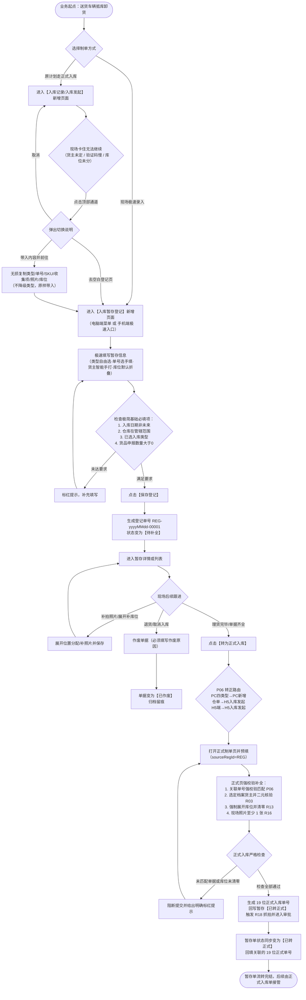
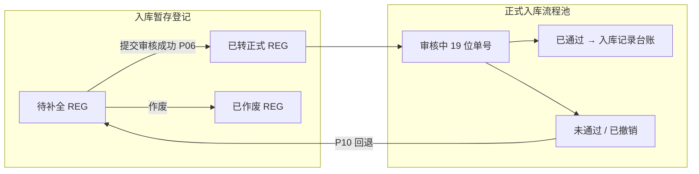

# 入库暂存登记业务流程推演

> **包含场景**：【现场极速直接暂存】 / 【正式入库受阻切换并无损带入登记】 / 【多人补充与修改暂存单】 / 【暂存单一键转为正式入库】 / 【暂存单作废】 / 【P10 驳回回退】 / 【仓单 H5 转正】 / 【盘点 P11】 / 【R32 追溯】  
> **说明**：本文用通俗易懂的语言，推演入库暂存登记从现场极速卸车记账到最终转为正式入库的完整流转过程；**第八节**与前端原型共享 Mock（`03-前端原型demo/shared/inbound/inbound-staging.mock.ts`）对齐，便于评审与自测。  
> **规则真源**：[入库暂存登记业务规则规格.md](./入库暂存登记业务规则规格.md)（P01～P11）· [入库记录业务规则规格.md](../10-仓储管理-入库记录/入库记录业务规则规格.md)（R32）  
> **版本**：V1.6 | **更新时间**：2026-10-14 | **责任人**：森云科技

---

## 一、核心业务定位与原则

1. **现场事实极速记录（30秒记一单）**：大宗商品送货车到达仓库后，现场卸车、过磅称重节奏紧凑。暂存登记就是为了让现场人员先把“货已经送到现场”的事实记下来，防止货在仓库却没进系统。
2. **入库类型全面放开**：现场明知是质押或监管货物，直接选择对应入库类型；关联单号支持下拉选择，也支持直接手写文本单号（现场知道纸质单号即可手填，甚至可先留空）。
3. **填写门槛极大放宽**：取消复杂的货主开关，支持档案联想或直接手打临时文字；二级堆放位置默认折叠，现场卸车无需分垛；照片与动态收集项全部支持选填。
4. **只有正式提交审核成功才算转正**：点击“转为正式入库”时，并不会马上生成正式入库单，而是把暂存单的内容完整复制到正式入库页面。只有在正式入库页补齐所有必填项并**点击【提交审核】成功**后，暂存单才会同步变成【已转正式】，避免中途取消产生废单。
5. **与实际库存完全隔离**：暂存单只是现场备忘，在转为正式入库前，**不计入**实际库存、**不占用**货权、**不生成**条形码、**不走**审批流程。
6. **权限安全规范**：拥有该仓库管辖权限的人员都可以查看和补充修改；转正审批依然遵循发起人自审禁止原则。

---

## 二、端到端业务流转图

---

## 三、参与人员与职责分工

| 参与角色 | 核心工作 | 主要操作 |
| :--- | :--- | :--- |
| **现场地磅员 / 理货员** | 车辆进场过磅、数量初核、记录卸货事实、手填司机或送货说明 | 新增暂存登记、补充修改暂存信息 |
| **仓库主管 / 监管站长** | 确认关联单据、安排最终定垛、发起转正式入库、作废无效单据 | 发起转正式入库、核验单据、作废暂存单 |
| **存货货主 / 客户经办人** | 配合提供手机短信验证码（仅限新货主第一次建档时） | 转正式入库时配合接收验证码，暂存阶段免打扰 |
| **审计与风控人员** | 现场盘点核对、查看历史暂存与作废记录 | 查看暂存登记台账，可点击查看对应的正式单 |

---

## 四、主要业务场景时序推演

### 场景 1：现场 30 秒极速直接暂存
1. 地磅员在电脑端或手机端进入【入库暂存登记】，点击新增；
2. 基础信息：选择仓库“河南一号仓”，选择入库类型“质押入库”；
3. 关联单号：由于正式系统质押单还在走流程，地磅员直接手工输入纸质单号：“*司机持纸质协议-0988*”；
4. 货主说明：现场货主未定，直接在【货主/送货说明】中手打输入：“*司机王师傅，车牌豫A88888，过磅净重 50.25 吨*”；
5. 货品与数量：选择货品“高纯A级电解铜”，输入重量 50.25 吨；
6. 堆放位置与照片：堆放位置保持默认折叠不展开，照片暂不上传；
7. 点击【保存登记】，系统在 2 秒内生成登记单号 `REG-20261014-00001`，状态为【待补全】。整单耗时不到 30 秒！

### 场景 2：在正式入库页面受阻，切换并无损带入暂存
1. 理货员原本在正式入库页面录单，但因货主未建档或现场库位还没分完，无法提交；
2. 理货员点击页面顶部的【入库暂存登记】通道；
3. 界面弹出说明提示：告知理货员暂存不进审批、不记库存、不发短信，**当前已填写的类型、货品、数量、库位和照片将原样带入**；
4. 理货员点击【带入内容并前往】，系统把刚才已经录入的质押入库类型、货品等信息完整无损带入登记页面；
5. 理货员点击保存，生成【待补全】的暂存单。

### 场景 3：理货员现场补录与展开堆放
1. 叉车将电解铜运至 1 号库房 A 区 01 垛位；
2. 理货员用手机进入暂存详情，点击【编辑】；
3. 点击展开【堆放位置分配】，添加一行：1 号库房 - A 区 - 01 垛位，堆放数量填 50.25 吨；顺手用手机拍下货物外观照片 1 张；
4. 点击保存，暂存单要素得到补充，依然处于【待补全】状态。

### 场景 4：主管一键转正与严格闭环
1. 质押融资审批通过，质押单号已在系统生成；
2. 仓库主管打开该笔【待补全】暂存单，点击【转为正式入库】；
3. 系统打开正式入库页面，带入全部信息，并自动强制展开堆放位置；
4. 针对暂存时手填的单号与临时货主，主管进行补全：
   - 关联单号：在下拉框中选择系统正式质押单号 `PLEDGE-20261014-002`；
   - 货主信息：在下拉框中搜索并选定正式建档企业“河南森云实业有限公司”；
   - 检查库位未堆放数量为 0，照片已具备；
5. 仓库主管点击【提交审核】：
   - 正式入库单提交成功，生成 19 位正式单号，暂存单回写【已转正式】；
   - 触发摄像头抓拍存证；
   - 系统核对该暂存单当前仍然处于待补全状态，自动将其更新为【已转正式】，回填关联正式单号。

---

## 五、重点异常场景处理

### 1. 多人同时转正式冲突（防止重复提交）
- **现象**：理货员小张和主管老李同时打开了同一张待补全的暂存单，两人都在正式页面里补全信息。
- **系统处理**：
  1. 小张动作更快，率先补齐并点击【提交审核】成功，系统生成了正式入库单，暂存单变成【已转正式】；
  2. 老李稍后也点击【提交审核】，系统发现这笔暂存单已经被小张转正了，立刻拦截提交；
  3. 页面明确提醒老李：*“该登记单已由 [小张] 于 [时间] 转为正式入库（正式单号: 19位数字单号），本次提交已取消”*；
  4. 老李的页面内容不会被强制清空，老李也可以直接点击单号去查看小张提交的正式单。

### 2. 手工单号转正时的校验拦截
- **现象**：暂存时用户手工输入了单号“司机纸质单01”，转正进入正式页时。
- **系统处理**：
  1. 正式页打开时尝试匹配系统单据；
  2. 若系统中无此单号，正式页在【关联单号】输入框高亮标红提示：*“未在系统中检索到该有效单号，请重新选择”*；
  3. 用户必须从下拉列表中选中系统真实存在的单据，否则底栏提交审核按钮保持强阻断拦截。

### 3. 库位未分配的处理
- **现象**：暂存时保持默认折叠，未分配具体垛位。
- **系统处理**：
  1. 暂存单正常保存，仅在底栏弱提示未分配差额；
  2. 转为正式入库时，正式页面自动展开堆放明细，未堆放数量必须为 0，否则系统标红阻断，不允许提交。

### 4. 正式单驳回或撤销后暂存回退（P10）
- **现象**：暂存已【已转正式】并回填 19 位单号，但正式单在审批中被驳回或申请人撤销。
- **系统处理**：
  1. 登记单自动回退为【待补全】，列表【关联正式入库单号】展示为「—」；
  2. 操作记录写入失败单号与原因（例：「正式单 xxx 已驳回，暂存回退待补全」）；
  3. 允许再次【转为正式入库】，仍须满足 P06 路由与版本锁；正式单主表仍不展示来源暂存单号（R32）。

---

## 六、Mock 数据剧本与全场景推演

> **用途**：评审、测试与原型演示共用同一套样例数据；时间轴默认 2026-10-14。角色示例：张三（理货员）、李四（地磅员）、仓库主管、审批人。

### 6.1 Mock 登记单与入库申请对照表

> **真源**：`03-前端原型demo/shared/inbound/inbound-staging.mock.ts`（15 条，覆盖五类入库类型 × 三态登记 × 关联单/库房/作废/P10 样例）。

| Mock id | 登记单号 | 类型 | 状态 | 场景要点 |
| :--- | :--- | :--- | :--- | :--- |
| reg-1 | REG-20261014-00001 | 质押 | 待补全 | 手填关联单（G-C）、临时货主、青白江仓 |
| reg-2 | REG-20261014-00002 | 普通 | 已转正式 | P10 驳回 Demo；正式单 2026101415101200008 |
| reg-3 | REG-20261014-00003 | 抵押 | 待补全 | 系统关联单 DY20260818-0056（G-B） |
| reg-4 | REG-20261014-00004 | 监管服务 | 待补全 | 关联单留空（G-A） |
| reg-5 | REG-20261014-00005 | 普通 | 待补全 | 档案货主、主表库房混选（暂存不 R06） |
| reg-6 | REG-20261014-00006 | 质押 | 已转正式 | 稳定已转正式、无待审申请 |
| reg-p10 | REG-20261014-00007 | 抵押 | 待补全 | P10 已回退样例（备注含驳回说明） |
| reg-cd | REG-20261012-00008 | 仓单 | 待补全 | PC 转正须 H5；CD-20261012-001 |
| reg-9～15 | REG-20261012-00009 等 | 普通/监管等 | 混合 | 作废 2 条、海霸王/生鲜筛仓、货主留空等 |

**联动入库申请（P10 演示）**：`apply-staging-p10` → 单号 `2026101415101200008`，审核中，`sourceRegId=REG-20261014-00002`，来源 `staging-convert`。

### 6.2 登记单 · 正式单 · 入库记录台账关系

| 规则要点 | 说明 |
| :--- | :--- |
| **P01** | REG 阶段零库存、零条码；不进「入库记录」列表（该列表仅已通过） |
| **R32** | 正式单 UI **不展示**【来源暂存单号】；追溯以暂存【关联正式入库单号】及服务端 `sourceRegId` 为准 |
| **P10** | 正式单终态未通过/已撤销 → 登记回退【待补全】，可再次转正 |

**原型路由（P06）**：PC 普通/质押/抵押/监管 → `/仓储/入库管理/入库记录/新增?sourceRegId={REG}`；**仓单（PC 点转正）** → H5 `/m/inbound/initiate?sourceRegId={REG}`；H5 暂存任意类型 → 同上 H5 链路（H5 **P10** 预填）。

### 6.3 剧本 A：reg-1 质押极速暂存 → PC 转正（对齐第四节场景 1～4）

| 步骤 | 操作 | 登记单 / 系统 |
| :---: | :--- | :--- |
| 1 | 保存登记（库位折叠、无照片） | REG-20261014-00001，**待补全**，version=2 |
| 2 | 可选：编辑补库位、补 1 张照片 | 仍 **待补全**（P04/P05 弱校验） |
| 3 | PC【转为正式入库】O03 确认 | 打开 PC 新增页带 `sourceRegId` |
| 4 | 关联单：手填单无法匹配则红字，改选系统质押单（P06 情况 C） | 阻断直至选对 |
| 5 | 货主改选档案企业；新货主则提交前 R03 短信 | P03 |
| 6 | 库位展开，未堆放数量=0；现场照片至少 1 张 | R13、R16 |
| 7 | 【提交审核】成功，假设生成 `2026101415300000123` | **已转正式**，回填 19 位单号；进入库申请，**不入**入库记录直至通过 |

**中途关页未提交**：登记单保持 **待补全**（仅提交成功才已转正式）。

### 6.4 剧本 B：P09 正式页切换暂存（逻辑样例，可生成新 REG）

| 步骤 | 操作 | 结果 |
| :---: | :--- | :--- |
| 1 | PC 正式新增已填质押/SKU/部分库位，货主未建档 | 无法提交 |
| 2 | 【入库暂存登记】→「带入并前往」 | P09 原样带入登记页 |
| 3 | 保存 | 新 REG **待补全**；与 reg-1「直接进暂存菜单」业务等价 |

### 6.5 剧本 C：reg-cd 仓单 — PC 须转 H5

| 步骤 | 操作 | 预期 |
| :---: | :--- | :--- |
| 1 | PC 对 REG-20261012-00008 点转正 | O03 明示「请前往移动端入库发起」 |
| 2 | H5 `/m/inbound/initiate?sourceRegId=REG-20261012-00008` → 下一步货品页同参 | H5 P10 预填 |
| 3 | 校验仓单 CD-20261012-001、R13/R16 后提交 | 新 19 位单号；reg-cd **已转正式** |

### 6.6 剧本 D：reg-2 + 申请单 — P10 驳回回退（原型可点「驳回」）

**初始态**：reg-2 **已转正式**，关联 `2026101415101200008`；申请 **审核中**。

| 步骤 | 操作 | reg-2 / 申请 |
| :---: | :--- | :--- |
| 1 | PC「入库申请」对该行 **驳回** | 申请 → 未通过 |
| 2 | 系统 P10 | reg-2 → **待补全**；关联正式单号清空；操作备注写入驳回原因 |
| 3 | 再次 O03 转正 | 允许；仍走 P06 |
| 4 | 若正式单 **已通过** | reg 保持已转正式；单号进入入库记录台账，详情仍无 REG 字段 |

**对称规则**：申请人 **撤销** 审核中正式单，登记单同样 P10 回退（与驳回等价；原型 Demo 以驳回为主演示）。

### 6.7 剧本 E：已转正式不可再转正 / 并发冲突

| 动作 | 预期（P06 防冲突） |
| :--- | :--- |
| reg-2 初始 **已转正式** 时再点转正 | 禁止；仅查看或跳转正式流程 |
| 两人同开 reg-1 正式页，先提交者成功 | 后提交者：状态/版本锁拦截，提示已由他人转正及正式单号 |

### 6.8 剧本 F：作废（Mock：reg-10 / reg-11）

| 条件 | 操作 | 结果 |
| :--- | :--- | :--- |
| **待补全**（如 reg-1） | 作废并填原因（最多 200 字） | **已作废**，不可再转正 |
| **已转正式**（如 reg-2） | 作废 | 拒绝 |
| **已作废**（reg-10 退货、reg-11 重复登记） | 列表筛选 / 详情 | 仅查看，无转正 |

### 6.9 剧本 G：关联单号转正三种情况（以 reg-1 为例）

| 情况 | 暂存录入 | 正式页 |
| :--- | :--- | :--- |
| A | 非普通类型且关联单留空 | 必须下拉选系统有效单，否则阻断 |
| B | 暂存已选系统单 | 带入即过 |
| C | 手填「司机纸质单据-0988」 | 无法匹配则红字，必须重选 |

### 6.10 剧本 H：盘点协同（P11）

| 现场 | 账面（WMS） | 处置 |
| :--- | :--- | :--- |
| reg-1 铜已卸场，仍待补全 | 无库存 | 查暂存台账；盘点备注「对应 REG-00001 待转正」 |
| reg-2 铅锭已转正式、审批中 | 无库存 | 备注「正式单 …008 审批中」 |
| reg-cd 牛肉在库，待补全 | 无库存 | 备注 REG-00008；**禁止**盘盈直接入账 |
| 正式单审批通过 | 有库存 | 按 WMS 盘点，与 REG 展示无关 |

### 6.11 剧本 I：追溯链（R32）

| 查阅方 | 应看 | 不应看 |
| :--- | :--- | :--- |
| 风控 / 审计 | 暂存详情【关联正式入库单号】、操作记录 | — |
| 运营在正式入库详情 | 19 位单号、货主、明细 | **无**【来源暂存单号】字段（见入库记录 ASCII 详情 6.3 说明条） |
| 研发接口 | 提交携带 `sourceRegId`；服务端 REG 与 19 位单映射 | 正式单列表/详情主表字段不暴露 REG |

### 6.12 原型自测路径（约 5 分钟）

1. **reg-cd**：PC 转正 → 提示手机 → H5 入库发起见暂存预填横幅。  
2. **reg-1**：PC 新增 `?sourceRegId=REG-20261014-00001` → 预填 → 可选提交观察 reg-1 变已转正式。  
3. **P10**：入库申请驳回 `2026101415101200008` → 暂存列表 reg-2 变 **待补全**、正式单号清空。  
4. **入库记录详情**（任一已通过单）：确认基础信息无 REG，与 R32 一致。

### 6.13 Demo 与规则差异（评审知悉）

| 能力 | 规则 | 当前原型 Demo |
| :--- | :--- | :--- |
| P10 驳回 | 支持 | 支持（`apply-staging-p10` + 驳回） |
| P10 撤销 | 支持 | 未绑定 `rollbackStagingReg` |
| 作废 | 支持 | 无已作废 Mock 行 / 新增页待扩展 |
| H5 新增暂存 | 支持 | 工作台 FAB + 两步表单；H5 转正提交回写 P10 |

---

## 七、关键疑问与拍板决议

| 编号 | 讨论问题 | 最终确定方案 | 具体落实规则 |
| :--- | :--- | :--- | :--- |
| **Q01** | 入库类型是否放开 | **全面放开 5 类入库类型** | 支持普通、质押、抵押、监管服务、仓单，不再强制降级 |
| **Q02** | 关联单号怎么录入 | **支持系统联想 + 允许手动输入** | 暂存阶段选填；转正时强校验必须匹配系统有效单据 |
| **Q03** | 货主怎么录入最快 | **取消 Switch，单输入框智能一体化** | 支持档案联想与自由手打临时文本；转正时强校验标准档案 |
| **Q04** | 堆放位置怎么简化 | **默认折叠收起，按需自主展开** | 现场卸车无需分垛即可保存；转正时正式页强制展开并执行清零 |
| **Q05** | 收集项与照片怎么处理 | **全部放宽为选填** | 暂存不阻断录入；转正提交审核时按 R16 至少上传 1 张现场照片 |
| **Q06** | 正式页切暂存怎么处理 | **无损原样带入** | 已填写的类型、单号、货品、附件原样带入，不再清空或降级 |

---

## 八、版本说明

| 版本号 | 更新日期 | 更新内容 | 经办团队 |
| :---: | :---: | :--- | :---: |
| **V1.2** | 2026-10-13 | 语言文字大白话优化 | 产品团队 |
| **V1.3** | 2026-10-14 | 对齐入库记录：SKU、收集项/补充资料带入、具体位置文本、监管服务降级、19 位正式单号 | 产品团队 |
| **V1.4** | 2026-10-14 | 全面放开入库类型（普通/质押/抵押/监管服务/仓单）；关联单号选填+支持手填及转正强校验；货主智能一体化（取消Switch）；二级堆放默认折叠；收集项/附件全面选填；P09类型无损带入 | 产品团队 |
| **V1.5** | 2026-10-14 | P06 转正路由：仓单→H5 入库发起；H5 转正 `/m/inbound/initiate?sourceRegId` | 产品团队 |
| **V1.6** | 2026-10-14 | 新增第六节 Mock 数据剧本（reg-1/reg-2/reg-cd、P10/P11/R32）；第五节补充 P10 异常；对齐共享 Mock 与原型自测路径；修正 Q 表表头 | 产品团队 |
