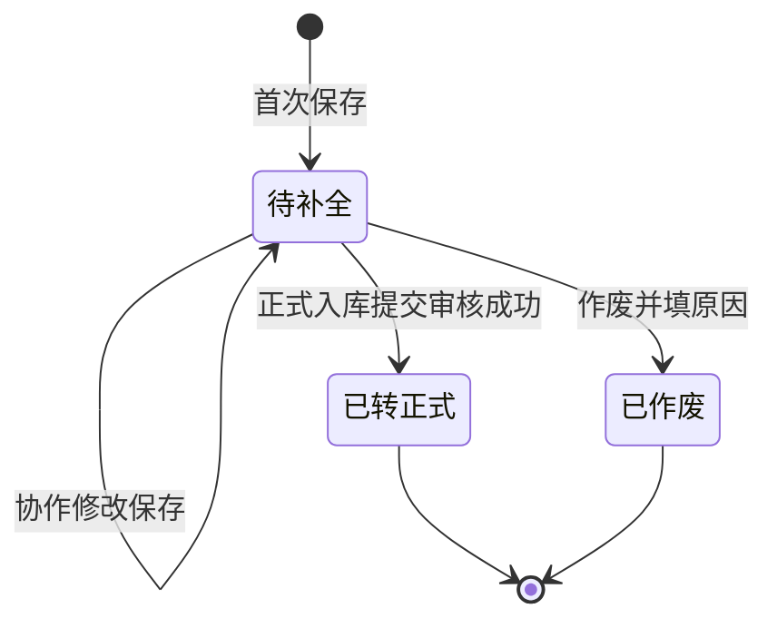

# 入库暂存登记业务规则规格

> **文档说明**：「入库暂存登记」状态、弱校验、转正联动、权限规则的唯一定义来源。  
> **统一引用规范**：本菜单 **P01～P11**；转正预填启用时引用 [10-入库记录业务规则规格](../10-仓储管理-入库记录/入库记录业务规则规格.md) **R01～R06、R11/R11b、R12～R17、R27、R28、R32**；正式页货主口径见 **【合作方货主引用与快捷建档规则】(R03)**（**不在**正式提交时建档）。  
> **6.3 正式单联动**：见 [10-仓储管理-入库记录](../10-仓储管理-入库记录/)（**【入库暂存登记联动与来源追溯规则】(R32)**）；**6.3 暂定开发**：三件套与原型为准，PC/H5 菜单、正式页 **P09** 反向通道、列表/详情 **【转为正式入库】** 随研发迭代逐步放开（未上线前可按环境开关隐藏）。  
> **版本**：V1.7 | **更新日期**：2026-10-19 | **责任人**：森云科技（Senyun Technology）

---

## 一、功能定位与基本原则

| 项目 | 说明 |
| :--- | :--- |
| **功能定位** | 现场到货事实备忘与极速收货工具（非正式入库审批单） |
| **单据来源** | ① 本菜单直接新增；② 正式入库新增页主动切换并无损带入（P09） |
| **与入库记录边界** | 不进审批、不计库存、不发条码、不进「入库记录」已通过台账（P01）；字段与 SKU/库位结构与入库记录对齐，便于一键预填转正 |
| **库存影响** | 【待补全】登记单：零库存、零货权、零条码；仅【已转正式】表示已把快照交给正式单，仍以正式单审批通过入账 |

### 数量口径（与入库记录对照）

| 名称 | 阶段 | 含义 | 约束 |
| :--- | :--- | :--- | :--- |
| 计量参数（申报数量） | 登记单 | 现场申报总量（如地磅净重） | 大于 0；单位 R11b 只读 |
| 未堆放数量 | 登记单 | 总量减已分配位置量 | 默认折叠未分配；登记允许大于 0（P04）；转正提交按 **R13 必须为 0** |
| 正式入库数量 | 正式单 | 审批通过后入账量 | 入库记录规则 |

---

## 二、状态定义与流转

### 2.1 状态定义

| 状态 | 说明 | 允许 | 禁止 |
| :--- | :--- | :--- | :--- |
| **待补全** | 已保存，要素可不全 | 编辑、转正、作废、查看 | 入账、条码、导出正式凭证 |
| **已转正式** | 正式单已提交审核成功 | 查看、跳转正式单 | 再编辑、再转正、作废 |
| **已作废** | 人工废弃 | 查看（含原因） | 编辑、转正 |

### 2.2 状态流转图

---

## 三、核心业务规则（P01～P09）

### 【登记单与正式单完全分开】(P01)

独立 `REG-yyyyMMdd-00001` 编号；不写 WMS、不生成二维码、不进审批待办、不出现在入库记录列表（仅 `APPROVED`）；暂存保存不做法务存证。

### 【暂存保存门槛极速放宽】(P02)

保存登记单仅需同时满足以下极简最低门槛：
1. **入库日期**：已选且**不晚于当前时间**（R01，默认当前系统时刻）；
2. **入库仓库**：在用户数据权限管辖范围内（R05）；
3. **入库类型**：支持选择 `普通入库`、`质押入库`、`抵押入库`、`监管服务入库`、`仓单入库`（默认普通入库）；
4. **至少 1 行货品（SKU）**：且计量参数（重量/数量）大于 0。

**不要求强校验项**：关联单号允许留空或手填、货主允许手填临时说明、主表库房选填、二级库位允许折叠不分配、现场照片与收集项允许留空。

### 【货主智能一体化录入与转正核验】(P03)

取消繁琐的 Switch 开关与独立交接说明控件，提供统一的【货主/送货说明】智能输入框：
1. **档案联想**：输入时下拉模糊联想系统合作方档案（企业/个人）；选中档案货主后，系统反显其统一社会信用代码或脱敏手机号，并打上【档案货主】标签；
2. **临时自由手填**：若现场货主未定、暂未建档或司机不清楚，**允许直接手工输入临时文本**（如“货主待定，司机王师傅 138xxxx，车牌豫A88888”，最多 100 字）。系统自动打上灰色【临时待核】标签；
3. **免发短信与正式页货主（后续转正启用时）**：
   - 暂存阶段不论录入何种货主，均**不触发**联系手机短信核验；
   - **转正启用后**：正式页须绑定合作方 `owner_partner_id`（**【合作方货主引用与快捷建档规则】(R03)**）；【临时待核】文本须在正式页改为搜索/快捷建档；金融类未验证货主走 **PA-R04b**，**不在**提交时原子建档。
4. **本期裁切**：**【转为正式入库】** 入口 PC/H5 **关闭**（见 **R32**）；登记单仍可在本菜单独立新增/编辑/作废。

### 【二级堆放默认折叠与自主分配】(P04)

1. **默认折叠展示**：货品卡片中的【堆放位置分配】在暂存新增/编辑页**默认处于折叠状态**（折叠提示：“待理货定垛 / 点击展开分配具体库位（选填）”），现场卸车时无需分垛即可快速保存；
2. **自主按需填写**：若现场理货员当场已确定垛位，允许自主点击展开并录入多库位行（库房、分区、具体位置文本最多 20 字、堆放数量）；
3. **弱校验与转正强闭环**：
   - 暂存阶段：未分配库位或未堆放数量大于 0 仅作为弱提示，**绝不阻断保存**；
   - 转正阶段：在正式入库页打开时，系统强制展开堆放明细，并严格执行正式规范 **【未堆放数量清零强阻断】(R13)**，必须清零后方可提交审核。

### 【现场拍照与收集项全面选填】(P05)

1. **SKU 收集项**：随货品规格渲染的扩展收集项（如化验报告、规格参数）在暂存阶段**全部放宽为选填**，现场可填可不填；
2. **附件区**：现场照片（0～10 张）与补充资料（0～10 个）在暂存阶段**全部放宽为选填**；
3. **转正强闭环**：转正进入正式页后，正式提交审核时严格执行 **R16** 校验（至少上传 1 张现场照片）。

### 【一键转正式与关联单号校验闭环】(P06)

> **本期状态（6.3.3）**：PC/H5 暂存列表/详情 **不展示**【转为正式入库】；正式入库页 **不展示** P09 反向按钮。下列条文 **保留**，后续版本与 **R32** 同步启用。

1. **转正入口与确认弹窗 (O03)**：暂存单列表操作列或详情页底栏点击【转为正式入库】，首先弹出【转为正式入库确认与引导弹窗】(O03)，提示转正前置风控要求、**目标正式制单页**与结案时机；用户确认后按下列路由打开正式制单页并预填快照（携带 `sourceRegId=登记单号`），**不直接生成**正式单；用户点击【取消】留在当前页；
2. **转正目标页路由（端侧 + 入库类型）**：
   | 操作端 | 暂存「入库类型」 | 转正目标（预填 `sourceRegId`） | 说明 |
   | :--- | :--- | :--- | :--- |
   | **PC** | 普通 / 质押 / 抵押 / 监管服务 | PC 新增入库 `/仓储/入库管理/入库记录/新增?sourceRegId={REG}` | 对齐 PC **【PC 端手工制单白名单】(R04a)** |
   | **PC** | **仓单入库** | **H5 入库发起** `/m/inbound/initiate?sourceRegId={REG}` | 仓单正式制单 **禁止** 在 PC 新增页提交（R04a）；O03 须明示「请前往移动端入库发起完成转正」，可提供复制链接或扫码打开 H5 |
   | **H5** | 全部 5 类（含仓单） | **H5 入库发起** `/m/inbound/initiate?sourceRegId={REG}` → 【下一步】`/m/inbound/initiate/goods?sourceRegId={REG}` | 对齐 **【移动端入库发起白名单】(R04f)**；预填与强校验见 H5 **P10** |
3. **关联单号的三种转正校验情况**：
   - **情况 A（暂存时单号留空）**：暂存若选了非普通入库（质押/抵押/监管服务/仓单）且未填关联单号，正式页强校验拦截，要求必须在下拉框中选择系统内有效的对应单据（对齐正式 R04）；
   - **情况 B（暂存时选择了系统单号）**：直接原样带入并校验通过；
   - **情况 C（暂存时手工输入了文本单号）**：正式页打开时系统自动尝试与系统单据匹配；若能精准匹配则自动绑定，若系统中不存在该单号，正式页高亮标红提示“未匹配到系统有效单据，请在下拉框中重新选择”并阻断提交；
4. **单据状态回写**：正式制单页（PC 或 H5）【提交审核】成功生成 19 位正式单号后，暂存登记单状态自动流转为【已转正式】，回填【关联正式入库单号】，写入转正人与转正时间；**不在**正式入库单主表写入来源暂存单号（R32，关联仅存暂存侧）；
5. **防冲突与版本锁**：提交时登记单必须仍为【待补全】；若登记单版本号落后则拦截提示重新打开。已转正式终态不可逆。

### 【暂存不调用摄像头抓拍】(P07)

登记保存/修改不触发 IoT 抓拍；正式单提交成功后按 **R18** 抓拍（登记单详情不展示设备抓拍）。

### 【权限隔离与多人协作】(P08)

按仓库数据权限隔离（R05）；同仓可协作编辑。并发保存以后保存者版本落后提示刷新（单据版本号机制）。暂存单不做超期自动作废。

### 【从正式入库页带入与无损复制】(P09)

> **本期状态（6.3.3）**：正式入库新增页 **隐藏** 本通道（**R32**）；仅可从本菜单直接新增登记单。

**触发（后续启用）**：PC/H5 正式入库新增页用户点击【入库暂存登记】唤起说明弹窗（O01）。

**带入矩阵**（选择「带入并前往」）：

| 正式页内容 | 登记页结果 |
| :--- | :--- |
| 入库日期、入库仓库 | 原样带入 |
| 入库类型 | **原样带入**（支持普通/质押/抵押/监管服务/仓单，不再强制降级） |
| 关联单号 | **原样带入**（若正式页已填则保留；支持手填文本） |
| 货主信息 | 已选档案货主则带入名称与标识；未选则允许手填临时说明 |
| 主表入库库房 | 原样带入（若有）；暂存仍可为空 |
| SKU 行：SKU、计量、收集项、备注、现场照片、补充资料 | **原样无损复制，登记页可继续编辑** |
| 二级堆放：库房、分区、具体位置、堆放数量 | 原样带入；若正式页未分完，登记页默认展示已填行并允许折叠 |
| 短信 / 审批 / 库存 | **不触发** |

**按钮**：取消（留在正式页）；前往空白登记页；带入并前往登记页。

### 【正式单终止后暂存回退】(P10)

1. **提交成功**：正式单【提交审核】成功 → 登记单【已转正式】，回填 19 位【关联正式入库单号】（审批流程中仍视为已转正，不可重复 O03）。
2. **未通过 / 已撤销**：关联正式单进入终态 **未通过** 或 **已撤销** 时，系统自动将登记单回退为【待补全】，清空列表【关联正式入库单号】展示为「—」；在操作记录写入「正式单 {单号} 已驳回/已撤销，暂存回退待补全」及失败单号供审计。
3. **再次转正**：回退后允许再次【转为正式入库】；仍须满足 P06 路由（仓单 PC 须提示手机操作）与版本锁。

### 【盘点与账实差异协同】(P11)

1. **现象**：货物已卸场但登记单仍为【待补全】或未审批通过时，WMS 账面无库存，盘点可能出现实物多于账面。
2. **处置**：盘点人员须先查【入库暂存登记】是否存在匹配【待补全】/审批中正式单的登记单；在盘点备注说明（例：「实物对应暂存 REG-xxx，待转正入库」）。
3. **禁止**：**不得**以盘盈等方式将暂存实物直接调入账面；须完成转正 + 正式单审批通过后由入库生效写入库存。

---

## 四、作废与异常

### 4.1 作废

仅【待补全】可作废；原因必填最多 200 字；作废后终态只读。

### 4.2 正式单驳回/撤回

见 **【正式单终止后暂存回退】(P10)**：登记单回退【待补全】并可再次转正；正式单侧在入库申请/我的申请中处理，不在入库记录台账展示。

---

## 五、操作权限

| 操作 | 权限码 | 说明 |
| :--- | :--- | :--- |
| 查看台账 | `R-WH-IN-REG` | 菜单与列表 |
| 新增 | `R-WH-IN-REG-ADD` | 含 P09 带入 |
| 编辑 | `R-WH-IN-REG-EDIT` | 待补全 |
| 转正 | `R-WH-IN-REG-CONVERT` | 打开正式预填（**本期 UI 关闭**，权限码保留） |
| 作废 | `R-WH-IN-REG-VOID` | 待补全 |

---

## 修订记录

| 版本 | 日期 | 变更 |
| :---: | :---: | :--- |
| V1.2 | 2026-10-13 | 大白话规则初版 |
| V1.3 | 2026-10-14 | 对齐入库记录：R01/R11/R12/R06、P09 完整带入表、具体位置文本、跨模块引用与 6.3 正式单来源单号 |
| **V1.4** | 2026-10-14 | 全面放开入库类型（普通/质押/抵押/监管服务/仓单）；关联单号选填+支持手填及转正强校验；货主智能一体化（取消Switch）；二级堆放默认折叠；收集项/附件全面选填；P09类型无损带入 |
| **V1.5** | 2026-10-14 | P06 转正路由：仓单须 H5 入库发起；H5 暂存转正统一 `/m/inbound/initiate?sourceRegId`；引用 H5 P10 |
| **V1.6** | 2026-10-14 | P10 正式单驳回/撤回回退待补全；P11 盘点协同；取消正式单来源暂存单号字段 |
| **V1.7** | 2026-10-19 | **6.3.3**：P03 对齐入库 R03 快捷建档；P06/P09 转正与反向通道 **本期关闭**（R32） |
