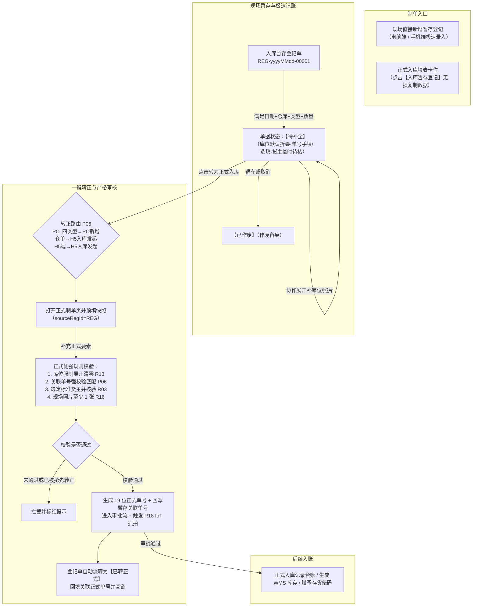

# 入库暂存登记主PRD

> **功能说明**：现场到货卸车时的极速记账与协作工具。货主未定、单号未出、库位未分、照片未齐时，先把到场事实记在**独立暂存台账**；后续一键带入正式入库页提交审批。字段与 [入库记录字段清单](../../../🌟🌟🌟-最新基准版/B端PC/02-仓储/09-入库管理-入库记录/入库记录字段清单.md) 共用货品 SKU、库位、影像口径，保存门槛极速放宽。  
> **版本**：V1.6 | **更新时间**：2026-10-14 | **责任人**：森云科技（Senyun Technology）  
> **三件套**：[字段清单](./入库暂存登记字段清单.md) · [业务规则规格](./入库暂存登记业务规则规格.md) · 本文  
> **推演**：[入库暂存登记业务流程推演.md](./入库暂存登记业务流程推演.md)  
> **线框**：PC [列表](./入库暂存登记_ASCII_列表页.md) / [新增编辑](./入库暂存登记_ASCII_新增页.md) / [详情](./入库暂存登记_ASCII_详情页.md)；H5 [列表](./入库暂存登记_ASCII_H5列表页.md) / [新增](./入库暂存登记_ASCII_H5新增页.md) / [详情](./入库暂存登记_ASCII_H5详情页.md)  
> **6.3 入库记录副本（不改基准版）**：[10-仓储管理-入库记录](../10-仓储管理-入库记录/) · [H5/存量改造摘要](../05-存量改造与关联业务协同/入库暂存登记-存量入库板块业务改造规格.md)

---

## 1. 业务背景与要解决的问题

### 1.1 实际业务背景
大宗商品运到监管仓库后，卸车称重节奏紧凑。正式入库单要求货主核验（短信二元核验）、关联单据严格匹配、库位必须全部理清、现场照片齐全。现场常出现货主暂未建档/联系不上、系统质押单号还未下发、货物先在月台未分垛等紧急情况，导致无法在系统里及时记账。

### 1.2 现场面临的主要问题
1. **货到了账上没记录**：只能靠纸质或微信记账，易漏单，实物脱管；  
2. **入库类型脱节**：现场明知是质押或监管货，但因系统缺关联单号而无法正常登记；  
3. **货主核验卡住作业**：验证码收不到或货主暂未定导致制单流程卡死；  
4. **理货分垛需要时间**：要求卸车称重瞬间分完所有垛位不切实际；  
5. **多人协作防覆盖**：地磅员、理货员、站长需跨终端（PC/H5）补录同一单而不互相盖单。

---

## 2. 功能范围

| 本期包含的功能 | 本期不包含的功能 |
| :--- | :--- |
| - **现场极速新建登记单**：日期 + 仓库 + 类型 + SKU 数量大于 0 即可保存（P02）； - **入库类型全面放开**：支持普通、质押、抵押、监管服务、仓单入库； - **关联单号选填与手填**：支持系统联想与手工自由输入文本；转正时强校验闭环（P06）； - **货主智能一体化录入**：取消繁琐 Switch 开关，支持档案快搜与手填临时说明（P03）； - **二级堆放默认折叠**：现场卸车免分垛，支持按需展开自主分配；转正清零闭环（P04）； - **收集项与附件全面选填**：暂存不卡参数与照片，转正按 R16 补齐（P05）； - **正式入库页一键切换带入**：无损带入类型、单号、货品与附件（P09）； - **一键转正式**：防冲突与版本锁（P06）； - **同仓库协作**：PC + H5 全端支持（P08）。 | - 暂存不计入库物理库存、不发条码、不进审批流（P01）； - 暂存不调用摄像头抓拍（P07）； - 不混入正式入库记录台账列表（仅展示 `APPROVED`）； - 不做超期自动作废； - 盘点不自动平账。 |

---

## 3. 业务流转过程说明

---

## 4. 页面功能说明

### 4.1 PC 列表页

- **筛选区**：默认 4 项（登记单号、入库日期范围、入库类型、入库仓库）+ 展开（状态、货主/送货说明、登记人、关联正式入库单号）。  
- **表格列**：
  - 登记单号（`REG-yyyyMMdd-00001`，支持轻量复制）；
  - 入库类型（普通/质押/抵押/监管服务/仓单）；
  - 货主/送货说明（档案货主显示名称；临时文本显示说明并带灰色【临时待核】标签）；
  - 入库仓库；
  - 货品摘要（SKU 展示名）；
  - 申报数量（千分位，带计量单位）；
  - 单据状态（待补全、已转正式、已作废）；
  - 关联正式单号（19 位正式单号，转正后生成可点击跳转；未转正为「—」）；
  - 登记人 / 登记时间；
  - 操作列（待补全：编辑、转为正式入库【弹出 O03 确认窗】、作废【弹出 O02】；已转正式/已作废：查看详情）。

### 4.2 PC 新增/编辑页

- **Card 1 基础信息**：
  - 入库日期（默认当前时间，不可选未来时间 R01）；
  - 入库仓库（单选，受数据权限 R05 约束）；
  - 入库类型（下拉可选普通、质押、抵押、监管服务、仓单）；
  - 关联单号（非普通入库时展示，支持下拉联想系统单据，**同时支持自由手工输入文本**，选填）；
  - 货主/送货说明（智能一体化输入框，支持档案联想或自由手填临时文字最多 100 字，取消 Switch 开关）；
  - 入库库房（选填；若选则受 R06 同属性约束）；
  - 备注（选填，最多 140 字）。
- **Card 2 货品与堆放明细（双层嵌套结构）**：
  - 一级货品：【+ 添加货品】；SKU 支持模糊快搜（三列联动）→ 计量参数（申报数量必填大于 0，单位只读 R11b）→ 动态收集项（选填）→ 货品备注（选填）；
  - 二级堆放位置：**默认折叠收起**（提示“待理货定垛 / 点击展开分配具体库位（选填）”），用户可按需点击展开添加库位行（库房、分区、具体位置文本最多 20 字、堆放数量）；未分配堆放数量弱提示，不阻断保存；
  - 附件区：现场照片（0～10 张）与补充资料（0～10 个）全部放宽为选填。
- **Card 3 单据汇总底栏**：
  - 实时汇总：货品品类数、货品总数量（申报总量）、堆放总数量、未堆放总数量。
- **操作按钮**：【取消】、【保存登记 / 暂存】。

### 4.3 PC 详情页

- **子板块**：基础信息、货品与库位明细（默认展示展开后的库位与附件摘要）、操作审计记录；
- **状态区操作**：
  - 【待补全】：支持【编辑】、【作废】（弹出 O02 输入原因）、【转为正式入库】（弹出 O03 确认窗，确认后新开正式新增页并预填快照）；
  - 【已转正式】：展示“已转正式”盖章，关联正式单号可点击跳转至入库记录详情；
  - 【已作废】：展示作废人、作废时间与作废原因。

### 4.4 H5 移动端说明

- 保持业务状态机与字段规则强一致；
- 列表支持悬浮 ➕ 极速新建；新增页默认折叠堆放位置，支持手机现场拍照直接上传；
- 详情页吸底提供【转为正式入库】按钮，点击呼出 ActionSheet 确认面板 (O03)；确认后打开 **业务办理 → 入库发起** 预填页 `/m/inbound/initiate?sourceRegId={REG}`，【下一步】进入 `/m/inbound/initiate/goods?sourceRegId={REG}` 完成货品预填与提交（P06 / H5 P10）；
- **仓单入库**暂存单在 PC 端点击转正时，同样须前往上述 H5 入库发起链路（PC 不提供仓单正式制单页）。

### 4.5 核心交互弹窗说明 (O01 / O02 / O03)

- **O01 从正式页引导去暂存登记弹窗**：
  - **触发**：用户在 PC 正式入库新增页点击右上角【入库暂存登记】；
  - **交互**：展示暂存定位提示，提供【取消】、【去空白登记页】及【带入内容并前往 (推荐)】；
  - **逻辑**：选择带入时，无损原样复制已填字段并跳转暂存新增页（P09）。
- **O02 作废入库暂存登记二次确认弹窗**：
  - **触发**：列表或详情页处于【待补全】状态时，点击【作废】/【作废单据】；
  - **交互**：展示危险警示与单号确认，提供必填文本域【作废原因】（最多 200 字）；
  - **约束**：未输入原因前【确认作废】禁用；确认后单据流转为【已作废】且不可逆。
- **O03 转为正式入库确认与引导弹窗**：
  - **触发**：列表操作列或详情页底栏点击【转为正式入库】；
  - **交互**：系统提示即将把暂存快照（类型、关联单号、SKU、库位、照片）预填至正式制单页；**仓单类型在 PC 端须前往 H5 入库发起**（P06）；
  - **前置风控四提醒**：
    1. **货主核验**：临时待核货主须在正式页重新选定标准档案企业，触发 R03 二元核验；
    2. **库位清零**：未分配库位将在正式页强制展开，须将未堆放数量全部清零 (R13)；
    3. **现场照片**：正式入库单须至少上传 1 张现场货物照片 (R16)；
    4. **单号匹配**：手填关联单号须在系统内存在有效对应单据，否则阻断提交 (P06)；
  - **结案保障**：明确告知只有在正式页【提交审核】成功后，暂存单才回写为【已转正式】；中途放弃或关闭页面不产生废单。

---

## 5. 常见业务场景

### 场景 1 现场 30 秒极速过磅暂存
地磅员打开电脑或手机：选择仓库“河南一号仓” → 选择“质押入库” → 关联单号手填“司机持纸质协议088号” → 货主手填“司机王师傅，车牌豫A88888” → 货品选“电解铜”，重量填 50.25 吨 → 不展开堆放位置，直接点【保存登记】。耗时不到 30 秒，单据落库为 `REG-20261014-00001`（待补全）。

### 场景 2 理货员后续补录堆放与照片
货物卸完后，理货员用手机打开该单点击【编辑】：展开【堆放位置分配】，录入 1 号库房 A 区 01 垛位 50.25 吨，顺手拍 2 张货物外观照片保存。单据仍为【待补全】，数据完整度提升。

### 场景 3 主管一键转正与严格审核
业务主管在办公室打开该单点击【转为正式入库】：系统新开正式入库新增页，原样带入质押入库类型与货品数据。由于现场关联单号为手填，系统提示补齐：主管在下拉框中选中系统已批复的正式质押单号，货主下拉选择建档的“河南XX商贸有限公司”，现场照片已具备，库位数量已清零，点击底栏【提交审核】。系统完成新货主核验（若有），生成 19 位正式单号，登记单回写为【已转正式】并实现全链路互链。

---

## 6. 核心规则对照表 (P01～P09)

| 编号 | 名称 | 要点 |
| :---: | :--- | :--- |
| **P01** | 登记与正式分开 | 独立 REG 编号；不写物理库存；不进入库记录审批台账 |
| **P02** | 暂存保存极速放宽 | 日期+仓库+类型+SKU 数量大于 0 即可保存；类型全面放开；R01 禁未来 |
| **P03** | 货主智能一体化 | 取消 Switch；支持档案联想或自由手填临时文字；转正时强核验 R03 |
| **P04** | 二级堆放默认折叠 | 默认折叠免分垛，支持按需展开；暂存弱提示，转正强清零（R13） |
| **P05** | 收集项与附件选填 | SKU 模板项与照片/补充资料均选填；转正正式提交时强校验 R16 |
| **P06** | 转正与单号闭环 | 留空/手填单号转正时强校验系统单据；防冲突拦截；版本锁 |
| **P07** | 暂存不抓拍 | 暂存不调用摄像头抓拍，正式单提交成功后按 R18 抓拍 |
| **P08** | 权限与协作 | 数据权限隔离（R05）；同仓协作；单据版本防覆盖 |
| **P09** | 正式页无损带入 | 正式页切暂存无损带入类型、单号、货品、收集项与附件，不降级 |

---

## 7. 验收标准

1. **入库类型与单号**：支持自由选择 5 类入库类型；关联单号支持下拉和自由手填；转正时单号不存在系统时强阻断。  
2. **极速保存**：不录入货主（手填临时说明）、不展开堆放位置、不上传照片，仅凭仓库+日期+类型+SKU重量即可成功保存登记单。  
3. **货主一体化**：取消 Switch 开关，输入框既可检索档案，也可直接输入任意文本；列表正确展示【临时待核】标签。  
4. **P09 无损复制**：从正式入库页点击【入库暂存登记】，已选入库类型与关联单号完整带入，不强制重置为普通入库。  
5. **转正互链（暂存侧）**：正式提交审核成功后，登记单自动流转为【已转正式】并回填【关联正式入库单号】；正式单主表不展示来源暂存单号（R32）。正式单未通过/已撤销时暂存回退【待补全】（P10）。
6. **盘点协同（P11）**：卸货未入账导致账实差异时，盘点须核对暂存台账并备注，禁止盘盈自动平账。

---

## 8. 修订记录

| 版本 | 日期 | 内容 |
| :---: | :---: | :--- |
| V1.2 | 2026-10-13 | 大白话初版 |
| V1.3 | 2026-10-14 | 对齐入库记录 SKU/收集项/补充资料/具体位置；索引衍生与 6.3 正式单增量路径 |
| **V1.4** | 2026-10-14 | 全面放开入库类型（普通/质押/抵押/监管服务/仓单）；关联单号选填+支持手填及转正强校验；货主智能一体化（取消Switch）；二级堆放默认折叠；收集项/附件全面选填；P09类型无损带入 |
| **V1.5** | 2026-10-14 | P06 转正路由：仓单→H5 入库发起；H5 暂存转正目标页 `/m/inbound/initiate?sourceRegId` |
