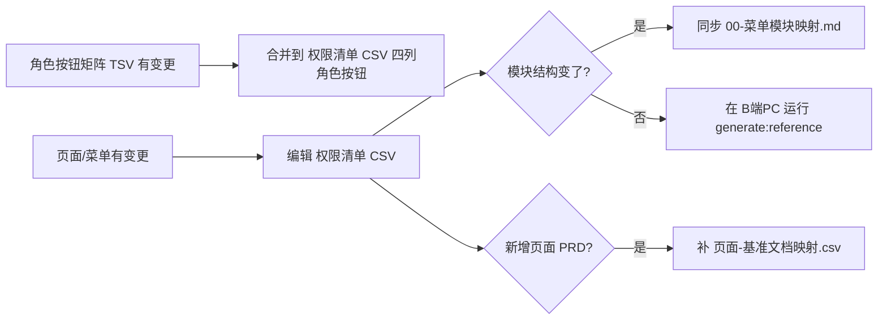

# 功能与数据权限 · 基准清单

> **版本**：V2.0 | **更新日期**：2026-11-11
>
> **定位**：全平台页面级**功能按钮**、**四类角色按钮**与**数据可见范围**的基准唯一定义来源，与 [B端PC/00-菜单地图.md](../B端PC/00-菜单地图.md)、[B端H5/00-菜单地图.md](../B端H5/00-菜单地图.md) 及 C端/SAAS 索引对应。

---

## 一、文件清单

| 文件 | 说明 |
| :--- | :--- |
| [功能与数据权限清单.csv](./功能与数据权限清单.csv) | **主数据源**：250 行 × 19 列；含菜单路径、按钮并集、四类角色按钮、数据权限、上线状态与基准目录 |
| [00-菜单模块映射.md](./00-菜单模块映射.md) | 14 个模块 ↔ 端 ↔ 基准 PRD 目录对照；含「角色按钮矩阵与权限清单关系」说明 |
| [页面-基准文档映射.csv](./页面-基准文档映射.csv) | 128 行页面 → 具体 PRD / 字段清单 / 规则规格路径 |
| [scripts/normalize-csv.mjs](./scripts/normalize-csv.mjs) | CSV 规范化工具：列名对齐、旧列名兼容、继承行处理 |
| [scripts/csv-inheritance.mjs](./scripts/csv-inheritance.mjs) | CSV 解析与继承行工具；被 PC 原型 `generate-menu-catalog.mjs` 与权限脚本共用，**勿删** |

> **角色级上游来源**：`00-草稿对话/2026.11.10-系统菜单角色权限矩阵_按钮分格版.tsv`（231 行）。CSV 的四列角色按钮由该表合并而来；TSV 本身不替代 CSV，因为缺少模块编码、基准路径与记录状态。

> **已清理**（2026-11-11）：`apply-latest-updates.mjs`（2026-09-03 一次性补丁，已执行完毕）、`sync-from-draft.mjs`（从 10 月旧草稿整表覆盖，会冲掉后续 6.3 增量与角色列）。`csv-inheritance.mjs` 因被原型菜单生成脚本引用，保留。需要旧脚本时从 git 历史恢复。

---

## 二、CSV 字段说明

### 2.1 页面与权限列

| 原型页列 | CSV 列名 | 说明 |
| :--- | :--- | :--- |
| **页面路径** | `端` + `所属模块` + `一级菜单` + `二级菜单` + `Tab` | 拼装菜单路径；合并单元格写法允许留空，读取时沿用上一行 |
| **页面功能按钮** | `页面功能按钮` | 页面按钮并集，顿号分隔 |
| **数据可见范围** | `数据可见范围` | 数据过滤规则 |
| **变更记录** | `创建时间` + `修定时间` + `变更说明` | 日期格式 `YYYY年M月D日` |
| **旧系统对照** | `旧系统路径` | 老系统菜单路径，便于迁移核对 |

### 2.2 四类角色列（2026-11-11 新增）

| 列名 | 说明 |
| :--- | :--- |
| `平台运营方按钮` | 平台运营方在该页可操作/可查看的按钮；`—` 表示无权限 |
| `仓储服务方按钮` | 仓储服务方视角 |
| `监管服务方按钮` | 监管服务方视角 |
| `资金服务方按钮` | 资金服务方视角 |

> C 端页面的「平台运营方」一列在 TSV 中表示 **门户管理员**，不是 B 端平台运营方；SAAS 四页四类角色均为「无」，因为走 SAAS 专属账号体系。

### 2.3 菜单索引列（文档维护用，原型页不展示）

| 列名 | 说明 |
| :--- | :--- |
| `菜单模块编码` | 如 `01-工作中心`、`12-C端PC`、`14-SAAS` |
| `顶栏/底栏模块名` | 菜单地图显示名 |
| `基准模块目录` | 如 `B端PC/01-工作中心`、`C端PC/01-首页/` |
| `记录状态` | `active` / `planned` / `cancelled` / `6.2-target` / `6.3-target` |

---

## 三、维护工作流



1. **日常改权限**：直接编辑 [功能与数据权限清单.csv](./功能与数据权限清单.csv)；
2. **角色按钮有更新**：先改 TSV，再合并到 CSV 四列角色按钮，保持「TSV 为角色级来源、CSV 为落地主表」；
3. **同步原型参考页**：
   ```bash
   cd 03-前端原型demo/B端PC
   npm run generate:reference
   ```
4. **新增菜单页**：在 [页面-基准文档映射.csv](./页面-基准文档映射.csv) 追加一行，指向对应基准目录；
5. **CSV 结构异常**：运行 `node scripts/normalize-csv.mjs` 规范化（先备份）。

---

## 四、与其它文档的关系

| 层级 | 路径 | 关系 |
| :--- | :--- | :--- |
| **本目录（基准）** | `00-功能与数据权限/` | 页面级按钮与数据权限口径 |
| 菜单地图 | `B端PC/00-菜单地图.md`、`B端H5/00-菜单地图.md` | 导航结构真源；`所属模块` 必须对齐 |
| 全局契约 / RBAC | [00-全局契约与RBAC权限矩阵](../00-全局契约与RBAC权限矩阵.md) | 角色级权限矩阵；本清单为页面级落地 |
| 菜单迭代记录 | [B-迭代需求/00-菜单迭代记录/](../../B-迭代需求/00-菜单迭代记录/README.md) | 各版本菜单/导航变更历史 |
| PC 原型参考页 | `03-前端原型demo/B端PC` → `/系统参考/功能与数据权限` | 由 CSV 自动生成，只读展示 |

---

## 五、统计摘要（2026-11-11）

| 端 | 记录数 |
| :--- | :---: |
| PC（B 端） | 151 |
| 移动（B 端 H5） | 80 |
| C端PC | 8 |
| C端H5 | 7 |
| SAAS | 4 |
| **合计** | **250** |

| 记录状态 | 数量 |
| :--- | :---: |
| active | 209 |
| cancelled | 26 |
| planned | 14 |
| 6.3-target | 1 |

模块共 **17 个**：B 端 11 个、B 端 H5 3 个、C 端 2 个、SAAS 1 个。

---

## 六、修订记录

| 日期 | 版本 | 说明 |
| :--- | :---: | :--- |
| 2026-11-11 | V2.1 | 暂存登记需求暂缓、供应链监管业务下线：删除对应目录、权限行与页面映射，统计更新为 252 行 / 128 行 |
| 2026-11-11 | V2.0 | 合并 2026-11-10 角色按钮矩阵：新增四类角色列，补 C端/SAAS，清理一次性脚本，更新统计与维护流程 |
| 2026-09-03 | V1.5 | 迭代记录真源迁至 B-迭代需求 Markdown |
| 2026-09-03 | V1.4 | 迭代记录改为版本化 CSV 真源（已废弃） |
| 2026-09-03 | V1.3 | 与菜单地图对齐：补 6.2 开锁/预警等级、H5 内部审批/预约/开锁 |
| 2026-09-03 | V1.2 | 同步 9 条页面 + 5 处字段更新；修复继承行导入逻辑 |
| 2026-09-03 | V1.1 | CSV 列名对齐原型四列；移除功能说明等冗余字段 |
| 2026-09-03 | V1.0 | 自草稿目录迁入基准版 |
