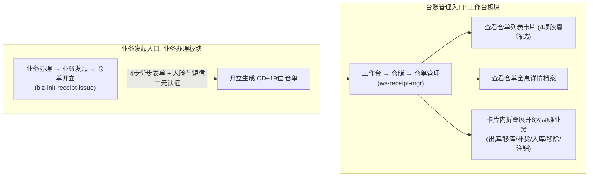

# 仓单管理（移动端工作台）

> **所属板块**：移动端工作台 · 仓储业务  
> **moduleId**：`ws-receipt-mgr`  
> **菜单路径**：**工作台 → 仓单管理**（完整路径：工作台 → 仓储 → 仓单管理）  
> **原型路由**：`/m/workspace/warehouse-receipts`  
> **业务发起入口对照**：**业务办理 → 业务发起 → 仓单开立**（`biz-init-receipt-issue`，`/m/receipts/initiate`）  
> **PC 端基准对齐**：[05-仓单管理](../../../../B端PC/03-仓储/05-仓单管理/) · [仓单管理主PRD](../../../../B端PC/03-仓储/05-仓单管理/仓单管理主PRD.md) · [操作字段清单索引](../../../../B端PC/03-仓储/05-仓单管理/操作字段清单/操作字段清单索引.md)  
> **功能清单唯一定义来源**：`03-前端原型demo/B端H5/src/data/mobileMenuData.ts`  
> **导航索引**：[00-菜单地图.md](../../../00-菜单地图.md) · [01-功能清单与原型路由.md](../../../01-功能清单与原型路由.md)

---

## 一、移动端双入口协同关系

在 SYZC 移动端体系中，仓单业务严格按「业务发起」与「台账管理」划分为两大标准入口：

| 业务环节 | 移动端入口路径 | 功能与职责说明 | PC 端协同入口 |
| :--- | :--- | :--- | :--- |
| **仓单开立** | **`业务办理 → 业务发起 → 仓单开立`** | 现场仓管/货主圈选可用库存，完成人脸活体+短信二元强认证，在线签署防伪协议生成仓单 | PC 顶栏右上角【仓单开立】弹出二维码，扫码直达移动端此入口 |
| **查看仓单列表** | **`工作台 → 仓储 → 仓单管理`** | 集中展示名下仓单列表卡片、筛选状态、查看基础信息与货物明细 | PC 菜单【仓储 → 仓单管理】列表页 |
| **动碰流转操作** | **`工作台 → 仓储 → 仓单管理`** | 触发仓单出库、移库、补货、入库、移除、注销等敏感资产变更业务，强制唤起活体人脸核验 | PC 列表点击操作按钮弹出移动端直达二维码，引导在手机端完成办理 |

---

## 二、界面能力与核心交互对齐

1. **小程序顶栏与规范筛选栏**：
   - 顶部居中 44px 导航栏（`NavBar`），右侧预留微信/小程序固定胶囊区域，**绝不放置「开立 / 新增」按钮**；
   - 顶部常驻搜索框（持有人名称/货品信息搜索）；
   - 横向排布 4 个标准筛选下拉胶囊：【仓库】、【货品】、【三方登记】、【状态】，支持快速点选联动。

2. **仓单卡片结构（方案 B · 贴齐移动源码）**：
   - **单号与时间行**：仓单编码（`CD...`）一键复制，右侧制单时间；
   - **主体与状态徽标**：左侧圆形印章徽标（“正”（绿）、“审”（黄）、“冻”（蓝灰）、“注”（深灰）），货主名称与企业信用代码/个人脱敏手机号，右侧状态胶囊；
   - **持有人差异行**：**仅当持有人与存货人不一致时单独展示**；
   - **货物明细展示**：格式为 `货品名称-数量单位`，默认展示前 2 项，项数大于 2 项时支持【展开/收起】；
   - **储存位置**：显示仓单所在仓库全称，标注三方中仓登准入徽标；
   - **底栏操作栏**：
     - 【下载】：审批中状态收窄隐藏；
     - 【变更记录】：点击呼出半屏抽屉，展示时间轴动碰流水与凭据下载；
     - 【详情】：点击进入全息详情页；
     - 【更多操作】：带折叠箭头，点击在当前卡片内部向下展开 2 行 × 3 列业务宫格。

3. **卡片内折叠展开 6 大动碰操作（宫格展开）**：
   - 包含：仓单入库、仓单补货、仓单移库、仓单出库、仓单移除、仓单注销；
   - **置灰与权限拦截规则**：
     - 当持有人与存货人不一致时，**仓单入库**、**仓单补货**、**仓单移库** 变为灰色禁用状态并标注“非存货人禁用”；点击拦截并轻提示：“持有人非原始存货人，禁止办理补货/移库/入库”；
     - 审批中或存在在途流程时，点击拦截提示“您还有【xxx】正在审批中，暂无法发起新的流程！”；
     - 正常可用时，直接跳转进入对应的动碰业务办理页面。

4. **仓单全息详情档案**：
   - 基础信息卡片（四行结构对齐 PC 标杆，含关联单号穿透查看、三方登记、制单人与制单时间）；
   - 货品明细（大类/品类/规格折叠展开，支持查看各垛位批次二维码）；
   - 变更记录时间轴 Tab；
   - 底部吸底操作栏（下载存证与更多操作）。

---

## 三、相关引用与规范

- **主 PRD 需求规格**：[仓单管理主PRD.md](../../../../B端PC/03-仓储/05-仓单管理/仓单管理主PRD.md)
- **字段定义规范**：[仓单管理字段清单.md](../../../../B端PC/03-仓储/05-仓单管理/仓单管理字段清单.md)
- **业务规则规格**：[仓单管理业务规则规格.md](../../../../B端PC/03-仓储/05-仓单管理/仓单管理业务规则规格.md)
- **H5 样式规范**：[H5端样式规范 v1.2](../../../../03-前端原型demo/样式规范-%20H5端/README.md)
