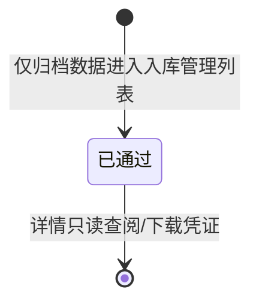

# 入库管理 业务规则规格（B端H5）

> **文档定位**：H5 **入库管理（台账）** 与 **入库发起（制单）** 两个菜单的 **P 系列** 规则；R/C 真源见 [PC 入库记录业务规则规格](../../../../B端PC/02-仓储/09-入库管理-入库记录/入库记录业务规则规格.md)。  
> **统一引用规范**：本文件 **P01~P10**；跨模块 **R03、R04、R04f、R06、R11、R11b、R13、R15、R16、R17、R18、R19、R26、R32**；暂存侧 **P06** 见 [入库暂存登记业务规则规格（6.3）](../../../../../B-迭代需求/6.3版本（2026.09）/09-仓储管理-入库暂存登记/入库暂存登记业务规则规格.md)。  
> **版本**：V1.4 | **更新时间**：2026-10-14

---

## 一、与 PC 的边界

| 维度 | PC 入库记录 | H5 入库管理（台账） | H5 入库发起 |
| :--- | :--- | :--- | :--- |
| 列表状态 | 仅已通过 | 仅已通过（同 R26） | 不涉及 |
| 流程中单据 | 归属 **入库申请** / 审批中心 | 不展示 | 提交后进入流程池 |
| 制单入口 | 仓储 → 新增入库 | 无 | 业务办理 → 入库发起 |
| 列表操作 | 下载记录、单据下载 | 同左（卡片内） | — |

---

## 二、H5 规则（P 系列）

### 【入库管理已通过台账】(P01)

移动端 **入库管理** 列表接口 **必须** 与 PC 入库记录一致，仅查询已通过（`APPROVED` / 现网 `status: [2]`）。列表 **不设** 状态列、状态 Badge、审核状态下拉；卡片提供【下载记录】【单据】与【查看详情】（对齐现网 `store-record.vue`）。

### 【双入口职责分离】(P02)

- `ws-inbound-mgr` → `/m/workspace/inbound-records`：只读已通过台账与详情。  
- `biz-init-inbound` → `/m/inbound/initiate`：入库制单与提交。  
两入口 **不得** 在入库管理列表页提供悬浮【入库】；发起页 Session 暂存策略见 P03。

### 【两步步骤条强制顺序】(P03)

入库发起须按 **基础信息 → 货品明细** 顺序；`【下一步】` 进入 `/m/inbound/initiate/goods`。基础信息实质性变更时清空已填货品（对齐 native 缓存策略）。未选仓库/库房禁止【下一步】；无货品行禁止【提交审核】。

### 【发起字段与 PC 新增对齐】(P04)

发起步骤字段与 PC 新增页同口径；选货、计量、收集项、堆放与 **【货品 SKU 选取与三级联动】(R11)**、**【计量单位随 SKU 只读】(R11b)** 一致；未堆放试算与 **【未堆放数量清零强阻断】(R13)** 一致。手工入库类型遵循 **【移动端入库发起白名单】(R04f)**。

### 【入库货品三列级联选货】(P08)

入库发起步骤 2 货品卡片以 **单行【入库货品】** 为入口，点击唤起底部 Sheet：**左列大类、中列品类、右列 SKU（货品规格）**；列间联动与 PC 三列下拉等价。选中 SKU 后关闭 Sheet，反填大类/品类/规格摘要，并执行与 PC 相同的计量标签、**只读单位**、收集项模板加载及堆放/数量清空策略；再次打开 Sheet 时定位到当前 SKU 所在列并高亮。

### 【新货主核验弹层】(P05)

未建档货主在 **提交审核** 时唤起核验弹层（R03）；Mock 环境验证码 `123456`。

### 【库房同审核属性 Toast】(P06)

多选库房混选「需审核」「免审」时 Toast 拦截（R06）；库房属性与仓库 R02+R03+F13 运行时同源（6.3 见迭代入库记录 R06 正文）。

### 【详情货品行附件与 IoT 只读】(P07)

**入库管理详情**（已通过）在 **各货品行卡片展开区** 只读展示与 PC 入库记录详情【查看附件】弹窗 **同三块口径**：现场照片（R16）、补充资料（R17，含 PDF 预览）、设备抓拍（R18，`goodsLines[].iotCaptures`，含设备名与抓拍时间）；无抓拍或无设备时展示「抓图失败或无监控设备接入」，不阻塞打开详情。详情 **不提供** 撤销（流程撤销在入库申请/我的申请，非本菜单）。

### 【列表多货品摘要与完整清单】(P09)

与 PC **【列表多货品气泡聚合展示】(R15)** 同口径：卡片【入库货品】展示首规格 +「等 N 种」；**多种类时**可点开底部 Sheet 查看 `goodsNames` 全量清单。列表/详情 Mock 与 PC 共用 `shared/inbound/inbound-approved-seed.ts`。

### 【暂存登记转正预填制单】(P10)（6.3）

- **触发**：H5 入库暂存登记列表/详情点击【转为正式入库】并经 O03 确认；或 PC 端对 **仓单入库** 暂存单转正（P06 强制 H5 链路）。
- **路由**：打开 `/m/inbound/initiate?sourceRegId={REG}`，拉取登记快照预填步骤 ①（基础信息）；用户【下一步】进入 `/m/inbound/initiate/goods?sourceRegId={REG}` 预填货品、库位与附件；全程携带同一 `sourceRegId` 与登记单版本号。
- **强校验**：与 PC 转正一致，提交审核时叠加 **R03、R04/R04b、R06、R13、R16** 及暂存 **P06** 关联单号匹配；**仓单入库**须选有效仓单关联单号（R04f）。
- **回写**：【提交审核】成功时将登记单置为【已转正式】并回填关联正式单号（R32 / P06；正式单主表不展示来源暂存）；登记单非【待补全】或版本冲突时强阻断。正式单未通过/已撤销时暂存 **P10** 回退。

---

## 三、状态机（本菜单视角）

流程中状态机见 PC 入库记录业务规则规格「三、」；提交入库后单据 **不经过** 入库管理列表，直至审批通过。

---

## 四、附录：移动入口与 moduleId

| moduleId | 名称 | 路由 | 职责 |
| :--- | :--- | :--- | :--- |
| ws-inbound-mgr | 入库管理 | /m/workspace/inbound-records | 已通过台账 |
| biz-init-inbound | 入库发起 | /m/inbound/initiate | 手工制单提交 |

---

## 五、修订记录

| 日期 | 版本 | 变更内容说明 |
| :--- | :--- | :--- |
| 2026-10-14 | V1.3 | **P07** 扩展为货品行附件三块（R16~R18）与 PC 查看附件弹窗同口径。 |
| 2026-10-14 | V1.4 | **P10** 暂存转正预填：`sourceRegId` 入库发起两步；仓单 PC 转正须 H5；对偶 R32/P06。 |

---

*PC 端 R 规则变更时，须同步核对本文件 P 规则与字段清单。*
