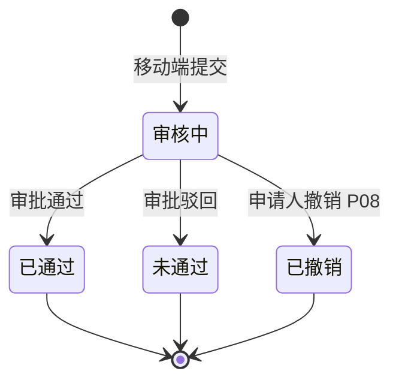

# 入库管理 业务规则规格（B端H5）

> **文档定位**：移动端入库列表、发起、详情之 **H5 交互规则** 与 **PC 共用业务规则引用块**。状态机、未堆放算法、货权联动等 **R 系列真源** 在 [PC 入库记录业务规则规格](../../../../B端PC/02-仓储/09-入库管理-入库记录/入库记录业务规则规格.md)；本文件 **P 系列** 仅描述移动端增量。  
> **统一引用规范**：本菜单 **P01~P08**；跨模块引用 **R03、R06、R11、R13、R16、R17、R18、R19**（定义见 PC 规格正文）。  
> **版本**：V1.0 | **更新时间**：2026-10-12

---

## 一、与 PC 的边界

| 维度 | PC 入库记录 | H5 入库管理 |
| :--- | :--- | :--- |
| 列表状态 | 仅已通过归档 | 全状态流水 |
| 制单入口 | 仓储 → 新增入库 | 业务办理入库发起 + 列表悬浮入库 |
| 步骤交互 | 单页折叠面板 | 两步步骤条（基础信息 \| 货品明细） |
| 详情修改记录 | 独立 Tab | 摘要或空态（审批在 PC/审批中心完成） |

---

## 二、H5 规则（P 系列）

### 【列表全状态展示】(P01)

移动端入库管理列表 **必须** 展示审核中、已通过、未通过、已撤销四类状态 Badge；不提供 PC 端【下载记录】【单据下载】，改为详情内「单据下载」Mock 按钮（已通过态）。

### 【双入口路由一致】(P02)

`ws-inbound-mgr` 与 `biz-init-inbound` 分别映射 `/m/workspace/inbound-records` 与 `/m/inbound/initiate`；列表悬浮【入库】与业务办理入口进入 **同一基础信息页**。步骤 0→1 使用浏览器 Session 暂存表单；新开发起入口应清空暂存，避免脏数据串单。

### 【两步步骤条强制顺序】(P03)

入库发起须按 **基础信息 → 货品明细** 顺序前进（对齐 native `step-list`）；基础信息页内货主与入库字段同屏展示，【下一步】进入 `/m/inbound/initiate/goods`。上一步可返回修改基础信息；基础信息实质性变更时清空已填货品明细（对齐 native 缓存策略）。未选仓库/库房时禁止【下一步】；无货品行时禁止【提交审核】。

### 【步骤内字段与 PC 新增对齐】(P04)

各步骤字段集合与 PC `P-CKG-009-ADD` 一致；未堆放数量计算公式与 **【未堆放数量清零强阻断】(R13)** 相同，提交前在货品卡片标题行与底栏汇总双重提示。

### 【新货主核验弹层】(P05)

未建档货主在 **提交审核** 时唤起全屏/居中核验弹层，向联系电话发送验证码；Mock 环境接受 6 位码 `123456`；通过后提交并沉淀建档（R03）。

### 【库房同审核属性 Toast】(P06)

基础信息页多选库房时若混选「需审核」「免审」标签，立即 Toast 拦截并拒绝非法选择（R06）。

### 【详情 IoT 抓拍只读】(P07)

详情附件区须展示设备抓拍图至少 1 张（已通过/审核中均可）；抓拍失败仅展示「抓拍失败，稍后补录」灰态，不阻塞详情打开（R18）。

### 【审核中撤销】(P08)

仅 `审核中` 状态详情页展示【撤销申请】；撤销后状态变已撤销，列表刷新；已通过禁止撤销。

---

## 三、状态机（移动列表视角）

---

## 四、附录：移动入口与 moduleId

| moduleId | 名称 | 路由 |
| :--- | :--- | :--- |
| ws-inbound-mgr | 入库管理 | /m/workspace/inbound-records |
| biz-init-inbound | 入库发起 | /m/inbound/initiate |

---

*PC 端 R/C 规则变更时，须同步核对本文件 P 规则与字段清单，无需维护双轨编号对照表。*
