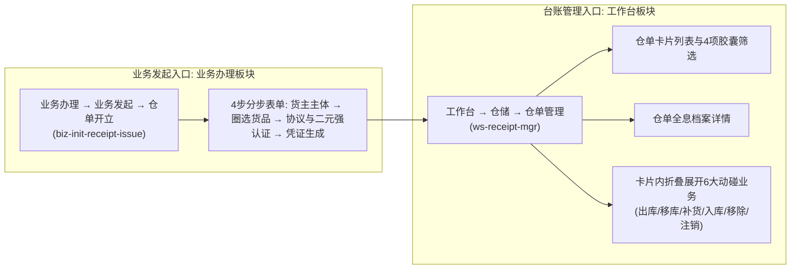

# 仓单开立（移动端业务发起）

> **所属板块**：移动端业务办理 · 业务发起  
> **moduleId**：`biz-init-receipt-issue`  
> **菜单路径**：**业务办理 → 业务发起 → 仓单开立**  
> **原型路由**：`/m/receipts/initiate`  
> **四步分步路由**：
> - 步骤一（货主主体）：`/m/receipts/initiate`
> - 步骤二（圈选货品）：`/m/receipts/initiate/goods`
> - 步骤三（协议与认证）：`/m/receipts/initiate/confirm`
> - 步骤四（完成凭证）：`/m/receipts/initiate/success`  
> **台账管理入口对照**：**工作台 → 仓储 → 仓单管理**（`ws-receipt-mgr`，`/m/workspace/warehouse-receipts`）  
> **PC 端基准对齐**：[05-仓单管理](../../../../B端PC/03-仓储/05-仓单管理/) · [仓单管理主PRD](../../../../B端PC/03-仓储/05-仓单管理/仓单管理主PRD.md)  
> **功能清单唯一定义来源**：`03-前端原型demo/B端H5/src/data/mobileMenuData.ts`  
> **导航索引**：[00-菜单地图.md](../../../00-菜单地图.md) · [01-功能清单与原型路由.md](../../../01-功能清单与原型路由.md)

---

## 一、双入口隔离与业务职责

在 SYZC 移动端体系中，仓单业务严格遵守**双入口物理隔离**规范：

- **硬性约束**：工作台「仓单管理」列表页顶栏与卡片内**严禁放置「开立 / 新增」按钮**；发起仓单必须由「业务办理 → 业务发起 → 仓单开立」发起，或在 PC 端扫描直达二维码进入。

---

## 二、端到端 4 步开立规范说明

### 步骤一：货主主体（`/m/receipts/initiate`）
1. **货主类型选择**：支持【企业】与【个人】切换；
2. **货主名称选择**：呼出半屏选择抽屉，带出企业统一社会信用代码或个人脱敏手机号与身份证号；
3. **企业经办人信息**：企业类型下强制录入经办人真实姓名、11 位手机号（接收验证码）与 18 位身份证号。

### 步骤二：圈选货品（`/m/receipts/initiate/goods`）
1. **所属仓库指定**：仅展示该货主有在库合规库存的仓库；
2. **双扣减模式支持**：
   - **先进先出 (FIFO) 自动配平**：选择货品品类后录入开立总量，系统自动按入库时间先后顺序匹配扣减垛位批次；
   - **自定义精准垛位勾选**：精确勾选各库房/分区/垛位批次，并录入本次开立数量；
3. **物位二维码展示**：支持查看各垛位批次的现场核验二维码。

### 步骤三：协议与二元强认证（`/m/receipts/initiate/confirm`）
1. **明细汇总核验**：汇总货主主体、经办人、仓库、货品批次与总件数吨位；
2. **法律协议签署**：勾选《SYZC 数字仓单资产存管与物权质押监管协议》（支持弹窗阅读协议全文）；
3. **高保真活体人脸识别比对**：唤起公安人脸识别模态层，完成摄像头人脸活体扫描比对（匹配度 99.2%）；
4. **6 位短信动态验证码核验**：人脸通过后向绑定的手机号下发 6 位动态验证码，支持 60 秒倒计时与模拟填充。

### 步骤四：完成凭证（`/m/receipts/initiate/success`）
1. **成功凭据呈现**：绿色成功对勾，显示“数字仓单申请开立成功”；
2. **全局唯一单号**：生成 `CD + 19位` 仓单唯一编码（支持一键复制）；
3. **快捷导航**：提供【查看仓单详情】直达台账档案，以及【返回业务办理】。

---

## 三、相关引用与设计真源

- **PC 端主 PRD**：[仓单管理主PRD.md](../../../../B端PC/03-仓储/05-仓单管理/仓单管理主PRD.md)
- **PC 端字段清单**：[仓单管理字段清单.md](../../../../B端PC/03-仓储/05-仓单管理/仓单管理字段清单.md)
- **业务规则规格**：[仓单管理业务规则规格.md](../../../../B端PC/03-仓储/05-仓单管理/仓单管理业务规则规格.md)
- **H5 样式规范**：[H5端样式规范 v1.2](../../../../03-前端原型demo/样式规范-%20H5端/README.md)
