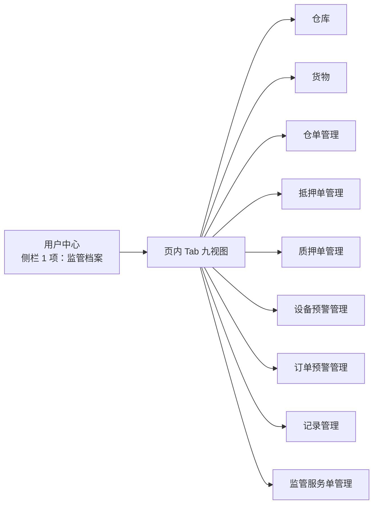

# 监管档案 · 业务规则规格

> **文档定位**：PC「用户中心 → 监管档案」单入口、页内九视图、数据权限与只读跳转规则的唯一真源。下游业务的字段、状态机与操作规则仍以各菜单三件套为准。
>
> **版本**：V1.0 | **更新时间**：2026-11-11
>
> **统一引用规范**：本文件规则编号 **R01~R04**（业务规则）、**P01~P02**（权限规则）、**C01~C02**（异常与边界）。跨菜单引用一律写全名称与编号。

---

## 一、页面定位与导航关系

### 1.1 定位

监管档案是 **按主体聚合的只读门户**：选定一个货主后，把仓库、货物、仓单、抵质押订单、预警、操作记录在一个页面里串起来看；要处理业务，跳转到对应菜单。

### 1.2 与菜单地图的关系

| 维度 | 口径 |
| :--- | :--- |
| 侧栏 | 用户中心下只有 **监管档案** 一项 |
| 页面内 | 九个视图作为顶 Tab 切换，不生成侧栏子菜单 |
| 权限清单 | 保留九行 Tab 权限，用于按钮级授权与验收 |
| 原型路由 | 保留 `/用户中心/监管档案` 及各视图 `?tab=` 参数，供书签与深链 |

---

## 二、业务规则

### 【监管档案单入口与页内视图规则】(R01)

1. **单入口**：PC 侧栏「用户中心」分组下只展示「监管档案」一项，路径固定 `/用户中心/监管档案`；不允许把九个视图展开成侧栏兄弟菜单。
2. **九个视图**：仓库、货物、仓单管理、抵押单管理、质押单管理、设备预警管理、订单预警管理、记录管理、监管服务单管理，以顶 Tab 形式呈现，顺序固定。
3. **先选主体**：进入页面未选择主体时，九个视图统一空态「请先选择监管主体」，不发起业务数据请求。
4. **状态保留**：切换 Tab 保留当前主体与筛选；同一会话内返回页面恢复上次 Tab。
5. **深链**：`?tab=warehouse` 等参数可直接打开指定视图，未授权时回落到第一个有权限的视图。

### 【监管档案数据权限分层规则】(R02)

1. **仓储类视图**（仓库、货物、仓单管理、记录管理、设备预警管理）按账号的 **仓库权限** 过滤；未授权仓库的数据不返回。
2. **订单类视图**（抵押单管理、质押单管理、订单预警管理、监管服务单管理）按账号的 **订单数据权限** 过滤；可见订单才可见其关联货物与预警。
3. **双重交集**：同一主体在不同视图可见范围可以不同，属于正常现象，不视为数据错误；页面不做跨视图强行统一。
4. **租户隔离**：所有查询强制注入租户条件，跨租户数据在任何视图都不可见。
5. **越权防护**：URL 手工传参或接口直调越权主体时，返回空列表并记录安全日志，不返回 403 以外的业务数据。

### 【监管档案只读聚合与跳转规则】(R03)

1. **只读边界**：本页不提供新增、编辑、删除、审批、处理预警等写操作；所有行操作都是跳转。
2. **跳转方式**：统一新标签打开下游详情或办理页，携带 `partnerId`、`archiveMenu=货主信息` 与来源标识；本页不弹业务编辑窗。
3. **参数校验**：跳转前校验目标菜单权限；无权限时按钮置灰并提示「无该菜单权限，请联系管理员授权」。
4. **数据一致性**：本页列表数据为查询时点快照，不订阅实时推送；用户刷新后按最新数据展示。
5. **不反写**：下游处理完成后不回写本页任何字段；重新进入按最新结果展示。

### 【监管档案页内视图授权规则】(P01)

1. **按视图授权**：九个 Tab 分别对应权限清单的一行 Tab 权限；只授目录权限不等于通吃九视图。
2. **未授权隐藏**：无权限的视图不展示 Tab，不占位；全部无权限时展示整页无权限空态。
3. **操作权限**：行操作按钮的可用性由下游菜单的操作权限决定，本页不另行定义新的权限码。
4. **档案跳转**：【查看档案】依赖「货主信息」菜单权限，无权限时只展示主体名称与脱敏证件号。

### 【监管档案页面级操作与筛选规则】(P02)

1. **筛选生效**：筛选条件只作用于当前视图；切换 Tab 后按该视图支持的条件重新校验（如订单类视图忽略仓库条件并提示）。
2. **时间跨度**：业务时间范围起止不得超过 366 天，超出时提示「查询时间跨度不能超过 1 年」。
3. **重置**：恢复四项筛选默认值，但保留当前主体，不重新选择主体。
4. **分页**：每页 10 条，翻页保留筛选与 Tab。

---

## 三、异常与边界

### 【未选择主体或主体失效】(C01)

| 情况 | 系统处理 | 提示 |
| :--- | :--- | :--- |
| 未选择主体进入 | 九个视图空态，不发请求 | 请先选择监管主体 |
| 主体已被合并 | 按合并后主档展示，提示主体已合并 | 该主体已合并至「{新主体}」，已为您切换 |
| 主体被冻结 | 正常展示只读数据，写操作跳转后被下游拦截 | 该主体已冻结，仅可查看 |

### 【跨视图数据不一致】(C02)

| 情况 | 系统处理 | 提示 |
| :--- | :--- | :--- |
| 仓库视图有库存、订单视图无订单 | 正常展示，互不推断 | 无 |
| 同一货物在两个视图数量不同 | 以各视图真源为准，页面不合并计算 | 数据以对应业务菜单为准 |
| 下游单据刚变更、本页未刷新 | 展示查询时点数据 | 数据为查询时点结果，请刷新获取最新 |

---

## 四、数据权限与角色矩阵

| 角色 | 仓库 | 货物 | 仓单 | 抵押单 | 质押单 | 设备预警 | 订单预警 | 记录 | 监管服务单 |
| :--- | :---: | :---: | :---: | :---: | :---: | :---: | :---: | :---: | :---: |
| 平台运营方 | 全部 | 全部 | 全部 | 全部 | 全部 | 全部 | 全部 | 全部 | 全部 |
| 仓储服务方 | 管辖仓 | 管辖仓 | 管辖仓 | 关联订单 | 关联订单 | 管辖仓 | 关联订单 | 管辖仓 | 关联订单 |
| 监管服务方 | 管辖仓 | 管辖仓 | 管辖仓 | 关联订单 | 关联订单 | 管辖仓 | 关联订单 | 管辖仓 | 关联服务单 |
| 资金方 | — | — | — | 关联订单 | 关联订单 | — | 关联订单 | — | — |
| 审计访客 | 只读 | 只读 | 只读 | 只读 | 只读 | 只读 | 只读 | 只读 | 只读 |

> 上表为默认口径；具体账号以权限清单中九行 Tab 的实际授权为准。

---

## 五、修订记录

| 日期 | 版本 | 说明 |
| :--- | :---: | :--- |
| 2026-11-11 | V1.0 | 6.3 合入：建立单入口 + 九视图规则、数据权限分层、只读跳转与授权口径 |
