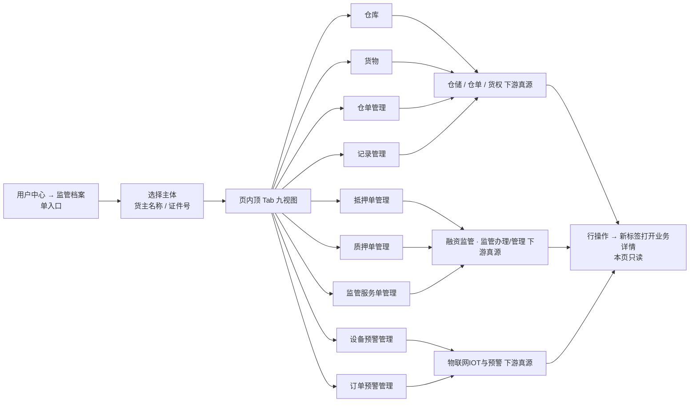

# 监管档案 · 主 PRD

> **文档体系（三件套为核心）**：
>
> | 层级 | 文档 | 职责 | 真源 |
> | :--- | :--- | :--- | :---: |
> | **核心** | 本文（主 PRD） | 业务背景、功能范围、模块定位、**页面功能说明**、业务场景、权限、验收 | ✅ |
> | **核心** | [监管档案字段清单](./监管档案字段清单.md) | 页内九个视图的筛选、列表列、取值与控件规格 | ✅ |
> | **核心** | [监管档案业务规则规格](./监管档案业务规则规格.md) | 单入口与页内 Tab、数据权限、只读聚合与跳转规则 | ✅ |
> | *衍生* | 页内各业务视图的字段与规则 | 由下游菜单三件套承载，本页只做聚合展示 | ❌ |
>
> **版本**：V1.0 | **更新时间**：2026-11-11 | **责任人**：森云科技（Senyun Technology）
>
> **菜单路径**：PC 用户中心 → 监管档案（`/用户中心/监管档案`）
>
> **权限清单**：`2.用户中心 / 监管档案 / 仓库 / 货物 / 仓单管理 / 抵押单管理 / 质押单管理 / 设备预警管理 / 订单预警管理 / 记录管理 / 监管服务单管理`（九个 Tab 各占一行）
>
> **规则引用规范**：本菜单规则编号为 **R01~R04**、**P01~P02**、**C01~C02**；关联业务规则以下游菜单编号为准，不另起别名。

---

## 1. 业务背景与要解决的问题

### 1.1 业务背景

监管员在贷后管理、现场盘库、司法协查时，需要按「一个客户（货主）」看全貌：他名下有哪些仓库在监管、存了什么货、开过哪些仓单和抵质押单、触发过哪些预警、做过哪些操作。过去这些信息分散在仓储、融资监管、物联网预警三个模块，要来回切换菜单、反复输入客户名称。

6.3 把原「项目管理 → 监管档案」迁入 **用户中心**，并收敛为 **一个入口 + 页内九个视图**：选一次客户，九个视图都在同一页切换，不再展开成九个子菜单。

### 1.2 核心痛点

1. **到处找数据**：同一客户的信息分散在多个模块，查一次要开七八个页面。
2. **口径不一致**：各模块各自按仓库或订单过滤，监管员看到的范围不同，容易误判。
3. **权限难对齐**：九个视图对应不同权限粒度，侧栏拆九项后既难授权也难验收。

---

## 2. 功能范围

| 包含 | 不包含 |
| :--- | :--- |
| 单一入口「用户中心 → 监管档案」，页内九个视图切换； 按主体名称、证件号、仓库、状态、时间范围筛选； 仓库 / 货物 / 仓单 / 抵押单 / 质押单 / 设备预警 / 订单预警 / 记录 / 监管服务单九类数据的只读聚合； 列表行操作跳转到对应业务详情（新标签打开）； 按视图粒度控制数据权限与操作权限。 | 在本页新增或修改业务单据； 在本页直接处理预警或审批； 跨租户查询； 为九个视图各建一套独立三件套（各自真源仍在下游菜单）。 |

---

## 3. 模块定位与系统链路

**定位**：监管档案是 **只读聚合门户**，不承载业务写入。字段、状态机、操作规则的唯一真源仍在各下游菜单三件套；本页只负责「按客户串起来看」和「跳过去处理」。

---

## 4. 页面功能说明

### 4.1 页面入口与骨架

1. **入口**：PC 顶栏「用户中心」→ 左侧仅一项「监管档案」；点击进入 `/用户中心/监管档案`；
2. **顶部区**：页面标题「监管档案」+ 当前选中主体卡片（主体名称、类型、脱敏证件号、货主角色状态、【查看档案】）；
3. **筛选区**：主体名称/证件号、仓库、业务状态、业务时间范围，共 4 项 + 【查询】【重置】；
4. **页内 Tab**：仓库、货物、仓单管理、抵押单管理、质押单管理、设备预警管理、订单预警管理、记录管理、监管服务单管理；
5. **列表区**：按当前 Tab 展示对应列与行操作，底栏统一分页（10 条/页）。

> **导航口径**：九个视图是 **页内 Tab 权限**，不是九个子菜单；侧栏只保留「监管档案」一项。权限清单保留九行，用于按钮级授权与验收。

### 4.2 九个视图各自看什么

| Tab | 看什么 | 主要行操作 | 数据权限 |
| :--- | :--- | :--- | :--- |
| 仓库 | 该货主在监管仓库的存货总览 | 详情、待提货、新增入库/出库/移库、货物转让、仓单开立、抵押/质押开立、新增异动 | 仓库权限 |
| 货物 | 按货物规格汇总的在库数量与状态 | 详情、待提货、新增出入库/移库/转让、仓单与抵质押开立 | 仓库权限 |
| 仓单管理 | 该货主的仓单台账与状态 | 详情、仓单出库/开立、变更记录、补货、移库、移除、注销、入库 | 仓库权限 |
| 抵押单管理 | 抵押类监管订单及存续动作 | 详情、操作记录、货物出库、查看资料/风险、置换、加补仓、解抵押、估值、盘点、盘点报告、移库、查看监控、平仓、设备管理、贷款结果录入、监管报告、部分结清、安全线、货物异动、抵押入库、日常监管、风险公示、加工管理 | 订单数据权限 |
| 质押单管理 | 质押类监管订单及存续动作 | 同上（置换质押、解质押、质押入库等） | 订单数据权限 |
| 设备预警管理 | 该货主关联仓库的设备预警流水 | 查看页面、详情 | 仓库权限 |
| 订单预警管理 | 该货主关联订单的押品预警流水 | 查看页面、详情 | 订单数据权限 |
| 记录管理 | 该货主的业务操作与审计记录 | 查看页面、详情 | 仓库权限 |
| 监管服务单管理 | 监管服务类订单及服务动作 | 详情、操作记录、资料管理/上传、置换、加补仓、解抵押、估值、盘点、盘点报告、移库、查看监控、平仓、查看风险、设备管理、服务结果录入、监管报告、服务结算、出库、安全线、货物异动、抵押入库、日常监管、风险公示、加工管理 | 订单数据权限 |

> 行操作的具体字段、按钮置灰条件与状态约束，以下游菜单三件套为准，本页不重复定义。

### 4.3 交互规则

1. **先选主体**：未选择货主时，九个 Tab 均为空态，提示「请先选择监管主体」；
2. **Tab 记忆**：切换 Tab 保留当前筛选条件；从下游页面返回时恢复上次 Tab 与筛选；
3. **行操作跳转**：一律新标签打开对应业务详情或办理页，携带 `partnerId` 与 `archiveMenu=货主信息`；本页不弹业务编辑窗；
4. **空态与无权限**：无某 Tab 权限时该 Tab 不展示；有权限但无数据时展示业务空态文案，不显示报错。

---

## 5. 业务场景

### 场景 1【贷后核查一个客户的全貌】(S01)
* **角色**：监管服务方贷后专员
* **情境**：季度贷后检查，需要核对某货主名下全部在押货物与最近预警。
* **行为**：进入用户中心 → 监管档案，输入货主名称选中主体；依次切换「仓库」「货物」看库存，切到「订单预警管理」看未处置预警，切到「记录管理」看近期操作。发现一条未结案预警后，点击【详情】新标签跳到预警详情处理。
* **结果**：一页看完，处理动作仍在原业务菜单完成，全程只读留痕。

### 场景 2【司法协查调取仓单与抵质押历史】(S02)
* **角色**：风控合规经理
* **情境**：法院来函要求提供某企业历年仓单与抵质押记录。
* **行为**：按统一社会信用代码选中主体，切到「仓单管理」与「质押单管理」，逐条【详情】查看并下载凭证；「记录管理」导出操作审计。
* **结果**：数据范围严格按账号的仓库/订单权限过滤，越权数据不可见。

---

## 6. 权限与安全

1. **菜单授权**：九个 Tab 分别授权；只授「监管档案」目录不等于通吃九视图；
2. **数据权限**：仓储类视图按仓库权限过滤，订单类视图按订单数据权限过滤；
3. **只读边界**：本页不提供新增、编辑、删除、审批入口；所有写操作跳转下游菜单；
4. **审计**：查看详情、下载凭证按下游规则留痕；本页不额外落业务日志。

详见【监管档案单入口与页内视图规则】(R01)、【监管档案数据权限分层规则】(R02)、【监管档案只读聚合与跳转规则】(R03)、【监管档案页内视图授权规则】(P01)。

---

## 7. 验收标准

- [ ] 用户中心侧栏只有「监管档案」一项，进入后九个视图为页内 Tab；
- [ ] 未选主体时九个 Tab 均为空态；
- [ ] 仓库、货物、仓单、设备预警、记录五个视图按仓库权限过滤；
- [ ] 抵押单、质押单、订单预警、监管服务单四个视图按订单数据权限过滤；
- [ ] 任一 Tab 的行操作均新标签打开下游详情，且携带主体与档案域参数；
- [ ] 无某 Tab 权限时该 Tab 不展示，权限清单九行仍可对照。

---

## 8. 修订记录

| 日期 | 版本 | 说明 |
| :--- | :---: | :--- |
| 2026-11-11 | V1.0 | 6.3 合入：建立监管档案单入口 + 九视图三件套，替代原「项目管理 → 监管档案」聚合页口径 |
