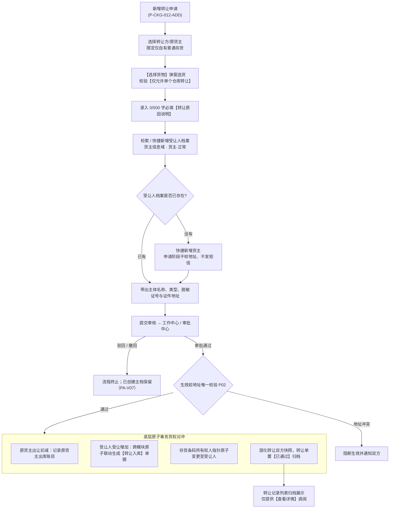

# 转让记录业务规则规格

> **文档定位**：仓储 / 货物转让 / 转让记录模块（单据生命周期、货权纯净性、单仓强阻断、受让新货主二元核验、转让入库跨模块联动、权限控制）所有业务逻辑与交互约束的唯一定义真源。
> 字段定义见 [转让记录字段清单.md](./转让记录字段清单.md)；业务场景见 [转让记录主PRD.md](./转让记录主PRD.md)。
>
> **业务真源与核心底线**：
> - 货物转让是供应链金融存货在仓货权的法定所有权变更，实物储位在物理上可以不移动，但系统货权资产归属必须发生原子级法定转移；
> - 涉及货权转让，系统严格限定**仅允许自有普通存货**转让，处于质押、抵押或仓单管控状态的货物绝对阻断转让；
> - 审批通过时，系统原子触发“原货主货权核销 + 接收方【转让入库】自动生成”，实现跨模块账实对冲闭环；
> - 严禁凭空臆造未在系统采集或核准截图中存在的规则。
>
> **版本**：V1.2 | **更新时间**：2026-09-16 | **责任人**：森云科技（Senyun Technology）

---

## 一、模块业务定位与单据状态机

### 1.1 模块定位与端到端货权流转链路

### 1.2 转让单状态机说明

| 状态编码 | 状态名称 | 状态定义说明 | 业务表现 |
| :--- | :--- | :--- | :--- |
| `DRAFT` | **草稿 (不提供)** | 系统不提供独立草稿箱机制 | 退出新增页即丢弃未保存数据 |
| `PENDING` | **审批中** | 申请已提交，在审批中心流转中 | 在审批中心与“我的申请”展示；原货主对应存货施加转让占用锁 |
| `APPROVED` | **已通过** | 审批流全节点通过，货权变更生效 | **进入本台账归档**；自动联动接收方生成【转让入库】，右上角盖绿色【已通过】印章 |
| `REJECTED` | **未通过** | 审批节点被驳回终止 | 原货主存货转让占用释放；在审批中心查看驳回意见，不进入本台账 |
| `REVOKED` | **已撤回** | 发起人在审批完成前主动撤回 | 释放转让占用，在“我的申请”留痕，不进入本台账 |

---

## 二、列表操作按钮矩阵

转让记录列表操作列保持极简收敛，**仅提供 1 个文字操作按钮**：

| 操作按钮 | 对应权限点 | 按钮表现 | 触发行为说明 |
| :--- | :--- | :---: | :--- |
| **查看详情** | `详情` | 金色高亮 | 调起转让单详情页，展示转让双方主体、时间、500字原因、树形转让货物明细及审批流转记录 |

> **规范边界**：本模块不提供【单据下载】、【下载记录】或列表直接编辑/删除操作，严格以当前线上实际运行界面为准。

---

## 三、核心业务规则与逻辑规格

### 【货权转让纯净性约束】(R01)
1. **纯净存货准入原则**：
   - 货物转让属于法律意义上的所有权转移。为保障供应链金融资金方信贷资产安全，**转让业务仅支持“普通存货转让”**；
   - 任何处于质押中（关联质押单）、抵押中（关联抵押单）或已签发数字仓单（关联仓单编号）的监管货物，均具有法定的担保物权或物权凭证负担，系统严禁直接发起转让。
2. **转让前置解绑规则**：
   - 若客户确需转让质押或抵押中的存货，必须先由借款人履行还款、追加保证金或置换抵质押物手续，在风控平台完成**办结解押**并变更为自有普通存货后，方可进入本模块发起转让。

### 【单仓转让强监管物理阻断】(R02)
1. **同仓转让强闭环**：
   - 单笔转让业务内包含的所有货物，**必须严格位于同一个实体监管仓库内**；系统严禁跨仓库混合勾选与打包转让。
2. **选货弹窗双重阻断拦截**：
   - 在【选择货物】弹窗中，当某货品规格在多个实体仓库均有库存时，一级主行转让数量输入框**直接置灰禁用**，并显示提示文案：**`仅允许单个仓库转让`**；
   - 二级展开明细中，若存在属于其他仓库的库存行，操作列同样以红色文字标明 **`仅允许单个仓库转让`** 予以强行阻断，防止操作员因跨仓误操作造成货权移交与仓储监管混乱。

### 【受让人挂接货主信息域规则】(R03)
> 6.3 合入：废止「接收方 / 待生效」两段式与提交时短信二元建档，受让人直接在【货主信息】档案域挂接或创建。

1. **引用范围**：新增转让页的受让人只从【用户中心 → 合作方档案 → 货主信息】检索，不跨域混选，也不再单独维护「接收方」台账。
2. **存量命中**：输入姓名、身份证号或统一社会信用代码模糊匹配；命中后带出主体名称、主体类型、脱敏证号与证件地址，灰底只读。
3. **新受让人**：无匹配时通过【+ 快捷新增货主】打开与货主信息一致的新增表单，挂接隐式角色 **货主 · 正常**；创建来源标记「转让快捷建档」。
4. **申请阶段不校验地址唯一**：申请提交时不执行【证件登记地址防重复唯一校验与同步阻断规则】(P02)，也不因缺证件地址阻断；地址校验留到生效节点（R09）。
5. **不发送短信**：申请阶段的快捷建档默认「未验证」，不触发短信；受让人验证状态在生效或后续金融业务前按【合作方短信二元身份核验服务规则】(G04b) 处理。
6. **驳回或撤销保留主档**：转让单未完结即驳回/撤销时，已创建的货主主档与货主角色 **保留**（正常态），系统不回收（PA-V07）。

### 【转让生效地址唯一校验与双向快照】(R09)

1. **生效前校验**：终审通过、执行库存与货权转移前，对受让人执行【证件登记地址防重复唯一校验与同步阻断规则】(P02)；个人与企业分池校验，地址冲突 **阻断生效**，单据停在待生效处理状态并通知双方。
2. **通过后转移**：校验通过后在同一事务内扣减转让人库存、生成受让人「转让入库」，并写入货权流转记录。
3. **双向快照**：生效瞬间固化转让人与受让人两份不可变快照，字段至少包含主体标识、主体类型、主体名称、脱敏证件号、证件地址、地址来源、快照角色、准入规则版本、快照时间。
4. **不回写**：双方档案后续改名、改址、冻结解冻，均不回写历史转让单与快照。
5. **历史兼容**：6.3 之前已完结的转让单按原「接收方」文本展示；未完结单据按迁移规则将接收方清洗为货主信息域主档（M-R08）。

### 【转让原因合规必填】(R04)
1. **强合规录入**：
   - 基础信息区必须录入 **`* 转让原因说明`（必填红星）**；
   - 文本框提供 `0/500` 字数统计计数器，未输入说明或超过 500 字阻断提交。
2. **司法存证追溯**：
   - 转让原因说明详细记录货权转让交易背景（如买卖合同编号、货款支付结算依据或企业重组协议），审批通过后固化于详情页【转让原因】，提供法定司法审计举证效力。

### 【跨模块转让入库联动与货权对冲】(R05)
1. **审批流转与库存转让锁**：
   - 转让申请提交后进入审批流。审批未完结前，原货主对应库存位置上的对应数量被系统施加“转让占用锁”，禁止被其他出库、移库或盘点重复锁定。
2. **终审通过跨模块原子对冲**：
   - 审批终审通过时，系统底层数据库事务原子执行对冲：
     1. **原货主货权核销**：在原货主名下扣减该批库存，系统联动生成 1 条 **`出库类型=转让出库`** 的已通过出库记录（写入【出库记录】台账，不生成提货单）；
     2. **受让人跨模块联动入库**：系统在受让人名下自动联动生成 1 张 **`入库类型=转让入库`** 的入库单，单据自动关联原转让单号；
     3. **物理储位与条码资产无缝继承**：货物的物理仓库、库房、分区、具体垛位保持不变，唯一存货条码实物资产的所有权主体指针原子变更至接收方。

### 【详情页纯净无影像展示】(R06)
1. **组件与排版规范**：
   - 详情页顶部展示 19 位转让单号、复制图标、【返回】按钮及绿色【已通过】大圆章；
   - 基础信息网格采用紧凑两列排版，仅展示 6 项核心信息：制单人、制单时间、受让人（带脱敏标识）、转让人（带信用代码/手机号）、转让时间、转让原因。
2. **无照片说明**：
   - 货物转让属于纯货权交易与所有权凭据流转，货物无需物理出入库或调拨，因此**新增表单与详情页均不设【现场照片】与【设备抓拍图】**。

### 【台账终态归档与禁止反冲正】(R07)
1. **归档台账属性**：本台账仅展示终审通过的有效单据，审批中单据在审批中心流转。
2. **禁止线上反审批冲正**：
   - 转让单审批通过即完成法律物权交付，系统不提供线上撤销或反审核功能；
   - 若双方终止交易或需退回货权，必须由受让人作为转让方，反向重新发起一笔新的转让申请并履行审批手续。

### 【货权档案转移与存证互通】(R08)
* **触发时机**：货物转让单终审通过（`APPROVED`）且跨模块对冲完成时；
* **【06-货权档案】互通行为**：
  1. **原货主所有权核销**：在原货主货权档案中扣减该批转让货物库存与货值，生成转让出库流水，物理储位保持不变；
  2. **新货主确立新档案**：在原物理储位为受让人确立新的【所有权】货权档案，初始化受让人在库库存与货值；
  3. **单一所有权原则**：转让仅支持无权利负担的自有普通存货，确保新货主取得纯净无瑕疵所有权。
* **【07-货权公示】互通行为**：
  1. 原货主关联公示记录标记转让流转，固化历史公示事实；
  2. 为新受让人货权档案同步初始化一条【未公示】记录，支持新货主后续生成货权牌与中登网登记。
* **【08-证据管理】互通行为**：
  1. 自动生成一条存证类型=【其他】（细分标记为“货物在仓转让”）流水（受让人端联动生成【入库】流水）；
  2. **转让二元证据固化**：固化转让双方主体实名/企业认证二元信息、500 字转让合同原因说明及受让货品清单快照，杜绝虚假转让与买卖纠纷。

---

## 四、数据权限与角色控制矩阵（RBAC）

| 角色代码 | 角色名称 | 可视数据范围 | 允许的操作权限 |
| :--- | :--- | :--- | :--- |
| `R-SYS-ADMIN` | 系统超级管理员 | 全平台租户与全部仓库转让单 | 查看页面、详情 |
| `R-WMS-OPERATOR` | 仓库监管员 / 操作员 | 当前账号有权限的管辖仓库转让单 | 查看页面、新增转让、详情 |
| `R-WMS-MANAGER` | 仓储主管 | 负责仓库的全部转让单 | 查看页面、新增转让、详情、审批转让 |
| `R-FIN-AUDITOR` | 资方风控审核员 | 所属资金方关联的货主转让单 | 查看页面、详情（只读审计） |

---

## 修订记录

| 日期 | 版本 | 变更内容说明 | 影响范围 | 修订人 |
| :--- | :--- | :--- | :--- | :--- |
| 2026-09-04 | **V1.0** | 建立转让记录最新基准版业务规则规格。 | 全模块 | AI PM / 森云科技 |
| 2026-09-16 | **V1.1** | 规范货权档案所有权转移、公示初始化与证据管理二元证据。 | 货权档案、货权公示、证据管理 | AI PM / 森云科技 |
| 2026-09-16 | **V1.2** | 规则编号全面语义自解释化升级：【规则名称】(Rxx) 格式，中英文规范化与语言去冗余。 | 全文 | AI PM / 森云科技 |
| 2026-11-11 | **V2.1** | **6.3 合入**：R03 改为「受让人挂接货主信息域」，废止接收方/待生效与提交时短信建档；新增【转让生效地址唯一校验与双向快照】(R09)。 | R03、R09 | AI PM / 森云科技 |
