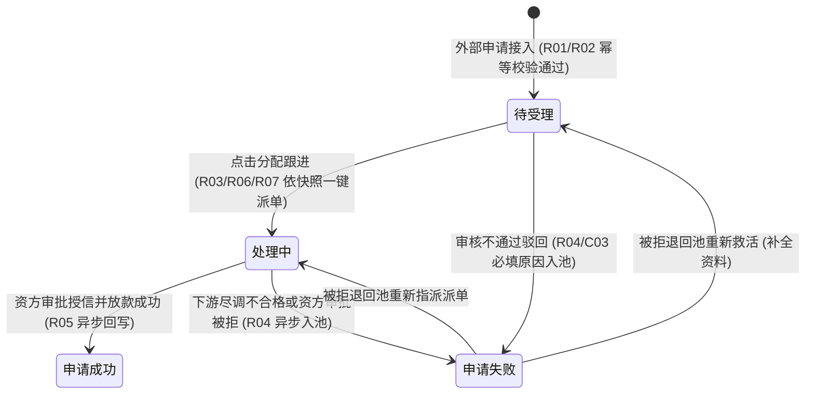

# 客户融资需求线索业务规则规格

> **文档定位**：融资监管 / 融资管理 / 客户融资需求线索模块状态机、动作约束、前置校验规则、路由分流、计算公式、权限与风控规则的**唯一定义真源**。主 PRD、字段清单及端侧原型仅引用本文件规则编号（R01~R08, C01~C03, P01~P03），不重复定义规则本体。  
> **模块类型**：融资业务前置接入单据总台账（涵盖 C 端申请接入、运营资料审核、尽调路由自动分流一键直派、驳回入池及下游状态异步回写）  
> **参考文档**：[《客户融资需求线索主PRD》](./客户融资需求线索主PRD.md)、[《客户融资需求线索字段清单》](./客户融资需求线索字段清单.md)、[《客户融资尽调办理》](../02-融资管理-客户融资尽调办理/)、[《客户融资授信办理》](../03-融资管理-客户融资授信办理/)、[《被拒退回池》](../05-融资管理-被拒退回池/)  
> **移动端对应**：`B端H5/03-业务办理/03-客户需求审批/03-客户融资需求线索`  
> **版本**：V1.3 | **更新时间**：2026-11-12 | **责任人**：森云科技（Senyun Technology）

---

## 一、对象定位与单据层级

| 项目 | 规格内容 |
| :--- | :--- |
| **单据层级** | **【第1层-计划/线索接入层】**（全系统融资监管业务的前置接入流水中枢） |
| **核心职责** | 统一承接外部客户（C 端移动门户或外部系统）提交的动产质押融资申请；固化申请主体、存货/仓单抵质押物及“需要尽调”路由快照；支持运营人员完成信息审核后一键直派跟进（流转至“处理中”）或异常驳回入池（“申请失败”）。 |
| **单据来源** | 外部 C 端移动门户或第三方合作系统通过标准应用程序编程接口（API）自动提交生成。 |
| **上游单据** | **C 端用户融资申请单**：通过标准接口以申请唯一流水号 1:1 创建线索单据，携带申请主体资质、意向融资金额/期数、抵/质押物类型、需要尽调标识和存货/仓单快照。 |
| **下游影响** | 1. **需要尽调=是**：自动生成【客户融资尽调办理】待尽调任务，指派同机构尽调专员，状态更新为“处理中”； 2. **需要尽调=否**：自动生成【客户融资授信办理】授信任务，指派合作资方机构，状态更新为“处理中”； 3. **驳回**：自动写入【被拒退回池 -> 线索被拒标签页】异常归集池，状态更新为“申请失败”； 4. **资方放款**：资方审批放款后异步回写授信与贷款额度，状态变更为“申请成功”。 |
| **审核流** | **【审核与一键直派分流】**（贴合现网老习惯方案 B：在待受理状态下一键分配跟进直接派发或驳回，取消非必要中间受理态）。 |

---

## 二、数量、金额与期数口径隔离表

| 口径名称 | 存在于 | 业务含义与计算公式 | 约束条件 |
| :--- | :--- | :--- | :--- |
| **意向融资金额（万元）** | 线索主表 | 客户在申请时填写的期望融资金额 | 系统自动带出，`意向融资金额 > 0`，单位万元，保留 4 位小数（如 `500.0000万元`），不可手工修改 |
| **意向融资期数** | 线索主表 | 客户期望融资期限（月/期） | 系统自动带出，必须为正整数（`期数 ≥ 1`），不可手工修改 |
| **授信金额（万元）** | 列表/详情回写 | 资方机构最终审批确认并授信的额度 | 本节点初始为空（展示“—”），下游授信成功后异步回写；`0 < 授信金额`，保留 4 位小数 |
| **授信期数** | 列表/详情回写 | 资方机构最终批准的授信期限 | 本节点初始为空（展示“—”），下游授信成功后异步回写；正整数 |
| **贷款金额（万元）** | 列表/详情回写 | 线上抵质押订单实际发放的贷款金额 | 本节点初始为空（展示“—”），下游放款后异步回写；`贷款金额 ≤ 授信金额`，保留 4 位小数 |
| **贷款期数** | 列表/详情回写 | 贷款合同约定的实际还款期限 | 本节点初始为空（展示“—”），下游放款后异步回写；正整数 |

---

## 三、全景业务状态机与时序图

### 1. 状态定义

| 状态名称 | 状态代码 (`Enum`) | 业务含义 | 是否终态 | 进入条件 | 离开条件 |
| :--- | :--- | :--- | :---: | :--- | :--- |
| **待受理** | `PENDING_ACCEPT` | 外部申请成功接入后的初始状态，等待运营人员核验派单 | 否 | 上游接口成功推送申请并创建线索记录 | 点击【分配跟进】派单成功（进入处理中）/ 点击【驳回】（进入申请失败） |
| **处理中** | `PROCESSING` | 已完成路由分配派工，下游正在进行线下尽调或资方授信审核 | 否 | 待受理线索执行【分配跟进】派单成功 | 资方放款完成（进入申请成功）/ 资方审批拒绝（进入申请失败） |
| **申请成功** | `SUCCESS` | 资方授信审批通过并完成抵质押贷款放款 | 是 | 下游资方核心系统放款成功异步回写 | 无（业务完结归档） |
| **申请失败** | `APPLY_FAILED` | 运营审核不准入或资料不合规执行驳回后的状态 | 否（入池待调度） | 运营人员执行【驳回】动作并确认成功 | 在被拒退回池执行“重新救活”或“按路由重新指派” |

### 2. 状态流转时序架构

---

## 四、状态流转表与核心规则矩阵

| 当前状态 | 触发动作 | 前置校验条件 | 结果状态 | 二次确认与交互形态 | 后置级联影响 | 失败阻断提示 (浮窗提示) |
| :--- | :--- | :--- | :--- | :--- | :--- | :--- |
| **未入库** | 接入融资申请 | 【申请要素必填与格式合规校验规则】(R01) 【接口幂等与防重复接入规则】(R02) | 待受理 | 无（接口自动处理） | ① 保存申请主体及存货/仓单快照 ② 继承产品配置带入“需要尽调”快照 (R03) ③ 记录生成时间戳与唯一线索编号 | 接口返回错误响应：“重复申请或数据不完整” (C01) |
| **待受理** | 分配跟进（路由直派） | 【尽调路由判定与快照锁定规则】(R03) 【线索直派与路由分配校验规则】(R06) 需要尽调=是已选尽调专员，或需要尽调=否已选有效资方机构 | 处理中 | 弹出模态表单：「融资线索跟进分配」（方案 A 锁定） | ① 状态更新为“处理中” ② 需要尽调=是：向【客户融资尽调办理】写入待尽调任务 ③ 需要尽调=否：向【客户融资授信办理】写入授信任务 ④ 回写线索最近处理人与处理时间 (R07) | 浮窗提示：“分配失败：缺少有效路由配置或指派目标为空” (C02) |
| **待受理** | 驳回 | 【异常驳回留痕与被拒入池规则】(R04)（驳回原因必填，最多 200 字） | 申请失败 | 弹出模态弹窗：「确认驳回该融资需求？驳回后将进入被拒记录池」 | ① 状态更新为“申请失败” ② 记录驳回原因、处理人与处理时间 ③ 可靠写入【被拒退回池 -> 线索被拒标签页】 | 浮窗提示：“驳回失败：请填写驳回原因” (C03) |
| **处理中** | 资方审批放款回写 | 下游完成授信审批并成功放款 | 申请成功 | 无（系统异步消息驱动） | ① 状态更新为“申请成功” ② 回写授信金额/期数与贷款金额/期数 (R05) ③ 记录最终结单时间戳 | 系统日志记录异步回调异常 |

---

## 五、动作能力矩阵

| 操作动作 | 待受理 (`PENDING_ACCEPT`) | 处理中 (`PROCESSING`) | 申请成功 (`SUCCESS`) | 申请失败 (`APPLY_FAILED`) |
| :--- | :---: | :---: | :---: | :---: |
| **查看详情** | ✅ | ✅ | ✅ | ✅ |
| **分配跟进（路由直派）** | ✅（方案 A 锁定） | ❌ | ❌ | ❌（在被拒退回池操作重新指派） |
| **驳回并填写原因** | ✅ | ❌ | ❌ | ❌ |
| **列表组合筛选与导出** | ✅ | ✅ | ✅ | ✅ |

---

## 六、核心业务规则清单 (R01 ~ R08)

### 1. 准入与幂等接入规则

### 【申请要素必填与格式合规校验规则】(R01)
* **企业货主**：企业名称、统一社会信用代码、经办人姓名、经办人手机号（11 位合规格式）必填；
* **个人货主**：申请人姓名、申请人身份证号（18 位合规校验）、联系电话必填；
* **融资意向**：意向融资金额 大于 0（单位万元）；意向融资期数 不少于 1 且必须为正整数；货物类型必须属于 `['存货', '仓单']`；要素不全阻断生成并返回错误响应。

### 【接口幂等与防重复接入规则】(R02)
* 上游推送请求必须携带全局唯一的外部申请流水号 `apply_request_no`；
* 5 分钟内同一 `apply_request_no` 或相同申请主体在同产品的未终结申请重复提交，系统直接阻断并返回既有线索编号，严禁重复生成多笔单据 (C01)。

### 2. 路由分流与执行规则

### 【尽调路由判定与快照锁定规则】(R03)
* 线索单据生成时，系统读取对应融资产品的“需要尽调”配置（`YES` / `NO`）并永久固化至线索单据快照；
* 后续流转严格依赖该快照执行强行分流锁定（方案 A），不受产品后续规则变更影响，弹窗内禁止人工任意切换模式：
  * **快照为 `YES`**：分配弹窗强行锁定仅展示尽调专员下拉列表，禁止选择资方机构；
  * **快照为 `NO`**：分配弹窗强行锁定仅展示合作资方机构下拉列表，禁止指派尽调专员。

### 【异常驳回留痕与被拒入池规则】(R04)
* 运营人员执行驳回必须在模态弹窗中录入结构化驳回原因及详细说明（最多 200 字），禁止空值提交 (C03)；
* 驳回提交成功后，主单据状态更新为“申请失败”，并通过事务消息可靠投递写入【被拒退回池 -> 线索被拒标签页】；入池记录永久不可物理删除。

### 【融资金额与期数口径隔离规则】(R05)
* 严格执行数量/金额/期数口径隔离规范：意向融资金额、授信金额、贷款金额单位统一为万元，保留 4 位小数（如 `500.0000万元`）；
* 意向融资金额与期数由 C 端输入带入，落库后不可手工修改；授信金额、授信期数、贷款金额、贷款期数在线索阶段初始为空（展示“—”），由下游授信与放款流程完成后异步回写更新。

### 【线索直派与路由分配校验规则】(R06)
* 贴合现网老习惯（方案 B），待受理单据支持在列表行操作或详情页直接点击【分配跟进】一键直派；
* 分配跟进时强校验路由目标有效性，未选定有效专员或资方机构禁止提交流转 (C02)；提交成功后单据状态由“待受理”更新为“处理中”。

### 【下游流转单据自动创建与回写规则】(R07)
* 分配跟进成功后，系统自动在下游对应模块创建流转任务：
  * 需要尽调=是：向【客户融资尽调办理】写入待尽调任务，通知尽调专员；
  * 需要尽调=否：向【客户融资授信办理】写入授信任务，通知资方机构；
* 同步将线索主单据状态变更为“处理中”，回写最近处理人与处理时间戳。

### 【分布式防并发加锁与状态防护规则】(R08)
* 运营在列表或详情点击【分配跟进】或【驳回】时，后端对线索唯一主键 `clue_id` 加 Redis 分布式乐观锁（超时时间 5s）；
* 若已被其他运营人员并发处理，即时返回提示：“*单据已被更新，请刷新列表*”，杜绝重复派单或并发状态覆盖。

---

## 七、异常阻断规则 (C01 ~ C03)

### 【重复申请接入阻断】(C01)
* 命中重复流水号或同一主体存在未办结相同产品线索时，接口拒绝并返回统一错误码。

### 【路由目标配置缺失阻断】(C02)
* 分配跟进时若系统检测到对应机构无有效尽调专员账号，或无可用合作资方，阻断提交并浮窗提示：“*缺少有效路由配置或指派目标为空*”。

### 【驳回必填原因缺失阻断】(C03)
* 驳回原因未填或超过 200 字时，前端即时红字校验拦截，服务端拒绝受理。

---

## 八、权限控制规则 (P01 ~ P03)

### 【基于角色的权限控制与操作鉴权】(P01)
* 严格区分线索查看、分配跟进及驳回操作权限，确保专人专责。

### 【平台运营与资方机构数据范围隔离】(P02)
* 平台初审运营可见全量线索流水；外部合作资方机构仅可查看已分配至本机构的单据。

### 【全路径操作审计日志留痕】(P03)
* 记录分配人、指派目标专员/机构、驳回原因说明及客户端 IP 地址，保障司法证据链完整。

---

## 修订记录

| 日期 | 版本 | 变更内容 | 影响范围 |
| :--- | :--- | :--- | :--- |
| 2026-11-12 | V1.3 | 业务流转采用方案 B（待受理直接分配跟进或驳回，去除非必要已受理态），分配弹窗保持方案 A（基于需要尽调快照强行自动锁定），金额单位规范为万元，状态流转表与动作能力矩阵对齐“待受理/处理中/申请成功/申请失败” | 全文档 |
| 2026-09-16 | V1.2 | 全量规范化重构：确立自解释规则编号体系（R01~R08、C01~C03、P01~P03），规范状态机与流转矩阵 | 全文档 |
| 2026-08-14 | V1.1 | 细化尽调路由与被拒入池逻辑 | 规则细化 |
| 2026-08-01 | V1.0 | 初始建立客户融资需求线索业务规则规格 | 全文档 |
