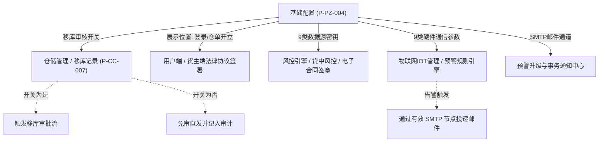
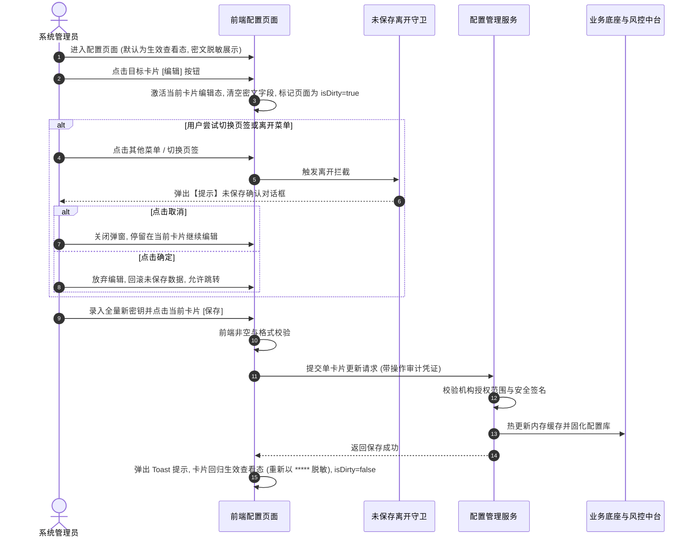

# 基础配置业务规则规格

> **版本**：V1.0 | 2026-10-09  
> **编写依据**：[基础配置主PRD](./基础配置主PRD.md)、[基础配置字段清单](./基础配置字段清单.md)、[功能与数据权限清单](../../00-功能与数据权限/功能与数据权限清单.csv)  
> **真源声明**：本规格书是 SYZC 系统【基础配置】（P-PZ-004）生命周期流转、未保存强阻断、敏感凭证掩码脱敏、卡片级独立保存热生效、协议多触点挂载、SMTP 连通性测试及平台权限隔离的**唯一业务逻辑与技术规则真源（SSOT）**。所有业务规则与交互控件均遵循中文规范与唯一编号体系。

---

## 1. 业务对象与能力边界

### 1.1 业务对象定义
基础配置是 SYZC 平台的顶层中枢控制台，面向当前登录机构及其下辖仓库，集中统管 4 大维度的运行基础：
1. **基础参数**：全局业务风控门禁（移库审核）与终端合规协议体系；
2. **数据源参数**：企业实名、OCR、中仓登、短信、电子签章及 GIS 地图等外部认证接口接入鉴权凭据；
3. **硬件参数**：视频流媒体、环境温湿度传感器、智能挂锁、人脸门禁及车载 GPS 等物联网边缘网关协议；
4. **邮件配置**：支持多节点的 SMTP 预警通知投递通道与连通性验证。

### 1.2 与下游业务模块的联动机制

---

## 2. 状态机与生命周期流转

### 2.1 配置卡片/行级状态定义

| 状态名称 | 适用范围 | 业务含义 | 页面可见特征 | 允许操作 |
| :--- | :--- | :--- | :--- | :--- |
| **未配置** | 数据源/硬件/邮件 | 当前项在系统中尚未录入有效调用凭据 | 输入框为空，或显示默认占位符提示“请输入...” | 【编辑】、【保存】 |
| **生效中 (查看态)** | 全页签所有项 | 配置已成功保存，系统处于正常监听与调用态 | 敏感字段统一以 `*****` 掩码脱敏只读展示，协议与开关正常反显 | 【编辑】、【删除】、【发送测试邮件】 |
| **编辑态 (修改中)** | 卡片/行级/基础页签 | 用户主动触发编辑，输入框解除锁定 | 敏感字段强制清空，输入框高亮供重新录入；页面产生 Dirty 标记 | 【取消】、【保存】、【测试】 |
| **已删除** | 邮件配置行 | 某个 SMTP 服务器节点被用户主动移除 | 列表行被移除，系统注销该节点的邮件路由调度 | — |

---

### 2.2 卡片级编辑与保存流转时序图（Mermaid）

---

### 2.3 状态流转动作矩阵

| 当前状态 | 触发动作 | 触发主体 | 前置条件 | 结果状态 | 异常或提示 |
| :--- | :--- | :--- | :--- | :--- | :--- |
| **生效中 (查看态)** | 点击【编辑】 | 管理员 | 具备页面编辑权限 | **编辑态 (修改中)** | 该卡片敏感项清空，获得焦点 |
| **编辑态 (修改中)** | 点击【取消】 | 管理员 | 处于编辑模式 | **生效中 (查看态)** | 放弃当前录入，还原上一版本脱敏回显 |
| **编辑态 (修改中)** | 点击【保存】 | 管理员 | 当前卡片/表单必填项完整，格式合法 | **生效中 (查看态)** | 校验失败红字提示；成功则 Toast“保存成功” |
| **生效中 (查看态)** | 点击【删除】 | 管理员 | 针对邮件配置行，至少保留一条主节点 | **已删除** | 弹出二次确认弹窗；确认后彻底移除 |
| **编辑态 (修改中)** | 点击菜单离开 | 管理员 | 页面存在 Dirty 未保存修改 | 拦截弹窗 | 提示：“您有配置内容未保存，若直接退出编辑内容将丢失，请确认是否退出？” |

---

## 3. 核心业务规则规格

### 3.1 基础参数配置规则 (CFG-R 系列)

#### 【移库审核全局拦截与免审直通规则】(CFG-R01)
* **规则描述**：
  1. **开关为“是”（默认）**：全系统下辖所有实体仓库，凡发起移库申请（包括计划移库、紧急移库），强制进入「工作中心 → 审批中心」的移库审核专道；在审核通过并获取开锁指令前，物理设备禁止解锁，存货货位状态处于【移库锁定】；
  2. **开关为“否”**：现场仓管员发起移库操作时，系统直接放行执行，自动完成货位扣减与移入记账，并自动在系统审计流水中打上 `approval_required=false` 标签以供事后审计。
* **生效机制**：开关保存后秒级热生效，**遵循历史流水不回写原则**，不追溯影响已在审批中的存量移库单据。

#### 【协议展示位置与动态多组维护规则】(CFG-R02)
* **规则描述**：
  1. **展示位置白名单**：每组协议的展示位置下拉框严格受限于两档枚举：`登录` (LOGIN)、`仓单开立` (RECEIPT_ISSUE)；
  2. **协议组数量约束**：系统支持配置 $1 \sim 20$ 组协议；当列表中仅剩余 1 组协议时，该组的【删除一组】按钮置灰禁用，确保系统至少保留 1 组基础合规协议；
  3. **标题唯一性与字数限制**：单组协议名称必填，限制 $1 \sim 50$ 字符，同展示位置下协议名称禁止重复；
  4. **添加一组行为**：点击【+ 添加一组】，在末尾追加默认展示位置为“登录”、协议名称为空、文件未上传的空白配置项。

#### 【协议附件格式与大小限制强校验规则】(CFG-R03)
* **规则描述**：
  1. **格式白名单**：仅允许上传 `.jpg`, `.jpeg`, `.png`, `.pdf` 格式文件；若用户尝试上传 `.doc`, `.xls`, `.zip` 或可执行文件，前端选择器与后端网关强校验拦截，报错：`“仅支持上传图片和pdf格式文件”`；
  2. **文件容量上限**：单份协议附件大小严禁超过 $20\text{MB}$；
  3. **存证固化**：上传成功后，系统计算文件 SHA-256 哈希值并写入安全存储（OSS），终端用户在签署时调阅的是固化哈希版本。

---

### 3.2 未保存交互与安全防泄露规则 (CFG-R 系列)

#### 【未保存离开强阻断拦截规则】(CFG-R04)
* **规则描述**：
  1. **Dirty 状态检测**：当用户在【基础参数配置】修改了开关或协议，或在【数据源参数】、【硬件参数】、【邮件配置】中点击了任意卡片的【编辑】并产生键盘输入时，页面全局上下文标记 `isDirty = true`；
  2. **拦截触发场景**：在 `isDirty = true` 期间，用户点击切换顶栏 4 个页签、点击左侧导航栏其他菜单、点击浏览器刷新或前进/后退时，系统立即阻断页面切换，并弹出模态二次确认弹窗；
  3. **弹窗选项行为**：
     - 点击【取消】：关闭弹窗，停留在当前编辑卡片，数据完好保留；
     - 点击【确定】：关闭弹窗，清除 Dirty 状态，放弃未保存的所有改动，执行跳转。

#### 【全字段敏感凭据脱敏与清空重录防泄露规则】(CFG-R05)
* **规则描述**：
  1. **绝对脱敏原则**：为防止机构间屏幕窥探或截屏泄露，所有 ApiKey、SecretKey、AppId、AppSecret、AppKey、Token、服务端 AK、数字证书密码、发件人密码及短信签名，在已配置的查看状态下**一律以 5 个星号（`*****`）掩码展示**，后端接口严禁向前端明文返回上述机密字段；
  2. **清空重录机制**：用户点击某卡片的【编辑】按钮时，系统并不将密文还原为明文，而是**强制清空该卡片内的所有密文输入框**，强制用户必须全量重新键入新的有效密钥再提交保存，从根源杜绝因局部修改引发的未知凭证残留风险；
  3. **安全置顶警示**：数据源与硬件参数页签顶部强制常驻红色星号安全提醒，向管理员明确此项保密机制。

---

### 3.3 数据源与硬件独立生效规则 (CFG-R 系列)

#### 【数据源参数独立卡片热生效规则】(CFG-R06)
* **规则描述**：
  1. **卡片级独立保存**：数据源纳管的 9 大类别（企业四要素、营业执照OCR、房产登记、个人二元、验证码短信、通知短信、地图、实人一体、电子签章）各自拥有独立的 `[ 编辑 ]` 与 `[ 保存 ]` 交互闭环；
  2. **局部热同步**：点击某一卡片的【保存】时，系统仅对该卡片内涉及的表单项执行完整性校验并提交更新，风控底座仅针对该接口进行热加载重载，绝对不影响其他 8 类数据源的平稳运行；
  3. **电子签章特殊校验**：电子签章卡片保存时，系统后台通过证书解密口令与别名尝试加载证书公私钥对，验证证书链有效性及有效期；若密码错误或证书已过期，阻断保存并精准提示：`“证书文件解析失败或证书密码错误，请核实后重试”`。

#### 【硬件参数独立卡片热生效与网关路由规则】(CFG-R07)
* **规则描述**：
  1. **独立保存粒度**：赛达监控、芯途监控、赛达温湿度、芯途锁、享宇智能挂锁等 9 类硬件参数各自独立保存；
  2. **通信协议强校验**：
     - 赛达监控：存储类型限定于 `1-云存` / `2-本存`；直播流协议限定于 8 档枚举；监控报警服务商限定于 `monitorSd` / `monitorXtyg`；
     - 芯途异构监控：直播流协议限定于 `rtmp` / `flv` / `hls`；
  3. **空配置防死锁**：若某类硬件设备尚未采购或接入，其参数卡片允许处于未配置状态；当仓库现场首次绑定该品牌设备时，设备服务层会前置校验该卡片是否已完成参数配置，未配置时拦截设备激活。

---

### 3.4 邮件通道与连通性验证规则 (CFG-R 系列)

#### 【SMTP 邮件服务多节点调度规则】(CFG-R08)
* **规则描述**：
  1. **多节点冗余纳管**：系统支持维护多条有效 SMTP 发信配置行，作为全平台预警升级邮件通知的可用发信池；
  2. **端口与 SSL 联动**：端口输入常用 465 时，发信通道默认启用 SMTPS (SSL/TLS) 加密通信；端口输入 25 时使用 STARTTLS/明文传输；
  3. **删除保护**：当列表存在至少一条有效邮件配置且正在被预警通知规则引用时，删除该行前弹出强二次确认提示。

#### 【SMTP 邮件连通性即时测试规则】(CFG-R09)
* **规则描述**：
  1. **触发与输入**：点击任一配置行的【发送测试邮件】按钮，系统弹出【测试邮件发送】对话框，提供单行文本输入框：`* 请输入接收测试邮件的邮箱地址`；
  2. **实时握手探测**：用户录入收件邮箱并点击弹窗【确定】后，系统后端立即调度当前行的 SMTP 配置发起网络 Socket 握手、EHLO 指令、AUTH LOGIN 密码验证，并向目标收件邮箱投递一封固定标题为 `【森云科技 SYZC】系统邮件服务连通性测试报告` 的验证邮件；
  3. **结果即时反馈**：
     - 成功：弹窗自动关闭，页面弹出绿色 Toast 提示：`“测试邮件已发送成功，请查收”`；
     - 失败：弹窗不关闭，红色文字展示精准故障原因（如 `SMTP 身份鉴权失败（535 Authentication failed）` 或 `无法连接至服务器端口（Connection timeout）`）。

---

## 4. 权限与风控约束 (CFG-P 系列)

#### 【基础配置菜单访问与分级鉴权规则】(CFG-P01)
* **规则描述**：
  1. 进入【配置管理 / 平台管理 / 基础配置】菜单必须具备系统分配的查看权限代码；
  2. 各页签内部的【编辑】、【保存】及【删除】按钮受操作权限受控：普通业务操作员或审计员仅拥有纯文本只读权限，页面隐藏所有操作按钮。

#### 【机构数据源与硬件授权白名单隔离规则】(CFG-P02)
* **规则描述**：
  1. 机构系统管理员登录时，【数据源参数】与【硬件参数】页签展示给该机构的卡片列表，**严格受限于上级平台端赋予该机构权限内的白名单**；
  2. 若某机构未向平台开通“芯途异构锁设备”或“房产登记（中仓登）”业务权限，对应卡片在前端强制隐藏或置灰标识为 `“未向平台申请该功能授权”`，严禁越权注入配置。

#### 【配置变更全生命周期审计留痕规则】(CFG-P03)
* **规则描述**：
  1. 基础配置中任一参数的保存、编辑、删除或测试行为，均属于高危系统级操作，系统必须在后台 `sys_config_audit_log` 表中强行写入审计日志；
  2. 审计要素包括：操作人账号、操作人真实姓名、所属机构、操作时间戳、客户端 IP 地址、配置板块、变更动作、变更字段及**变更前后的脱敏数据镜像**；
  3. 审计日志严格遵循司法存证防篡改原则，禁止任何人通过前台或常规后台接口修改或清除。

---

## 5. 附录：跨模块承接映射与修订记录

### 附录 A：跨模块承接映射表

| 承接名称与编号 | 触发动作 | 来源对象 | 目标对象 | 承接规则与后置影响 | 失败补偿与兜底 | 关联规则 |
| :--- | :--- | :--- | :--- | :--- | :--- | :--- |
| 【移库审核状态联动】(XMOD-01) | 基础参数保存 | 移库审核开关 | 移库申请单发起接口 | 实时读取开关值：为“是”则单据走审批流；为“否”走免审直发 | 开关状态读取异常时默认回退为“是”（安全优先） | 【移库审核规则】(CFG-R01) |
| 【协议触点动态分发】(XMOD-02) | 协议配置保存 | 协议配置列表 | 登录页 / 仓单开立页 | 按展示位置过滤已生效协议，前端以弹窗或底部链接渲染 | 文件缺失时隐藏对应链接并上报系统警告 | 【协议展示规则】(CFG-R02) |
| 【预警邮件通道调用】(XMOD-03) | 物联网告警升级 | 邮件配置列表 | 预警升级调度任务 | 轮询调用有效的 SMTP 服务器节点发送预警通知邮件 | 主节点发送失败时自动故障转移重试备用节点 | 【SMTP多节点调度】(CFG-R08) |

---

### 附录 B：修订记录

| 版本 | 修订日期 | 修订内容 | 修订人 | 审核人 |
| :--- | :--- | :--- | :--- | :--- |
| **V1.0** | 2026-10-09 | 依据最新系统截图与历史资料，完成基础配置业务规则规格编制发布 | 产品团队 | 系统架构组 |
