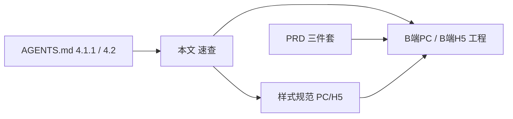

# 原型页面布局速查（PC / H5）

> **用途**：新建或改版 `B端PC` / `B端H5` 页面前 **先读本文**；条文真源在样式规范 Markdown，本文只做索引、检查清单与已落地样例对照。  
> **全局入口**：根目录 [`AGENTS.md`](../AGENTS.md) **4.1.1**（布局）+ **4.2**（标注三件套）+ **4.2.1**（双端标注对齐）。  
> **双端标注**：[`原型双端标注对齐说明.md`](./原型双端标注对齐说明.md)（H5 不得另写一套业务正文）。

---

## 1. 页面类型 → 规范文档（条文真源）

| 页面类型 | PC 规范 | H5 规范 |
| :--- | :--- | :--- |
| **列表** | [样式规范- PC端/02](./样式规范-%20PC端/02-PC端列表页与筛选区规范.md) | [样式规范- H5端/02](./样式规范-%20H5端/02-移动端列表页设计与交互规范.md) |
| **详情** | [样式规范- PC端/03](./样式规范-%20PC端/03-PC端详情页子板块规范.md) | [样式规范- H5端/03 §3](./样式规范-%20H5端/03-移动端详情页与时间线规范.md) |
| **新增/编辑 · 配置/多策略** | [样式规范- PC端/04](./样式规范-%20PC端/04-PC端新增编辑与配置页规范.md) | —（复杂配置优先 PC；H5 以查阅为主） |
| **新增/编辑 · 仓储/单据分步** | PC：04 §7 + 基本信息/明细 Card；简单字段可单页提交 | [样式规范- H5端/04 §5](./样式规范-%20H5端/04-移动端表单与新增编辑规范.md) |
| **模块壳层 / 工作中心** | [PC 01](./样式规范-%20PC端/01-PC端整体架构与页面骨架规范.md) · [`AGENTS.md` 4.3](../AGENTS.md) | [H5 01](./样式规范-%20H5端/01-移动端整体架构与导航规范.md) |
| **色彩 / 表格** | [PC 05](./样式规范-%20PC端/05-PC端色彩与表格视觉规范.md) | [H5 05](./样式规范-%20H5端/05-移动端色彩与视觉系统规范.md) |

规范总览：[PC README](./样式规范-%20PC端/README.md) · [H5 README](./样式规范-%20H5端/README.md)

---

## 2. 硬性布局要点（防遗忘）

| 端 | 列表 | 详情 | 新增/编辑 |
| :--- | :--- | :--- | :--- |
| **PC** | 筛选 Card + `lg:grid-cols-4` 默认 **4** 项 +「展开筛选」；draft/applied 分离；`WarningFilterHeader` | 多块 `DetailSection`；`DetailField` **上 label 下 value**；内容区 **4 列**栅格 | 配置类：多 Card、逐块保存、业务 Dialog、Dirty 拦截 |
| **H5** | 搜索 + 状态胶囊 + **筛选抽屉**（等价 PC 筛维度）；三段式列表卡片 | 子板块标题 + 块内字段；**≤2 层** Card | **步骤条** + 分组 Card + 吸底按钮；分步校验 |

---

## 3. 工程组件（PC 复用）

| 能力 | 位置 |
| :--- | :--- |
| 详情板块/字段 | `B端PC/src/shared/components/DetailSection.tsx` + `index.css` `.detail-section` / `.detail-field` |
| 筛选头 / 分页 | `B端PC/src/components/business/WarningListPrimitives.tsx` |
| 筛选栅格惯例 | `grid gap-4 lg:grid-cols-4`，展开项 `expanded && …` |
| **上线说明 vs 规格对照** | `@prototype/B端PC/src/components/form/ProductFieldHint` + `PrototypeSpecCallout`（PC 经 `B端PC/src/components/form/` 再导出）；文案真源 `*-ui-labels.ts` 的 `*_USER_*` / `*_SPEC_*` |

H5 步骤条样式参照：`B端H5/src/features/inbound-records/components/NativeInboundStepBar.tsx`

---

## 4. 已落地样例（验收对照 · 非条文真源）

实现或评审时若与样式规范冲突，**以样式规范为准**；样例仅用于快速对齐观感。

| 类型 | PC 样例 feature | H5 样例 feature |
| :--- | :--- | :--- |
| 列表 | `device-warning-events`、`collateral-warning-events` | 同主题 H5 预警列表（若有）或按 02 规范新建 |
| 详情 | 同上 `*DetailPage` + `DetailSection` | 按 03 §3 子板块 |
| 配置表单 | `order-warning-configs`、`device-warning-configs` | — |
| 仓储表单 | `inbound-records`（PC 筛选/详情/表单） | `inbound-records` + `NativeInboundStepBar` |

---

## 5. 构建前检查清单（Agent / 研发）

**每一套新页面（列表 + 详情 + 表单）交付前勾选：**

- [ ] 已读本文 **第 1～2 节** 及对应终端样式规范章节
- [ ] PC 列表：筛选区是否 **默认仅 4 项**、其余在展开区？
- [ ] PC 详情：是否 **禁止** 左右表格行 Label-Value？是否使用 `DetailSection` / `DetailField`？
- [ ] PC 配置/复杂编辑：是否分块保存与 Dirty/Dialog 符合 04？
- [ ] H5 列表：筛选是否 **抽屉/胶囊** 而非首屏堆叠大量控件？
- [ ] H5 分步单据：是否有 **步骤条** + 分组 Card + 吸底提交？
- [ ] 字体与排版约束：全站首选 **`PingFang SC`（苹方）**；**严禁**在单号、时间、数量等常规业务列滥用 `font-mono`；业务单号**禁止截断**（预留足够宽度 + `whitespace-nowrap`）；Sticky 操作列**必须**使用 100% 不透明实体背景（防横向滚动文字穿透）。
- [ ] 标注：`PrototypeDocument` 三件套 + `AGENTS.md` 4.2 打点（与布局并列，不省略）
- [ ] 表单辅助文案：用户可见说明用 **ProductFieldHint**；含 P/R 编号、PRD 引用用 **PrototypeSpecCallout**，禁止混在同一段灰字里
- [ ] UI 移植场景：[`UI移植追踪.md`](./UI移植追踪.md) — 只换 UI，不改状态机/按钮语义

---

## 6. 与其他文档关系

