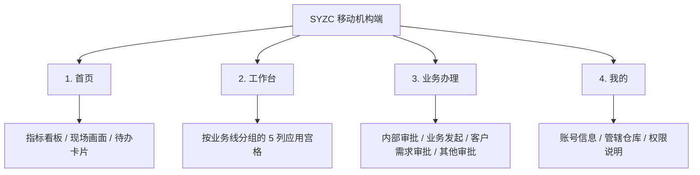

# 01-移动端整体架构与导航规范

> 本章管「页面外面那一圈」：外壳、标题栏、底部四大 Tab、滚动隔离、返回逻辑。
> 色值与字号见 [05-色彩、字体与视觉系统规范](./05-移动端色彩与视觉系统规范.md)。

---

## 1. 四大主场景（底部常驻 Tab）

H5（机构端）固定四个 Tab，常驻底部，顺序不可调换：



| Tab | 路由 | 说明 |
| :--- | :--- | :--- |
| 首页 | `/m/home` | 经营与风控总览 |
| 工作台 | `/m/workspace` | 全部功能入口（二级、三级页面从这里进） |
| 业务办理 | `/m/tasks` | 审批与发起的待办聚合 |
| 我的 | `/m/profile` | 账号、权限、仓管辖范围 |

---

## 2. 外壳与视口

### 2.1 现状（按工程实际情况）

H5 原型**直接铺满浏览器视口**，没有外加手机外壳：

- `MobileShell` 是 `relative flex flex-1 flex-col h-full w-full min-h-0 overflow-hidden bg-[#edf2f8]`。
- 页面高度 100%（`html / body / #root` 都是 `height:100%`）。
- 想在电脑上看得像手机，用浏览器的设备模拟（390 × 844）或右侧标注面板的机型预设，**不要**在代码里写死 `max-w-[390px]`。

> 旧版规范里 `h-screen sm:h-[844px] max-w-[390px]` 的示例代码与实现不符，已删除。

### 2.2 三段式纵向结构

```text
┌──────────────────────────────┐
│ 标题栏 NavBar / 页面标题（44px，固定） │  shrink-0
├──────────────────────────────┤
│ 内容区（独立滚动）                    │  flex:1; min-height:0; overflow-y:auto
│                              │
├──────────────────────────────┤
│ 底部 Tab 栏（56px，固定）             │  shrink-0
└──────────────────────────────┘
```

**硬性要求**：

1. 外壳 `overflow-hidden`，内容区自己滚，底栏永远不被顶出屏幕。
2. 内容区必须带 `min-h-0`，否则 flex 子项撑破外壳、滚动失效。
3. 二级页面没有底部 Tab 栏，改为底部操作栏或吸底按钮（见 04 表单规范）。

---

## 3. 标题栏（NavBar）

二级页面（列表、详情、表单）统一用 `NavBar` 组件（`B端H5/src/components/layout/NavBar.tsx`）。

| 元素 | 规格 |
| :--- | :--- |
| 高度 | `44px`，`sticky top-0`，白底，底部分割线 `#e5e7eb` |
| 左右内边距 | `12px` |
| 返回按钮 | `36px × 36px` 圆形，点击态浅灰底，左箭头 20px |
| 标题 | `16px` 粗体、居中、单行、超长省略（最多占宽 55%） |
| 右侧插槽 | 至少 36px 宽，放操作图标或文字按钮 |

四个 Tab 首页**不用 NavBar**，用页面自带的标题栏：高 `44px`、标题 `18px` 粗体、右侧一个功能图标（如工作台的宫格图标）。

---

## 4. 底部 Tab 栏

| 元素 | 规格 |
| :--- | :--- |
| 高度 | `56px`（`h-14`） |
| 背景 | 白色 95% + 背景模糊（`bg-white/95 backdrop-blur-md`），顶部 1px 分割线 |
| 图标 | `22px`，未选中描边细、选中描边加粗并轻微放大 |
| 文字 | `11px` |
| 未选中 | 灰 `#9ca3af` |
| 选中 | 蓝色 `#1875f0` + 加粗（历史色，见 05 第 1.1 节） |
| 点击反馈 | `active:scale-95` |

- 角标（待办数）用红色圆点，放在图标右上角。
- 底栏不参与页面滚动，也不随键盘弹起而隐藏（原型不做键盘适配）。

---

## 5. 滚动隔离

### 5.1 组件

列表页统一用 `TabScrollLayout`（`B端H5/src/components/layout/TabScrollLayout.tsx`）：**固定筛选头 + 下方独立滚动区**。

```text
<MobileShell>
  <NavBar />
  <TabScrollLayout header={<筛选区 />}>
    <列表滚动区 />
  </TabScrollLayout>
</MobileShell>
```

### 5.2 标注打点注意

给列表滚动区加标注打点时，包裹层必须用 `H5_SCROLL_HOST`（`relative flex min-h-0 flex-1 flex-col`），否则外层 `relative` 块不参与 flex，列表会滚不动。这是踩过的坑，源码里有注释，别再用普通 `div` 包一层。

---

## 6. 返回逻辑

1. **一律优先浏览器历史后退**（`navigate(-1)`），不要硬编码 `backTo="/"` 或写死某个列表页。
   - 从「工作台」进存货管理，返回回到「工作台」；从「业务办理」进客户入库需求，返回回到「业务办理」。
2. 深度链接（外部推链、扫码进入）没有历史可退时，才用 `handleStackBack(navigate, location, fallbackPath)`：优先用路由 state 里的 `returnTo`，其次历史后退，最后 `replace` 到兜底列表页。
3. 表单提交成功、外部推送等特殊链路，才允许显式跳到指定页面（例如提交成功后回 `/m/tasks`）。
4. 当前页有未保存改动时，返回要先弹确认（见 04 第 7 节）。

---

## 7. 三类页面骨架

### 7.1 列表页

```text
标题栏（NavBar：列表名）
筛选区（固定，不随列表滚动）
  ├─ 搜索框 + 状态胶囊 / 下拉胶囊行
  └─「更多筛选」→ 底部筛选抽屉
列表滚动区（卡片列表，12px 间距）
```

细则见 [02-列表页设计与交互规范](./02-移动端列表页设计与交互规范.md)。

### 7.2 详情页

```text
标题栏（NavBar：详情名）
摘要卡（单号 + 状态 + 关键信息）
分页签（可选：明细 / 审核记录 / 修改记录 / 资料）
板块列表（SectionCard）
底部操作栏（可选，吸底）
```

细则见 [03-详情页与时间线规范](./03-移动端详情页与时间线规范.md)。

### 7.3 新增 / 编辑页

```text
标题栏（NavBar：表单名）
步骤条（多步单据才有）
分组表单卡（原生行式或标签在上式）
吸底按钮栏（安全区适配）
```

细则见 [04-表单与新增编辑规范](./04-表单与新增编辑规范.md)。

---

## 8. 安全区

所有吸底元素（按钮栏、Tab 栏、弹层底部）必须处理 iPhone 底部安全区：

```text
padding-bottom: calc(0.75rem + env(safe-area-inset-bottom))
```

- 目前工程里有 `calc(...+env(...))` 与 `max(...)` 两种写法，**统一用 `calc` 这一种**。
- 吸底卡片、抽屉的底部按钮区同样要加，否则在真机上会被小白条挡住。

---

## 9. 反面设计

| ❌ 禁止 | ✅ 应做 |
| :--- | :--- |
| 整页滚动，底栏被顶走 | 外壳固定高度，内容区独立滚动 |
| 返回写死 `backTo="/"` | `navigate(-1)` + `handleStackBack` 兜底 |
| 二级页面也挂底部四大 Tab | 二级页用返回 + 底部操作栏 |
| 页面里写死 `max-w-[390px]` 手机框 | 用浏览器设备模拟看效果 |
| 标注包裹层用普通 `div` 导致列表滚不动 | 用 `H5_SCROLL_HOST` |
| 吸底按钮不加安全区 | `calc(0.75rem + env(safe-area-inset-bottom))` |
| 标题栏高矮不一、标题字号乱飘 | 统一 44px / 16px 粗体 |
