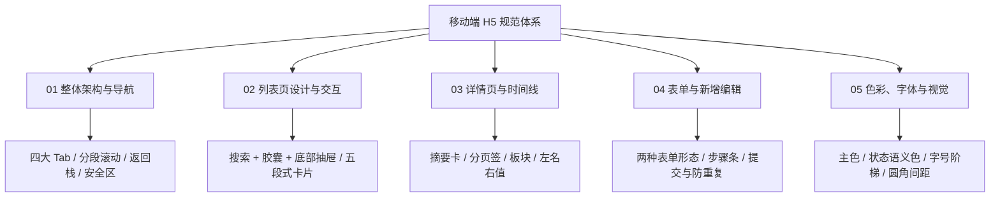

# 📱 SYZC 移动端（H5）页面布局与视觉规范

> **版本**：v1.1（2026-10-29 修订）
> **适用终端**：森云科技 · SYZC 供应链金融存货监管系统 —— 移动机构端（H5 / 小程序）
> **构建前入口**：[`../原型页面布局速查.md`](../原型页面布局速查.md) · 全局 [`AGENTS.md`](../../AGENTS.md) 4.1.1

---

## 0. 本次修订（v1.0 → v1.1）

v1.0 按「设计理想态」写，与已落地的 `B端H5` 有多处对不上。v1.1 做了一次**规范对齐实现**的校准：

| 章节 | 改了什么 |
| :--- | :--- |
| 01 架构与导航 | 删除与实现不符的 390px 手机外壳示例；补齐 `NavBar`、底部 Tab 栏、滚动隔离、返回逻辑、安全区的真实参数 |
| 02 列表页 | 筛选从「右侧抽屉」改为「搜索 + 胶囊 + **底部**抽屉」；卡片结构改为实现里的五段式；补充单号在 H5 可截断的口径 |
| 03 详情页 | 字段排布从「名在上值在下」改为**左名右值**（实现主流）；补充摘要卡、分页签、`SectionCard` 竖色条语义 |
| 04 表单 | 修正章节编号错乱（原 1→2→5→3）；补充「原生行式 / 标签在上式」两种形态；区分「内容末尾按钮」与「固定吸底栏」两种提交方式 |
| 05 视觉 | 主色从 `#1875f0` 校正为实际在用的 `blue-600`；补齐 `#232D39` 中性色系、完整状态语义色、圆角与间距规则 |

> 业务原则（三维权限穿透、物权流向等）已不属于样式规范范畴，保留在 `AGENTS.md` 与各菜单 PRD 中。

---

## 1. 规范总览

**阅读顺序建议**：先看 05 的第 1 节（主色口径），再看与当前任务对应的页面章节。

---

## 2. 规范文档索引

| 序号 | 规范文档 | 核心内容 |
| :---: | :--- | :--- |
| **01** | [整体架构与导航规范](./01-移动端整体架构与导航规范.md) | 四大 Tab、外壳与视口、标题栏、底栏、滚动隔离、返回逻辑、安全区 |
| **02** | [列表页设计与交互规范](./02-移动端列表页设计与交互规范.md) | 两层筛选（胶囊 + 底部抽屉）、五段式卡片、操作收敛、空态 |
| **03** | [详情页与时间线规范](./03-移动端详情页与时间线规范.md) | 摘要卡、分页签、板块竖色条、左名右值、审批记录、吸底操作栏 |
| **04** | [表单与新增编辑规范](./04-表单与新增编辑规范.md) | 原生行式 / 标签在上式、步骤条、底部弹层、提交与离开拦截 |
| **05** | [色彩与视觉系统规范](./05-移动端色彩与视觉系统规范.md) | 主色与中性色、状态语义色、工作台配色、字号阶梯、圆角间距 |

### 2.1 页面类型速查

| 页面类型 | 遵循文档 | 一句话要点 |
| :--- | :--- | :--- |
| 台账列表 | 02 | 搜索 + 胶囊筛选 + 底部抽屉；五段式卡片，操作一行最多 4 个胶囊 |
| 台账详情 | 03 | 摘要卡 + 板块；字段左名右值；无数据不渲染板块 |
| 分步新增/编辑 | 04 | 步骤条 + 分组卡 + 末尾全宽按钮或吸底栏 |
| 工作台 / 首页 | 01 + 05 | 5 列图标宫格；按分组循环取色 |

---

## 3. 工程对照（条文 → 代码）

新页面直接复用下列实现，**不要另起一套**：

| 能力 | 真源文件 |
| :--- | :--- |
| 外壳 / 标题栏 / 底栏 / 固定筛选布局 | `B端H5/src/components/layout/`（`MobileShell`、`NavBar`、`BottomTabBar`、`TabScrollLayout`） |
| 交互色与通用样式常量 | `B端H5/src/shared/h5-ui-theme.ts` |
| 返回逻辑 | `B端H5/src/shared/navigation/stack-back.ts`（`handleStackBack`） |
| 详情板块 | `B端H5/src/components/ui/SectionCard.tsx` |
| 字段键值 / 折叠块 | `B端H5/src/components/ui/Accordion.tsx`（`KeyValue`、`AccordionItem`） |
| 筛选胶囊 / 筛选抽屉 | `B端H5/src/components/ui/DropdownFilterPill.tsx`、`FilterDrawer.tsx` |
| 操作面板 / 轻提示 | `B端H5/src/components/ui/ActionSheet.tsx`、`Toast.tsx` |
| 表单分组卡 / 行 | `B端H5/src/features/inbound-records/components/NativeInfoCard.tsx`、`NativeFormRow.tsx` |
| 步骤条 | `B端H5/src/features/inbound-records/components/NativeInboundStepBar.tsx` |
| 底部选择面板 | `B端H5/src/features/inbound-records/components/MobileDownSelectSheet.tsx` 等 |
| 资料管理页签 | `B端H5/src/shared/document-management/`（`DocumentManagementTab`） |
| 标注滚动区约束 | `h5-ui-theme.ts` 的 `H5_SCROLL_HOST` / `H5_SCROLL` |

---

## 4. 已知偏差与收敛计划

以下是「规范已写明、工程尚未对齐」的项，**新页面按规范写，老页面顺路修**：

| 优先级 | 偏差 | 影响面 | 处理方式 |
| :--- | :--- | :--- | :--- |
| 高 | 主色三套并存：正文 `blue-600`、底栏与工作台 `#1875f0`、PC `#165dff` | 全站 | 先定一个蓝，再改 `BottomTabBar` 与工作台配色数组（19 处）；是否与 PC 同色需拍板 |
| 高 | 页面底色三种：`#edf2f8` / `#f4f6f8` / `#f4f5f7` | 全站 | 统一 `#edf2f8`，搜索框保留 `#f4f5f7` |
| 中 | 卡片圆角曾 12px / 16px 两套（入库卡 16px） | 全站 | ✅ 已统一：`H5_CARD` 与 `RecordCard` 均为 12px，工作台分组卡保留 16px 特例 |
| 中 | 出库卡曾 4 个操作、类型胶囊用了紫 / 青 | 出库记录列表 | ✅ 已统一：入库/出库共用 `RecordCard`；操作一行最多 4 个胶囊，超出折叠为【更多操作】，类型胶囊中性描边 |
| 中 | 详情有两套板块写法：平铺板块（12px）与 `SectionCard`（16px 可折叠） | 9 个详情页 | 台账类用平铺、预警类用可折叠，逐步收敛到 12px |
| 低 | 出库类型胶囊用了紫 / 青等调色板外颜色 | 出库列表 | 按 05 第 3 节语义色取 |
| 中 | 卡片间距被重复叠加（`space-y-3` + `mb-3`） | 部分列表 | 去掉卡片自身的 `mb-3` |
| 中 | `SectionCard` 默认绿条，部分页面没传语义色 | 详情页 | 显式传色（05 与 03 第 4.1 节） |
| 中 | 详情字段两套灰阶（`gray-500/900` 与 `#232D39`） | 详情页 | 新页面统一 `#232D39` 系 |
| 低 | Tab 首页标题 16px / 18px 混用 | 首页、我的 | 统一 18px 粗体 |
| 低 | 安全区两种写法（`calc(...)` / `max(...)`） | 9 处吸底栏 | 统一 `calc(0.75rem + env(safe-area-inset-bottom))` |
| 低 | 详情页签条各页面手写，无公共组件 | 3 个详情页 | 抽公共页签组件 |
| 低 | 1 处历史 `font-mono` 用法 | 设备预警解除页 | 去掉 |
| 低 | 列表无下拉刷新 / 加载更多 | 原型范围外 | 明确不在原型内实现 |

---

## 5. 核心原则

1. **一屏三段**：标题栏（固定）+ 内容（独立滚动）+ 底栏/操作栏（固定）。
2. **筛选两层**：首屏只放搜索 + 常用胶囊，其余进底部抽屉，不堆三层。
3. **卡片信息五段**：类型 → 主体 → 指标 → 经办 → 操作；操作用胶囊按钮，一行最多 4 个，超出折叠为【更多操作】。
4. **详情最多两层**：板块卡内不再套卡片，字段默认左名右值。
5. **表单先选形态**：高频采集用原生行式，字段多用标签在上式，同组不混用。
6. **危险动作不上列表**：删除、注销、平仓一律进详情或二次确认。

---

## 6. 构建前检查（与速查文档第 5 节一致）

- [ ] 外壳：`MobileShell` + 独立滚动区，底栏不被顶走；标注包裹用 `H5_SCROLL_HOST`
- [ ] 返回：`navigate(-1)` + `handleStackBack` 兜底，没有硬编码 `backTo="/"`
- [ ] 列表：搜索 + 胶囊 + 底部抽屉；卡片五段；操作胶囊一行 ≤ 4 个，超出用【更多操作】向下展开
- [ ] 列表：卡片不再额外加 `mb-3`；单号可截断但点击进详情
- [ ] 详情：摘要卡 + 板块；`SectionCard` 显式传竖条色；字段左名右值；无数据不渲染
- [ ] 详情：吸底操作栏存在时，滚动区留 `pb-24`
- [ ] 表单：同组只用一种形态；数字/日期/多选走对应控件与底部弹层
- [ ] 表单：步骤条 + 末尾按钮或吸底栏；提交按钮有禁用与「提交中…」态
- [ ] 视觉：主色 `blue-600`、文本 `#232D39`、页面底 `#edf2f8`，新页面不再出现 `#1875f0`
- [ ] 安全区：所有吸底元素带 `env(safe-area-inset-bottom)`
- [ ] 标注：`PrototypeDocument` 三件套 + `AGENTS.md` 4.2 打点
