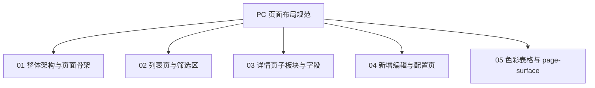

# SYZC B 端 PC 原型 · 页面布局与视觉规范

> **版本**：v1.0  
> **生效时间**：2026年  
> **适用范围**：`03-前端原型demo/B端PC/` 全部业务页面（标注三件套仍遵循根目录 `AGENTS.md` 4.0～4.2 节）  
> **构建前入口**：[`../原型页面布局速查.md`](../原型页面布局速查.md)（PC/H5 对照 + 检查清单，与 [`AGENTS.md`](../../AGENTS.md) 4.1.1 同步）

---

## 1. 规范总览

本规范**直接定义**列表、详情、新增/编辑三类页面的骨架、栅格、折叠与分块规则，不依赖「对照某菜单页面」才能落地。新菜单原型必须先匹配本规范，再挂载 PRD 三件套打点。

---

## 2. 页面类型与规范映射

| 页面类型 | 规范文档 | 核心要点 |
| :--- | :--- | :--- |
| **台账列表** | [02-列表页与筛选区规范](./02-PC端列表页与筛选区规范.md) | 筛选 Card、默认 4 列筛选项、超出折叠、列表表格区 |
| **台账详情** | [03-详情页子板块规范](./03-PC端详情页子板块规范.md) | 多子板块白底卡片、字段名在上内容在下、四列栅格 |
| **配置/复杂表单** | [04-新增编辑与配置页规范](./04-PC端新增编辑与配置页规范.md) | 顶栏摘要、基本信息 Card、策略/明细分块、业务弹窗 |
| **模块壳层** | [01-整体架构与页面骨架规范](./01-PC端整体架构与页面骨架规范.md) | 顶栏模块、Sidebar 显隐、内容区 `p-6` 与 `space-y-4` |
| **表格与色板** | [05-色彩与表格视觉规范](./05-PC端色彩与表格视觉规范.md) | `page-surface`、表头/边框、语义色 |

---

## 3. 与标注规范的分工

| 维度 | 本规范（样式规范- PC端） | `AGENTS.md` 4.2 标注标杆 |
| :--- | :--- | :--- |
| 布局、栅格、折叠 | ✅ 真源 | 仅索引指向本目录 |
| PRD / 字段清单 / 规则挂载 | — | ✅ 真源 |
| Mermaid 状态机、规则 ID 打点 | — | ✅ 真源 |

---

## 4. 公共实现约定（工程内统一类名）

原型工程通过以下类名与组件**落实**本规范（新页面应复用，禁止另起一套详情/筛选样式）：

- 详情子板块：`DetailSection`、`DetailField`（样式见 `B端PC/src/index.css` 中 `.detail-section`、`.detail-field`）
- 列表筛选顶栏：`WarningFilterHeader`（展开/收起、重置、查询、可选新增）
- 列表筛选栅格：外层 `grid gap-4 lg:grid-cols-4`，展开区继续同栅格或 `lg:col-span-2` 占宽
- 列表分页：`WarningListPagination`

---

## 5. 核心原则

1. **一页两区**：标准台账列表 = 上筛选 Card + 下列表 Card（或 `page-surface` 表格容器），中间 `space-y-4`。
2. **筛选项默认一行四个**：桌面宽度 `lg`  breakpoint 下 4 列；第 5 项起放入「展开筛选」，禁止默认堆满两行以上。
3. **详情禁止左右 Label-Value 表格行**：统一上下结构（灰小字标签 + 深色内容值）。
4. **配置页分块可独立保存**：多策略/多 Card 时，块内保存 + Dirty 离开确认，与简单 CRUD 单页提交区分。

---

## 6. 构建前检查（与速查文档第 5 节一致）

- [ ] 列表：筛选 Card + 默认 4 筛选项 + 展开区 + draft/applied
- [ ] 详情：`DetailSection` + `DetailField`（上 label 下 value）
- [ ] 配置表单：04 规范（分块保存 / Dialog / Dirty）
- [ ] 标注：`AGENTS.md` 4.2 三件套与打点
